# Перегон — 2026-10-07

[Главный отчёт](../README.md) · [Фичи и исправления](../CHANGELOG.md)

## 1. Manager started

13:02 · F0

Коммит: [4a1e178ef](https://github.com/shsanek/EXEcutor/commit/4a1e178ef)

Tools checked (ninja installed), Chrome profile up, Blender MCP not running. Agent 0a (CMake + MinGW/clang toolchains + EXEcutor smoke) launched.

## 2. Gate 0a PASS: two builds

13:09 · 0a

Коммит: [712987003](https://github.com/shsanek/EXEcutor/commit/712987003)

CMake presets win32 (MinGW i686, static C++, msvcrt.dll only) and native (clang arm64). peregon.exe and core_tests.exe print byte-identical output natively and in EXEcutor (release + debug). Emulator fix: msvcrt __p__iob / __p___mb_cur_max with test. Re-verified by the manager.

- ✓ build all both --clean
- ✓ native ctest
- ✓ EXEcutor stdout == native: 4/4
- ✓ imports: kernel32 + msvcrt

## 3. Gate 0g PASS: scene runner and report

13:20 · 0g

Коммит: [a336a0f30](https://github.com/shsanek/EXEcutor/commit/a336a0f30)

Scene runner (--scene/--seed/--replay/--ticks/--capture), capture to BMP/JPG, metrics.json, run_scene.sh native+EXEcutor, compare.json, report.py -&gt; runs.js, Scene runs section with per-scene history. scene_smoke seed 7: state, image hashes and BMP bytes identical in EXEcutor and natively. Re-verified by the manager (run 003).

- ✓ build all both --clean
- ✓ scene_smoke native == EXEcutor: final 6d68069b
- ✓ gate 0a still PASS

## 4. Gate 0f PASS: own shader compiler

13:31 · 0f

Коммит: [4ee0598f8](https://github.com/shsanek/EXEcutor/commit/4ee0598f8)

pgsl shader language -&gt; vs_2_0/ps_2_0 bytecode (from MS token-format docs) + Metal source + layout header. unlit_textured and vertex_lit_fog render pixel-identical in EXEcutor D3D9, native Metal and the analytic reference. Re-verified by the manager (run 02). Contract for 0d: vs c255 = (-1/W, +1/H, 0, 0) per render target.

- ✓ shaderc tests: 34
- ✓ unlit_textured: d369c1c5 x3
- ✓ vertex_lit_fog: f5bb01c5 x3

## 5. Gate 0c PASS: rhi + rhi_null

13:38 · 0c

Коммит: [cc8805a32](https://github.com/shsanek/EXEcutor/commit/cc8805a32)

C ABI render interface (handles, buffers, DXT textures, render states, fixed-function block, 0f program records, readback) and a validating null backend with an integer-only software rasterizer. scene_rhi_cube (checker cube on a DXT1 floor) is byte-identical in EXEcutor and natively. Re-verified by the manager after integrating (run 03, gates 0a/0f still PASS).

- ✓ rhi_tests: 19/19, 509 checks
- ✓ scene_rhi_cube: 0x6972857f29725bb6 both

## 6. Gate 0b PASS: deterministic core

13:40 · 0b

Коммит: [65947a4cb](https://github.com/shsanek/EXEcutor/commit/65947a4cb)

60 Hz fixed-step clock with interpolation, pause and time scale; SSE2-only float policy with own sin/cos/atan2/exp/log (no libm); named PCG32 streams; .prpl input replays with per-tick world hashes; INI-like balance file with hot reload (data/balance.txt from the progression doc). Native and EXEcutor bit-identical. Re-verified by the manager: gates 0b, 0a, 0c, 0f, 0g all PASS on the integrated tree.

- ✓ core_tests: 44/44 both builds
- ✓ float bit-identity: 106496 results, 0xa8e6b5282e53e99f
- ✓ scene_core_replay + .prpl: byte-identical
- ✓ balance hot reload

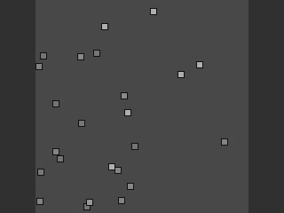

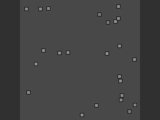

## 7. Gate W14a PASS: asset pipeline + grey-box kit

13:48 · W14a

Коммит: [fb054d470](https://github.com/shsanek/EXEcutor/commit/fb054d470)

assetc (glTF/GLB -&gt; .pmesh with LODs; PNG -&gt; .ptex RGBA8/BC1/BC3 with mips; own PNG decoder and BC encoder), C loader in src/assets, headless Blender kit of 7 grey boxes with 5 procedural textures. Rebuild is byte-identical; loader output identical natively and in EXEcutor. Re-verified by the manager (all 6 gates PASS). Decisions: specular in diffuse alpha (BC3); world Y-up, right-handed, metres.

- ✓ assetc tests: 53/53
- ✓ asset_tests native == EXEcutor
- ✓ kit reproducible

## 8. Gate 0e PASS: Metal backend + SDL3 window

14:14 · 0e

Коммит: [3d4117c26](https://github.com/shsanek/EXEcutor/commit/3d4117c26)

Whole rhi ABI on Metal (cached pipelines, 3 frames in flight, BC1/BC3, readback, offscreen headless device), fixed-function uber shader, 0f MSL programs, SDL3 window with Retina and keyboard/mouse/gamepad. G0 cube on Metal matches the integer reference within 2 LSB on 100% of pixels (SM2 and fixed-function). Re-verified by the manager: gates 0e, 0a, 0b, 0c, 0f, 0g, w14a PASS.

- ✓ rhi_metal_tests: 17/17
- ✓ scene_g0_cube Metal vs reference: 100.00% within 2 LSB
- ✓ scene_rhi_cube: 99.69% (texel-edge floor pixels)
- ✓ window input == text replay hash

## 9. Gate C0 PASS: data contracts (milestone M0)

14:19 · C0

Коммит: [1feb89963](https://github.com/shsanek/EXEcutor/commit/1feb89963)

Contract headers (SurfaceMap, GameState, VehicleStats, ItemDef, Inventory/CargoMass, DamageEvent, ArenaSpawn + ContractDef, WeaponDef, EnemyDef, vehicle parts T1-T3, events, save record), content DB from 7 data files with cross-reference validation and hot reload, deterministic event bus, 7 M0 stub scenes (W1, W2, W3, W4, W8, W9, W10). Content hash 0xa6cfa1c0 identical in EXEcutor and natively. Re-verified by the manager: gates c0, 0a, 0b, 0c, 0e, 0f, 0g, w14a PASS. Design conflict resolved by the manager: keep the empty Kolymaga 0-100 = 12 s exact; the 04 §10.5 loaded example becomes 2230 kg / 12.3 s.

- ✓ contracts_tests: 21 tests, 421 checks
- ✓ content hash: 0xa6cfa1c0 both builds
- ✓ M0 scenes: 7/7 identical

## 10. Gate 0d PASS: Direct3D 9 backend in EXEcutor

14:26 · 0d

Коммит: [3b25f1eb0](https://github.com/shsanek/EXEcutor/commit/3b25f1eb0)

render_d3d9.dll implements the whole rhi ABI on real d3d9.dll (validated by an rhi_null shadow device), Win32 window module, runner --rhi null|metal|d3d9 and --ff. In EXEcutor vs the integer reference: 99.99% edge-aware, 94-97% strict. Investigation: EXEcutor picks mips exactly per the D3D9 rule; the reference approximates it. Manager decision: make the reference and Metal follow the D3D9 LOD rule (task G0a), then G0 is gated strictly EXEcutor vs native. Open emulator bug E1 (Present on a visible window).

- ✓ rhi_d3d9_tests in EXEcutor: 21 tests, 375 checks
- ✓ scene_g0_cube edge-aware: 99.99%
- ✗ scene_g0_cube strict 2 LSB: 94.4-97.1% (reference LOD)

## 11. Gate W10a PASS: UI foundation + EXEcutor Present fix (E1)

14:37 · W10a

Коммит: [6754e8c9f](https://github.com/shsanek/EXEcutor/commit/6754e8c9f)

src/ui: batched 2D quads through the rhi, Inter 4.001 (OFL) atlas with Latin + Cyrillic in 3 sizes, label/button/list/progress/grid/tooltip widgets with keyboard/gamepad focus navigation, tr() stub. Fake-data screens: road HUD, 6x4 cargo bed, contract board; byte-identical in EXEcutor and natively, recorded input moves focus. Also integrated E1: EXEcutor d3d9 Present on a visible window no longer fails when the host cannot display the frame (new test D9_79; d3d9 288/0, d3d8 31/0).

- ✓ ui_tests: 17/17
- ✓ 3 UI scenes native == EXEcutor
- ✓ E1 D9_79 + d3d9/d3d8 suites

## 12. F0 exit gate G0 PASS: textured cube in EXEcutor

14:43 · G0

Коммит: [206e53805](https://github.com/shsanek/EXEcutor/commit/206e53805)

Owner policy: EXEcutor-only target (win32 D3D9); Metal/SDL frozen; EXEcutor output is the reference; screenshots from EXEcutor present dump. G0: scene_g0_cube renders through Direct3D 9 in a real EXEcutor window (RunGame), SM2 and fixed-function; frames taken by EXECUTOR_PRESENT_DUMP; deterministic state hash on repeated EXEcutor runs; replay harness (gate 0b) and D3D9 backend (gate 0d) green. New tool: tools/run_rungame.sh. F0 Foundation is complete.

- ✓ gate 0b (deterministic core + replays)
- ✓ gate 0d (D3D9 backend in EXEcutor)
- ✓ scene_g0_cube deterministic in EXEcutor
- ✓ RunGame window + present dump: SM2 and FF

## 13. Gate W1 PASS: world of the 2x2 km slice

15:20 · W1

Коммит: [301f5dcf4](https://github.com/shsanek/EXEcutor/commit/301f5dcf4)

src/world: slice layout as text data (camp, fuel station, elevator, asphalt road with ambush, forest dirt road with mud), seeded heightfield, 32x32 tiles x 64 m with 4 LODs and culling, SurfaceMap contract with wetness, terrain_detail shader + fixed-function fallback, chase/third-person/free cameras in the sim, Win32 input map as data, GameState Camp/Drive/OnFoot/Pause, save file. scene_w1_world plays a 1600-tick recorded session in EXEcutor D3D9: avg 4.8 ms/frame, ~205 draws, ~23k triangles. Golden reference = EXEcutor D3D9 output. Re-verified by the manager (one flaky RunGame run, re-run PASS).

- ✓ world_tests: 15, native == EXEcutor
- ✓ SM2 + FF match goldens in EXEcutor
- ✓ save round-trip byte-identical
- ✓ frame time EXEcutor D3D9: 4.8 ms avg

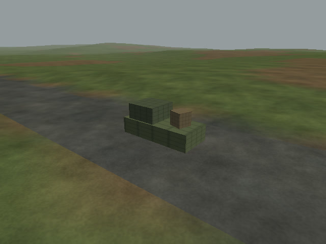

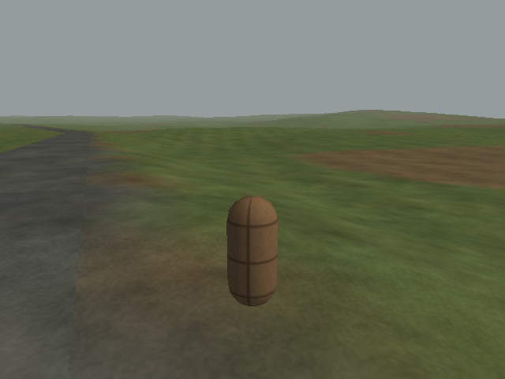

## 14. Gate W3 PASS: combat and weapons

15:29 · W3

Коммит: [25d32a486](https://github.com/shsanek/EXEcutor/commit/25d32a486)

src/combat: on-foot player (capsule collision, walk/run/dodge), crowbar (arc, executions give ammo), sawn-off (8 pellets, knockback interrupts the brute charge), nail gun, roof MG with overheat; C0 DamageEvent/ENEMY_KILLED events; ammo from the truck bed; scripted raider/brute/buggy dummies. 4 bot replays deterministic in EXEcutor D3D9. Design check: sawn-off DPS 93.7 vs table 70 (table contradicts its own rate/reload; to W8). Re-verified by the manager.

- ✓ combat_tests: 20/20
- ✓ nail gun DPS: 140 (design 140)
- ✓ TTK sawn-off vs brute: 4.10 s (design 3.5 +-20%)
- ✗ sawn-off DPS vs table: 93.7 vs 70 (design conflict)

## 15. Gate W8 PASS: economy and session simulator

16:04 · W8

Коммит: [d0d1e42af](https://github.com/shsanek/EXEcutor/commit/d0d1e42af)

src/economy: trader prices with reputation, cargo value, seeded loot tables, mechanic upgrades for 4 parts x T1-T3, contract rewards, repair/ammo costs, all data-driven with hot reload; session simulator plays the prototype timeline with 6 player types + 200 random players. Kolymaga 0-100 fixed at 12.00 s. Findings: income ~1120 coupons/h and XP ~940/h on target; only 1 upgrade in the first 30 min (target 2-3); expenses 21-23% (target 25-30%); ammo check fails (rig ammo covers 94-328% of arena HP); the truck bed is the bottleneck (~38 items left behind). Re-verified by the manager: w8, c0, w3, 0b PASS; w1 timed out twice at host load ~92 from other sessions (not functional; H1).

- ✓ economy_tests: 14/14 native == EXEcutor
- ✓ session sim deterministic: seed 7 hash 544530a7
- ✗ upgrades in first 30 min: 1 (target 2-3)
- ✗ 40% ammo check: fails: too much ammo

## 16. MAP-kit batch 1: 56 grey-box pieces for the big map

16:19 · MAP-kit

Коммит: [c0a981031](https://github.com/shsanek/EXEcutor/commit/c0a981031)

Real-size, labelled, collision-proxied grey boxes reconciled with map/brief/kit.json: settlement buildings (izba, brick house, khrushchyovka, school, club, shop, church), elevator, water tower, fuel station, bus stop, checkpoint, bridges, camp pieces and more. Rebuild byte-identical; loader identical in EXEcutor. Batches 2-4 (landmarks, defence/bridges/lines, props/wrecks/nature) in progress.

- ✓ gate map_kit
- ✓ pieces: 56 of 136

## 17. Gate W4 PASS: enemy AI

16:31 · W4

Коммит: [6eaf849cf](https://github.com/shsanek/EXEcutor/commit/6eaf849cf)

src/ai: sight cone + LOS + hearing, deterministic A* on a 0.5 m grid, cover choice and peeking, raider group tactics (suppress, flank, retreat when broken), raiders shoot back, brute charge state machine (only knockback interrupts), buggy road AI that rams the truck; spawns from C0 ArenaSpawn. Replays deterministic in EXEcutor D3D9. Gas station cleared in 12.5 s (24 dmg, 22% in cover), elevator 34.5 s (80 dmg, 52% in cover, 4 flanks, charge interrupted), road 33.6 s (1 ram, 6 buggies). Re-verified by the manager (w4, w3 PASS). Asset request for class A enemies deferred until the F1 slice playtest gate.

- ✓ ai_tests: 18, EXEcutor == native
- ✓ 3 replays deterministic

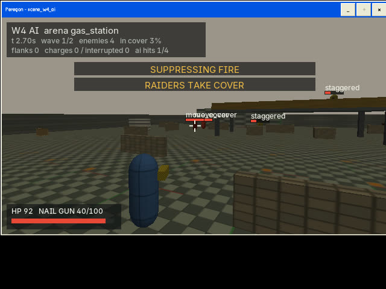

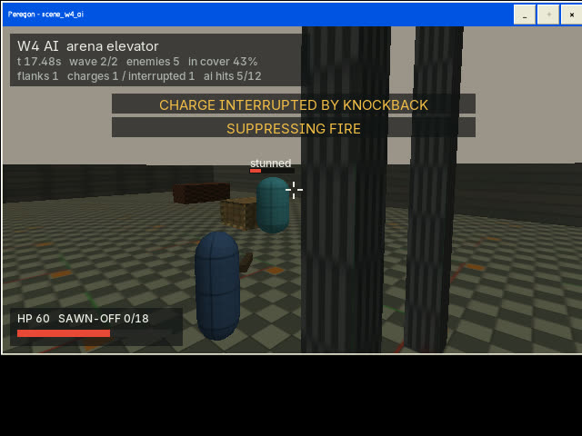

## 18. W11 audio integrated (gate pending audio thread)

16:40 · W11

Коммит: [19733d336](https://github.com/shsanek/EXEcutor/commit/19733d336)

src/audio: integer fixed-point mixer, voice priority/stealing, 3D attenuation/pan/distance low-pass, 5 buses with radio ducking, limiter; procedural diesel engine, tyres per surface, weapons, MG overheat hiss, radio static/crackle/tuning/voice stand-in, UI clicks; waveOut backend; scene_w11_audio writes a WAV byte-identical in EXEcutor and natively (listen: reports/shots/w11/04_w11_audio_mix.wav; guide in docs/audio.md). EXEcutor bug E3 fixed (waveOut ~3% slow, chained clock; new winmm tests). Remaining: underruns under host load because audio is pumped from the game loop -&gt; W11b audio thread.

- ✓ audio_tests: 17, EXEcutor == native
- ✓ WAV deterministic
- ✓ E3 overruns: 0 after fix
- ✗ RunGame underruns under load: 248 -&gt; W11b

## 19. Map L0: macro relief of the 32.8 km world

17:00 · MAP-L0

Коммит: [0dd302976](https://github.com/shsanek/EXEcutor/commit/0dd302976)

Real Altai elevation detail (AWS terrain tiles, attribution) from 4 reference patches on a designed layout + erosion: Zarechye 44.5% (148-1180 m), Ridge 31.4% (peaks 2452 m), closed Wasteland basin 24.1% (median 1152 m, spill 1273 m). Bystraya river with a 400-600 m gorge, Lake Kholodnoye, tributaries, tarns, salt pans; Seminsky pass 1333 m; gates G3-G6 placed. Deterministic build. Decisions: Ridge leg 16-20 min accepted, station moved deep into the basin, west edge = wide river, NW = swamp + forest belt.

- ✓ check_macro.py
- ✓ deterministic rebuild

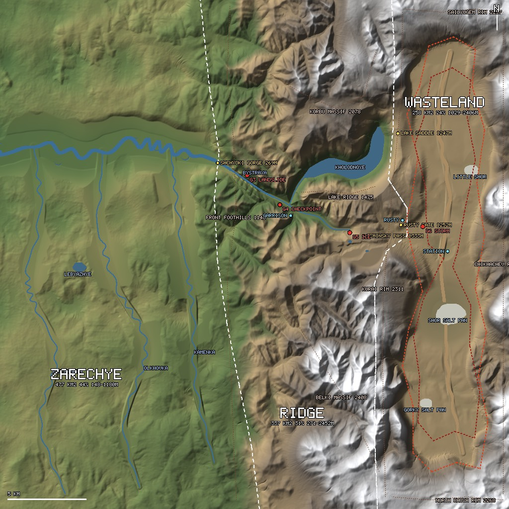

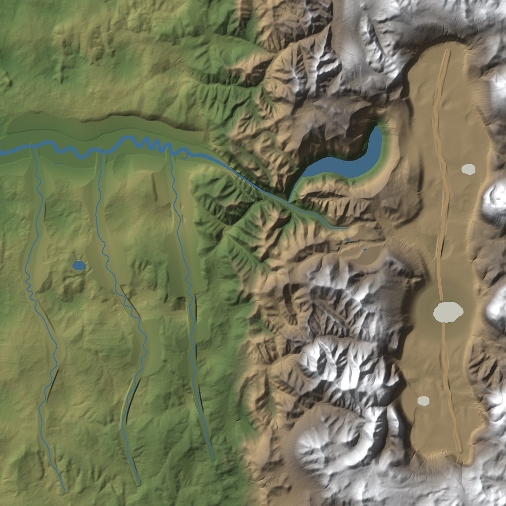

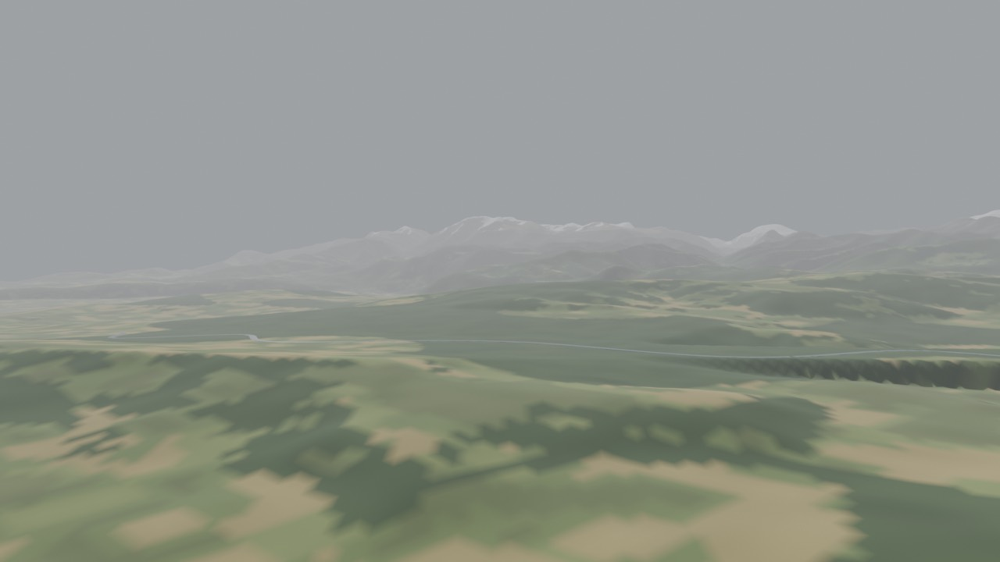

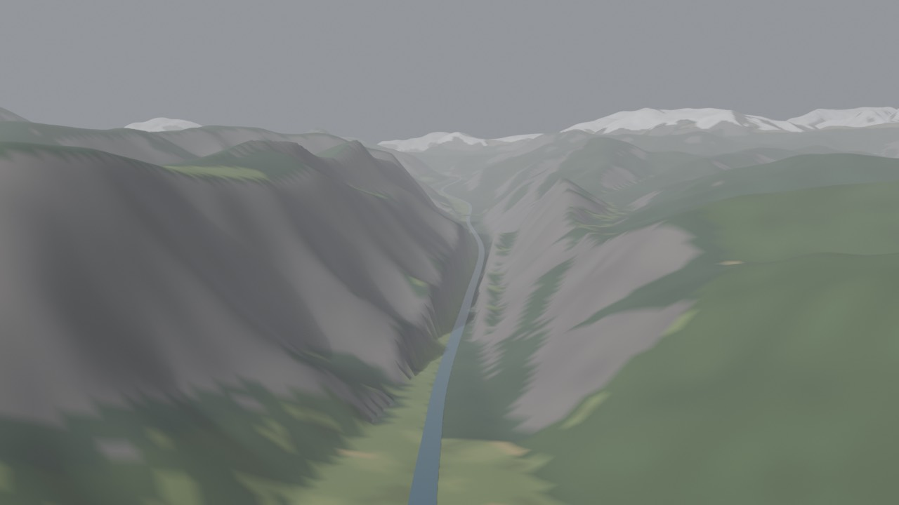

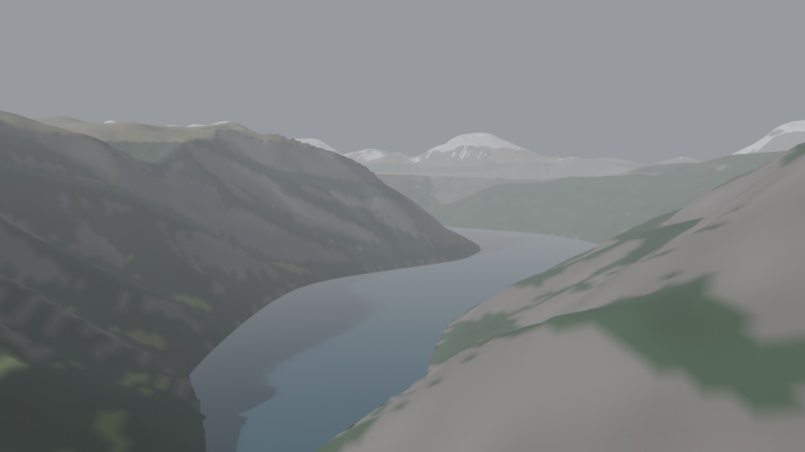

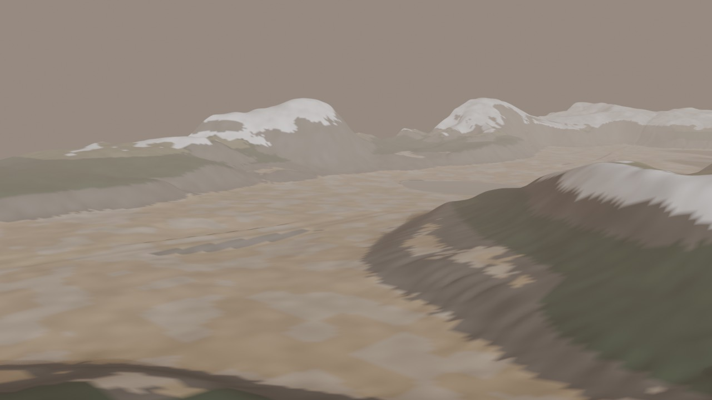

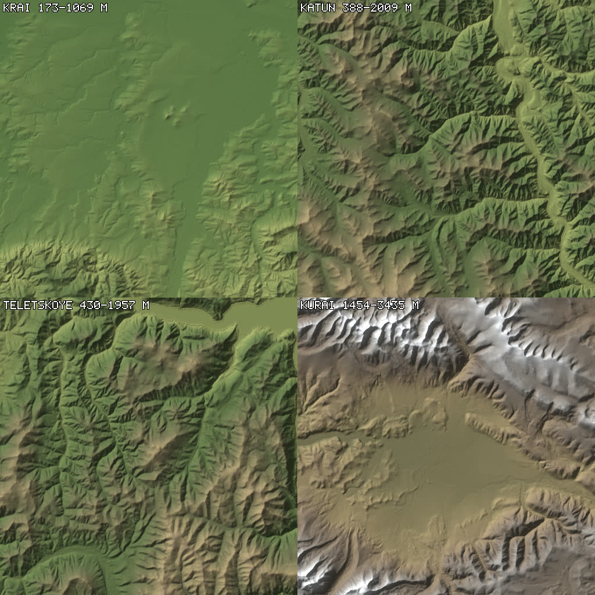

## 20. EXEcutor fix E4: MoveFileEx / MoveFile Windows contract

17:30 · E4

Коммит: [956ecd0dcc](https://github.com/shsanek/EXEcutor/commit/956ecd0dcc)

Found by W12 (atomic saves): MoveFileEx deleted the destination before rename (data loss when the source was missing) and overwrote without MOVEFILE_REPLACE_EXISTING. Fixed per Microsoft docs: exact error codes, atomic replace, cross-device copy, MoveFileWithProgress/ReplaceFile exports, CopyFile self-copy truncation. New kernel32 test 88/88; suites unchanged (518 pass).

- ✓ movefileex_contract: 88/88 (53 failed before)

## 21. S1: 14 surfaces and soil parameters

17:42 · S1

Коммит: [07591d341d](https://github.com/shsanek/EXEcutor/commit/07591d341d)

Contract v2: asphalt, broken asphalt, gravel, dirt, grass, mud, puddle, sand, snow, ice, rock, scree, takyr, ford; grip per surface/tier, climb limits per drive type (RWD/AWD/studs), sound classes, Bekker/Mohr-Coulomb soil parameters (k, n, c, phi, max sinkage, crust break) for emergent sinkage; terrain detail patterns per surface.

- ✓ gates s1, c0: PASS (manager)

## 22. Gate W9 PASS: cargo and truck bed

17:57 · W9

Коммит: [ba1cc72006](https://github.com/shsanek/EXEcutor/commit/ba1cc72006)

6x4 bed + 4x2 rig on the C0 inventory, rotation/move/straps, cargo mass -&gt; vehicle mass and centre of mass, loose items fly out on bumps and rams, lie on the road as bodies, picked up by hand; cargo screen on real data. Finding: a full bed of loot is ~10%% of the 1200 kg capacity — cells run out first (feeds B1).

- ✓ cargo_tests: 14/14, EXEcutor == native
- ✓ strapped items lost: 0

## 23. Nature kit: 51 plants + 23 rocks (grey boxes)

18:09 · MAP-veg

Коммит: [232233af1d](https://github.com/shsanek/EXEcutor/commit/232233af1d)

Birch, pine, larch, Siberian pine, spruce, fir, aspen, poplar, willow (3 LODs: mesh, crossed cards, billboard), shrubs, ground-cover cards, boulders, outcrops, tileable cliff modules, scree, river boulders; sway parameters and habitats/densities in assets/kit/nature.json. For the detailing agents; drawn in game by R1.

- ✓ gate map_veg

## 24. Gate W2 PASS: vehicle physics (owner extensions)

18:17 · W2

Коммит: [4e70d3c5a0](https://github.com/shsanek/EXEcutor/commit/4e70d3c5a0)

Raycast-free 7-point wheel ground sampling (climbs kerbs), per-wheel suspension with bump/rebound, anti-roll, bump stops; contact patch per wheel; S1 soil -&gt; emergent getting stuck (T1 full throttle stuck, gentle passes, +600 kg stuck, T2 passes, dry dirt passes); data/vehicle/chassis.txt with per-tier ride height 0.30-0.38 m and travel 0.27-0.35 m, no wheel/body intersection over full travel; steering sign fixed; 9-obstacle course at 2 speeds with telemetry plots (reports/shots/w2/52_plot_*.png).

- ✓ vehicle_tests: 24/24, EXEcutor == native
- ✓ 0-100: 12.22 s (target 12.00)
- ✓ stuck is emergent: no scripted gate

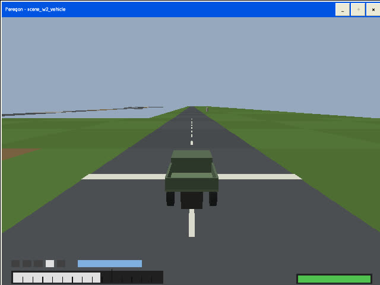

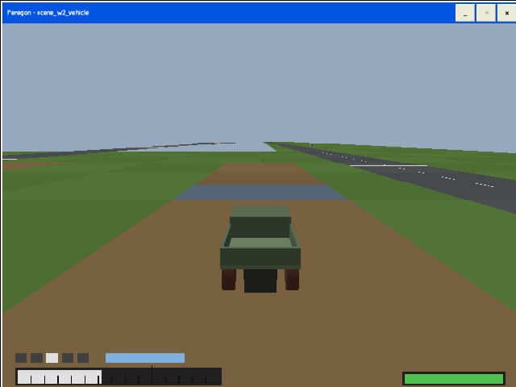

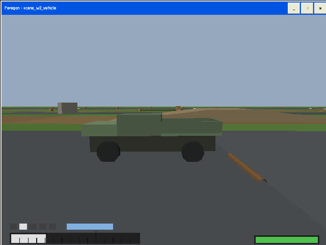

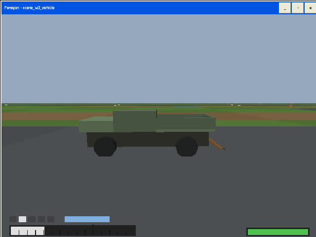

## 25. Map: relief rejected, rebuilt from real Altai DEM — owner picked candidate 2

18:25 · MAP-L0b

Коммит: [1b40bfa928](https://github.com/shsanek/EXEcutor/commit/1b40bfa928)

Owner rejected the first relief (drawn/carved rivers, flat plateaus) and the first layout sketch (axis-aligned strips). L0b now works fractally with owner approval per stage, from real DEM windows with rivers derived from flow accumulation. Three candidates: 1 Charysh, 2 Katun gate (Manzherok-Maima), 3 Kurai. Owner approved candidate 2 as the base; stage 2 (global relief) in progress, abandoned railway corridor along the Katun terraces.

- ✗ first relief: rejected by owner
- ✓ layout base: candidate 2 approved

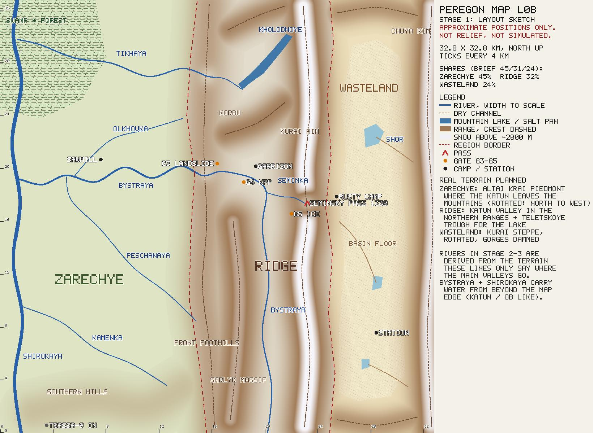

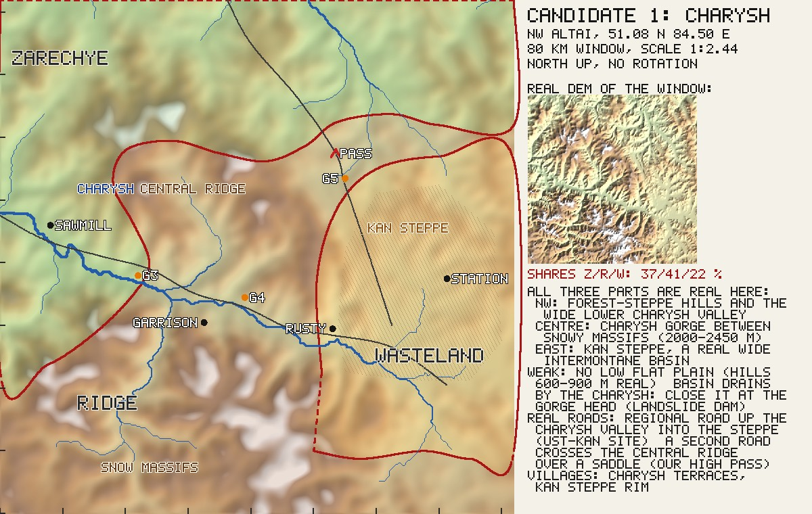

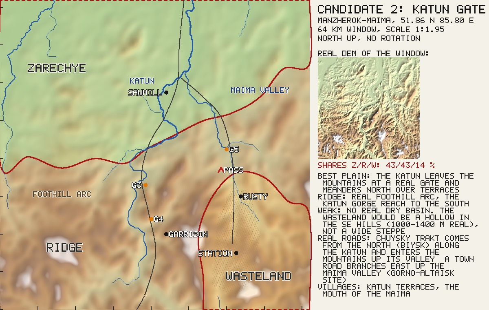

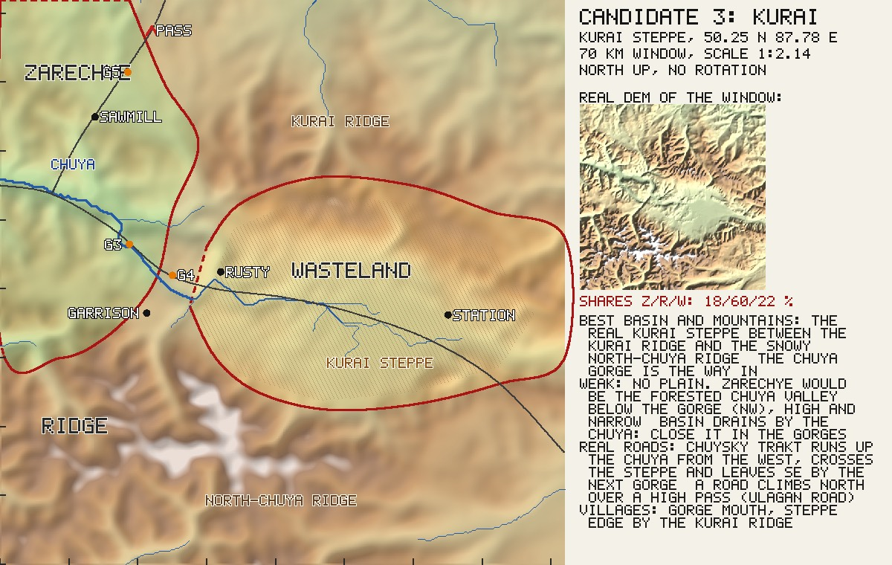

## 26. Gate W12 PASS: saves, settings, RU/EN, borderless window

19:09 · W12

Коммит: [947c58d4fe](https://github.com/shsanek/EXEcutor/commit/947c58d4fe)

Atomic saves in %APPDATA%\Peregon with backup and recovery, versioned sections with migrations, autosave on camp/car entry; settings (display mode, bus volumes, key bindings, language); RU/EN text tables with Russian plurals, named args, pseudo-locale and a missing/unused key check; display modes: borderless fullscreen by default (owner: no window frame), exclusive fullscreen, windowed, Alt+Enter. Verified by the manager (w12, w10a, w9 PASS).

- ✓ save_tests: 17/17 EXEcutor == native
- ✓ loc check: clean, 154 keys RU/EN
- ✓ window_tests in EXEcutor: 5/5 incl. Alt+Enter

## 27. Gate R1 PASS: nature rendering in the game

20:07 · R1

Коммит: [f6fdd2d897](https://github.com/shsanek/EXEcutor/commit/f6fdd2d897)

Vegetation and rocks from the nature kit drawn in EXEcutor D3D9: SM2 vegetation shader with vertex sway from the catalogue, crossed cards and billboards by LOD, alpha test, alpha-coverage-preserving mips, per-vertex AO, grass fade at range, fixed-function fallback; deterministic scatter by biome habitats over the slice and over streamed map tiles. Slice at tuned density 7.95 ms/frame avg in EXEcutor (budget 8). Normal/spec maps for trunks/rocks wait for kit textures. The per-triangle CPU cost seen in EXEcutor came from our own rhi validator (E5 fixing it).

- ✓ gate r1: PASS (agent)
- ✓ slice frame time: 7.95 ms avg

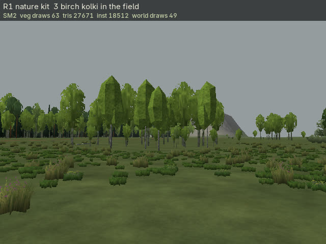

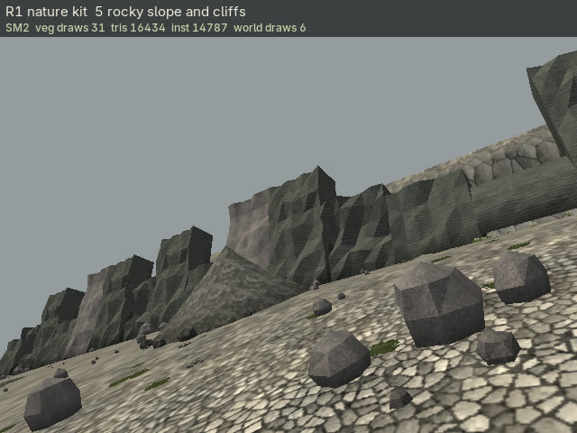

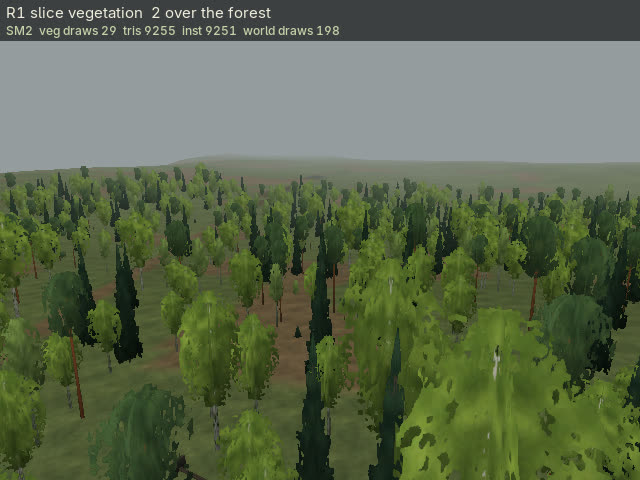

## 28. E5: per-triangle cost was our validator, not EXEcutor — frame time halved

20:26 · E5

Коммит: [30600c6e72](https://github.com/shsanek/EXEcutor/commit/30600c6e72)

Investigated a D3D9 cost of ~0.15 us per triangle in EXEcutor. Benchmark D9_80 (new EXEcutor test) shows EXEcutor draws static buffers at ~0.0007 us/triangle and ~0.47 us/draw (1M triangles in 0.4-0.7 ms). The cost came from Peregon itself: rhi_d3d9 ran the rhi_null validator per draw, which allocated and scanned every index in emulated x86. Fixed with per-buffer min/max index blocks and O(1) per-draw checks; goldens identical. Frame time in EXEcutor: world 5.0 -&gt; 2.4-3.2 ms, nature showcase 7.4-8.2 -&gt; 3.8-4.3 ms, slice with vegetation 7.5-7.9 -&gt; 4.3-5.3 ms.

- ✓ gates 0d, c0, g0, w14a
- ✓ d3d9 suite: 289/0 incl. D9_80
- ✓ goldens: 0 differences
