# Перегон — 2026-10-10

[Главный отчёт](../README.md) · [Фичи и исправления](../CHANGELOG.md)

## 78. Lighting fixes from the owner's shots: smooth cab shadows without the dashboard grid, per-pixel low-beam headlights without hard edges, textured distant hills, snow no longer clips to white

01:31 · LIGHT-FIX

Коммит: [621dd35b4e](https://github.com/shsanek/EXEcutor/commit/621dd35b4e)

Root causes and fixes (details in docs/lighting.md, LIGHT-FIX). (1) Cab shadows were blocky because the cab sun projector was fitted to the whole truck (about 7 m, 7 mm per texel, two point taps); it is now fitted to the fixed cab interior receivers (1.9 mm) and filtered with 4 rotated-grid taps. (2) The grid on the dashboard was shadow acne from a (1-cos)/cos slope bias with taps one texel apart; receivers now offset the lookup along the geometric normal. (3) The hard straight light edges in the cab view and on the yard came from headlight cones evaluated per vertex on big quads; the cone now lives in the headlight atlas (B/A channels) and every solid receiver and tree reads it per pixel. The lamp housing and bull bar no longer shadow the beam, lamps scale with scene exposure (a quarter of the night contribution at noon), and the beam is a low-beam pattern with a cut-off. (4) Distant terrain was a flat palette colour beyond 240 m with per-vertex light; a new terrain_far program draws the same ground layers at 4x/14x scale with per-pixel sun, blended in over 70-240 m. (5) Snow clipped to white; snow cover now lowers daylight exposure. Native only (owner rule 2026-10-10); sim hashes of the tours unchanged. Open: grass blades keep a per-vertex round cone, the near snow drift mesh has no grain, dusk slopes facing away from the sun stay dark.

- ✓ spot_shadow_render_check: per-pixel cone on one wall quad centre/corner 89/28 (per-vertex 56/58), low-beam cut-off 84/27, round-cone parity 1/255
- ✓ cab_lighting_tests + cab_render_check: receiver window texel 1.91 mm vs 6.99 mm; lit/shadow 191/38, 18 PCF edge pixels
- ✓ far_terrain_render_check: luminance deviation far/near 6.0/0.0 at 400-900 m and 4.5/0.0 at 1200-2200 m, mean within 1/255, overlay alpha 12/255 before the band
- ✓ focused ctest (native-release): 12/12: far_terrain, ground_normal, spot_shadow, light, nature, aerial, cab_render, cab_lighting (+gpu), diffuse_gi (+render), view; shaderc golden OK (354 files, all SM2 budgets)
- ✓ frame time, native 1280x720, 28 views x conditions, 2 runs each: 3.72 -&gt; 3.87 ms mean (+0.15 ms); worst view +0.61 ms (dashboard at night)
- ✓ sim hash: tour final hashes unchanged (782f7136, ae0cc233)

## 79. Truck audio, gauges and window glass: procedural V8 driven by the tachometer RPM, old-truck gear shifts, door sounds, master limiter, smooth gauges, lowered window wiped clean

01:34 · TRUCK-AUDIO

Коммит: [3c4a4b66dd](https://github.com/shsanek/EXEcutor/commit/3c4a4b66dd)

Owner request 2026-10-10. Audio: native SDL3 output (native had no sound), mixing moved to the audio thread (game-thread audio 42.7 -&gt; 3.7 us per tick), procedural V8 (firing order, exhaust/intake, cab boom) on the same engine-speed value as the tachometer plus load/throttle, gear-shift transients (clutch thunk, lever clack, RPM-mismatch grind, engagement clunk, RPM drop/blip), door open/close, hood/tailgate, key, window crank; look-ahead limiter, session peak -6 dBFS, no full-scale samples. Research summary in docs/audio.md. Gauges: new engine-speed model (clutch coupling, cranking, catch flare, spin-down) drives the tach and the sound; all five needles are damped springs; brake-then-throttle now rises 800-&gt;1900 rpm over 0.5 s (max tick step 0.47 -&gt; 0.026 of the dial). Glass: the part of a side window below the door seal is wiped every step. Native only. Listen first: 10_session_full_after.ogg vs 11_session_full_old_engine.ogg. Open: tunables in code, tyres keep the old sound, play-scene hashes changed (coolant model).

- ✓ native-release full ctest: 33/33 after rebase on LIGHT-FIX
- ✓ audio_tests: 27/27 (7 new)
- ✓ view/play_cargo/glass_weather: 34/34, 29/29, 17/17

## 80. Starting valley story Q1: the elevator is the friendly Olkhovka granary, the Rusty stay at the spur station, every contract has a giver, a reason and a receiver

02:03 · STORY-Q1

Коммит: [3111146130](https://github.com/shsanek/EXEcutor/commit/3111146130)

Owner 2026-10-10: contracts must be meaningful and less aggressive. New faction olkhovka (not hostile) holds the elevator for good; places held by a non-hostile faction start open (no fight) and the elevator uses the keeper blueprint layer in play. Chain: c1 «Доски за хлеб» (boards from the Sawmill to the elevator weighbridge, grain back, no fight), c2 «Солярка с отрога» (the Rusty hold the forestry diesel and refuse any deal: the one fight, nothing delivered to the raiders), c3 «Солярка на жатву» (diesel to Olkhovka for the harvest tractor, paid in grain). Board jobs: boards_for_grain (starter), spur_fuel, harvest_fuel, boards_and_fuel, garrison_fuel_trade (only after an Emission gives the station to the Garrison); the supply-the-raiders job and the Rusty/Garrison-at-the-elevator jobs are gone. New cargo board_bundle (1x3). The board shows the giver, the reason and which stops the Rusty hold. Economy sim: friendly stops are trades (fight = 0), rewards 340/270/150 keep one T2 at the first mechanic visit and two by 0:30 (12/13 checks; expenses 14 % stay flagged because only one stop in three is a fight). Stages: elevator_unload replaces the elevator fight, outpost_unload removed. Docs: world-locations.md 1.1 (factions and story), contracts.md «Story contract chain (Q1)» with contracts 4-8 as proposals (kolkhoz harvest, ford stakes, ford toll parley, logs, medicine). Native only. Open: the autoplay bot cannot start the HERO truck engine or place cargo over the HERO bed rails, so the driving and carrying stages time out, identically on a clean claude/peregon-design build; the playthrough shots use stage jumps for those steps.

- ✓ contracts_tests: 27/27
- ✓ economy_tests: 14/14
- ✓ director_tests: 17/17
- ✓ loc, save, poi, bot, character, ai, world tests: pass
- ✓ stages with goals (native): handin_camp, mechanic, outpost_board, outpost_gate, outpost_handin
- ✗ driving and carrying stages: timeout, same on base (bot vs HERO truck)
- ✗ economy expenses / income: 14 % (target 25-30 %)

## 81. Player's home: a lived-in container at the Sawmill with a working door; sleep till morning (save point), or doze in the truck cab

02:06 · Q5 HOME

Коммит: [c5c3bf6475](https://github.com/shsanek/EXEcutor/commit/c5c3bf6475)

New kit piece container_home_6 at the Sawmill south yard (place-local 13,-24, door and window to the yard): a 20 ft container in faded blue paint with a cut-in door and window, plywood lining, plank floor, the imported bunk, burzhuyka (pipe through the roof, steel sheet under it) and pantry shelf snapped in, a small table with stools under the window, kerosene lamp, hanging bulb, hook board with a jacket and boots by the door (place for the shovel/battery later), bedside crate with a radio, calendar, rug; rain barrel and firewood outside. The door is a dynamic leaf (render extras + one rotated collision box in the foot world) that swings 100 degrees outward; E toggles it from outside and inside, a closed door blocks. The bunk (18:00-07:00) fades out, jumps the director clock to 07:00 (existing time API only), restores health, autosaves and fades in beside the bunk; the cab passenger seat (truck stopped, engine off) gives a worse rest: 4 hours at most, health topped up to 60. Rest quality and door state are in save section 120. Dev stages home_evening and cab_evening (19:30). No new generation; native only (owner rule). Open: no door sound (audio has no world one-shots), weather/snow not advanced over the skipped hours, table/stools/crate are grey boxes. Details and references in docs/home.md.

- ✓ poi_tests: 7/7: Sawmill assembles with 0 errors on flat and sloped ground (162 parts, 409 collision boxes), 0 coplanar faces left
- ✓ focused ctest (native-release): world, loc, save, director, bot, light, character, poi 8/8
- ✓ play_cargo_tests: 29/29 incl. new sleeping_skips_to_the_morning_restores_health_and_saves (22:00 -&gt; 07:00 next day, health 100, door survives save/load, cab 22:00 -&gt; 02:00, rest 0.5)
- ✓ stamps / R1 pak: poi_export: Sawmill stamps unchanged (no foundation); pak and shadows rebuilt locally only for shots
- ✓ in game: closed door stops the player 0.35 m from the leaf, player walks in, bunk and seat prompts, both sleep sequences captured; play_region_auto 20000 ticks runs

## 82. 24-minute day, four seasons with dynamic season weather and thunderstorms, autumn colour and baked leaf fall, bare and snowy trees, spring green-up and blossom

02:21 · SEASONS

Коммит: [f25968c32f](https://github.com/shsanek/EXEcutor/commit/f25968c32f)

Day = 24 real minutes (director 60x). data/world/seasons.txt (hot reload) drives the year (8 game days per season), temperature (winter sun never melts snow), a deterministic chain of weather regimes per season (fog mornings, summer showers and thunderstorms with lightning, flash, bolt and delayed thunder, long autumn drizzles, blizzards, spring slush) with smooth transitions, and the foliage curve. Leaves tint on the fly from a green-dominance mask with per-tree colour and timing; tools/trees/season_bake.py bakes leaf-fall stages (torn off, outer first), bare, snow-dusted, young and blossom variants of every deciduous atlas and impostor (183 ptex). Grass withers, litter and puddles appear on the ground, leaves fall. Debug: --season, F5-F8, [debug] in seasons.txt. Native only (owner rule). Perf (native, perf_tour 27 shots, best of 2): 5.33 ms legacy, 5.60 summer, 5.58 autumn transition. docs/seasons.md.

- ✓ season_tests: 8/8
- ✓ native ctest: 33/33
- ✓ shaderc golden + limits: vegetation_card_gi ps 64/64

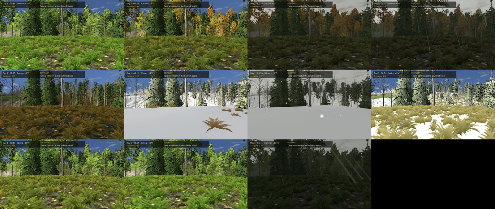

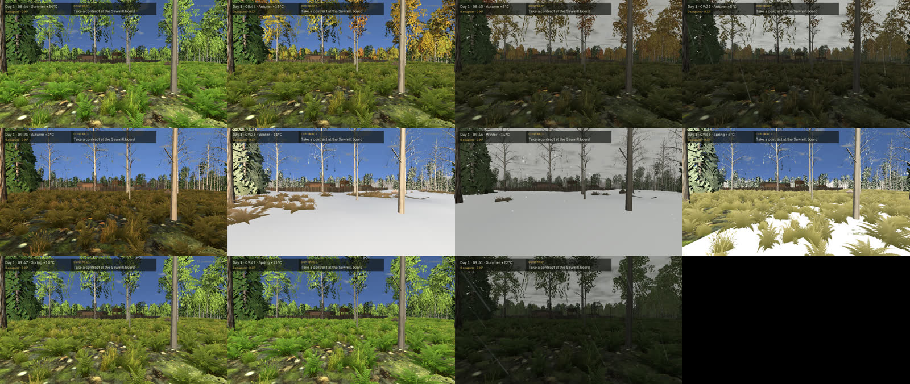

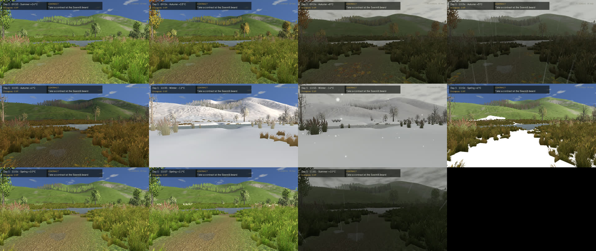

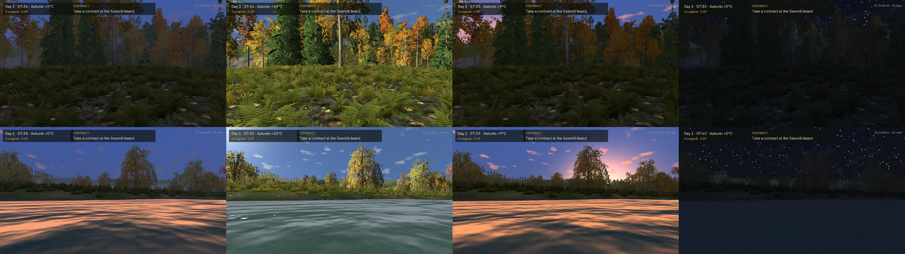

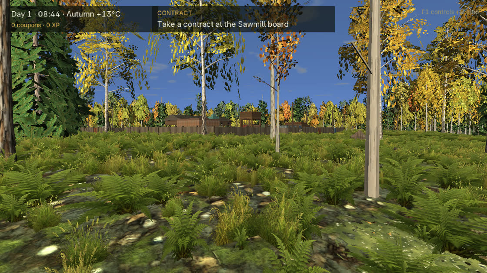

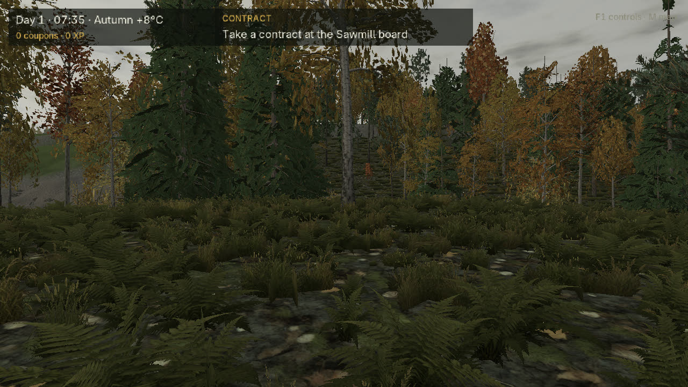

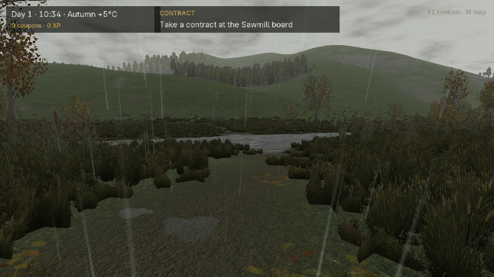

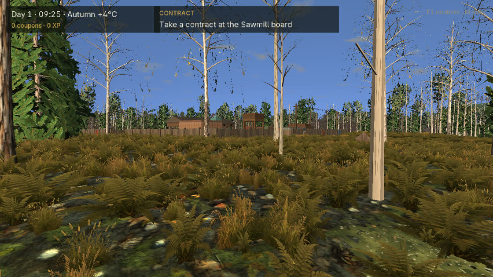

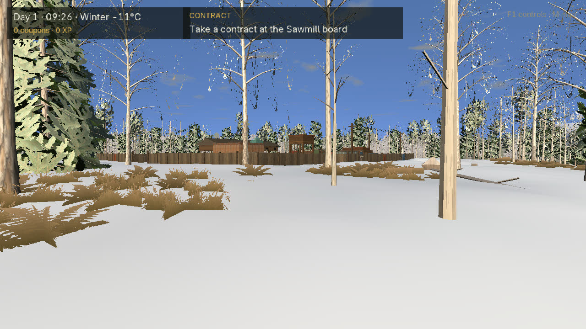

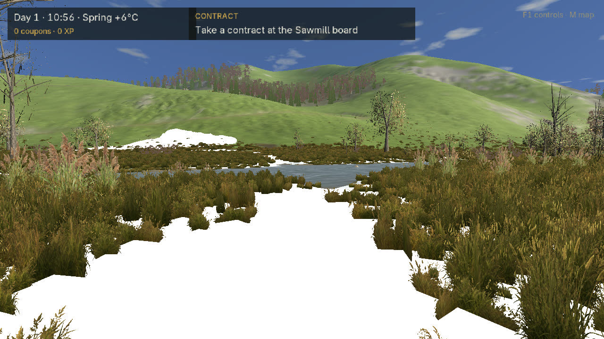

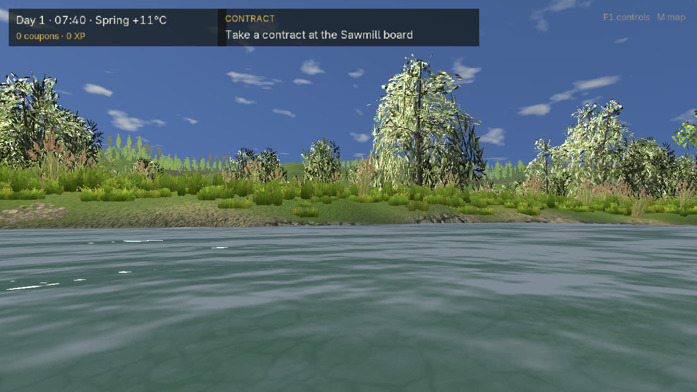

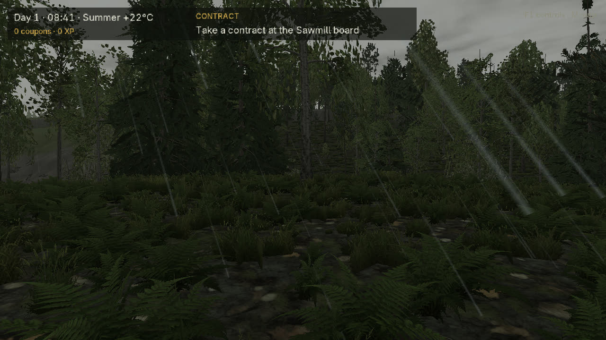

## 83. Three Tripo truck tools: shovel, front snow-plough blade, towed 3-furrow plough, game-ready and shown on the truck

02:51 · GEN3

Коммит: [d7594ce2f0](https://github.com/shsanek/EXEcutor/commit/d7594ce2f0)

Owner request. ChatGPT 4-view sheet per object (plough sheet revised once in the same chat), side views checked for handedness, inconsistent cells replaced by mirrors; Tripo multi-view: shovel H3.1 (55 cr.), plough blade H3.1 (55 cr.), plough H3.0 (40 cr.), Tripo balance 1530 -&gt; 1380 (batch reserve 1350). Imported with named attachment points: shovel grip_main/grip_off/mount_bed_side/tip (1.25 m, 2500/1000/374 tris), plow_blade mount_front/cutting_edge (2.30 m wide, 3999/1599/799), plough hitch (3.40 m, 6000/3000/1500). New tools/blender/lod_compare.py renders the source before decimation and every LOD from the same cameras with silhouette IoU: LOD0 0.996 / 0.987 / 0.981; plough LODs and blade LOD2 were raised after the first check shredded wheels and shares. New --truck-attach (presentation only, hash unchanged) draws the meshes on the player's truck: blade on the bumper, shovel on the left bed side, plough on the rear hitch (native Metal tour, noon and overcast).

- ✓ recognizability: LOD0 IoU vs source &gt;= 0.98 every view, LOD1 &gt;= 0.95, LOD2 &gt;= 0.88; before/after sheets per asset
- ✓ attachments: all on the LOD0 surface (grips 24 mm = handle radius, hitch 33 mm = ring radius)
- ✓ native: native-release build; asset/world/view/core tests pass; tour state hash 6dea54dd with and without --truck-attach
- ✓ budget: Tripo 150 cr. (1380 left, reserve 1350 for this batch), ChatGPT 4 req.

## 84. Winter rivers and lakes: ice that freezes gradually from the season climate, snow on ice, thaw, spring breakup, and recoverable breakthroughs under the truck or the player

03:14 · Q8 RIVERICE

Коммит: [dceead2e83](https://github.com/shsanek/EXEcutor/commit/dceead2e83)

data/world/river_ice.txt (hot reload) integrates frost degree-days hour by hour from the season climate: Stefan growth (about 54 cm mid-winter, 74 cm late winter), melt, rot and a wet surface in thaws, breakup on flowing water in spring (spring 0.3), open water by spring 0.45. Local onset by depth, current and a mouth/inflow factor: shore ice first, the main current last, shallow rapids stay open as leads. The ice_sheet shader draws over the water mesh with the same model: black first ice, grey ice, snow cover with wind-swept bare patches and white cracks, grey slush and puddles in the thaw, drifting floes and open leads at breakup. Gold bearing capacity (P = 7 h^2) against the truck body mass at the wheels or the player: cracking sounds and a spreading crack decal from 0.45 of capacity, a ramped seeded failure hazard above 0.8; the truck drops into the hole to the water depth and stays (the edge breaks, the hole rim ramps), R pulls it to the road; on foot the player climbs out wet (IceBodyHook for the survival model). Debug: F10 forced thickness, F11 break here, [debug] force_m / force_year / enabled; tools/river_ice_tour.sh, river_ice_probe. Native only. Perf +0.2 ms. docs/river-ice.md.

- ✓ river_ice_tests: 9/9
- ✓ shaderc golden + limits: ice_sheet ps 46/64
- ✓ world/season/loc tests: pass

## 85. Grey box of the Olkhovka kolkhoz next to the elevator: wheat fields with shelterbelts, the abandoned kolkhoz yard, the kolkhoz village on the slope, a generated wheat ground texture

03:15 · WHEATKOLKHOZ

Коммит: [95bc2c4fd4](https://github.com/shsanek/EXEcutor/commit/95bc2c4fd4)

On the floodplain terrace 600 m north-east of the elevator: the kolkhoz yard (two cow sheds MTF, one collapsed to its concrete posts, MTS hangar with a tractor, silage trench, grain floor under a canopy, office and club, Rozhnovsky water tower, fuel store, combine and tractor wrecks, concrete fence remains), reached by a gravel grain road from the trunk by the elevator and a field track to the ford road. Two wheat parcels (11 ha) with birch and poplar shelterbelts (new wheat and shelterbelt surfaces and habitats, straw crop cards), and seven household plots terraced along a contour street. Layout checked against 27 Commons reference photos (side-by-side sheets). Polycam wheat texture (1 request) wired as an extra ground layer that borrows a free splat slot per tile (no shader change). Native only.

- ✓ build: native-release
- ✓ ctest (touched modules): world, nature, poi, light, ground_normal, spot_shadow, bot, view; map_tests borrow test
- ✓ POI on MAP terrain: kolkhoz + 7 plots 0 errors, 0 warnings, physics_vs_drawn 0
- ✓ r1check: OK
- ✓ stamps: poi_export --check

## 86. The truck shovel as a real tool: bed-side mount, home hook, both hands and the weapon slots, digging snow and mud, digging the truck out of a drift

03:56 · Q3 SHOVEL

Коммит: [7ec5056bfa](https://github.com/shsanek/EXEcutor/commit/7ec5056bfa)

The imported GEN3 shovel hangs on the left bed side; E takes it off, hangs it back, puts it down anywhere (lying on the ground or floor) or hangs it on the free hook of the home board. While carried it occupies the weapon slots and both hands (fire, reload and weapon keys stripped, gun holstered, one carry slot shared with cargo and the Q6 battery). LMB is a 0.8 s stroke that bites once: near a wheel it clears a tapered snow lane through the wheel and under the belly and digs a mud ramp ahead of the tyre (vehicle::World::dig_around_wheel); elsewhere it shovels snow off the snowpack (a new shovelled field: real mass removal that tyre grip, plough drag, ground support, grass and the near snow mesh all see, refilled by snowfall, saved) or levels mud ruts; hard ground scrapes. A stuck hero truck (0 km/h at full throttle in a 0.55 m snowpack) drives out after 32 wheel strokes. First person: shovel mesh with glove fists in the hands layer and a snow/earth load after the bite; third person: a shared-humanoid body (bandit_mikhalych as stand-in) with both arms solved onto the handle. Sounds: snow chop, dirt thud, metal scrape, clank. Body-heat hook shovel_exertion_per_min for Q6 (one line after it merges). Data in data/tools/shovel.txt; stages shovel_truck/hands/snow/snow_dug/home. Native only. Details in docs/tools.md.

- ✓ vehicle_tests: 68/68: snow dig mass/refill/serialize; rig truck stuck in a 0.6 m drift 0.34 m -&gt; 71 m after 28 wheel strokes; wet mud 4 m before firm ground 1.1 m -&gt; 92 m after 16 strokes
- ✓ play_cargo_tests: 34/34 incl. 4 shovel tests: slot exclusivity and cargo rule, hang/drop/save-load, one stroke digs snow and levels ruts, hero truck stuck in 0.55 m snow -0.02 m -&gt; 92 m after 32 strokes
- ✓ view_tests grip check: FP arms IK residual 0.000 m, skinned hands 25 mm from the sockets; 3P bandit_mikhalych idle+walk with the stroke: 0 errors, hands 28 mm, handle never in the body
- ✓ in game (native): stuck truck 0 km/h at full throttle; 4 strokes open a pit to the grass; dug out it drives off at 14-21 km/h; take/hang on truck and hook

## 87. Survival: cab heater, body temperature, engine vibration, a battery that drains, freezes and comes home, overheating and the heater trick

04:03 · Q6 SURVIVAL

Коммит: [84e69a49e9](https://github.com/shsanek/EXEcutor/commit/84e69a49e9)

New data-driven module src/survival (data/survival/survival.txt). Cab heater lever (an instance of the authored wiper switch under it, levels 0-3, fan loop sound, needs ignition and a live battery); cab air follows the outside, the heater core (warm coolant only), windows and doors: a -22 C night with heater 3 gives +21 C in 10 min, off stays -17 C. Body temperature with a readable heat balance (cold air, walking/running/carrying, warm cab, stove at home): gradual shivering of camera and hands, slower movement, frost vignette, HUD readout and hints; health drains only below 34 C, to a 25 HP floor. Engine vibration by rpm on the dash, gauges, mirrors and the cab camera (idle shudder, cranking, catch). Battery 6ST-60 on the game clock: drains from lamps/fan/wipers/ignition only with the engine off, the alternator charges it (weak at idle), cold cuts capacity and cranking (a weak one cranks up to 3x longer, a dead one only clicks), freezes when discharged in frost; removable with the hood up as a two-hand item, placed anywhere (the home container interior is warm), refitted. Overheating: heater draw, low coolant, boiling with steam and hiss, power loss, gauge pinned; the full heater cools the engine. Save section 130, dev stages survival_*, tools/survival_runs.py. Native only (owner rule). Open: the heater lever reuses the wiper-switch mesh; on the short native climb spike the heater lowers the peak only 115 -&gt; 113 C (large effect on sustained load in the unit test); check seasons temperatures when they land. Details in docs/survival.md.

- ✓ survival_tests: 17/17: heater on/off/windows, warm engine needed, coolant draw, hot climb boils and the heater keeps it below boiling, battery drain/charge/cold/freeze/home overnight, body cooling/running/warming, vibration
- ✓ play_cargo_tests: 36/36 incl. 6 survival: heater lever levels and fan power, battery remove/carry/drop/save/refit, dead battery clicks, cold crank 92 ticks vs 45, overheat throttle loss, frost cooling and cab warming, save/load
- ✓ native-release ctest: all 34 pass (contracts_tests counts 15 items)
- ✓ native scripted runs: 10 runs with traces in shots/survival_q6 (summary.json)

## 88. Economy targets for the logistics loop: expenses 10-20 % by category, greed checked at fight stops only, a modest trim of contract 2

04:10 · EC1 ECONTARGET

Коммит: [5d19c7de96](https://github.com/shsanek/EXEcutor/commit/5d19c7de96)

After STORY-Q1 only the spur station is a fight, but the simulator still expected a fight at every stop (expenses 25-30 %, loot left over the session). The manager decided to restate the targets with reasoning rather than raise costs. Costs were not raised. Per run, the 04 design's repair (-80...-150) is 3-6x the routine wear of 10.5; the rest is combat damage that a peaceful hauling run does not take. New expense target 10-20 % of income: repair 5-12 % (routine wear), ammo 3-8 % (one refill per fight stop), fuel 1-4 % (10.5 consumption at 2.5 per litre, 7-10 km per run), food and trade losses 0 % (not modelled: no hunger, no trader spread, no cargo lost on the road). The check fails when the total or any category leaves its band. Income: contracts are not overpaid per run (150-340 coupons, inside 10.3; loot about 53 a run against ~200), but net per hour sat at 1202-1248 against the 1250 ceiling (4.4 runs an hour, low expenses), so c2_spur_fuel, the richest run, goes from 270 to 250 coupons. Greed: only fight stops count. Each must leave loot or fill at least 90 % of the cells, and the load leaving it must be 50-100 %. Before EC1, the station's stash (9-16 cells) always fit the 16 cells left beside the 4 canisters, so it never forced a choice; gas-station scrap goes from 3-6 to 5-8, and what is left behind is cheap, heavy scrap. Result: every design check is OK on seeds 1-10 (130 OK, 0 FLAG) and on seeds 1-40. Timing is unchanged: contract 1 back at 16:20 with one T2 affordable, two upgrades by 0:30, contract 3 starting at 29:42-29:49. Native only. Open: the fuel price against the diesel story (owner call); the 25-30 % band for combat-heavy regions later.

- ✓ economy_tests: 16/16 (new: greed_counts_fight_stops_only, design_checks_pass_on_ten_seeds)
- ✓ contracts_tests: 27/27
- ✓ director_tests: 17/17
- ✓ bot_tests, save_tests: pass
- ✓ economy sim design checks, seeds 1-10: 13/13 OK on every seed (was 11-12/13)
- ✓ economy sim, seeds 1-40: 0 FLAG, net 1150-1213 per hour

| Seed | Net per hour before -&gt; after | Expenses before -&gt; after (repair / ammo / fuel %) | Greed before (old check) | Greed after (fight stops) | Flags before -&gt; after |
| --- | --- | --- | --- | --- | --- |
| 1 | 1232 -&gt; 1197 | 14 % -&gt; 14 % (8 / 5 / 1) | 0 left, peak 62 %: FLAG | 2 of 2 full, 4 left: OK | 2 -&gt; 0 |
| 2 | 1216 -&gt; 1193 | 14 % -&gt; 14 % (8 / 5 / 1) | 0 left, peak 57 %: FLAG | 2 of 2 full, 2 left: OK | 2 -&gt; 0 |
| 3 | 1210 -&gt; 1181 | 14 % -&gt; 14 % (8 / 5 / 1) | 0 left, peak 62 %: FLAG | 2 of 2 full, 3 left: OK | 2 -&gt; 0 |
| 4 | 1222 -&gt; 1200 | 14 % -&gt; 15 % (9 / 5 / 1) | 0 left, peak 60 %: FLAG | 2 of 2 full, 2 left: OK | 2 -&gt; 0 |
| 5 | 1248 -&gt; 1213 | 13 % -&gt; 14 % (8 / 5 / 1) | 2 left, peak 60 %: OK | 2 of 2 full, 6 left: OK | 1 -&gt; 0 |
| 6 | 1202 -&gt; 1186 | 15 % -&gt; 15 % (9 / 5 / 1) | 0 left, peak 55 %: FLAG | 2 of 2 full, 1 left: OK | 2 -&gt; 0 |
| 7 | 1225 -&gt; 1190 | 14 % -&gt; 14 % (8 / 5 / 1) | 1 left, peak 62 %: OK | 2 of 2 full, 5 left: OK | 1 -&gt; 0 |
| 8 | 1218 -&gt; 1189 | 14 % -&gt; 14 % (8 / 5 / 1) | 0 left, peak 57 %: FLAG | 2 of 2 full, 3 left: OK | 2 -&gt; 0 |
| 9 | 1241 -&gt; 1206 | 14 % -&gt; 14 % (8 / 5 / 1) | 1 left, peak 60 %: OK | 2 of 2 full, 5 left: OK | 1 -&gt; 0 |
| 10 | 1233 -&gt; 1204 | 14 % -&gt; 14 % (8 / 5 / 1) | 1 left, peak 60 %: OK | 2 of 2 full, 4 left: OK | 1 -&gt; 0 |

## 89. Farming on the kolkhoz wheat fields: a towed plough in spring, a towed combine pouring grain into the truck bed in autumn, the field following the seasons

04:17 · Q4 FARM

Коммит: [38b4d54943](https://github.com/shsanek/EXEcutor/commit/38b4d54943)

New peregon_farm module and data/farm/farm.txt. The GEN3 plough and a grey-box pull-type combine are real towed implements: hitched and unhitched on foot at the rear tow hook (back the truck up to the drawbar), trailer kinematics with a jackknife limit, wheels on the ground, lowered/raised with G, draft on the truck by soil and wetness. The plough turns field cells (1 m grid over both parcels) into furrows along its path; Olkhovka sows them in the spring window; the crop grows sprouting, green, ripening, ripe gold and lodged with the season (ground decals on the wheat surface and the wheat grass driven per cell). The combine cuts ripe wheat to stubble, its hopper and auger pour the grain into the bed as a growing heap (grain_bulk cargo, 50 kg a cell, the truck mass follows), and the bed is tipped at the elevator pit. Two jobs from Nadezhda Petrovna on the Sawmill board: plough the kolkhoz field (spring) and bring in the harvest (autumn, 600 kg). Saved (section 124), deterministic, native only.

- ✓ farm_tests: 11/11
- ✓ cargo / vehicle / play_cargo tests: 19/19, 65/65, 30/30
- ✓ native ctest: 35/35
- ✓ determinism: farm_harvest stage twice: same final hash
- ✓ perf: farm decals and grass filter within noise (&lt; 0.1 ms)

## 90. Night balance: a physically placed moon with calendar phases and dim moonlight, seasonal meadows near and far, grass in the low beam, snow grain, brighter dusk slopes

04:38 · LB1 NIGHTBAL

Коммит: [d10de8a796](https://github.com/shsanek/EXEcutor/commit/d10de8a796)

Root cause of the bright autumn night (autumn:0.32 23:40): moonlight was about 75 % of the noon sun after night exposure, and a fixed near-full phase (0.62) had its declination mirrored from the sun, so whenever the season set an autumn or winter sun, a nearly full moon stood 40-60 deg high; at 22:30 it was still rising, and in summer it stayed low. Now the moon sits at its ecliptic longitude (sun + phase), the phase follows the season calendar (29.53 sun-path days, about 2.6 game days, held noon to noon), moonlight is about 1.3x the moonless sky ambient at full moon and scales with lit fraction^2.5, part of it scatters into the sky ambient and off snow, and moonlit snow uses the snow exposure. Meadows: a vertex-shader tint by the grass weight (+2 VS slots, no pixel cost) in the far, splat and material terrain shaders turns them to straw in autumn, dead grass in late autumn/winter/early spring and fresh green in spring (seasons S2). LF1: grass reads the low-beam cone from the headlight atlas. LF2: the near snow drift mesh has a grain texture. LF3: more low-sun sky fill. Also fixed: season atlas rebuilds left destroyed textures bound, which failed the render in season tours. LF4 is unchanged. Native only; sim hashes unchanged.

- ✓ native-release ctest: 36/36 (light_tests +2 moon tests, season_tests +1 phase test)
- ✓ shaderc check: golden OK; terrain_far vs 183, terrain_splat_gi vs 252/256 ps 64/64, grass_card_spot ps 60/64
- ✓ frame time, perf_tour native 1280x720, best of 2: 5.70 -&gt; 5.50 ms (season off), 5.68 -&gt; 5.58 ms (autumn); noise
- ✓ sim hash: tour final hashes unchanged (9460d3bf night, 3b5ca6b7 meadows, 2530229e headlights)

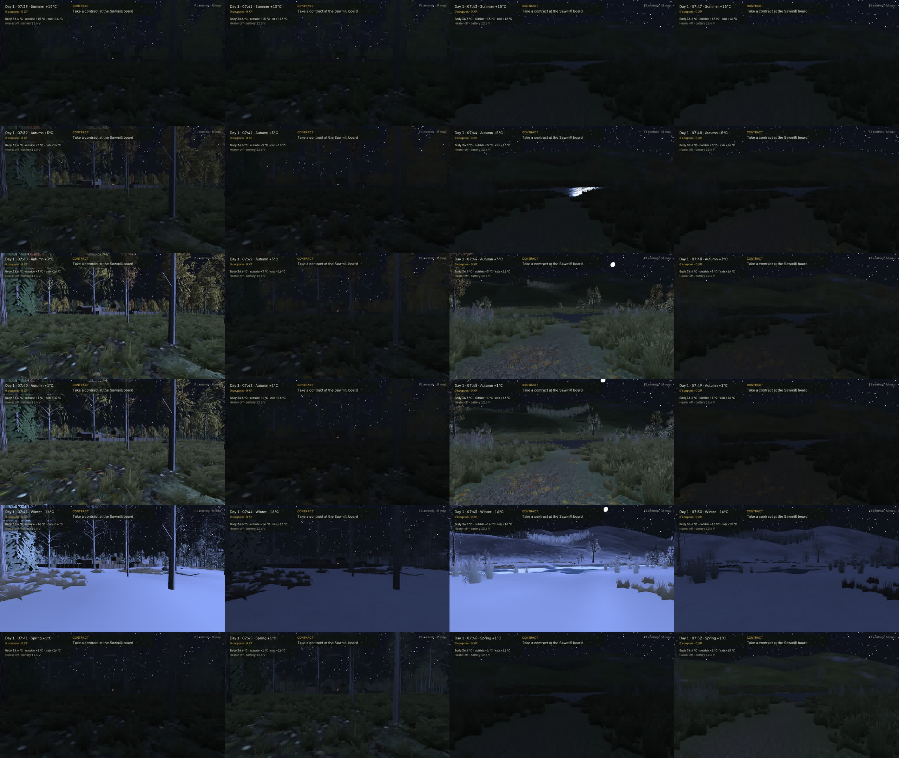

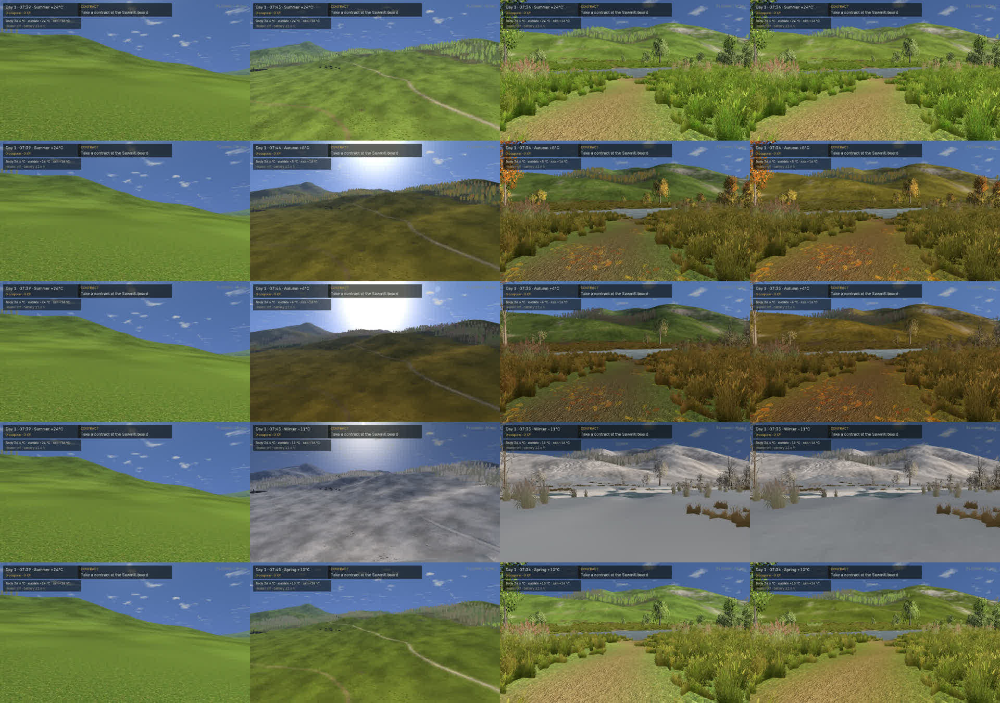

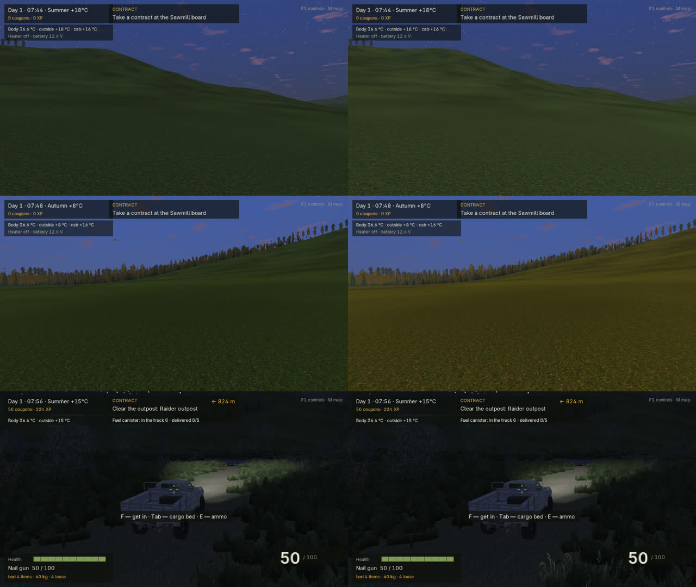

## 91. Kolkhoz polish: pitched roofs, real-size brick, dirt yard, grass banks, tramlines and planted belts, no more black buildings at a distance

05:34 · KH2 KOLKHOZPOLISH

Коммит: [8901a259c9](https://github.com/shsanek/EXEcutor/commit/8901a259c9)

Manager review of WHEATKOLKHOZ fixed against the reference photos: a new grey-box kit primitive roof_NN (gable prism, slope UVs at the set texel density) gives the cow sheds, hangar, tok, office, log houses and sheds pitched slate/tin roofs; cow sheds are whitewashed silicate brick and the office red brick at real brick size (existing generated textures, baked); the yard lost its glossy puddle 'marble' patches and got ruts; village plots sit at street level with gentle grass batters; the farm field shows tramlines, a weedy headland margin and weed/lodged patches (presentation only, the plough/harvest overlay unchanged); shelterbelts are planted rows. Buildings went black at a distance because their own footprint shadow in the baked mask darkened their roofs; walls now sample the mask outside their face and exposed roof tops take only the horizon sun. Native only.

- ✓ build: native-release
- ✓ ctest (touched modules): world, nature, poi, light, view, season, shaderc, asset, spot_shadow, ground_normal, far_terrain, diffuse_gi_render; farm_tests 12/12
- ✓ farm_check.sh: PASS (hitch, harvest, plough, tip at the elevator, save/load)
- ✓ r1check: OK (base had a failing village_06 stamp)
- ✓ stamps / nature catalogue / shaderc golden: poi_export --check, nature_catalog --check, shaderc check
- ✗ region stages drive_elevator / drive_home / elevator_unload: goal not reached on the base tip either (truck does not move, identical summaries base vs KH2)

## 92. Winter road quest: a scripted blizzard buries the Sawmill - Kolos elevator road, fit the plough blade at Grisha's and clear it

05:40 · Q2 WINTERPLOW

Коммит: [d2817a73ba](https://github.com/shsanek/EXEcutor/commit/d2817a73ba)

In winter Nadezhda Petrovna radios the Sawmill: a blizzard is coming, Olkhovka's stove and generator are out of diesel. The blizzard (data-driven, forced through the season weather with a whiteout fog) grows wind-slanted ridges and packed troughs on two open field stretches of the road (SnowDrifts: a sparse 0.5 m drift/berm layer inside the snowpack, saved, seen by tyres, boots, grass and the snow mesh). Grisha fits the GEN3 plough blade for free (220 kg on the front mount, mass/COM/inertia retuned) and straps two diesel canisters into the bed. Z/V lower/raise the blade (raised, skim, down, hydraulic travel); the blade cuts the snow to its edge height, pushes a windrow that spills into berms on both sides, resists by face height x snow strength (fresh 350 Pa, packed drift 760 Pa) with stiction, floats on its skids and collides with trees/rocks/walls. Without the blade the truck bogs at the first ridges; lowered straight into a full ridge it stalls, skimming first works. The cleared lane persists in the save and refills with new snow; a later blizzard buries it again. Delivery at the weighbridge: +260 coupons, +220 xp. Surface-agnostic PlowLayer so mud can be added later. Rebased over shovel, survival, farm, river ice, LB1 and KH2 (the shovel also digs drifts). Native only.

- ✓ native-release ctest: 36/36 (winterplow_tests 7)
- ✓ vehicle_tests: 76/76 (plow_tests 8)
- ✓ cargo / play_cargo / farm tests: 19/19, 40/40, 12/12
- ✓ plough sim cost: +0.08 ms per tick
- ✗ snow mesh rebuild spikes: 25-35 ms p95 while driving/ploughing in snow (pre-existing full rebuild, WP-B8)

## 93. Snow mesh rebuilds only what changed: ploughing and driving in snow drop from 27-38 ms to 7-8 ms p95 frames

06:26 · SN1 SNOWMESH

Коммит: [f22b3ca9cb](https://github.com/shsanek/EXEcutor/commit/f22b3ca9cb)

Root cause: the 240 m snow mesh (2 m lattice, 512 cells refined to 25 cm) was rebuilt in full on the CPU at 15 Hz whenever any tyre track, shovel bite, plough cut or drift changed, and on every 8 m camera step, then uploaded into new static buffers. Now MapSnowBuilder keeps 30 x 30 world-anchored 8 m chunks; Snowpack and SnowDrifts log changed rectangles (SnowChangeLog, not saved or hashed), so only touched chunks rebuild; camera steps rebuild the entering row and queue the edge-fade ring; snowfall, refill, loads and tile streaming queue stale chunks that are swept oldest/nearest first at 32 chunks per frame. Chunk builds use per-chunk grids for tracks, digs and drift cells instead of map lookups per vertex. One dynamic VB/IB with DISCARD uploads, still one draw. Output equals the old full build up to sub-10 um float rounding on clipped edges: captures differ by 1 colour level on a few pixels, sim hashes unchanged. Owner's terrain-displacement idea evaluated and documented (blocked by 25 cm tracks/berms vs 2-4 m terrain, SM2 vs/ps/varying budgets full, single-stream RHI). Native only.

- ✓ native-release ctest: 36/36
- ✓ cargo / vehicle / play_cargo / farm tests: 19/19, 76/76, 40/40, 12/12
- ✓ map_tests incremental == full rebuild: 14 byte-exact checks through tracks, digs, drifts, moves, snowfall
- ✓ winterplow_plow frame mean / p95: 11.5 / 37.8 -&gt; 5.0 / 7.6 ms
- ✓ winterplow_stuck / arrival p95: 27.3 -&gt; 6.8 ms, 30.2 -&gt; 7.0 ms
- ✓ shovel_snow p95: 13.8 -&gt; 9.3 ms
- ✓ sim hashes (5 runs): unchanged
- ✓ captures before/after: &lt;= 2.8 % channels differ, almost all by 1 level

## 94. Front-mounted home-made harvester with a trunk auger over the cab; plough blade mounted tight to the bumper

06:48 · IMPL2

Коммит: [a868e96602](https://github.com/shsanek/EXEcutor/commit/a868e96602)

Owner feedback on FARM-Q4 / WINTERPLOW-Q2. The towed combine is gone: the harvest job now uses a front-mounted rig built from kit primitives - a 3.2 m header (cutter bar, cross auger, bat reel, dividers, skids) pushed on a short frame bolted under the front bumper, a thresher drum box hanging between the frame rails (belt from the engine pulley, chaff blower duct on the right), and a pipe auger trunk (хобот) from the front-left corner up past the A-pillar, along the cab roof edge above the driver door and bending down into the bed. The rig is a front implement: mount/dismount with E at the truck front (nose up within 1.2 m and 15 degrees), it stays on trestles at the field; G lowers the header (floats on skids within 15 cm, 40 cm lift), the header cuts its swath ahead of the truck, the thresher feeds the trunk at 25 kg/s into the bed. 380 kg on the front axle through a generic vehicle MountSpec (mass, centre, inertia, collision box against trees and walls). The door swing and the driver's windscreen view are checked numerically against the HERO cab geometry. Plough blade: the GEN3 mesh push frame compressed (tools/assetc/warp_mesh.py), moldboard 0.41 m and cutting edge 0.86 m ahead of the bumper, raised on a bumper mast with two rams; mass, centre, inertia and collision follow (front axle share 0.64 vs 0.67 with the old arm). Native only.

- ✓ native-release ctest: 36/36
- ✓ farm_tests: 17/17 (front mount, swath, float, trunk pour, door/view clearance)
- ✓ vehicle_tests: 79/79 (blade offset, front axle share, MountSpec mass and collision)
- ✓ cargo / play_cargo tests: 19/19, 40/40
- ✓ tools/farm_check.sh: FARM CHECK PASS (dismount/mount on foot, harvest determinism)
- ✗ rut strips on wheat: truck ruts drawn in grass colour (teal) on the wheat surface - pre-existing (play_detail), not fixed

## 95. Only the player's truck moves: one data switch stops traffic, convoys, buggies and every driving bot

07:00 · BOTREMOVE

Коммит: [c3481272ae](https://github.com/shsanek/EXEcutor/commit/c3481272ae)

Owner decision: the world has exactly one moving vehicle, the player's truck. data/world/driving.txt [driving] ai_driving = false (default) switches off, without deleting code, data or tests: director traffic and convoys (not spawned; breakdowns, obstacles, wrecks and the raider roadblock stay, all parked), W4 road buggies and the kinematic road truck (parked), the play autoplay's driving (drive axes dropped in Drive mode, log 'drive skipped'), the W13 DriveAgent, the W5 DriveBot, the region and proving route drivers and the farm / winterplow dev autodrives. On-foot NPCs, fights, the player truck and towed implements are unchanged; replays still drive (recorded input is player input). Tests that need AI driving print [SKIP] (ai_tests buggy ram, 7 director_tests session runs, bot_tests p5/p6); gates print SKIP for the region drive stages, the nightly autoplay sessions, the w4/action road-buggy replay and gates w5/i1. ai_driving = true and a rebuild bring everything back (ctest 36/36 with no skips). Found on the way: the play autoplay cannot drive on the tip even with the flag on (the engine starts off and the bot never turns the key), so 12 of 17 region stages miss their goals with the flag on and off alike. Native only.

- ✓ native-release ctest (ai_driving = false): 36/36, 10 test cases skipped
- ✓ native-release ctest (ai_driving = true): 36/36, 0 skipped
- ✓ cargo / vehicle / play_cargo / farm tests: 19/19, 76/76, 40/40, 12/12
- ✓ region run 20 000 ticks, player circles from farm_ripe: NPC vehicles 0 spawned, 0 m (flag on: 1, 729 m); truck 957 m, 43 km/h in both
- ✓ W5 replay 36 000 ticks: traffic 0, convoys 0 (committed run: 3 + 1)
- ✓ gate region (native, skip RunGame): drive stages SKIP, mechanic PASS
- ✗ autoplay drive stages: pre-existing: engine off at stage start, 12/17 stages fail with the flag on too

## 96. Truck care: cold start, antifreeze, fogged glass, frozen lock, oil, wet clothes, tea, a physical winch

07:24 · Q7 SURVIVAL2

Коммит: [856874851b](https://github.com/shsanek/EXEcutor/commit/856874851b)

Pure model src/survival/care (data/survival/care.txt) and game glue play_care/play_care_rig. Done in game: choke, pre-start heater and hand crank; factory antifreeze mix that water top-ups dilute (only a hard frost cracks a block, weld at the mechanic); windscreen fog with a hand wipe and a heater-on-the-glass switch, overnight rime and frozen wipers; a wet door lock that seizes on some frosty nights (seeded) and thaws with breath or hot water; oil burn, dipstick, top-up and low-oil wear; wet clothes from rain, snow and the river ice dunk, drying in the warm; a thermos of tea on B. Winch: an optional upgrade from Grisha (300 coupons + 2 parts); the cable kit and the jack live in a box under the passenger seat, the cable is walked around one or several trees (wraps and unwraps) and hooked back on the truck, then the drum pulls the truck through two forces in the vehicle sim; spare wheel behind the cab. Deferred: siphoning (owner, behind a data switch), punctures and planks (model only). Native only. Details and handoff in docs/survival.md.

- ✓ care_tests: 15/15
- ✓ play_care_tests: 17/17: every in-game mechanic incl. winch pull and save v2
- ✓ native-release ctest: all pass
- ✓ cargo/vehicle/play_cargo/farm tests: all pass
- ✓ native scripted runs: tools/care_runs.py, traces and summary.json in shots/survival2_q7

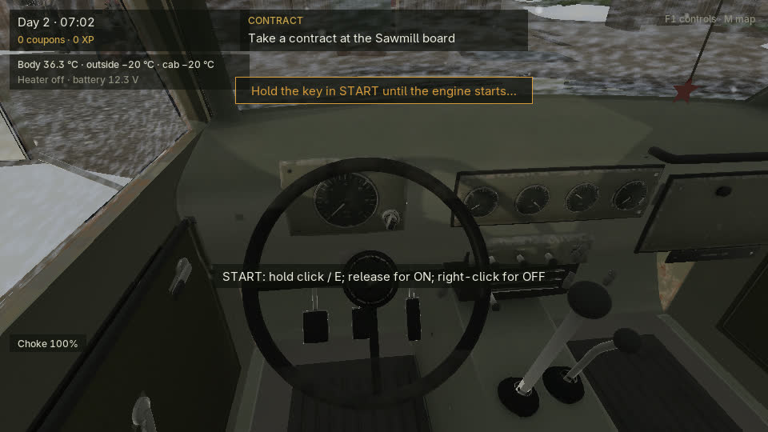

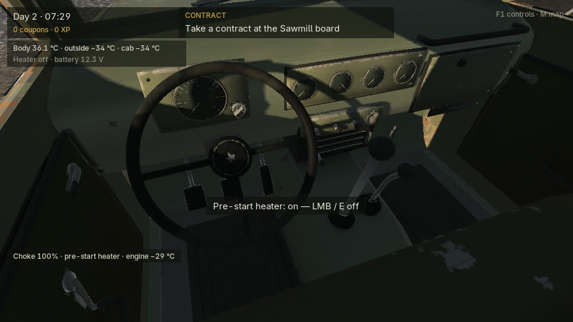

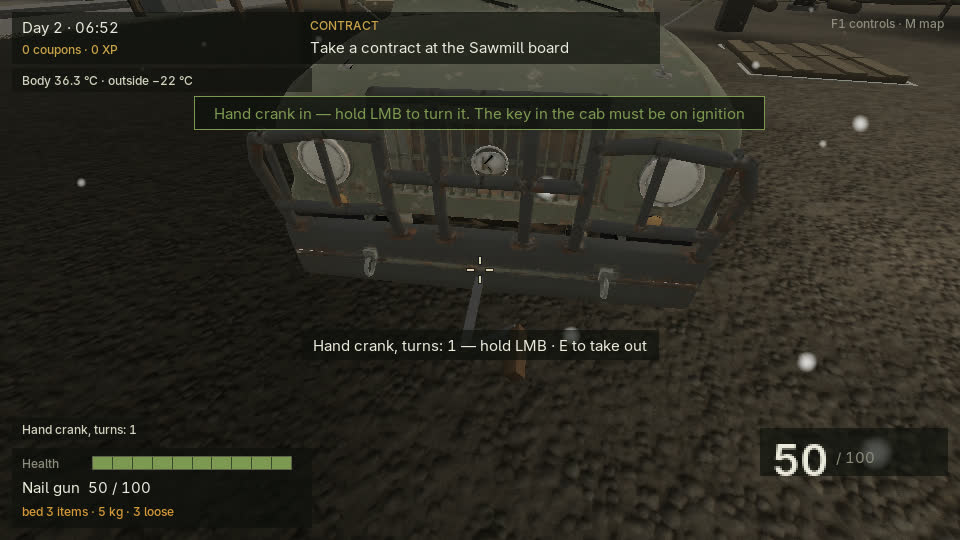

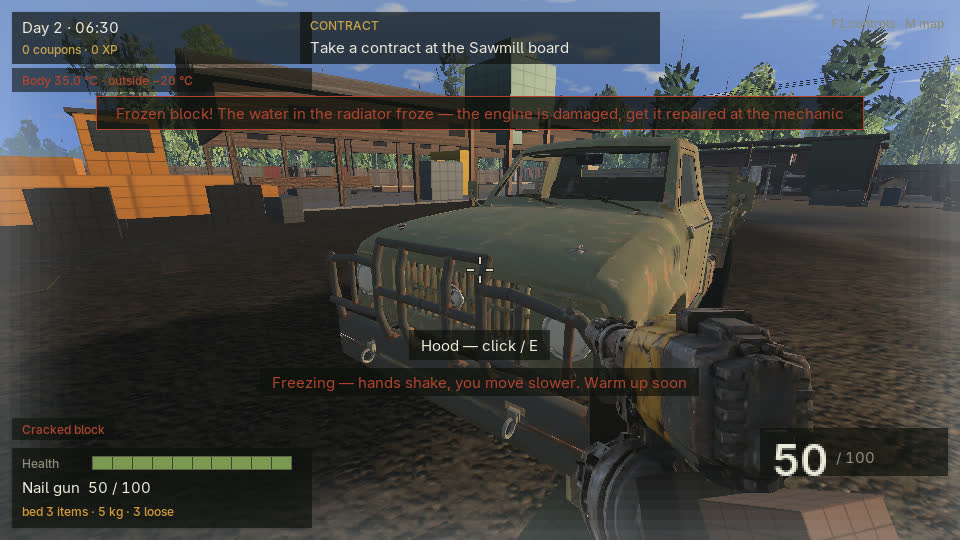

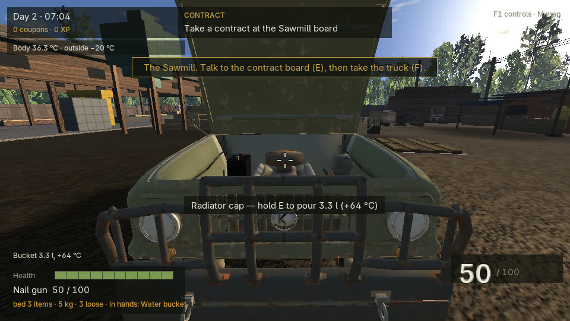

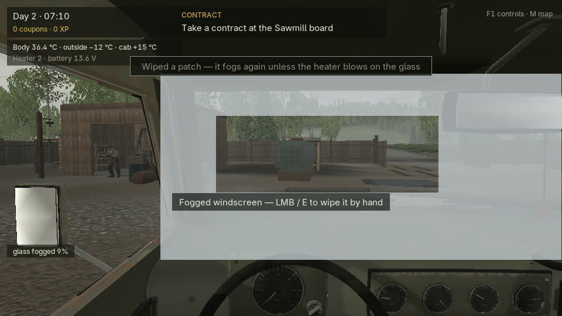

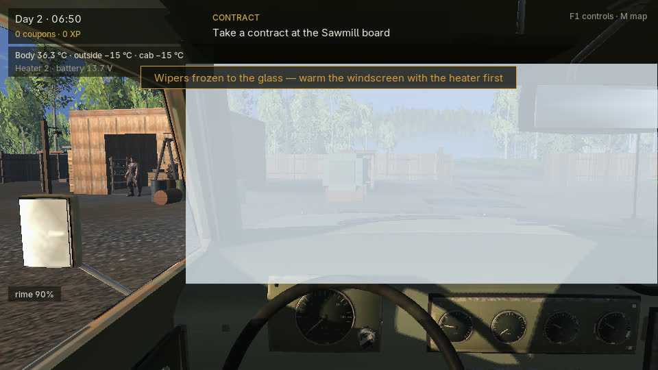

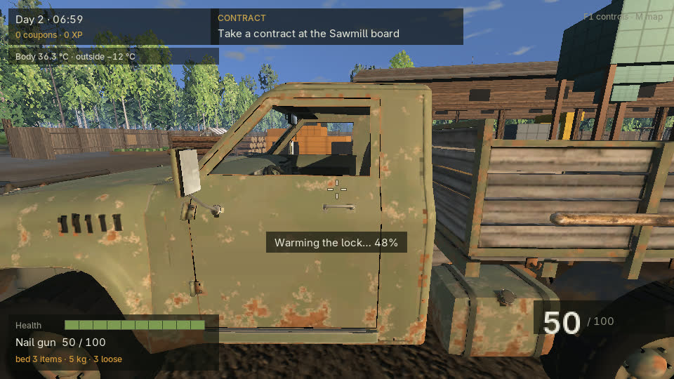

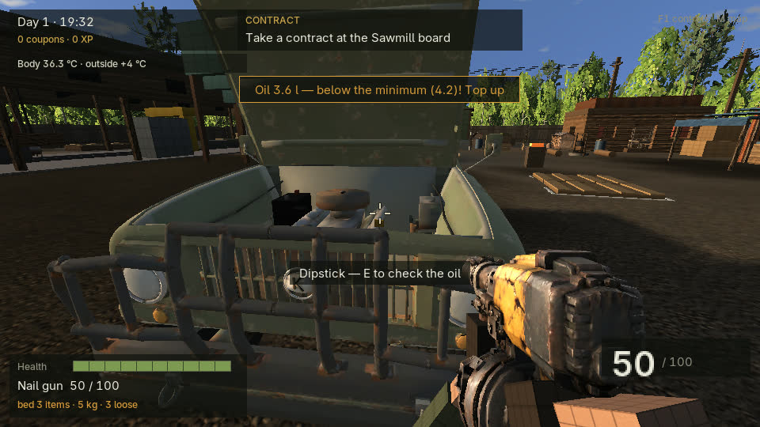

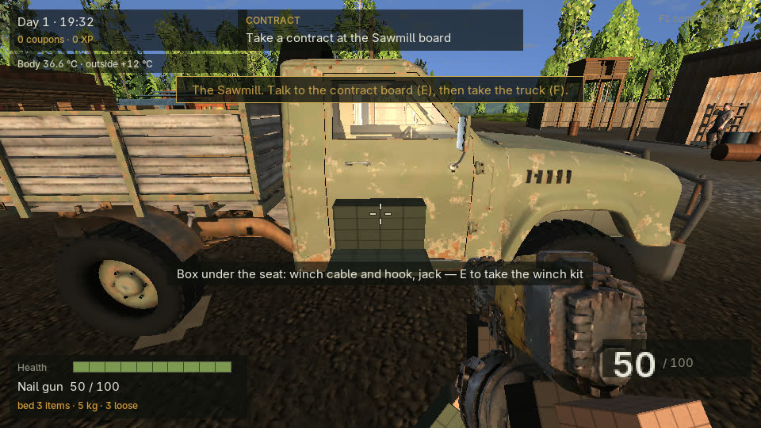

## 97. Truck engine sound: throttle response about 300 ms -&gt; about 45 ms, raspy distortion and crackle removed, V8 synth checked against real truck recordings

07:32 · AU2 ENGINESOUND

Коммит: [cb78422512](https://github.com/shsanek/EXEcutor/commit/cb78422512)

Owner complaint 2026-10-10: the engine wheezes/crackles, sounds strange, and roars late after pressing forward. Root causes: (1) the play scene scheduled audio 9 ticks (150 ms) ahead and SDL used a 1024-frame period; (2) Playback only moved its clock forward, so every game hitch added its length to the latency for the rest of the session; (3) EngineSpeed held load at 0 during the 0.25 s park-&gt;1st engagement and ramped it at 6/s (350 ms from a standstill, a short blip gave nothing); (4) a saturator compressed engine peaks by 3.6 dB (rasp), with 10-24 % random firing amplitude and instant-attack noise bursts; (5) bump stops played the bullet impact (2.9/4.3 kHz pings several times a second off-road); (6) gravel tyre grains crackled unfiltered in the cab. Push-&gt;audible on the real SDL device 205 -&gt; 20 ms (hitch case 398 -&gt; 25 ms), pedal-&gt;load 350 -&gt; 17 ms, 0 underruns. Synth: tick-length glides independent of device blocks, fractional pulse timing, no saturator, tonal carburettor moan, more low-rpm weight; spectra now inside the spread of 7 CC0 V8/truck recordings (sources and licences in docs/audio.md, analysis only). Listen first: 07/08 blips from a standstill, 09/10 pull, 01/02 full session. Native only; waveOut queue set to the W11-validated 6 x 735 frames but not re-run in EXEcutor.

- ✓ native-release full ctest: 36/36
- ✓ audio_tests / view_tests: 29/29 (2 new), 38/38 (1 new)
- ✓ cargo/vehicle/play_cargo/farm: 19/19, 76/76, 40/40, 12/12
- ✓ push-&gt;audible latency (SDL, steady): 205 ms -&gt; 20 ms, underruns 0
- ✓ session clicks / &gt;3 kHz energy in full pull: 514 -&gt; 257, 2.5 % -&gt; 0.5 %

## 98. Sun shadows, the kolkhoz road and the elevator people are back: a stale native data dir, a map that showed two roads, and nobody placed at the anchors

07:44 · FIX

Коммит: [d699db50b8](https://github.com/shsanek/EXEcutor/commit/d699db50b8)

Owner regressions on the native build. 1) Shadows: the native data dir build/map/r1 had no peregon_shadows.bin and a pak from 2026-10-08; native peregon --play never baked the cache (only play.sh --region did), and any POI/nature change makes the cache key stale. A/B 2581cefcd7 vs HEAD with fresh bakes renders the same shadows, so there is no shader or GI regression. Now native --play bakes the cache when it is missing or stale (13 s, threaded, byte-identical), the buckets cover the whole year (5 sun paths, 48 directions) so seasons keep shadows, and tools/play_native.sh + tools/map/r1_fresh.sh rebake the pak when map sources change. 2) Kolkhoz road: the stale pak had no kolkhoz roads and the M map drew only two slice roads; the map now draws every road of the R1 graph with kolkhoz/village labels, and a blue road sign marks the grain road at the trunk. 3) Elevator: Q1 made it friendly but nobody was placed at the anchors; Olkhovka residents (grey-box figures with day/evening shifts and work/guard/sit motion) and Nadezhda Petrovna (skinned baba_trader with attention) are there now.

- ✓ native-release ctest: 36/36
- ✓ light_tests: 27/27 (new: year buckets shade a tree and a house for 8 days x 3 hours)
- ✓ cargo_tests / vehicle_tests / play_cargo_tests / farm_tests: 19/19, 79/79, pass, 17/17
- ✓ A/B lighting 2581cefcd7 vs HEAD: same shadows with fresh bakes

## 99. U = real game time x8: clock, seasons, weather, snow, ice, crops and survival all fast-forward together

08:17 · TA1

Коммит: [86dcd5d615](https://github.com/shsanek/EXEcutor/commit/86dcd5d615)

U toggles x8 (two states). The play scene runs its whole simulation step 8 times per frame with a sim tick counter, so the director clock, calendar, weather chain, snowpack, river ice, farm year, survival (battery, cab, body, coolant, glass), wetness, traffic and contract timers advance together; physics keeps 1/60 s and x8 for N frames is bit-identical to 8N plain ticks. U is a recorded input (deterministic replays). x8 runs on foot or in a truck at &lt;= 4 km/h, drops with a HUD message on fight, enemy fire, a moving truck, damage or hypothermia, and is suspended in menus and sleep; HUD shows x8. Old sky-only time-lapse removed from U. Fix: the weather chain now follows a forced season (no rain at -15 C). Native run late summer -&gt; winter, 14.2 game days in 29.8 min, no drops. Frame time (Metal 1280x720): on foot 4.4 -&gt; 9.1 ms, stopped truck 6.7 -&gt; 13.6 ms; p95 ~20 ms from 8x more frequent sun-shadow mask refreshes (shadow cache owner). docs/seasons.md section 8.

- ✓ timewarp_tests (run directly): 8/8
- ✓ season_tests: 10/10
- ✓ native ctest: 36/36
- ✓ cargo/vehicle/play_cargo/farm tests: 19/79/40/17

## 100. Truck sound measured in the windowed game: throttle key -&gt; speaker 80 -&gt; 34 ms and no more lag after game stalls, clicks 3.7/s -&gt; 0.02/s, lower heavier V8, new tyre and surface synth

08:50 · AU3 AUDIO

Коммит: [ed0f885d5b](https://github.com/shsanek/EXEcutor/commit/ed0f885d5b)

Owner feedback on AU2: still wheezes and sometimes clicks, the sound lags the truck by a fraction of a second, the engine should be lower and heavier, tyre/surface sounds need a rework. Everything was measured in the real windowed native game (play_region, metal, the owner's data dir) with an in-process output tap, key-event log and timed live key presses. Root causes: (1) after any game stall the AU2 playback clock kept the stall length as extra delay and shed it one tick per 46 ms: 750 ms late after the 0.8 s start-up stall, still 300 ms late 8 s later; now late commands play at once and the clock only moves when a whole window agrees; (2) SDL3 on macOS queues 4 AudioQueue buffers: 63 ms from render to speaker; a CoreAudio output unit with a 256-frame IO buffer gives 23 ms (SDL kept as fallback); (3) the engine-sound rpm chased the drivetrain at 2600 rpm/s with a 111 ms lag; now 4000 rpm/s and 67 ms, load in one tick; (4) clicks came from the W11 tyre grains (15.7 click blocks/s alone) and, after that, the auto gear-shift lever clack and bump-stop burst; (5) wheeze = tyre noise and engine noise paths above 1.5 kHz. New TruckTyreSound from the physics wheels: roll, tread hum, rumble, smoothed grains, churn, squeal only on real wheelspin or slides, splash, 2.6 kHz ceiling. Engine centroid 298 -&gt; 164 Hz, 20-150 Hz share 51 -&gt; 74 %. Listen first: 01/02 session mix, 03/04 engine only, 05/06 tyres only, 08 surface sweep. Native only; waveOut shares the new schedule but EXEcutor was not re-run.

- ✓ native-release full ctest: 37/37
- ✓ audio_tests / view_tests: 33/33 (4 new), 38/38
- ✓ cargo/vehicle/play_cargo/farm: 19/19, 79/79, 40/40, 17/17
- ✓ key -&gt; speaker, windowed game (18 presses): 80.4 -&gt; 34.0 ms mean, p90 92.7 -&gt; 42.5
- ✓ extra delay after a 0.8 s stall: 750 ms decaying over 10 s -&gt; none
- ✓ mix click blocks / underruns: 3.69/s -&gt; 0.02/s, 0 underruns, 0 glitches

## 101. Real-time sun shadows on native: four cascades follow the moving sun for trees, buildings, the truck, NPCs and terrain; the baked shadows stay only for win32

09:04 · RT1 SHADOWS

Коммит: [2b86edaea7](https://github.com/shsanek/EXEcutor/commit/2b86edaea7)

The native renderer replaces the baked 16-bucket sun masks with cascaded shadow maps. A new native-only statement in the shader language (native ...; sun_shadow()) adds a 4-cascade depth-compare lookup with soft 9-tap filtering to the Metal version of every lit shader. The D3D9 SM2 bytecode stays byte-identical. Cascades of 2048 texels cover the view to 12/36/110/340 m; they snap to whole texels and re-aim every 0.05 deg of sun travel, so shadows rotate live through the 24-minute day, the seasons and time warp without shimmering. Casters: map terrain (drawn 0.8 m low, so hills shade valleys without blocky self-shadowing), POI kit and boxes, the HERO truck with its implements, the plough and the shovel, and nature and hero trees with leaf cards turned to the sun using the current leaf-stage atlas, so bare winter branches cast branch shadows. Skinned NPCs, bandits and the driver cast through their posed bones. Each pixel rebuilds its world position from the clip position, so every renderer's origin and rebasing just works. The truck footprint decals switch off while cascades are active. The far cascades refresh every 2nd/4th/8th frame and drop trunks and small props. Settings: Graphics -&gt; Sun shadows off/low/high (default high), --shadows. Presentation only: sim hashes are unchanged.

- ✓ native-release ctest: 38/38 (new sun_shadow_render_check: building, sun motion, leaf alpha, skinned NPC, off, +35 km origin)
- ✓ cargo / vehicle / play_cargo / farm tests: 19/19, 79/79, 40/40, 17/17
- ✓ shaderc: golden OK; every SM2 .bin/.asm unchanged; 5 new native-statement tests
- ✓ perf_tour native 1280x720, best of 2: off 6.47/13.83 ms, low 7.49/16.14 ms, high 7.70/16.71 ms (mean/p95); cascades 0.60/1.10/1.77/2.58 ms CPU per update
- ✗ far cascade spike: cascade 3 (about 500 draws, 2.6 ms) every 8th frame lifts p95 by about 3 ms (RT1a)
- ✗ baked AO: without the bake, tree crowns and walls lose the soft baked AO (RT1b)

## 102. Distance haze retuned: stronger toward 3 km, layered hills kept (parameters only, no formula change)

09:11 · HZ1 HAZE

Коммит: [b1f79ae99c](https://github.com/shsanek/EXEcutor/commit/b1f79ae99c)

Owner: haze should start gently before ~1 km and be near its maximum at ~3 km, without changing the model. The aerial perspective is pure Beer-Lambert (1-2^-kd) and has no onset term, so one density cannot be faint at 900 m and reach 92% at 3 km. Owner chose the least-squares fit: fog.density 0.00032 -&gt; 0.00075. Clear noon haze is now 20/36/73/89% at 0.5/1/3/5 km (was 9/17/43/61). Overcast/rain/snow multipliers eased 1.9/3.2/2.6 -&gt; 1.25/1.7/1.5 so bad weather stays hazier than clear without a wall. Fog weather kept at 6.5 (about 0.9 km visibility). The 250 m distance table is in docs/aerial-perspective.md. A true gentle onset needs a one-line formula change, proposed there.

- ✓ light_tests: 27/27, new calibration bounds
- ✓ aerial_render_check: 291 RGB, max err 0.47/255
- ✓ ctest native-release + cargo/vehicle/play_cargo/farm tests

## 103. Seasons of three game days (a year in 4.8 h) and U = off / x8 / x16

09:34 · SZ1

Коммит: [da85875681](https://github.com/shsanek/EXEcutor/commit/da85875681)

days_per_season 8 -&gt; 3: a season is 72 real minutes, a year 12 game days. Year-keyed systems (foliage, leaf fall, temperature, farm calendar and job windows, river ice) keep their shape. Retuned: snowpack rates scaled by a new [snow] section (fall 0.15, melt 0.35) so winter builds ~0.5 m over its three days and spring thaws it by spring 0.6 instead of hitting the 1 m cap a day after the first snow; the moon now runs one cycle per 6 game days (the old lunation aliased to a frozen phase); summer storm weight raised so 21 of 24 seeds see a thunderstorm in a 3-day summer. U cycles off -&gt; x8 -&gt; x16 -&gt; off, x16 = 16 fixed steps per frame with the same drop rules, HUD shows the factor; x16 for N frames is bit-identical to 16N ticks. Native year run at x16: 12.2 game days in 17.3 min without drops, frame 15.6 ms mean with rendering; on foot x16 13.2 ms (sim 6.8 ms). docs/seasons.md section 9.

- ✓ timewarp_tests (run directly): 10/10
- ✓ season_tests: 11/11
- ✓ native ctest: 37/37
- ✓ cargo/vehicle/play_cargo/farm/winterplow/play_care tests: 19/79/40/17/7/17

## 104. R2: the Bystraya right bank west of R1 - a bandit scrapyard, the abandoned hillside village Berezovka with its church on the hill, a grain yard with a rigged windmill, the ferry landing

10:08 · R2 AREA

Коммит: [4566c5571d](https://github.com/shsanek/EXEcutor/commit/4566c5571d)

The next window along the road network (tiles 64..68 x 42..46, baked with R1 as one pak): R1's west road continues as the Bystraya road (R4, 1.8 km) down the hill foot, fords the Berezovka creek and climbs onto the river terrace. On it: the scrapyard of a scrap crew who trade and extort (stall outside the gate, so a deal never needs a fight; walls of car bodies, stacked wrecks, a bus, watch posts); the abandoned village Berezovka on the hill's north spur, two contour lanes with 15 plots at different heights and angles, small pads only under the houses, yards and gardens on the natural slope, a well and banyas; its log church on the spur above (26 m tower, dome fallen to its ribs, overgrown churchyard), standing against the sky from the R1 edge road; the kolkhoz grain yard (dryer tower, galvanised bins, grain store) where a miller family rigged a wooden post windmill to grind the elevator's grain; the old cable-ferry landing on the Bystraya (the far bank is a future R3). Every POI is a grey box from kit pieces and existing textures, checked against Commons photos (Altai and Siberian villages, a Tomsk log church, post windmills, Soviet grain dryers, scrapyards, Katun ferries). In the game through kRegionZones, the shadow bake and the region map over R1 + R2, dev stages r2_*; the truck stays the only moving vehicle. Native only.

- ✓ r1check --r2 / R1: OK / OK (R1 unchanged)
- ✓ R2 POIs on MAP terrain: 20 complexes, 0 errors, 0 warnings, physics_vs_drawn 0
- ✓ native ctest: 36/36
- ✓ cargo / vehicle / play_cargo / farm tests: 19/19, 76/76, 40/40, 12/12
- ✓ poi_tests / stamps: 8/8, poi_export --check
- ✓ border drive (player replay): R1 side p95 4.41 ms, across the edge p95 4.47 ms, no hitch
- ✗ map_tests: 27/28: snow mesh test fails the same on the R1-only pak

## 105. Truck polish: dew-point fog in the glass, realistic overheating, spare under the rear, seat hatch, straight harvester conveyor

10:40 · TP1 TRUCK POLISH

Коммит: [0ca5240154](https://github.com/shsanek/EXEcutor/commit/0ca5240154)

Owner play-session fixes. 1) Windscreen fog is now per-texel condensation in the glass weather map: a texel fogs when the inner glass is colder than the dew point of the cab air (vapour from breath and wet clothes, exchange with outside air through leaks, open windows/doors and the heater's fresh air); the defroster jet warms the glass from the vents up; E wipes a soft streaky rag patch at the aimed point that fogs back while the glass stays cold; side windows fog too; the heater never adds fog. The UI rectangles are gone; rime is drawn in the glass too. 2) Coolant: engine fan airflow follows rpm, thermostat, fording and rain cooling, thermal mass; normal driving, overcast weather and river crossings never overheat (92 C redline crawl at 15 C, 87 C fording), only long heavy climbs at 38 C, low coolant or a damaged radiator boil. 3) The spare is the truck's own wheel lying flat under the rear overhang on a steel cradle. 4) The grey cabinet is replaced by a flush hinged hatch behind the driver door into the under-seat box (cable kit, jack); it closes with E or when you walk away. 5) The left trunk pipe is replaced by a straight 3.95 m conveyor at 37 degrees on the right side with a hopper throat and a chute with a bevelled mouth over the bed; chaff moved to the left; both doors open under it.

- ✓ ctest --preset native-release: 38/38
- ✓ care_tests: 17/17 (fog vs dew point, heater never fogs, rag patch, windows)
- ✓ survival_tests: 19/19 (overcast/fording/rain never overheat; heat, low coolant, damaged radiator boil)
- ✓ play_care_tests: 17/17 (aimed wipe, vents-up defrost, hatch open/close/auto-close)
- ✓ view_tests: 41/41 (spare pose and clearances, hatch flush behind the door)
- ✓ farm_tests: 18/18 (conveyor straight 30-45 deg, both doors clear, stays attached, pours from the mouth)
- ✓ cargo/vehicle/play_cargo/timewarp/winterplow tests: 19/19, 79/79, 40/40, 8/8, 7/7
- ✗ tools/farm_check.sh front harvester: 700 stubble cells / 180 kg: pre-existing, same with the pre-TP1 binary (the lane autodrive needs AI driving, which is off)

## 106. Map polish after the owner's play session: soft road and field edges, village plots on the natural slope, the grey slab gone, natural batters, the grain road re-routed along the contours

11:14 · MP1 MAP POLISH

Коммит: [f58159d24a](https://github.com/shsanek/EXEcutor/commit/f58159d24a)

Square road/field edges: the splat weights were nearest-cell reads of the 2 m surface map per 4 m vertex, sharpened to hard steps by the height blend; now a warped 13-tap bilinear kernel on a 2 m grid near roads (CPU only, no shader change). The wheat-field tracks were per-cell decal quads and square holes in the crop: the decal fades per vertex and the crop density is interpolated. Village plots levelled only under the buildings and the street fence (pad_shape footprints, near the street level), yards and gardens on the slope. The grey slab across the village street was a 1.5 m culvert under a 0.6 m fill: culverts now only under real embankments over a dip. Roads on gentle ground get noise-varied gentle batters with rounded crests and toes; serpentines, rock cuts and mountain classes unchanged. The kolkhoz grain road no longer cuts a 3-11 m ravine and climbs a 7.8 m embankment to the trunk: it leaves the trunk further west and traverses the hillside at 10 % (748 m). Junction rules keep the trunk shoulder intact. Native only.

- ✓ r1check (R1 + R2 pak): OK (old forest track earthworks WARN)
- ✓ POIs on MAP terrain: 31, 0 errors, 0 warnings, physics_vs_drawn 0
- ✓ native ctest: 38/38
- ✓ cargo / vehicle / play_cargo / farm / poi: 19/19, 79/79, 40/40, 17/17, 8/8
- ✓ grain road earthworks: max cut 10.79 -&gt; 3.72 m, junction fill 7.8 m -&gt; &lt; 2.5 m
- ✗ map_tests: 28/29: snow mesh seam test, fails on the base pak too

## 107. R2 fix: no more falling / low-poly ground west of the scrapyard (map streaming + camera floor), church on the summit, graded creek ford

12:56 · FIX2 R2

Коммит: [ba08d49e3c](https://github.com/shsanek/EXEcutor/commit/ba08d49e3c)

Owner bug: out of the truck west of the scrapyard the view hung high in the air, past the scrapyard trees vanished and the ground went low-poly. Root cause 1: the play scene primed the map streamer once around the R1 centre and never called update(), so with the R1+R2 window tiles x &lt; 34816 (road west of the scrapyard, ford, ferry, mill) were never loaded: ground, physics heights, trees, grass and colliders fell back to the 64 m far grid. Root cause 2: the view rig kept the camera above the R1 slice heightfield, which clamps to the R1 west edge height, tens of metres above the R2 floodplain. Fixes: per-tick streaming around the player (+ truck anchor), load 1600 / evict 2200 m, tile decode on a worker thread, synchronous ground load after teleports, nature/grass/colliders wait for pending tiles, the game refuses a pak that does not cover the region's places and roads; camera floor, foot frame and fx on the map terrain. Church moved to the summit the owner pointed at (454 m), with a hilltop pasture opening it on the skyline and a footpath from Berezovka (the summit cone is too steep for a road). The creek ford lost the roadside ditch pits that trapped the truck (all fords).

- ✓ ctest --preset native-release: 38/38 (new region_stream_check: coverage, all region roads driven with the play streaming config)
- ✓ cargo/vehicle/play_cargo/farm/timewarp/winterplow/play_care: 19/19, 79/79, 40/40, 18/18, 10/10, 7/7, 17/17
- ✓ r1check R1 / --r2: OK / OK (church on the top, footpath on dirt, ford ramps 11 %)
- ✗ map_tests (R1+R2 pak): 28/29: snow-mesh test, pre-existing
- ✓ frame time R1-&gt;R2 drive, native Metal: work avg 7.7-8.2 ms, p95 10-12 ms; spikes are nature/shadow/light uploads, not streaming

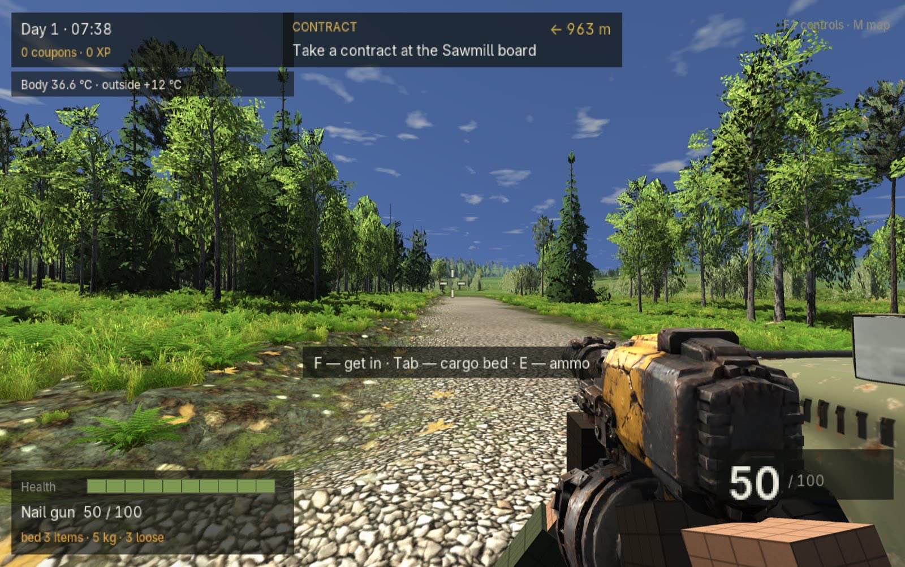

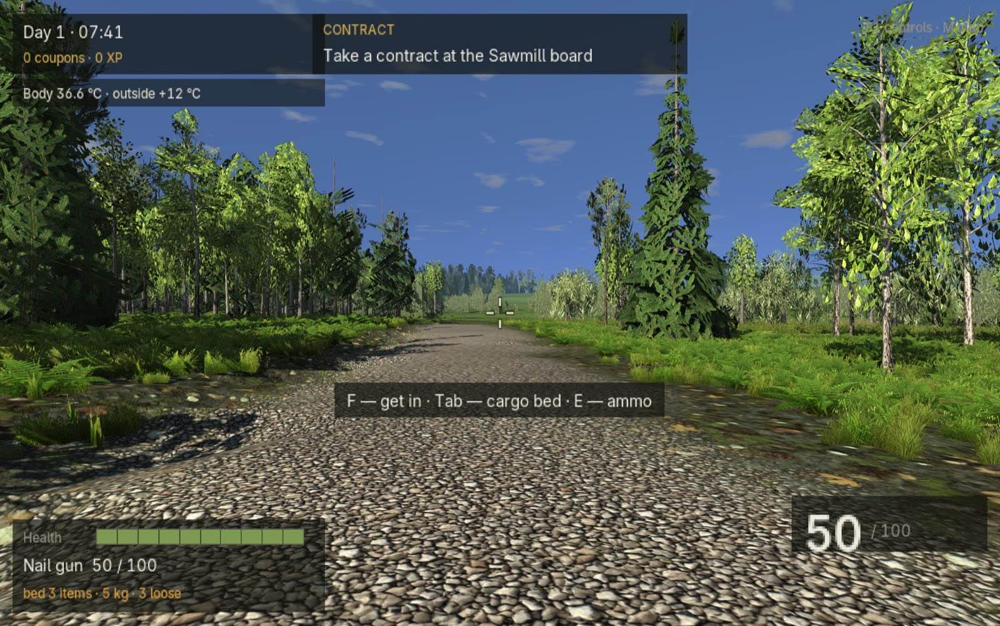

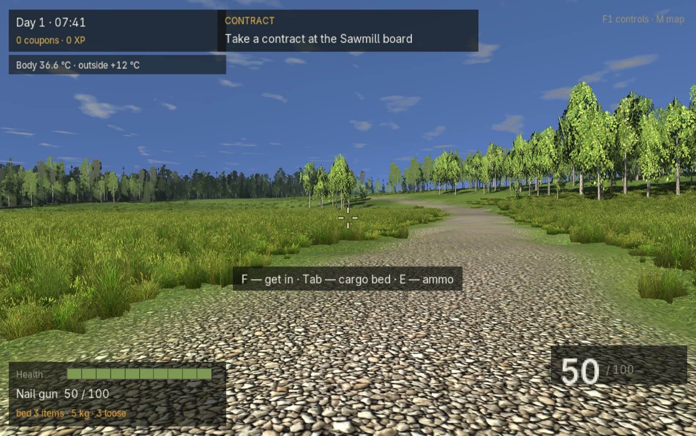

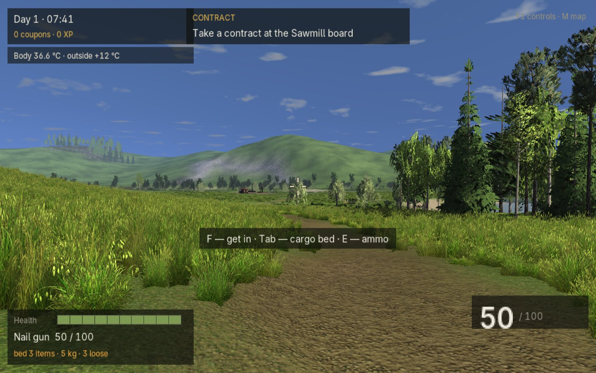

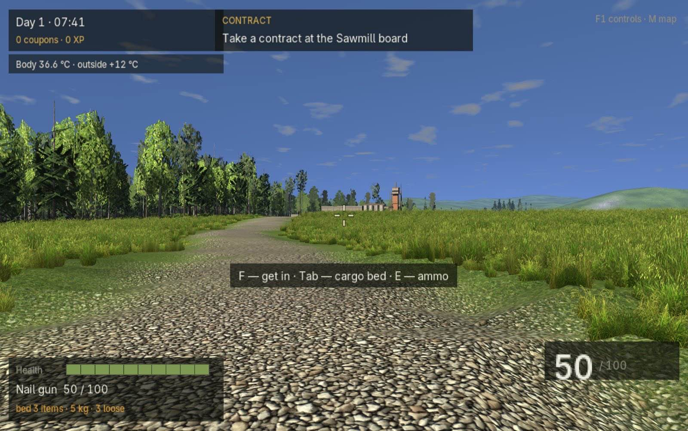

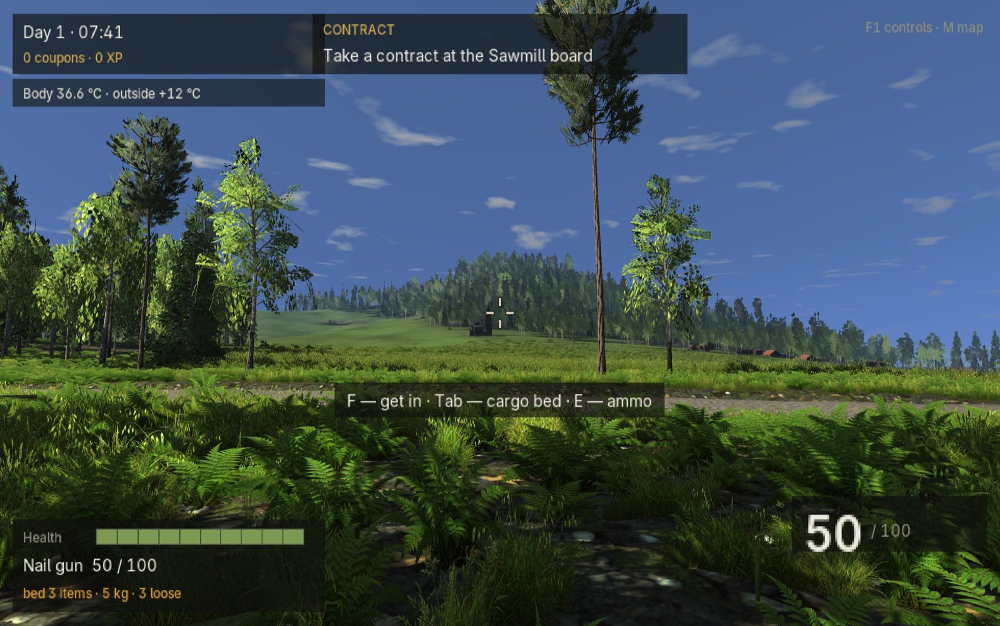

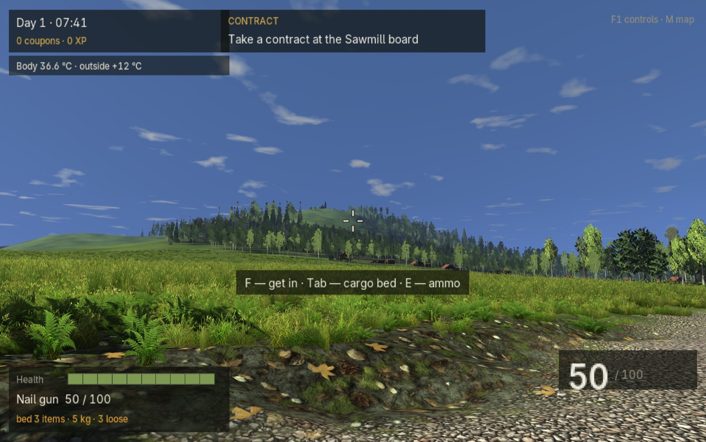

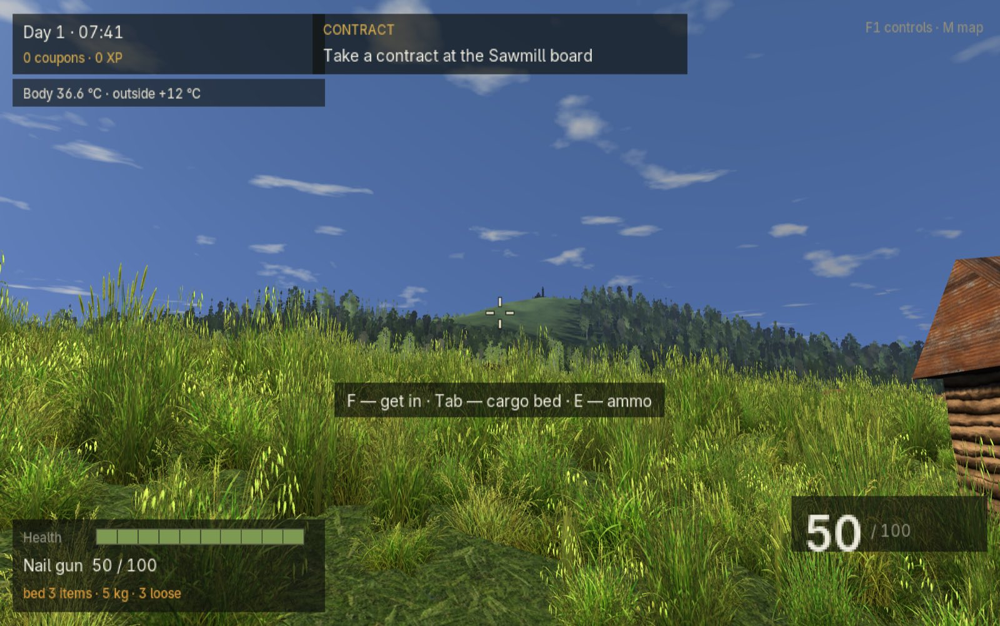

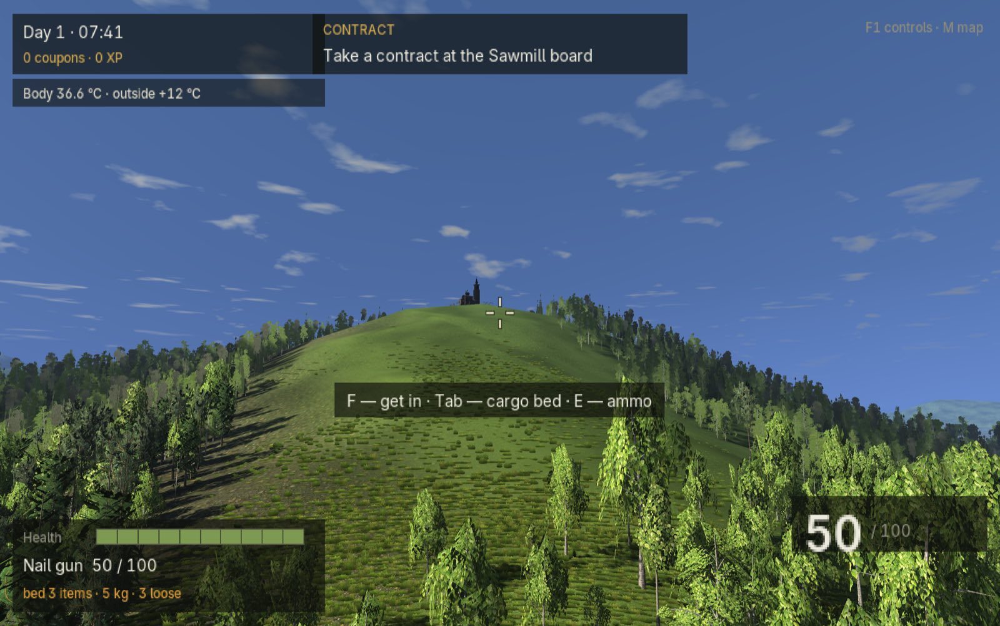

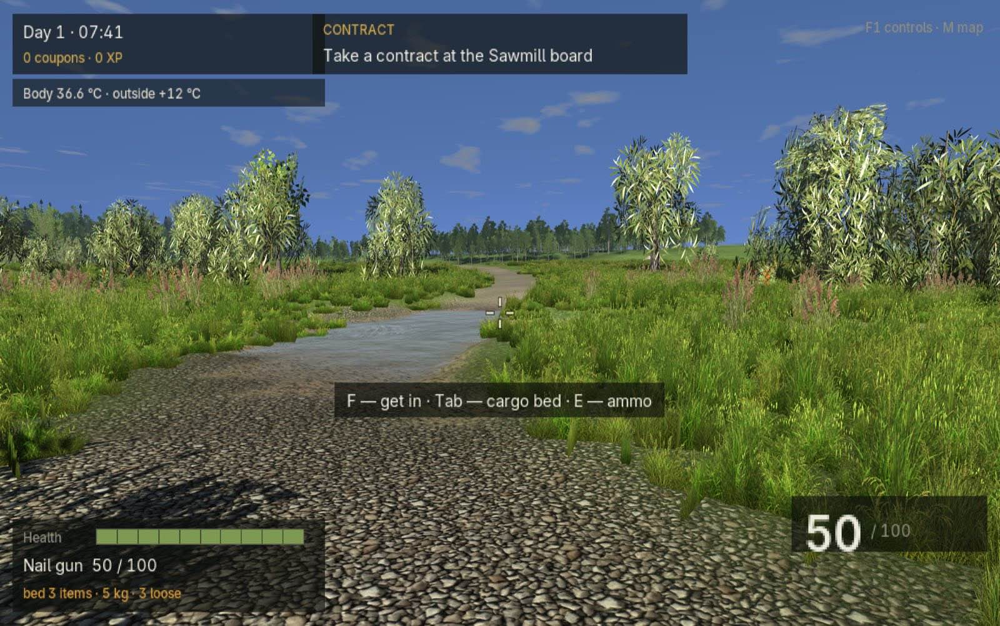

## 108. Sun shadows: soft contact-hardening edges, light dappled foliage, and smooth motion with no once-a-second jumps at dawn and dusk

13:45 · LS2 SOFT SHADOWS

Коммит: [4befde8ed1](https://github.com/shsanek/EXEcutor/commit/4befde8ed1)

The once-a-second jump came from the game clock. The atmosphere got the integer game minute, so with the 24-minute day the sun itself stepped 0.25 deg every real second. It now gets the fractional minute (presentation only, sim hashes unchanged). The shadow light direction now follows the sun every frame. Texel snapping is anchored to a pivot near the camera, so rotation no longer re-rasterises every edge. Cascades refreshed every 2nd/4th/8th frame keep their previous map and crossfade into the new one over the interval, so the far cascades glide instead of switching. The lookup is PCSS-style: a 6-read blocker search, a penumbra that grows with blocker distance (4-12 cm), 8 rotated hardware-compare taps and a receiver-plane depth bias. Shadows are tight at a pole's base and soft at its lamp. Branches high above the ground let a quarter of the sun through, so crowns cast light, dappled shade. Below 2 deg the direct sun now fades out instead of popping to unshadowed. Win32 SM2 bytes unchanged.

- ✓ native-release ctest: 38/38; sun_shadow_render_check adds contact hardening (59 -&gt; 119 mm edge), sub-2-deg fade, moving-sun stability, GPU microbench
- ✓ cargo / vehicle / play_cargo / farm / timewarp / winterplow / play_care: 19/19, 79/79, 40/40, 18/18, 10/10, 7/7, 17/17
- ✓ temporal stability (tools/shadow_stability.py, 240 frames, sun at game speed): spike ratio live clock 21.8 -&gt; 1.09, dawn 8.2 -&gt; 1.2, dusk 7.9 -&gt; 1.1; p99.9 pixel change 46 -&gt; 15 (live), 81 -&gt; 16 (dusk)
- ✓ perf_tour native 1280x720, best of 4: mean/p95 9.15/18.78 -&gt; 8.90/18.78 ms (shared Mac, run noise about 1.5 ms); lookup 0.23-0.26 -&gt; 0.29 ns per shaded pixel
- ✓ shaderc: every SM2 .bin/.asm unchanged; 47 tests
- ✗ LS2a / LS2d: the airy term keys on blocker height (tall walls lighten slightly far out); last 2 deg before sunset has no direct sun

## 109. Altai climate, persistent weather and climate-driven foliage: leaves grow in spring, fall in swirls in autumn

13:53 · WX1 CLIMATE

Коммит: [51714dda25](https://github.com/shsanek/EXEcutor/commit/51714dda25)

Temperature follows the monthly normals of the Katun foothills (Biysk and Gorno-Altaysk station tables) through a meteorological calendar (each game season covers its meteorological season), plus a seeded synoptic anomaly and a weather-dependent daily range. Weather persists: rain or snow after a clear spell is preceded by 1-3 game hours of cloud build-up (towering cumulus before storms), intensity ramps in and out over 50 game minutes, rain/snow is decided from the segment temperature with hysteresis and snowfalls last at least 4 game hours (shortest 3.5 h over 32 seeded years). Leaves follow growing degree days and autumn senescence (frosts, short days, cold); over 32 years with the snowpack there is not one minute of green leaves over snow; budburst day 113-144, colour from day 238-253, bare by day 270-291. Hoarfrost and rime whiten grass and trees on frosty calm mornings and in freezing fog. A baked per-leaf map lets each leaf grow from its centre in spring and drop one by one in autumn (native statements, SM2 keeps the per-tree switch). A cheap leaf particle pass (one draw, &lt;= 640 leaves) sheds leaves from nearby crowns with gust bursts, swirls them behind the truck over litter and kicks them on foot; litter follows the canopy onto forest-edge roads, darkens when wet, hides under snow. Cloud coverage, genus mix, base/top, density, wind, front and storm build-up are exposed for the cloud renderer (CL1). Perf: perf tour 9.54 -&gt; 8.87 ms, forest drive 4.89 -&gt; 4.25 ms (noise; leaf system about 0.05 ms). docs/seasons.md section 10.

- ✓ season_tests: 15/15
- ✓ native ctest: 38/38
- ✓ cargo/vehicle/play_cargo/farm/timewarp/winterplow/play_care: all pass
- ✓ green leaves over snow, 32 years: 0 min
- ✓ shortest snowfall: 3.47 h
- ✓ perf budget +0.5 ms: about +0.05 ms

## 110. Spare wheel removed, a modelled under-seat box with a flush lid as a small storage slot, fuel that lasts 2-3 in-game days

14:05 · TK2 TRUCK BOX

Коммит: [8584479729](https://github.com/shsanek/EXEcutor/commit/8584479729)

Owner requests. 1) The TP1 spare under the rear overhang and its cradle are gone (HERO truck and the legacy part tree); punctures and the wheel swap stay deferred, no jack is shown. 2) The box under the driver's seat is modelled in Blender as part of the cab (numbered copies assets/truck_wb/stage27_tk2_seat_box_{authoring,baked}.blend, the owner's open scene untouched): an opening cut through the cab side behind the driver door, a 0.57 m tub inside the seat base with a rubber seal ring and two hinges, and a flush 13 mm lid whose outer face keeps the panel's baked paint and rust; it swings out 100 degrees on its rear hinge. In the game it is a 1x3 cargo hold: E stows what you carry if it fits, E with empty hands takes the last item and then the winch cable kit (it lies behind the items after the winch upgrade), Tab arranges the box on the cargo screen; saved. 3) Fuel: a running engine now burns per in-game hour (0.42 l idle, +1.22 l with the pedal down) plus 37.5 l/100 km; a measured in-game day of driving takes 22.5 l (was 1.9 l), so a full 60 l tank lasts 2.7 days. Two to three times the old rate would still have lasted 11-16 days, so the days target set the numbers. Prices unchanged; contract 1 and 2 rewards +30/+20 keep the first-T2 pacing; the expense band is retuned to 15-26 % (fuel 6-12 %).

- ✓ ctest --preset native-release: 38/38
- ✓ view_tests: 40/40 (lid flush behind the door, sweep never deeper than the closed lid, opens outward)
- ✓ play_care_tests: 17/17 (box: stow, refuse when full, save/load, take order, winch kit, close, auto close)
- ✓ cargo/vehicle/play_cargo/farm/timewarp/winterplow tests: 19/19, 79/79, 40/40, 18/18, 10/10, 7/7
- ✓ economy_tests + peregon_economy_sim seeds 1-40: 16/16; every design check OK (net 1 167 per hour, expenses 21 %, fuel 9 %, one T2 at 16:20, two by 0:30)
- ✓ fuel day (play_region_fuel_day): before 1.9 l/day (tank 32 days), after 22.5 l/day (tank 2.7 days)
- ✓ frame budget (native Metal, care_truck_look, 3 runs): avg 9.00 -&gt; 8.87 ms, p95 16.49 -&gt; 16.23 ms, draws 1 310 -&gt; 1 282

## 111. Precipitation stops at roofs and crowns, dry and snow-free ground under roofs, snow caps on roofs/fences/truck, better puddles with optional reflections, frozen slippery puddles

14:35 · WX2

Коммит: [8f8afd933e](https://github.com/shsanek/EXEcutor/commit/8f8afd933e)

Top-down sky occlusion map (12.5 cm, lazy 16 m tiles from POI kit boxes, props and tree crowns; 64 m GPU window repacked after 8 m): rain, snow and falling leaves fade out below the occluder top, thin under crowns. Ground snow mesh scaled by a shelter factor (indoor 0, eave taper, +45 % windward drift, lee loss), 25 cm refinement near walls with an exact vertical cut on the wall line and a skirt; terrain snow layer and wet gloss removed under roofs through a new native sky_shelter() shader builtin (RHI set_sky_shelter, ABI 3). Roof caps from every up-facing occluder triangle: slope and tin sliding, soft edges, overhang lips, no caps under other roofs; incremental 8 m cells, rescaled during snowfall. Truck snow on hood/cab/bed: accumulates parked, blows off when driving, warm hood melts. Puddles follow hollows (Hessian axis), wet rim, silt, rain ripples, four shapes; Settings &gt; Graphics puddle reflections (off by default: sky colour; on: reflected ray traced through the height map). Puddles freeze below 0 C (ice + white cracks) and thaw in sun; frozen puddles cut tyre grip (braking 8.6 m -&gt; 42 m from 12 m/s) and make feet slide. Perf (native, best of 3, mean/p95): perf_tour 8.42/18.62 -&gt; 8.67/18.40 ms; wx2 tour 11.05/20.30 -&gt; 11.68/20.90 (reflections off), 12.30/21.77 (on); autumn rain +0.25, winter +0.73, snowfall +0.90 ms. docs/precipitation.md.

- ✓ native ctest: 39/39
- ✓ sky_occlusion_tests: 10/10
- ✓ vehicle_tests: 81/81 (frozen puddle grip)
- ✓ cargo/play_cargo/farm/timewarp/winterplow/play_care: 19/19 40/40 18/18 10/10 7/7 17/17
- ✓ cab_render_check: GPU roof map culls particles
- ✓ shaderc tests: sky_shelter: SM2 bytes unchanged

## 112. Dig anywhere: a deformable soil layer - pits, trenches and spoil piles in any soil, real ground for walkers and the truck, rendered as a 25 cm detail mesh

15:13 · SH2 DIGANYWHERE

Коммит: [fc63916ddf](https://github.com/shsanek/EXEcutor/commit/fc63916ddf)

The shovel digs soil anywhere (dirt, grass, mud, sand, takyr): LMB bites about 18 L and loads the blade, the next LMB throws the load where the player aims, forming piles that slump to a 38 deg angle of repose; depth limit 1.2 m (slower as it deepens); roads, rock, ice, water, building pads and roots refuse with a banner. A new core SoilField (25 cm nodes in 4 m chunks, saved in section 145, hashed only when used) conserves the dug volume, erodes by game time (slowly dry, about half a 1 m pit in two rain days, frozen under snow), dries from dark fresh earth to lighter dirt and fills with snow in winter. Walkers step down into holes, climb piles and cannot climb pit walls steeper than about 50 deg (new combat Ground::wall); the truck's wheels drop into pits, ride over piles and are jolted by a trench (World::ground, tilted normals). Rendering: per touched 64 m terrain chunk a 25 cm detail mesh that interpolates the drawn terrain lattice exactly (no seams) plus a terrain index buffer with the covered quads cut out, drawn with the terrain programs, near material normals, far overlay and sun/spot shadow casters; only touched chunks rebuild (0.37 ms per stroke). Grass, crops and small plants vanish on dug ground; the snow mesh lies on piles and in pits. Wheel dig-out and snow digging unchanged. Native only. Details in docs/tools.md (Digging anywhere).

- ✓ ctest native-release: 38/38
- ✓ vehicle_tests: 83/83: 674 L dug and thrown, net 0.00 L, steepest pile 0.78, wall 2.40; pit 1.17 m: 3 dry days 1.10, 3 rain days 0.42, frozen 1.17; wheel hub -0.23 m into a pit, +0.37 m on a pile; 1.2 m trench: wheel 0.33 m down, 44 -&gt; 21 m in 6 s
- ✓ play_cargo_tests: 43/43: real strokes dig/throw, refusals, road pile; walker held in a 1.2 m pit through 4 s of walking and jumping, climbs a 0.78 m pile; save/load hash, 2 rain days 1.06 -&gt; 0.50 m
- ✓ map_tests (R1 pak): soil mesh height error 7 um vs terrain + soil, untouched quad corners exact, chunk seam identical, one stroke rebuilds 1 chunk; 29/30 (the snow seam test fails on the base too)
- ✓ cargo/farm/timewarp/winterplow/play_care tests: 19/19, 18/18, 10/10, 7/7, 17/17
- ✓ perf (native, mean/p95 ms): region replay 10.56/19.59 -&gt; 9.67/15.57; camp shovel 8.97/18.40 -&gt; 8.92/18.50; digging next to a pit 9.56/18.93 vs 11.61/20.89 idle (map 1.3 ms)

## 113. Volumetric clouds from the weather model, with cloud shadows drifting over the hills

15:13 · CL1 CLOUDS

Коммит: [774b3b6eab](https://github.com/shsanek/EXEcutor/commit/774b3b6eab)

Native Metal clouds follow the WX1 cloud state: fair-weather cumulus that grow through the day, towering cumulus that merge into dark cumulonimbus with anvils during the storm build-up, frontal decks rolling in from upwind with cirrus first, rain, and clearing. Technique after Guerrilla's Nubis (weather map + Worley detail, cone light march, powder, HG silver lining, quarter-resolution march with temporal reprojection), Frostbite (energy-conserving integration, multiple-scattering octaves, cloud shadow map) and Rockstar's RDR2 talk (one integrated field for sky, ground shadows, GI and sky greying; a cheap high cirrus layer). A 256x256 cloud shadow map over 12 km feeds every RT sun-shadow receiver (pg_sun_shadow), grass shells and the GI sun term, so shadows drift with the wind. Overcast greying now follows the real cloud coverage, so a build-up keeps sun between the towers. Lightning lights the storm clouds. Win32 keeps its dome clouds (SM2 bytes identical). Cost: 0.88 ms GPU-synchronised at 1280x720 in a sky-filling view; perf tour within noise on the loaded Mac. docs/clouds.md.

- ✓ cloud_render_check (coverage, shadows follow coverage, CPU/GPU match, drift): 10/10
- ✓ sun_shadow_render_check cloud cases: 5/5
- ✓ native ctest: 39/39
- ✓ cargo/vehicle/play_cargo/farm/timewarp/winterplow/play_care: all pass
- ✓ cloud passes GPU 1280x720: 0.88 ms

## 114. The under-seat box access moved inside the cab: a locker in the seat base panel facing the driver door, the cab skin restored

17:42 · TK3 SEAT LOCKER

Коммит: [3cad938298](https://github.com/shsanek/EXEcutor/commit/3cad938298)

Owner: the TK2 hatch was on the outer cab body; the access belongs inside, on the seat base panel below the driver's cushion that faces the open door. The TK2 opening, lid, seal and hinges are removed and the outer skin is the original geometry and UVs again (GAME_body rebuilt from the untouched pre-TK2 baked model; every face off the seat panel checked identical). Modelled in Blender, live in the owner's session (Save As assets/truck_wb/stage28_tk3_seat_box_authoring.blend) and baked for the game (stage28_tk3_seat_box_baked.blend): a 0.21 x 0.174 m opening in the seat base end panel, a 0.37 m deep primer tub inside the bench with a rubber seal ring and floor mat, a five-knuckle piano hinge along the bottom edge, and a flush 13 mm lid carrying the panel's paint and rust, with two ribs, a rubber escutcheon and a steel turn latch; it drops open 90 degrees into a level shelf. The closed lid sits 68 mm inboard of the closed door; an open lid would reach the door, so the door waits at 22 % until the lid is shut and closing the door shuts the lid first. Gameplay as TK2 (1x3 storage, E open/put/take, the winch kit behind the items, Tab cargo screen, saved), but the target is the panel under the seat and exists only with the driver door open; reachable from the open door (1.2 m); it closes on walking away, getting in or shutting the door. Text: 'Рундучок в основании сиденья — E открыть крышку'.

- ✓ ctest --preset native-release: 39/39
- ✓ view_tests: 41/41 (lid flush in the seat panel, tub inside the seat base, sweep never deeper than the closed lid or below the floor; sampled real door geometry never touches the closed lid at any door angle or the open lid above the 22 % hold; the door waits for the lid)
- ✓ play_care_tests: 17/17 (target only with the door open, reach 1.22 m from the door, stow/refuse/save-load/take order/kit, auto close on walking away, closing the door shuts the lid before the door passes the hold)
- ✓ cargo/vehicle/play_cargo/farm/timewarp/winterplow tests: 19/19, 81/81, 40/40, 18/18, 10/10, 7/7
- ✓ cab skin restored: GAME_body off the seat panel identical to the pre-TK2 model (positions and UVs); other pmesh files unchanged

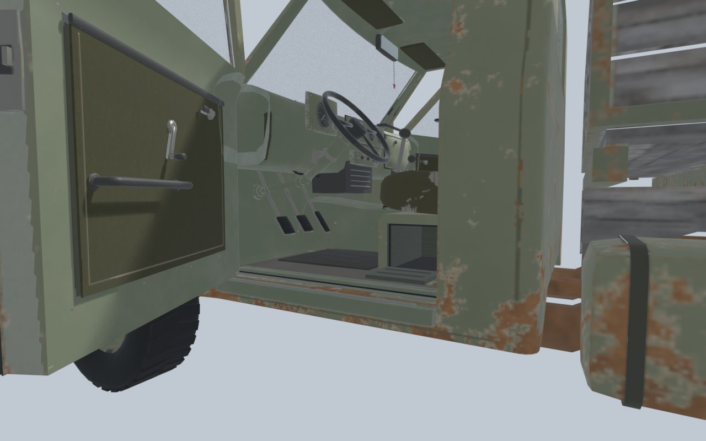

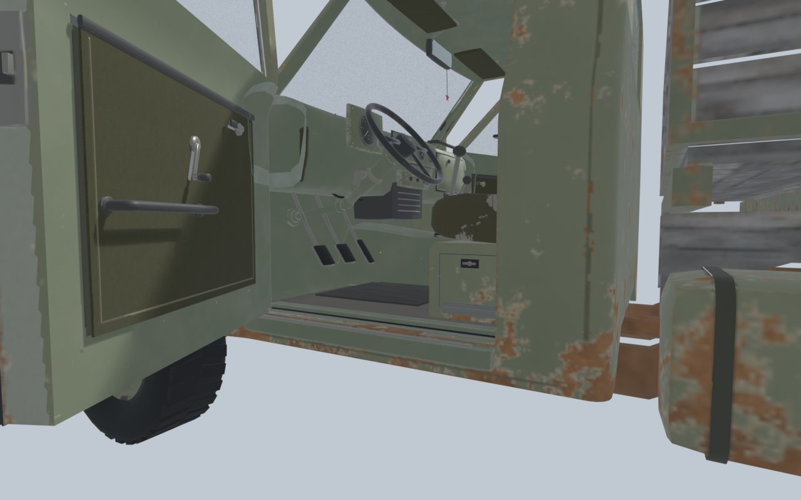

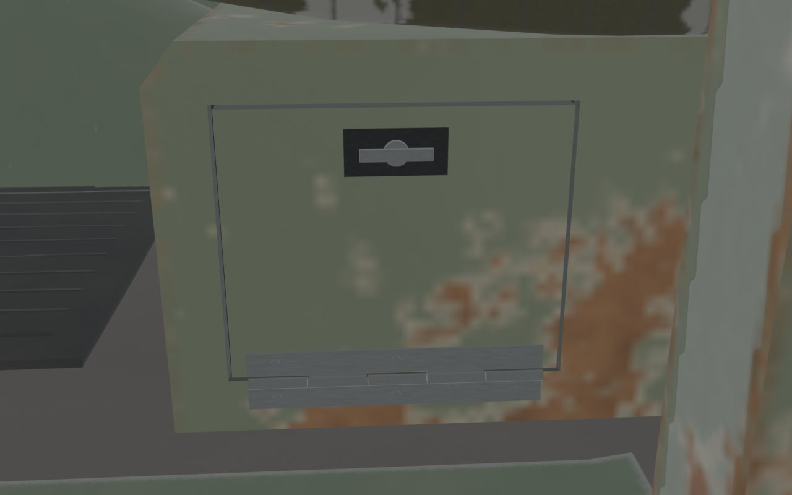

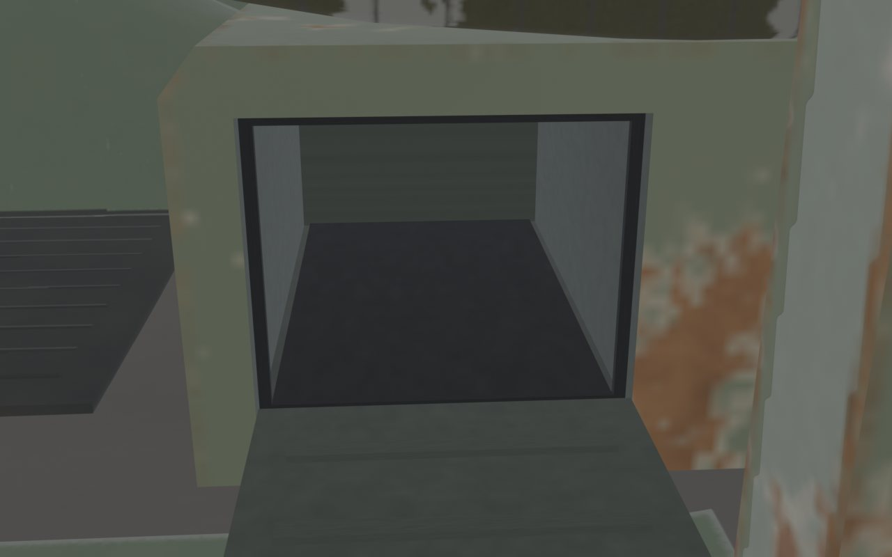

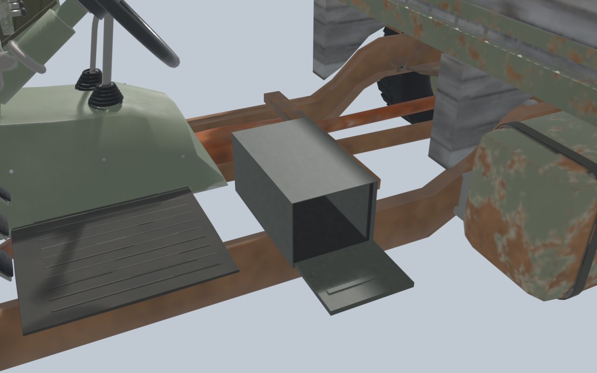

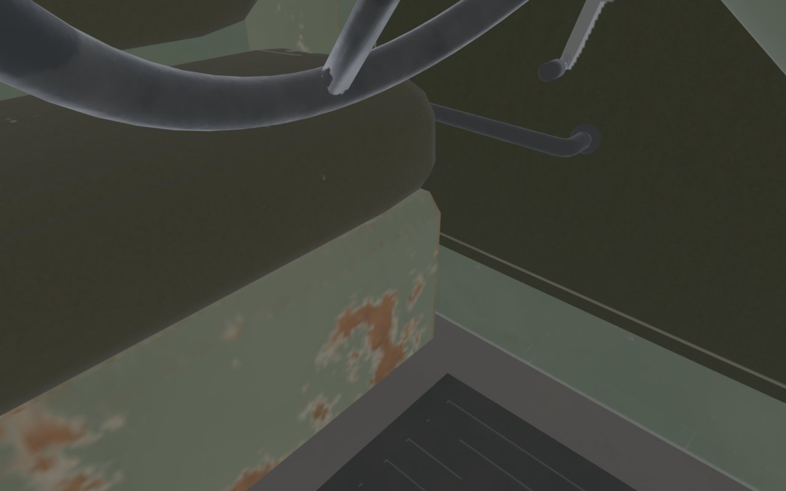

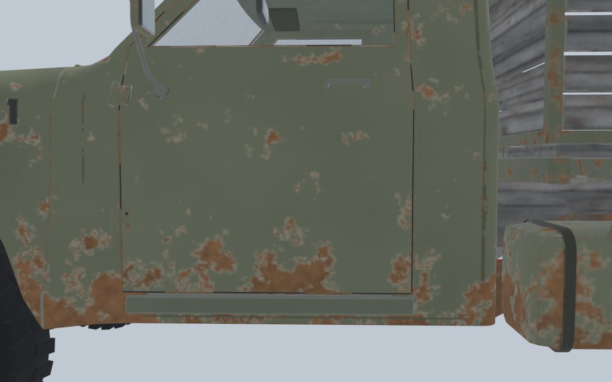

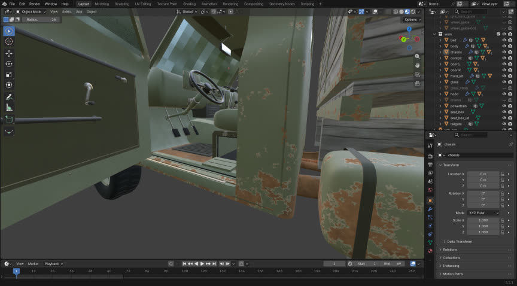

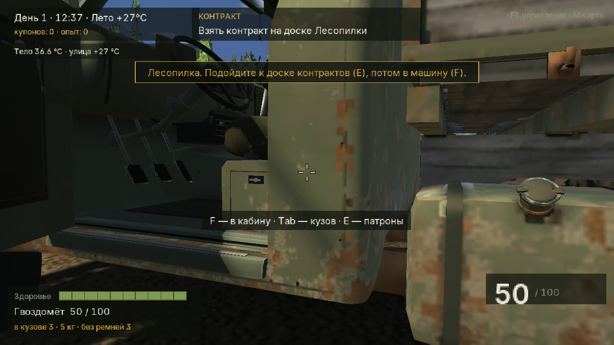

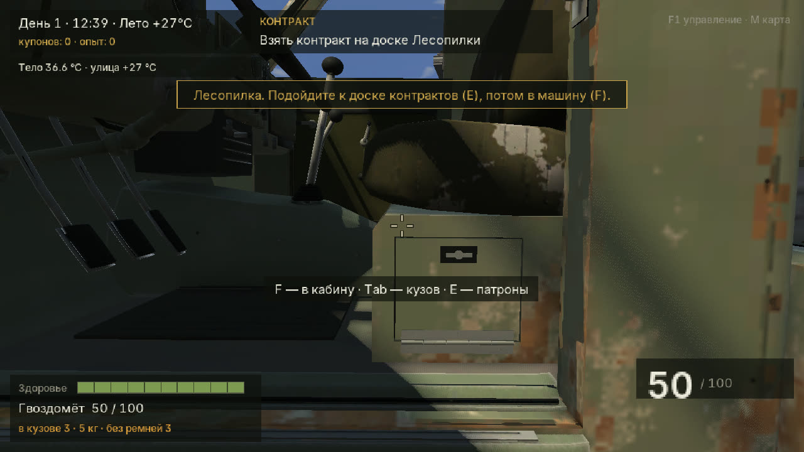

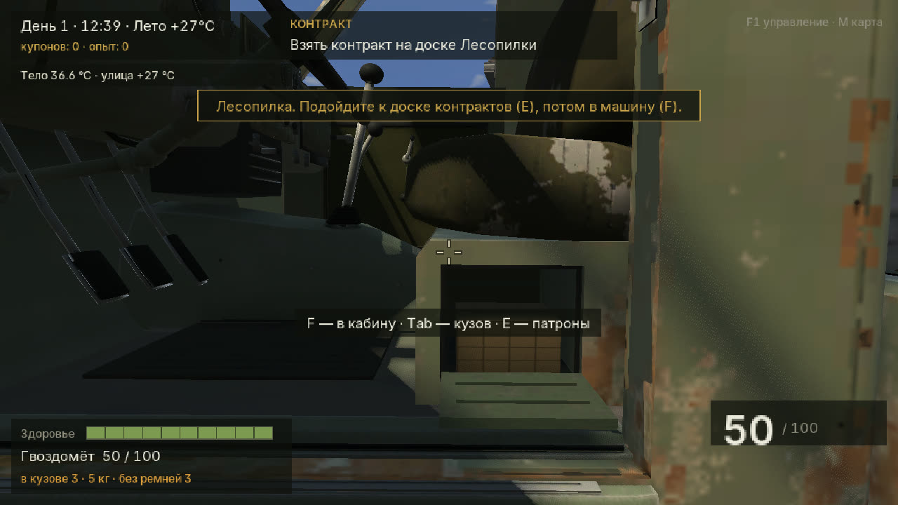

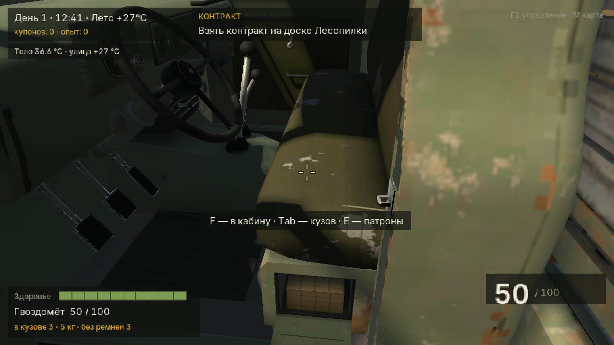

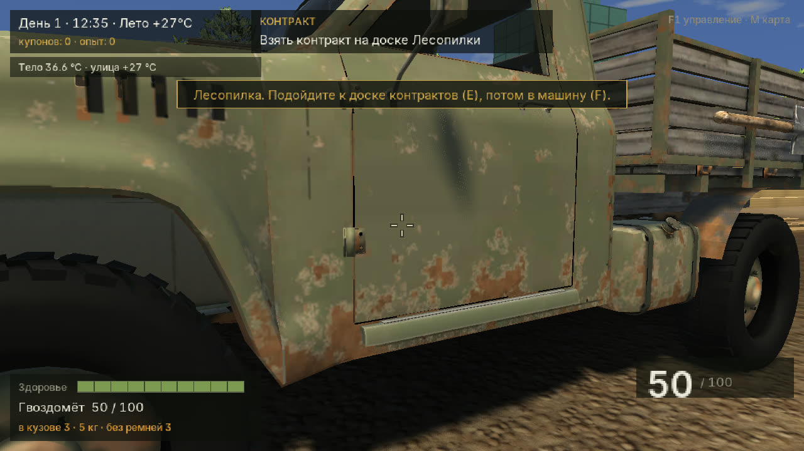

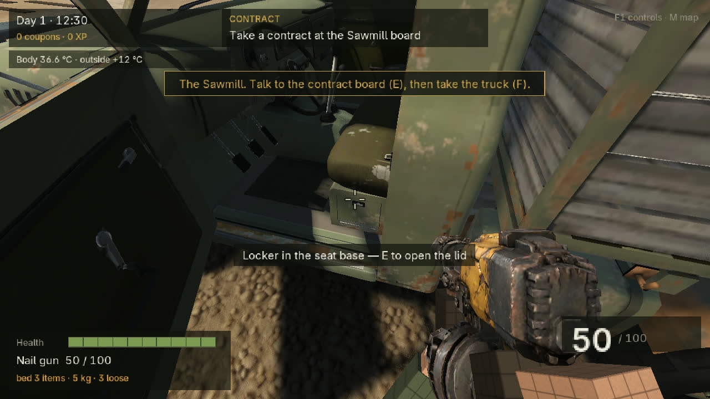

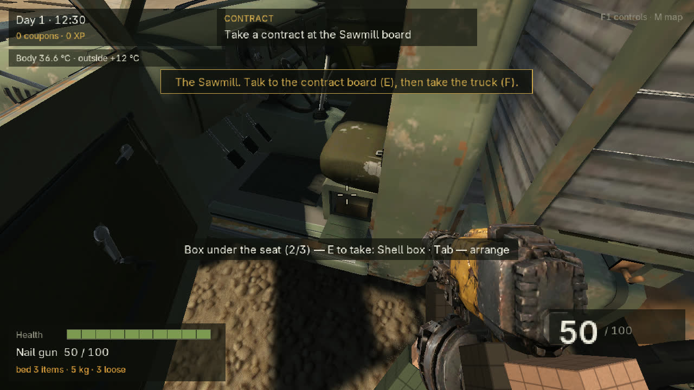

## 115. Atmosphere effects driven by the climate: breath, exhaust plumes, dust, morning mist, drifting snow, insects, rain splashes

17:42 · FX1 ATMOSPHERE

Коммит: [3cad938298](https://github.com/shsanek/EXEcutor/commit/3cad938298)

A curated, data-driven set of small effects (src/world/atmos_fx, data/world/atmos_fx.txt, one new soft-particle shader), each switched on by the WX1 climate state. Breath vapour from the player (first-person puffs low in the view, in the cab when the cab is cold) and NPCs below +5 C, stronger when running; a white exhaust plume on cold starts and in frost that thins as the coolant warms (a warm engine keeps a plume in hard frost), dark puffs on throttle steps; dust behind the wheels on dry dirt/gravel in dry weather (none when wet, raining or under snow), mud spatter on wet roads, snow powder in winter, road spray in rain; soft steam when the coolant boils (replaces the old steam boxes) and vapour off a hot wet hood; morning mist banks in hollows, over the river and fields on calm humid dawns, burned off as the sun rises; mirage pools on hot roads (partial: no screen-space distortion without a scene-colour copy); drifting snow along the ground in winter wind and snow blown off trees in gusts; midges over water at summer dusk, butterflies over meadows, poplar fluff in early June; rain splash rings on the ground and droplets on the truck, drips from trees during and after rain (roof occlusion and roof drips hook into WX2 after its merge). Particles are CPU-simulated, sorted and drawn in one alpha-blended draw after the hero truck (plus a tiny first-person pass); presentation only, sim hashes unchanged. Cost: 0.03-0.06 ms in the atmosphere section; frame deltas within run-to-run noise across six worst-case scenarios. docs/atmosphere.md.

- ✓ atmos_fx_tests: 15/15
- ✓ native ctest: 39/39
- ✓ cargo/vehicle/play_cargo/farm/timewarp/winterplow/play_care: all pass
- ✓ perf budget +0.7 ms: 0.03-0.06 ms section, deltas in noise
- ✗ heat shimmer distortion: partial (needs an RHI scene copy)

## 116. Power lines: a mapgen tool lays old leaning 10 kV and 0.4 kV lines with kiosks across R1 and R2; poles from kit primitives, catenary wires with haze

17:42 · PL1

Коммит: [3cad938298](https://github.com/shsanek/EXEcutor/commit/3cad938298)

tools/map/powerlines.py routes map/regions/*/powerlines/*.json between settlements and POIs: A* on 8 m with slope/climb/road-proximity costs (not along roads), road and river crossing angles (&gt;= 45 / 55 deg), string pulling to angle poles, gentle 1-2.6 deg bends on long runs, spans by class (10 kV ~64 m, 0.4 kV ~38 m), extra poles on hilltops for clearance, kiosk (KTP) sites outside compounds, village street lines that may change sides, branch taps. Seeded wear: lean, missing insulators, stolen spans, snapped and fallen wooden poles with wires on the ground (Berezovka). Baked as the PWRL tile block (poles on the baked ground + tree-clearing corridors). Runtime: poles as static kit ExtraObjects (concrete SV posts with crossarms, wooden poles on concrete stubs, struts, A-frames, kiosks), wires as camera-facing ribbons (wire_lit.pgsl, min 0.62 px, coverage alpha, same aerial haze), trees cleared under the lines. 12 lines, 139 poles, 8 kiosks. Perf (native, 3 interleaved pairs, r2 border drive): work mean 8.45 -&gt; 8.62 ms (+0.17), p95 14.77 -&gt; 14.97 ms. Sources (PUE-7, SV post catalogues, KTP datasheets, theft reports) in docs/powerlines.md.

- ✓ powerline_check: OK: poles on the ground (err 0.015 m, base never above), clear of carriageway (&gt;= 1.62 m), water, buildings, fences; spans and crossing angles in limits; 10 low-wire warnings on old lines
- ✓ r1check R1 / --r2: OK / OK
- ✓ native ctest: 39/39
- ✓ cargo/vehicle/play_cargo/farm/timewarp/winterplow/play_care: 19/19 81/81 40/40 18/18 10/10 7/7 17/17
- ✓ shaderc check: 402 files

## 117. Rain splashes only under open sky, streams and drips off roof eaves, conifers shed snow, NPC breath from the head

17:42 · FX1b ATMOSPHERE x WX2

Коммит: [3cad938298](https://github.com/shsanek/EXEcutor/commit/3cad938298)

FX1 atmosphere effects now read the WX2 sky occlusion map. Splash rings and droplets fall only under open sky: none under the Sawmill shed roof, porches or inside the home container, and fewer under tree crowns. Truck-top droplets stop when the truck stands under a roof. A new SkyOcclusion::eaves scan finds the roof edges on the occlusion map: lower edges of pitched roofs weigh most, gables little, and fences, rails and stove pipes are skipped. In rain, thin streams run off the eaves (spouts about every 0.6 m with a drop of at least 1.7 m), and drips continue while the ground stays wet. Every drop splashes on the ground or on the lower roof below. Spruces and pines now shed snow in gusts: bigger bursts over the cone of branches, with falling clumps, biased toward near trees in the view. NPC breath leaves the mouth of the posed head joint and follows head turns, instead of a fixed point at 1.68 m. Power lines (PL1) are not occluders (backlog FX1-5). docs/atmosphere.md section 8.

- ✓ atmos_fx_tests: 18/18 (3 new: eaves vs occlusion map, splash/drip placement under a roof, conifer snow)
- ✓ native ctest: 41/41
- ✓ cargo/vehicle/play_cargo/farm/timewarp/winterplow/play_care: all pass
- ✓ perf budget +0.7 ms: atmos section +0.10-0.12 ms near roofs in rain, 0 elsewhere; frame deltas are load noise

## 118. Clouds round 2: no cut cloud bottoms, fewer larger cumulus, tower groups at the horizon, cloud quality setting

18:02 · CL2 CLOUDS

Коммит: [56cea07ac8](https://github.com/shsanek/EXEcutor/commit/56cea07ac8)

Owner: cloud undersides looked like camouflage because they were cut at the bottom. Cause: cumulus cores started at full density on the layer-base plane (148 of 175 fair columns, 575/1526 overcast, 808/1631 storm), so the flat cut exposed the core where the noise was high. Density now ramps in over 60-250 m above a noise-varied base and cumulus cores have no holes: from below a cloud is darkest in its core and fades to the rim. Fair cumulus grow on 2 km cells (fewer, larger, softer), towers cluster by a 16 km regional field so build-ups show separate tower groups, towers have turrets instead of pillar sides and no grain at distance. New Settings -&gt; Graphics -&gt; Clouds: Flat (old 2D dome clouds, no passes, no cloud shadows) / Low / Medium / High, --clouds off|low|medium|high. GPU at 1280x720 on a quiet GPU: fair horizon 0.77 / 1.05 / 1.35 ms (CL1 0.7), build-up horizon 3.7 / 3.6 / 4.3 ms, off 0. docs/clouds.md 7.7.

- ✓ cloud_render_check (soft bases x3 weathers, clouds from below: opaque core darker than rim): 26/26
- ✓ columns cut at the layer base (fair/overcast/storm): 148/575/808 -&gt; 0/0/0
- ✓ native ctest: 41/41
- ✓ cargo/vehicle/play_cargo/farm/timewarp/winterplow/play_care: all pass
- ✓ clouds off cost: 0 passes

## 119. Autumn leaf atmosphere: leaves drift from every turning crown, a leaf carpet grows under the trees, a leaf in a puddle

18:02 · LF2 LEAVES

Коммит: [56cea07ac8](https://github.com/shsanek/EXEcutor/commit/56cea07ac8)

Leaves are cut algorithmically from the birch, aspen and shrub leaf atlases (connected leaves, solidity and width-profile tests against overlaps) into a 16-leaf sprite atlas and a tiling multi-coloured leaf-litter texture whose per-texel rank reveals leaves in the order they fall. Each tree sheds leaves from its own phenology state (its colour turn and fallen share, the same hash as the tree shader): nothing from green or bare trees, a smooth rise while the crown yellows and thins and a smooth fade as it goes bare. Up to 2 200 textured 3D leaves flutter, tumble and spiral near the player (a near-field emitter keeps them passing the camera under the crowns), catch the sun with back-light glow and glints, are shadowed by the sun cascades, and are pushed by gust puffs that also lift flurries from the carpet; GPU-animated flecks keep the stands alive to 115 m. The ground carpet is a draped grid over 44 m that grows with the fallen share of the nearby trees, lies over the grass shells with tufts poking through, darkens when wet, browns and greys through winter and spring and hides under snow; 3D cupped leaves lie on it near the camera. Wheels kick a few leaves only where litter lies (none on bare roads), footsteps rustle one or two. Easter egg: while a wet puddle near the player is out of view, a single leaf is laid on it, slowly turning and bobbing in the rain, until the puddle dries. CPU cost about 0.2-0.35 ms in a forest. docs/seasons.md section 11.

- ✓ leaf_tests (smooth per-tree fall, carpet follows fallen share, kick-up only on litter, floating leaf only out of view): 7/7
- ✓ native ctest: 41/41
- ✓ cargo/vehicle/play_cargo/farm/timewarp/winterplow/play_care: all pass
- ✓ perf budget +0.7 ms (forest): sections +0.2..0.35 ms, A/B within noise

## 120. Frame spikes removed on the R1 -&gt; R2 drives: no frame over 16.7 ms CPU on the border and ford drives (was 170), snow drive p99 42 -&gt; 14 ms

20:37 · PF1 SPIKES

Коммит: [a7e355c1ab](https://github.com/shsanek/EXEcutor/commit/a7e355c1ab)

Instrumented the worst frames (main-thread CPU clock, per-frame build/cascade/upload counters, tools/spike_perf.py on the border, ford, forest and snow drives). Spike sources: sun-mask tile refreshes (every resident tile re-blended and re-uploaded in one frame, 17-27 MB, 8-26 ms), map tile mesh builds (12 chunks per frame ~1 ms each, urgent near tiles 40 ms), the cab glass frost/drops maps in snow (4 x 512x512 per update, 11-18 ms) and the far sun cascade (4.5-6 ms every 8th frame). Fixes: tile meshes on 4 worker threads with the same deterministic install frame (byte-identical captures), stale sun masks refreshed two per frame nearest-first on a worker, glass maps computed in parallel (byte-identical), the far cascade split over the two frames of the 8-frame cycle that only render cascade 0 (into the back slot, published on the second half). Captures differ from before by at most 0.23 % pixels (later far-cascade crossfade). Before/after CPU ms (mean / p95 / p99 / max): border 9.09/17.56/24.62/30.76 -&gt; 8.44/9.56/10.22/13.14, ford 7.38/16.11/19.91/27.78 -&gt; 7.44/9.21/10.08/14.66, forest 8.92/12.58/12.97/18.16 -&gt; 8.15/9.11/9.52/23.29 (one host stall), snow 16.19/27.36/41.73/50.66 -&gt; 10.01/13.16/14.11/25.48. Details, wall-clock table and backlog in docs/perf.md (PF1).

- ✓ ctest --preset native-release: 40/40
- ✓ cargo/vehicle/play_cargo/farm/timewarp/winterplow/play_care: 19/19, 85/85, 43/43, 18/18, 10/10, 7/7, 17/17
- ✓ region_stream_check (R1+R2 pak): OK
- ✗ map_tests (R1+R2 pak): 29/30: snow-mesh test, pre-existing
- ✓ frames &gt; 16.7 ms CPU, border / ford / snow: 170 / 171 / 1541 -&gt; 0 / 0 / 5
- ✓ captures vs before (30 frames, 4 replays): &lt;= 0.23 % pixels changed, 4 px &gt; 24 levels; glass/snow identical

## 121. Dashboard: wide toggle-switch panel with icon plaques on top, gauges below, click anywhere on a card

21:43 · TK4 DASH TOGGLES

Коммит: [d5bbef3aa3](https://github.com/shsanek/EXEcutor/commit/d5bbef3aa3)

Owner: the old small switch panel was hard to hit. Done in the live Blender session (stage 29): the button panel moved up and widened to the gauge-row width, the four small gauges moved down under it, six chrome toggles (headlights, wipers, choke, glow-plug preheat, heater, defrost) with aluminium icon plaques. In game the toggles flip down (off) / up (on) from the existing control states; the panel is split into six full-height cards and a click anywhere on a card toggles it. The old LIGHT pull knob, pull knobs, lettering and the cloned knobs on the grille are removed. Pipeline: install_dash_toggles.py (baked stage 29), paint_dash_toggles.py (interior atlas swatches and plaques), export_hero_runtime.py reads runtime_motion from object properties.

- ✓ view_tests: 41/41
- ✓ play_cargo_tests: 43/43 (headlights and heater through the cards)
- ✓ play_care_tests: 17/17 (choke, preheat, defrost through the cards)
- ✓ vehicle_tests: 85/85
- ✓ glass_weather_tests: 17/17

## 122. Co-op network mode planned: host-authoritative, one shared replicated world, internet join by code from stage N1

22:05 · NET0 PLAN

Коммит: [dbe8574d2a](https://github.com/shsanek/EXEcutor/commit/dbe8574d2a)

Planning only, no game code. docs/coop.md: owner decisions (4 players, one shared truck with driver/passenger/bed seats, LAN + internet for the Tallinn friend, no chat, one identical world, visual effects local), 10 single-player assumptions with file references (one Input per tick, Mode mixing place and screen, per-player single fields, one combat player and foot world, UI inside the sim and its hash, camera-ray interactions, no seat model, sim state in PlayScene not saved/hashed: river ice holes, atmosphere, seasons shift, puddles, dev keys; one streaming focus; global pause/warp/sleep). Architecture: host runs the only simulation, 20 Hz delta snapshots, client predicts its own on-foot character (and later the truck when driving), world layers (ruts, snow tracks, drifts, soil, farm, ice holes) replicated as dirty-chunk int16+LZ4 patches with per-layer hashes compared across instances; ENet (MIT) over UDP, LinkSim harness, rendezvous + relay daemon planned on executor32.com (not touched). Stages N0-N11 with gates; friend can test from N1 (probe) and N2 (same world as a spectator), fully from N7.

- ✓ code study: play.h, play_game/foot/scene/save/seasons/river_ice, snowpack, soil_field, snow_drifts, ruts, vehicle World, replay formats, runner

## 123. Lake scout next to R1/R2: no natural hollows, six barrier/dug options, biggest the Olkhovka reservoir (87-148 ha, up to 285 ha)

22:20 · LK0 LAKES

Коммит: [0d093ae9bd](https://github.com/shsanek/EXEcutor/commit/0d093ae9bd)

Analysis and proposal only, no map changes (docs/lakes-scout.md, tools/lake_scout/). The L0 macro is a hydrologically conditioned DEM: priority flooding finds no depression deeper than 0.3 m, so every lake needs a barrier at a valley neck or digging. Dam-site scan over all streams within 3 km of the baked window (crest +3..+35 m, lake must not touch R1/R2) plus a floodplain scan for dug lakes. Options by neighbouring strip: A Olkhovka reservoir E/SE of R1 (dam 0.6 km past the R1 SE corner; +5/+8/+12 m = 48/87/148 ha, max in strip +20 m = 285 ha, dam 528 m x 9 m at +8); B neck lake E (a 1 km basin behind a 24 m rock sill: 26/45/65 ha, compact); C north side-valley lake on the far bank (21/32/48 ha); D Bystraya floodplain oxbow cluster N (5 dug lakes, 23 ha, no dam); E Kedrovka gorge lake W (10/24/42 ha); F south pond on the R2 edge (13/19/28 ha). Recommendation: the Olkhovka cascade A +8 m + B +5..8 m = 132 ha in two steps, reached by extending R1's Olkhovka valley road ~2 km east; second choice north lake country C + D. Bake gap: lakes only carve today, dams need a raise feature (backlog LK2).

- ✓ closed depressions in the macro (&gt;0.3 m): 0 in a 21 x 19 km box around R1/R2
- ✓ options touching the R1/R2 strips: 6 (A, B E/SE; C, D N; E W; F S)
- ✓ map sources changed: none (r1 bake stamp unaffected)

## 124. Co-op N0: world env moved into the simulation, saved and hashed per layer; dev keys are recorded commands

22:48 · NET N0

Коммит: [63e6ce62ba](https://github.com/shsanek/EXEcutor/commit/63e6ce62ba)

River ice holes/cracks, atmosphere clock and weather blend, seasons shift, puddles and the dev clock moved from PlayScene into play::WorldEnv owned by Game (stepped only from sim_step), saved in new optional sections 152/153 (also cab doors, windows, hood, tailgate, wipers, exact fuel) with a little-endian byte writer; old saves load. Dev keys Y/F5-F8/F10/F11 are EnvCommand bits in the input (text replays: optional 7th token). Manual save/load now run at the end of the world step, so a load restores exactly the saved tick. Game::hash() split into world_hash() + ui_hash(); layer_hashes() gives 15 layers (env, snow, drifts, ruts, soil, farm, ice, cargo, truck, physics, care, director, sites, players, world); --layer-trace and tools/net/layer_compare.py / layer_replay.sh print and compare them. Residents use the director clock only; foot ice no longer depends on render-side sky occlusion. Owner answers recorded in docs/coop.md: cross-play macOS/Windows, relay pending (direct UPnP/NAT-PMP first), shared wallet with per-player XP, friendly fire on.

- ✓ net_world_tests: 6/6: replay command token, cab/env round trip, old save loads, commands replay identically, save-&gt;load restores 12 saved layers and continues identically, ice hole survives save/load (R1 map)
- ✓ layer replays: home_q5_door_sleep 6000 ticks and net_n0_winterplow 4800 ticks: two runs equal on all layers every 600 ticks (tools/gate.sh n0 PASS)
- ✓ ctest native-release: 42/42
- ✓ direct tests: cargo 19/19, vehicle 85/85, play_cargo 43/43, farm 18/18, timewarp 10/10, winterplow 7/7, play_care 17/17

## 125. Co-op network layer: ENet transport, relay with join codes on executor32.com, LinkSim, connection probe in the game, friend kit

23:15 · NET N1

Коммит: [aca77681cd](https://github.com/shsanek/EXEcutor/commit/aca77681cd)

New src/net (ENet 1.3.18 MIT + LZ4 1.10.0 BSD-2 vendored with licences; socket layer for BSD sockets and Winsock in src/platform; explicit little-endian wire format, no host-endian structs, so macOS &lt;-&gt; Windows cross-play stays possible). ENet runs behind loopback shims, so direct links, relayed links and the LinkSim bad-link simulator share one path; every datagram carries a SipHash-2-4 MAC keyed by the session secret. Channels: unreliable, reliable, LZ4 bulk stream. Handshake checks protocol, content and map hashes and gives slots 1..3 (4 players). Relay peregon_relay runs on executor32.com UDP 27650 as its own systemd service (nginx and the site untouched): join codes like FJTAD4, relaying, direct-path introduction, rate limits and expiry; deploy/update/stop with tools/net/relay/deploy.sh. Join order: direct (host LAN, public and UPnP/NAT-PMP-mapped endpoints) first, relay as fallback. The game starts the probe with --net-host / --net-join CODE and draws an overlay (join code, link type, RTT, loss, KB/s); peregon_headless --net-probe runs it without a scene. Friend kit: tools/net/friend_kit.sh builds a 225 MB macOS arm64 zip with Join/Host/Probe scripts and a 3-line README (xattr Gatekeeper step). The owner's router does UPnP but sits behind another NAT (WAN 192.168.13.240), so the Tallinn friend will most likely come through the relay. Remaining gate step: the owner hosts and the friend joins for 10 minutes.

- ✓ net_tests (ctest): 13/13: 10000 reliable msgs in order under 200 +- 50 ms, 20 % loss, 5 % dup, 10 % reorder (4.4 s); 4 MB bulk intact (2.7 s); forged packets rejected; protocol/content mismatch rejected with reason; relay join by code; 4 players + full
- ✓ loopback 2 instances, local relay, latency 100 +- 10: RTT avg 101.33 ms (+1.33, limit 5)
- ✓ loopback 4 instances, latency 100 +- 10, loss 2 %: RTT avg 100.79 / 100.87 / 101.00 ms, loss 0-3.3 % per direction
- ✓ loopback 4 instances, latency 200 +- 50, loss 20 %: RTT avg 198.4 / 200.8 / 201.2 ms
- ✓ internet: this Mac through the executor32.com relay, 10 min: connected 600 s, RTT avg 143.5 ms, p95 148.8 ms, loss 0.04 % up / 0.03 % down (both ends on this Mac, so the path crosses the internet twice)
- ✓ friend kit end to end: unzipped kit game joined a host by code, overlay shows the link (direct on one machine)
- ✓ win32 compile of the N1 files: peregon_net, net_tests, peregon_relay, runner.cpp, net_glue.cpp build with mingw i686 (the win32 preset is red elsewhere, not from N1)
- ✗ owner + friend in Tallinn, 10 minutes: needs the two people (runbook in docs/coop.md 9.6)

## 126. Paper road atlas behind the sun visor: generated 1986-style map, aged paper, unfold in the cab, pencil notes

23:33 · PM1 PAPER MAP

Коммит: [cf2551d13a](https://github.com/shsanek/EXEcutor/commit/cf2551d13a)

Owner request: an immersive paper map like an old Soviet road atlas. A script draws the whole 49 km world at 1:100 000 from the real map data (relief, all 749 rivers, lakes, regions, gates, camps, railway, the baked R1+R2 roads, villages, power lines; forest from the bake's biome rules) plus a 1:20 000 inset of the built valley with 10 m contours, a 28-symbol legend, locator, frame with A-K/1-10 squares and a red cover; outside the built area it generates the 1986 network (26 villages, district town, the trakt through the gates and the Seminsky pass). Inks are printed as offset plates with halftone and misregistration. A second script ages it: fibre, yellowing, 4x5 double-accordion fold creases with ink rubbed off, holes and tears at the fold crossings, ragged edges, coffee rings and fingerprints. Folded to 21x10.5 cm it lies on top of the driver's visor (stage 30, live Blender), cover down and readable from the seat. Aim at it in the cab and click/E (or M in the cab) to unfold it full screen: pan, zoom, pencil, typed pins with Cyrillic, eraser; notes are saved. On foot or outside the cab M only says where the map is; above 8 km/h it asks to stop.

- ✓ paper_map_tests: 10/10 (cannot open on foot, opens from the seat by visor and M, speed rule, notes survive save/load, old saves load clean)
- ✓ tools/paper_map/tests: 9/9 (layout, noise equals the bake noise, deterministic network and print)
- ✓ play_cargo_tests: 43/43
- ✓ view_tests: 41/41
- ✓ play_care / vehicle / glass_weather: 17/17, 85/85, 17/17

## 127. Swimming and primitive diving: water temperature by season and current, stamina, breath, cold water, recoverable drowning

23:40 · WT1 SWIM

Коммит: [17dfed71e6](https://github.com/shsanek/EXEcutor/commit/17dfed71e6)

New library src/water (peregon_water, data/water/water.txt + fish.txt): water temperature lags the climate normals (still water tau 22 days, rivers 9 days with 30 % spring water, weather anomaly share, stratification, near 0 under ice): still water peaks at 18-19 C in early August, the fast Bystraya about 15 C, late autumn 2 C. Swimming from 1.3 m depth: the body floats with the eyes 12 cm above the surface (swim plane in FootGround), 0.85 m/s (Shift 1.4), the current carries 70 %, stamina drains in 300 s (sprint 70 s, x2 in icy water, +6 %/kg carried), exhausted swimmers go under more and more, C dives / Space surfaces, breath 45 s (half in icy water), out of breath = 8 HP/s, below 20 HP the current washes you ashore alive (no instant fail). Water mixes into the body temperature (x4 heat loss, 31 C neutral): 2 min in 0.1 C water 36.6 -&gt; 34.5 C; clothes soak; guns are slung and do not fire for 90 s after; items over 20 kg sink. Wading slows walking. Teal underwater tint, HUD strength/air bars and hints, splash sounds (new water_splash/oar/reel one-shots). State saved (sections 175/176, only when not default) and hashed only when used: r2_west_ford_drive hash unchanged (1bedb9d6). The same commit already carries the fishing, auger and boat models and glue (stages S2-S4 follow with their evidence).

- ✓ water_tests: 16/16
- ✓ play_water_tests: 12/12
- ✓ ctest native-release: 44/44
- ✓ replay hash r2_west_ford_drive: 1bedb9d6 = base

## 128. Float fishing: cast power, waiting, nibbles, the strike window, a tension fight; data-driven fish table (perch)

23:40 · WT1 FISHING

Коммит: [7ffb4a0ca7](https://github.com/shsanek/EXEcutor/commit/7ffb4a0ca7)

Rod bought at the trader (120 coupons), carried in both hands like the shovel. Hold LMB for cast power (3-16 m), the float lands and drifts with the current until the line is tight; 1-3 nibbles (striking a nibble scares the fish for 25 s), then the bite: 0.9 s to strike, late = the fish lets go and half the time takes the bait. Fight: hold LMB to reel, let go when it lunges; tension over the limit snaps the line, slack for 1.6 s frees the hook. Bite rate per tick from data/water/fish.txt: water body, current, depth, season, hour (dawn/dusk peaks), weather, water temperature, ice; one species (perch, 0.08-0.6 kg), more species are new sections. Seeded line RNG saved with the state: the native dawn run at the Olkhovka pool bites at tick 5620 every time and lands a 0.29 kg perch at 7046. Catch goes from the creel into the bed (stack of 60) when you get in the truck and sells for 4 coupons.

- ✓ water_tests (bite rate, nibble, strike window, fight, determinism): 16/16
- ✓ play_water_tests (rod catch into bed, early/late strike): 12/12

## 129. Ice fishing: ice auger on the river-ice thickness, holes as saved world state that refreeze, winter rod through the hole

23:40 · WT1 ICE FISHING

Коммит: [7af11a0843](https://github.com/shsanek/EXEcutor/commit/7af11a0843)

Ice auger (260 coupons) drills 1.2 m ahead on solid river ice using the RIVERICE effective thickness: 2.8 cm/s (8 cm in 3 s, 56 cm in 20 s), 1 m auger (thicker cannot), refused on open water or bare ground. Holes are world state (absolute coordinates, saved in section 176, hashed): a dark disc with ice chips, a skin grows with frost (Stefan law on a compressed clock: closes for fishing in about 20 game minutes at -15 C unless a line is in it, heals away in days or when the ice melts); the auger clears a skin. Winter rod (45 coupons): stand over a hole, LMB lowers the jig to the water depth, the same nibble/bite/strike/fight machine with the ice factor. Native winter run at the Olkhovka pool (ice 56 cm, -6 C): hole drilled in 20 s; jig down, bite at tick 10586, 0.44 kg perch at 10664.

- ✓ water_tests (auger times, refreeze, winter rod): 16/16
- ✓ play_water_tests (thin 8 cm 2.9 s vs thick 60 cm 21.4 s, 1.4 m refused, winter rod catch, skin, heal): 12/12

## 130. Inflatable rowing boat (Vega-3): bought in a bag, pumped up at the shore, heavy jerky oar strokes, drifts with the river, fishing from it

23:40 · WT1 BOAT

Коммит: [46135ab2ea](https://github.com/shsanek/EXEcutor/commit/46135ab2ea)

Reference Нырок Вега-3 (3.0 x 1.35 m, 30 kg, 340 kg, three seats, grey-green rubber, wooden thwart, oars in rowlocks). The trader sells the packed boat (900 coupons) while you own none; the 30 kg bag rides in the bed. At the water's edge hold LMB 24 s to pump it up (it appears beached at the waterline), E to get in, W/S row, A/D one oar (pivot alone), E to get out onto the bank (the boat is pulled up). Each oar stroke is an impulse (1.6 s cycle, 0.55 s pull) with glide and drag between strokes, strong sideways and yaw resistance: 1.0-1.75 m/s in steady rowing, a 1 m/s current carries it 9.7 m in 10 s, shallow water beaches it and strokes only push off. The view sits facing the bow and turns with the boat; the rod casts from the seat. Hold R beside it for 12 s to deflate back into the bag. One boat per world, saved with pose, velocity and oar phases. Grey-box model: tube capsules, bottom, two seats, rowlocks, animated oars.

- ✓ water_tests (stroke jerks, glide, one-oar turn, pivot, drift, beaching): 16/16
- ✓ play_water_tests (inflate, board, row 26 m/20 s, drift, out, pack; save/load): 12/12
- ✓ ctest native-release: 43/43
- ✓ play_care/cargo/timewarp/winterplow/audio tests: all pass

## 131. Kolymaga handling: rollover spin-up fixed at the root, heavier/stronger/slower hero truck with more grip and a compliant tyre

23:46 · VH1 TRUCK PHYSICS

Коммит: [05e109ddae](https://github.com/shsanek/EXEcutor/commit/05e109ddae)

Fall bug: the wheel strut divided the vertical gap by up.y with no compression bound and the wheels switched on at full strength when a rolling truck crossed up.y 0.2 with buried mounts; struts reported 2.9-4.4 m of compression and 0.8-1.3 MN, and the body left spinning at 72 rad/s (4189 deg/s, energy x44). Now the compression is bounded at full bump + 0.25 r, the wheel load fades out between up.y 0.7 and 0.35 with a conservative torque for the faded strut energy, and a 20 rad/s chassis spin cap is only a backstop; upright driving is bit-identical (all W2 goldens unchanged). Hero profile (ChassisConfig::set_profile("hero"), [hero*] sections in chassis.txt; generic trucks keep the stock tune): 1400 -&gt; 2240 kg with matching inertia, 240 -&gt; 324 N m, top speed 138 -&gt; 117 km/h (gearing solved for it), softer longer-travel suspension with more damping, tyre vertical compliance in series with the strut (implicit, filters gravel/washboard noise), more lateral grip with a gentler breakaway, spinning tyres keep more side grip, axle LSDs (T2/T3 still step up), less digging. Lab (vehicle_tests --handling): full-throttle climb dirt 13 -&gt; 32 %, grass 34 -&gt; 44 %; washboard heave 4.6 -&gt; 3.0 m/s2; hummocks 45 km/h roll rate 27 -&gt; 18 deg/s; slalom body slip gravel 8 -&gt; 4.5 deg; snow/ice still differ. Real R1 route (region_drive_auto, hero geometry, 12 runs incl. a keyboard driver at 2.6x route speed): skid ticks per minute 69 -&gt; 44, no spin-outs (89 and 55 deg before), wheels off the ground 3.5 -&gt; 2.1 %, stuck runs fixed (the old tune could not leave the outpost shelf start). Numbers, root cause and backlog: docs/truck_handling.md.

- ✓ fall regression: 40 random drops/rollovers, both tunes: energy above the start &lt; 1 %, max spin 404/448 deg/s (was 4189), max wheel load 38/77 kN (was 1.26 MN)
- ✓ vehicle_tests: 91/91 (6 new handling_* tests), W2/W2b goldens and course chains unchanged
- ✓ ctest native-release: 42/42
- ✓ direct tests: cargo 19/19, net_world 6/6 (R1 map), play_cargo 43/43 (shovel drift test now 0.75 m: the hero ploughs 0.55 m), farm 18/18, timewarp 10/10, winterplow 7/7, play_care 17/17

