# Перегон — 2026-10-14

[Главный отчёт](../README.md) · [Фичи и исправления](../CHANGELOG.md)

## 268. Последний блок реплик: дорожные встречи, брод и карта УАЗа

00:35 · DIALOGUE-R1-ROADSIDE

Коммит: [f4eb144ddc370fa06b7ac88c92099bcfaed3d714](https://github.com/shsanek/EXEcutor/commit/f4eb144ddc370fa06b7ac88c92099bcfaed3d714)

Ветка: `claude/peregon-design`

Завершены все 15 исходных областей переписывания и обе новые жилые точки Gameplay. Обновлены общие боевые выкрики пяти дорожных персонажей, их реестровые описания, три находки и связанные записи журнала на русском и английском. Для боевых персонажей не созданы несуществующие разговоры. Карта УАЗа, найденная до принятия задания Кузьмича, теперь засчитывается после принятия. HUD показывает четыре доступных варианта поиска заимки, сохраняя шесть внутренних условий задания.

- ✓ Базовый полный прогон: На ранее проверенном 150e98ca4d: 162 выполненных теста, 15579 проверок, 0 пропусков. Story 55/55 (6345), dialogue 56/56 (8305), play_story 22/22 (556), save 20/20 (271), loc 9/9 (102). Нативная сборка успешна, линтер 0 ошибок / одно прежнее предупреждение s1_vitka_turned. Первые ошибки стендов и исходный дефект ранней находки сохранены в логах.
- ✓ Отдельная поправка отображения: На итоговом 937c9f383b: 16/16 целевых тестов, 555 проверок, 0 пропусков; root сверил реальные логи. Проверены модель HUD RU/EN/pseudo, оба игрока, четыре варианта, условие «любой», отключённое направление, обычные подписи/счётчики и запасные тексты. Повторены ранняя/поздняя находка УАЗа, прежние пути Фёдора/вышки и миграция пяти условий. Эти 16 включают повторные тесты и не суммируются с базовыми как уникальные. Проверка локализации: 2234 ключа на язык, 6720 строк, PASS; сборка целевых executable успешна.
- ✓ Сохранение прогресса и границы поправки: Все пять исходных условий, эффекты, награды и ID сохранены; добавлено одно условие уже прочитанной карты в прежней стадии goal=any. Старые сохранения с пятью счётчиками догоняют стадию без повторной награды за карту. Единственная производственная правка C++ — шесть строк QuestHud для точного служебного маркера @omit в явных подписях целей; они скрывают недоступного Митрича и дублирующее условие карты, не меняя историю или локализацию вне этих подписей.
- ✓ Независимая проверка и интеграция: Root проверил завершённые текстовые/программные изменения, тесты, логи и оговорённые исключения. Замечаний после поправки нет; слияние без конфликтов, всё дерево design побайтово совпадает с проверенным итоговым автором. Coverage содержит 17 завершённых областей; HTML до/после — 1096 изменённых секций. Никаких запусков игры, сценариев, UI, снимков или пользовательских сохранений; изменённый тест рисования только скомпилирован, визуальная проверка не заявляется.
- ✓ Выпуск: Исходники интегрированы и отправлены; обновлённый выпуск игры, карта с новыми дворами, соответствующий теневой кэш и ZIP ещё не собраны. Старый выпуск c2d2c6c0 остаётся неизменным. Этот отчёт закрывает исходные работы, но не выдачу финальных файлов.

## 269. Общее хранение снега и колеи: пять состояний блоков, GPU и сохранение дальних следов

07:41 · F1 · Снег и колея

Коммит: [4a4f4ec95bde0f9e41a9917c57b3d3e83709f701](https://github.com/shsanek/EXEcutor/commit/4a4f4ec95bde0f9e41a9917c57b3d3e83709f701)

Снег и колея используют общий механизм блоков 6,4 м с четырёхбайтовыми индексами и неизменяемым нулевым блоком. Контактные блоки изменяются физикой на CPU, горячие — погодой на GPU; тёплые сохраняют сетку в RAM, остывающие и холодные — на диске. Восьмикадровый цикл ограничивает фоновую работу, переходы горячий↔тёплый происходят каждые четыре кадра. Подбор подробных блоков учитывает камеру, скорость, движение задним ходом и защитную область вокруг игрока. Снег вдали получает сглаженную прибавку к обычному рельефу. Прежнее удаление снежных следов по пределу количества ячеек заменено сохранением. Совместимость старых сохранений и кооператив проверены.

- Реальный GPU-путь реализован и проверен в Metal: расчёт погоды и изменение видимых вершин. Горячие сетки не скачиваются целиком при обычном обновлении погоды; контакт, смена уровня, сохранение и новый физический снимок могут потребовать чтения.
- CPU-эталон доступен через PEREGON_SURFACE_CPU=1. D3D9, D3D12 и null используют CPU. Проверена кросс-сборка и линковка 32-битной Windows/MinGW с D3D9; нативная Win64 и запуск игры в Windows не проверялись. Код D3D12 обновлён под новый интерфейс, но здесь не компилировался и не запускался.
- 16/16 новых проверок, 18 819 утверждений: границы блоков, нулевой блок, погода, GPU/CPU, смена владельца, лимиты, возврат, сохранение, сеть и освобождение после таяния.
- Длинная проверка с настоящим Metal: 96 блоков и 98 304 изменённые ячейки, все пять состояний, смена направления, дальний уход и возврат, сохранение/загрузка и полное таяние. Это отдельная проверка полей; обычные игровые замеры ниже длятся 1 800 тиков.
- Исходные vehicle_tests, snow_launch_tests, play_cargo_tests и net_world_tests прошли. Общая выборка 10/11 наборов проходит; единственное прежнее падение выделено отдельно.
- ✗ Прежнее падение world_tests: Проверка ждёт 4 зоны, в карте 6. То же падение независимо воспроизведено с исходными парсером, тестом и данными d2d7321b62; ожидание не подменялось.
- Два настоящих Metal-процесса, 4 200 тиков: 58/58 полных сверок совпали, 6/6 после окончания управления; подключение 0,54 МБ за 2,2 с, поток слоёв 27,5 КБ/с в среднем и 37,4 КБ/с максимум при лимите 48. Пик подготовки снимка 23,96 мс остаётся возможным рывком; прохождение сетевых проверок не означает устранение всех задержек.
- Методика таблицы: три прогона по 1 800 тиков на каждую версию; первые 300 кадров исключены, приведена медиана показателей трёх прогонов. Те же карта, seed, управление, камера, погода и настройки 1280×720; GI выключен, тени и облака low. Прогоны снимков отдельные. Компиляция не выполнялась параллельно измерениям; рабочий стол не изолирован от системных фоновых процессов.
- Измеренный исполняемый файл зафиксирован по a666a4bdda. В последующей правке исправлены только названия/знак итоговых метрик колеи после замера кадров; сводка явно переводит старую ориентацию знака, исходные журналы не изменены. Финальная сборка отдельно проверяет исправленный вывод.
- Для бурана использована дополнительная серия из трёх строго чередующихся пар до/после: в первой серии скорость неизменённого исходного файла менялась с 8,98 до 12,08 мс. Все первоначальные значения и новая серия сохранены; это ограничивает точность обобщения результатов на другую нагрузку рабочего стола. Профайлер сохраняет 1 799 завершённых интервалов при 1 800 тиках, последний интервал остаётся в очереди при выходе; обе версии считаются одинаково.
- Время GPU и RSS включают старт приложения; покадровые медианы/p95/p99 исключают его. RSS — весь процесс, а не только поверхность. Показатели GPU и RSS на Apple Silicon пересекаются и не суммируются. Счётчик всех выделений Metal есть только в новой сборке; честной дельты VRAM для старой версии нет.
- Физические изменения подтверждены численно: мокрая колея 1.401 м³, максимальная глубина 104.9 мм; зимние следы 73.889 м³. В буране природный снег вырос с 300 до 318.0 мм. Финальный аудит всех ячеек выполняется после измеренных кадров, его дополнительные чтения помечены отдельно.
- Бюджеты на каждое поле: 256 горячих и 2 048 тёплых блоков. Полностью занятые сетки трёх полей занимают 22,75 МиБ GPU и 182 МиБ RAM; индексы, геометрия, временные буферы и снимки считаются отдельно. Реальное разреженное заполнение и обмен в байтах сохранены в JSON. Контакт большого кузова/отвала/прицепа может потребовать больше четырёх блоков — физические опоры не отбрасываются.
- В парном крупном плане колея после перехода на GPU выглядит менее контрастной; физический объём и глубина сохранены. Этот визуальный недостаток оставлен видимым на снимках и не объявлен исправленным. Расчищенная полоса, снежный вал и дальняя граница также показаны парными кадрами.
- Ограничения: упрощённое накопление не восстанавливает порядок всех чередований осадков и таяния; дальняя картинка приблизительна до загрузки подробной сетки. Каталог изменённых блоков остаётся в RAM и перебирается при выборе; миллионы изменённых блоков не измерялись. Временный дисковый файл повторно использует освобождённые записи, но его максимальный размер не сжимается.
- Таблица показывает фактическую стоимость новой системы и расширенного снежного покрытия. Положительная дельта времени кадра означает замедление; ускорение во всех сценариях не заявляется. Все исходные BMP сохранены локально, опубликованы JPEG без ретуши.

| Сценарий | Медиана, мс: до → после | Δ | p95, мс | p99, мс | RSS, МиБ | GPU, мс |
| --- | --- | --- | --- | --- | --- | --- |
| Лето, обычная дорога | 6.16 → 6.57 | +6.6% | 8.03 → 8.98 | 9.63 → 21.13 | 1902 → 1912 | 6.73 → 7.04 |
| Мокрая земля и колея | 8.94 → 9.24 | +3.4% | 11.21 → 11.20 | 12.08 → 13.67 | 1867 → 1873 | 8.61 → 8.92 |
| Зима, 30 см снега | 6.18 → 6.79 | +9.8% | 9.41 → 13.54 | 15.61 → 16.08 | 1967 → 2042 | 6.70 → 7.75 |
| Буран и накопление снега | 8.10 → 10.53 | +30.0% | 11.83 → 14.96 | 18.20 → 19.57 | 1969 → 2046 | 8.14 → 10.53 |

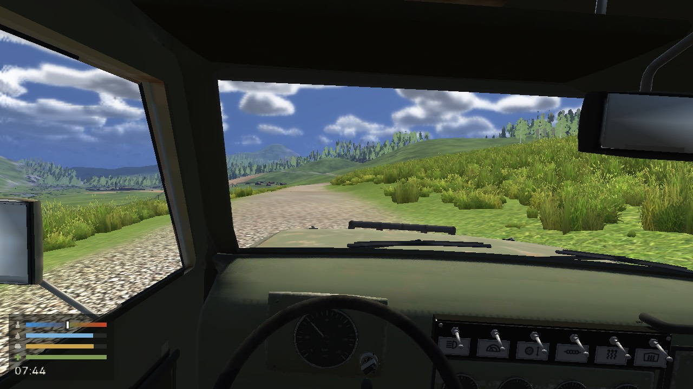

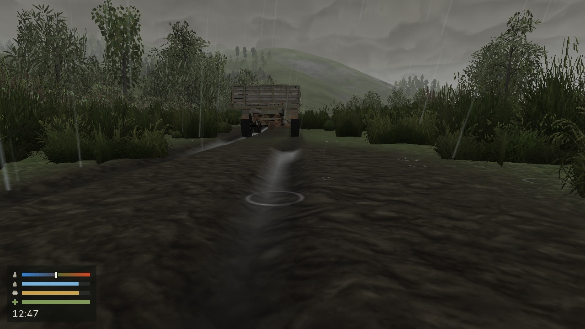

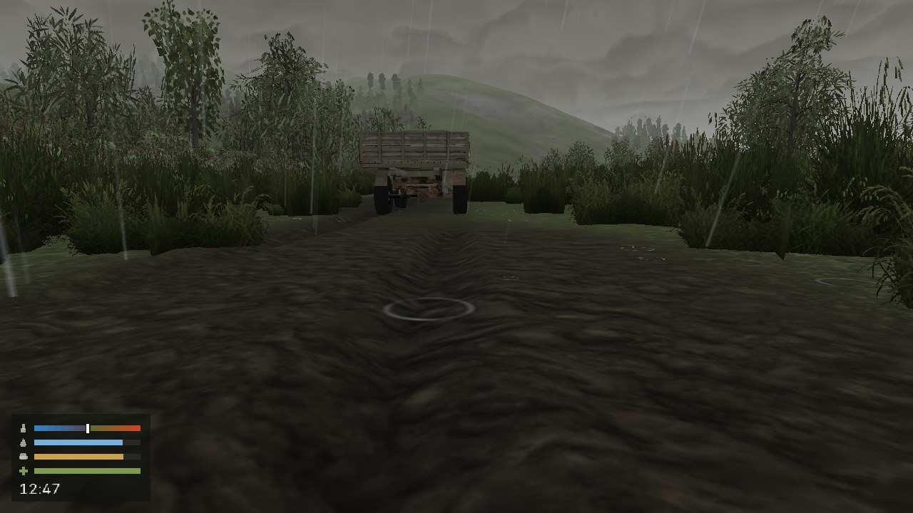

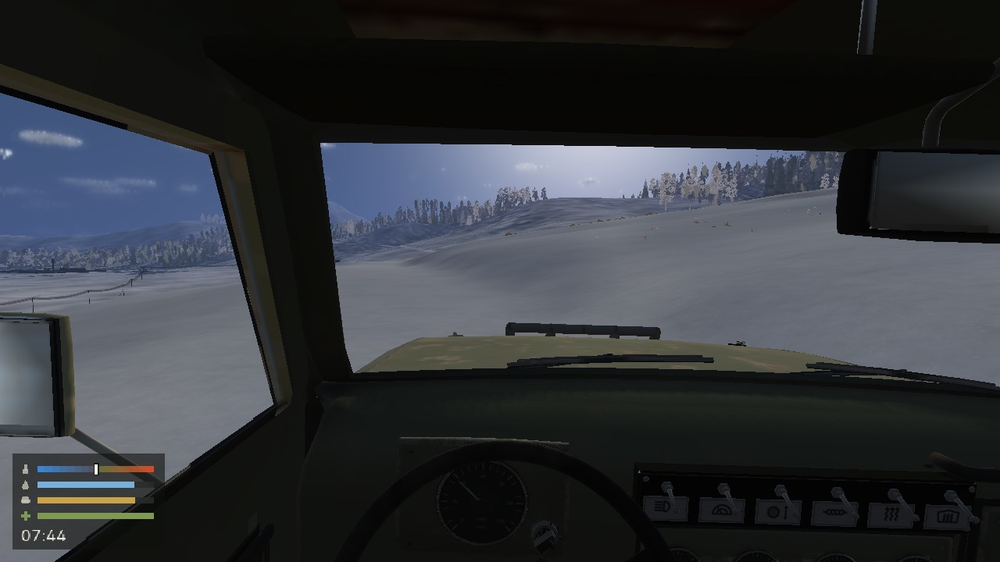

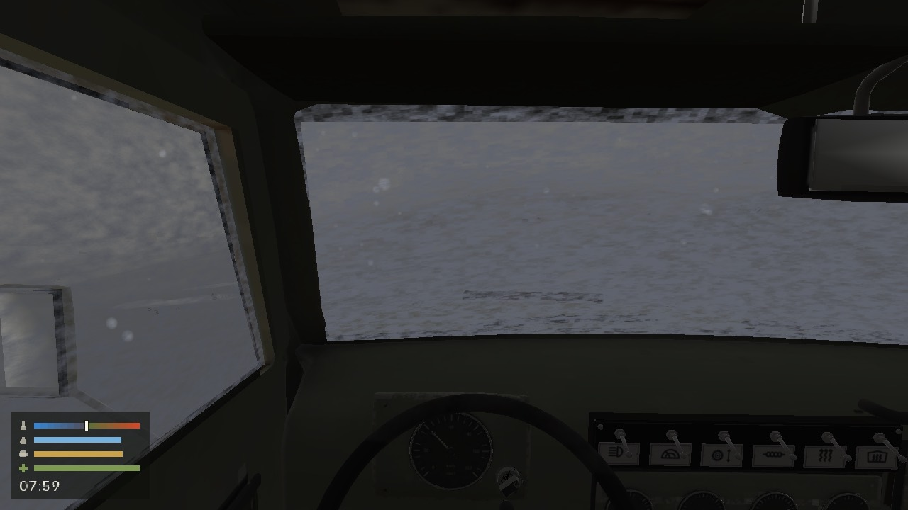

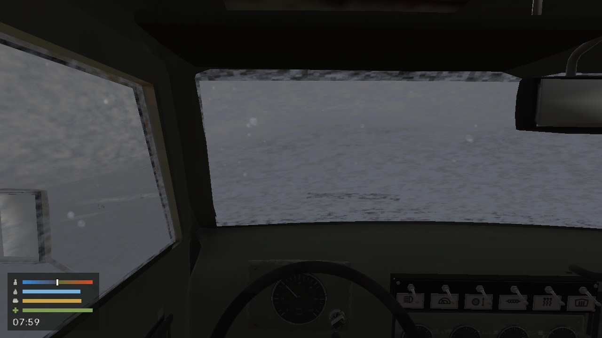

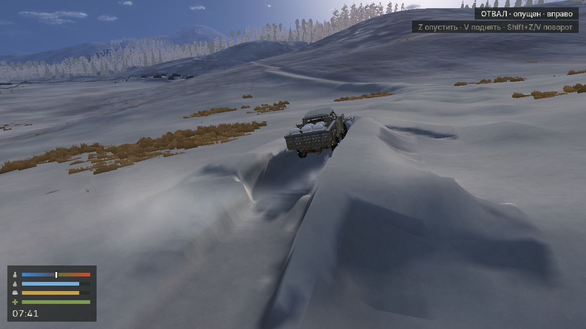

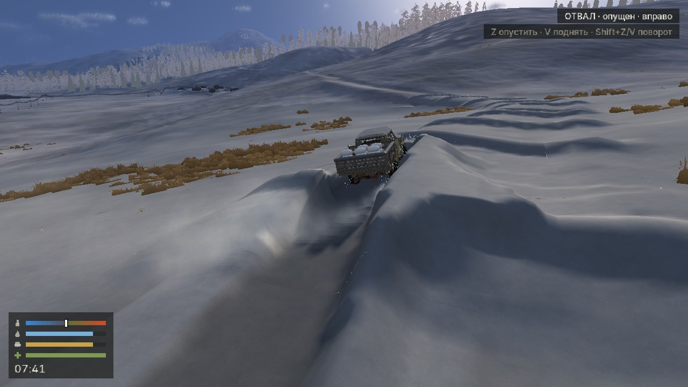

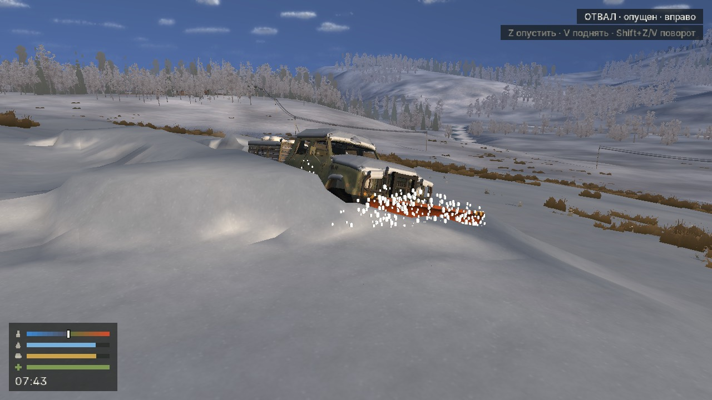

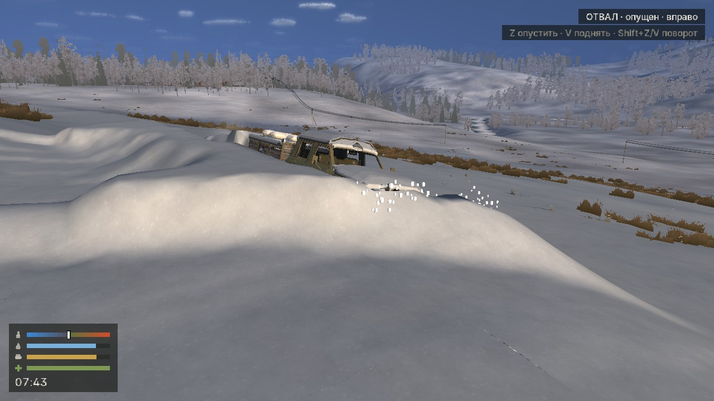

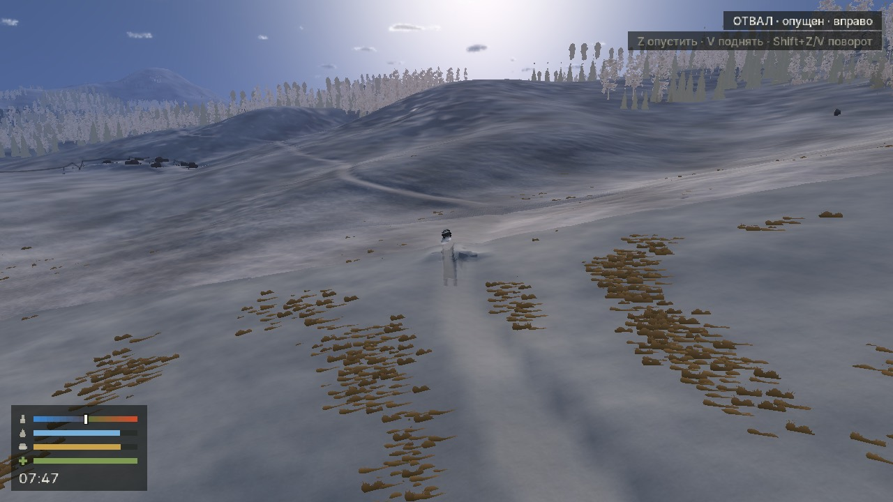

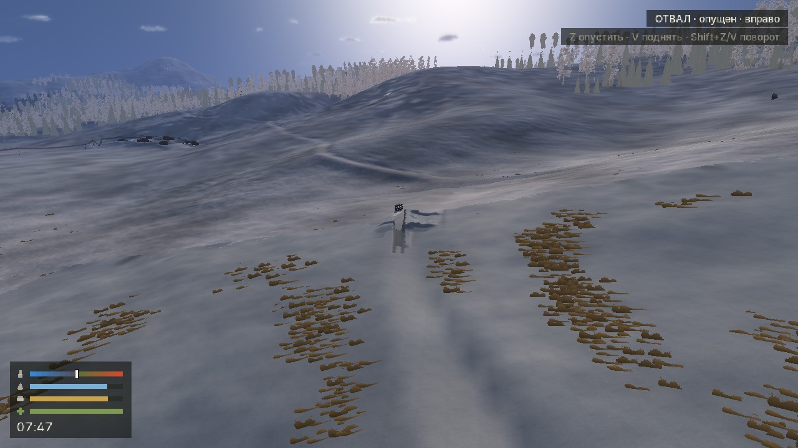

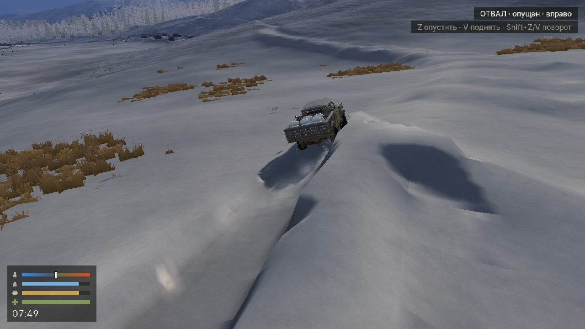

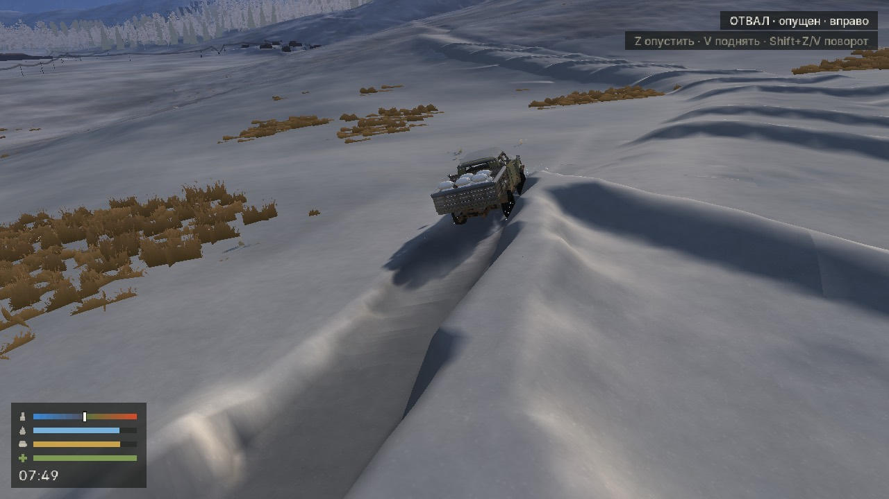

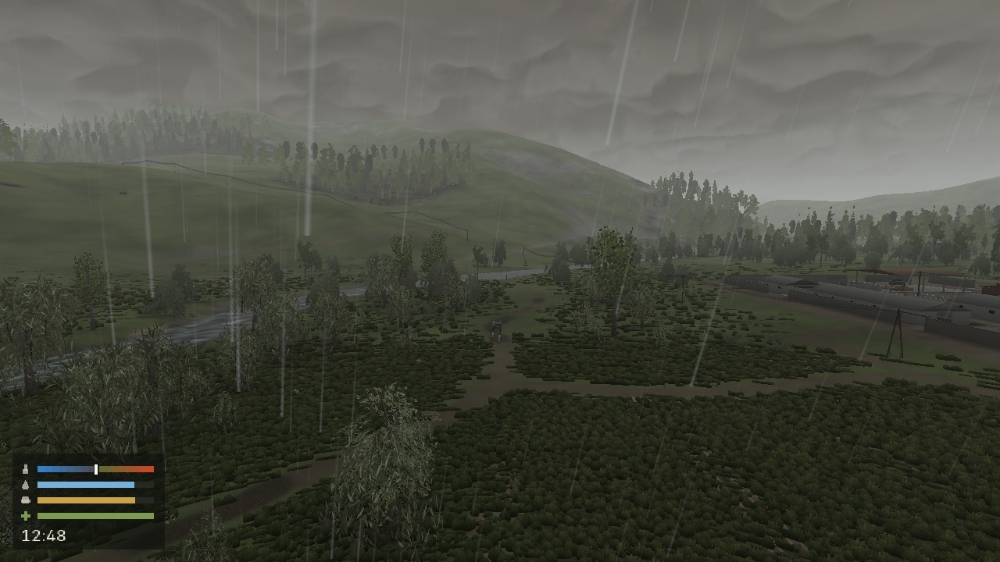

[Полные замеры и счётчики потоковой загрузки (JSON)](../evidence/surface-streaming-2026-10-14/comparison.json)

[Таблица сравнения (CSV)](../evidence/surface-streaming-2026-10-14/comparison.csv)

[Исходные журналы, команды, хеши, покадровые замеры и проверки](../evidence/surface-streaming-2026-10-14/raw-evidence.tar.gz)

## 270. Кабина: новый ручник, два сиденья и консоль, плафон, радио, без зеркал, выглядывание в окно и очистка стёкол снаружи

23:55 · CAB · Кабина

Коммит: [b5608eebb4](https://github.com/shsanek/EXEcutor/commit/b5608eebb4)

Ветка: `work/peregon-cab-interior`

Стадия 44 модели кабины (Blender, tools/truck/install_cab_interior.py): ручник — прямой наклонный рычаг с длинной резиновой рукоятью, повёрнут к водителю; передний диван разделён на два сиденья, между ними консоль с подлокотником, рычаги КПП и раздатки опущены и придвинуты. Новый потолочный плафон со своей клавишей (конфликт клика с оружейной стойкой устранён), все зеркала и крепления убраны. Поворот головы к открытому окну — водитель высовывается, в другую сторону видно заднее стекло. Боковые стёкла снаружи очищаются от инея и снега (F/ПКМ, 1,6 с). Зона клика ручки стеклоподъёмника 35 мм. Радио под панелью со стороны пассажира: громкость, механический ползунок настройки, тумблер; хуки Game::radio() для будущего звука. Состояния плафона и радио сохраняются и синхронизируются в коопе. Место для канистры за топором оставлено.

- ✓ Сборка win64 release (D3D12): зелёная
- ✓ Затронутые наборы ctest: 13/13: view, play_care, coop_seats, loadout, paper_map, roof_rack, glass_weather, care, survival, cab_lighting, net_world, coop_audit, coop_slots
- ✓ Модель: 136 деталей, 75 754 треугольника (было 127 / 77 078); проверки перекрытий и хода рычагов чистые; каждый элемент управления — первый хит из обоих передних сидений
- ✗ Открыто: лобовое и заднее стекло не скребутся; слабый светлый прямоугольник инея на боковых стёклах (было и раньше); у кабины не-героических грузовиков остались коробки зеркал; выглядывание без проверки столкновений

