# Перегон — 2026-10-15

[Главный отчёт](../README.md) · [Фичи и исправления](../CHANGELOG.md)

## 271. Товары у механика, спасение по R за треть накоплений, вода, бочки в лагерях, тёплый угол, глубокий снег, поле 10 %

02:10 · SURV · Выживание и экономика

Коммит: [2046f05972](https://github.com/shsanek/EXEcutor/commit/2046f05972)

Ветка: `work/peregon-survival-fixes`

У механика Гриши вкладка «Товары»: канистры масла (30) и антифриза (45) в кузов, услуги у мастерской (до 40 м): долив масла, зарядка и отогрев аккумулятора, заливка радиатора; цены в data/survival/care.txt. Удержание R в кабине 1 с открывает окно спасения: жители Лесопилки буксируют машину домой, лут в машине и рюкзаке теряется, плата — треть купонов; сохраняются термос, аккумулятор, ведро, лебёдка, канистра, груз контракта и оружие; отмена по умолчанию; работает для пассажира в коопе; бот сохраняет прежний сброс. Вода расходуется в 1,5 раза медленнее (30 игровых часов). Питьевые бочки в 20 лагерях (12 переделаны, 5 новых), без перепечки карты. Свой угол на Лесопилке: +12 °C даже без дров, ночь на нарах не ниже +18 °C; термос наливается у печки. Глубокий снег: минимальная скорость 0,32 м/с, игрок проваливается в свежий снег (не выше 0,4 м над землёй), край колеи — ступенька, а не стена. Поле: оплата при 10 % вспашки.

- ✓ Сборка win64 release (D3D12): зелёная, ребейз на b5608eebb4
- ✓ Наборы ctest: survival 35/35, care 19/19, food 11/11, food_play 21/21, farm 20/20, poi 9/9, play_care 40/40, road_return 2/2, coop_seats 24/24, coop_audit 25/25, save 20/20, economy 17/17, contracts 27/27, inventory 23/23
- ✗ Чужие падения: play_cargo 66/68 — два теста рычагов падают уже на b5608eebb4 (после CAB), отдан агенту CABFIX; woodcut 13/14 — падение было ещё на b83bc848f2
- ✗ Открыто: буксировка не тратит игровое время; удержание R клиентом в коопе не покрыто тестом; генератор coal_blueprints.py устарел

## 272. Тесты рычагов кабины по новым деталям; с топором в руках E снова поднимает бревно

02:40 · CABFIX · Рычаги и бревно

Коммит: [0479a26dea](https://github.com/shsanek/EXEcutor/commit/0479a26dea)

Ветка: `work/peregon-cabfix`

После перестройки кабины два теста play_cargo целились в координаты стадии 43. Сами рычаги раздатки (≈−37° вниз) и ручника (≈−48°) с места водителя достаются в пределах обзора 77°. Тесты теперь берут рукоять из экспортированных деталей через hero_pose — тот же путь, что пик в игре — и проверяют её в сдвинутом положении. Найдена ошибка в игре: ранний подбор предметов в interact_foot (03e3d5296b) перехватывал E на бревне с топором в руках («руки заняты»); теперь топор кладётся, бревно поднимается.

- ✓ ctest: play_cargo, woodcut, view, play_care, coop_seats — 5/5
- ✗ Процесс: часть сборок шла во время замеров PERF (01:04–01:09); отмечено, PERF предупреждён

## 273. Задания без «привези брёвна и гвозди», замер маршрутов, работа на Лесопилке пешком, лодка и палатка-куб в награду

03:20 · QUESTS · Задания и баланс

Коммит: [03aa869aac](https://github.com/shsanek/EXEcutor/commit/03aa869aac)

Ветка: `work/peregon-quests-balance`

«Брёвна и гвозди» остались только у запруды (всё в 150 м). Михеичу брёвна рубим за загоном, гвозди у него свои, соль относим к лабазу; стёкла продаёт Сыч, сахар — Зина на турбазе, трубу, свитер и соль Степка держит у экскаватора; клюква Люды — на берегу Ольховки. Все шаги заданий и работы радиорубки (70 строк) измерены по дорожной сети, методика и таблица в docs/quests.md §11.3: забор Михеича 31→8 мин, соль 26→9, крыша S5 33→17, труба на разрезе 28→5,6, свитер 20→0,5, удочка Толика 22→7,8. Работа на Лесопилке без машины: дрова (120), грибы (130), навес для дров (200), уха из Ольховки с удочкой Люды (70), ночью отогнать волков с того берега. Награды цепочек: палатка-куб только от Гурова после «Высокой воды», лодка «Вега» от Захара (или 400, если лодка есть), брезентовая палатка от Егора, нож Михеича, 150 и патроны от Кузьмича. Исправлено: предметы, положенные руками, не засчитывались в точке сдачи.

- ✓ ctest: story 59/59, play_story 23/23, play_dialogue 57/57, lake 10/10, play_lake 14/14, director 18/18, fauna 34/34, hunt_play 12/12, poi 9/9, icetent 5/5; story lint 0 ошибок
- ✗ Открыто: выплата Западного двора выше нормы (QB-3); у элеватора и турбазы нет пешей работы; уха считает улов, а не забирает рыбу; шаг погони за волками проверен только юнит-тестом

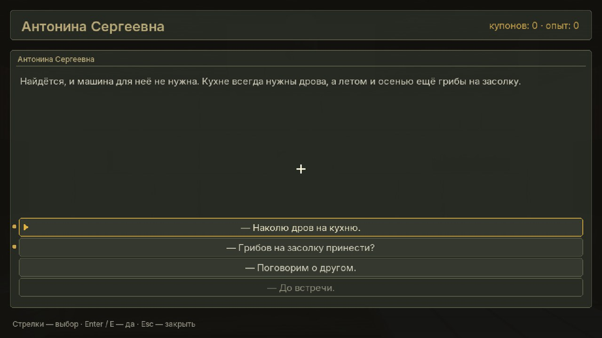

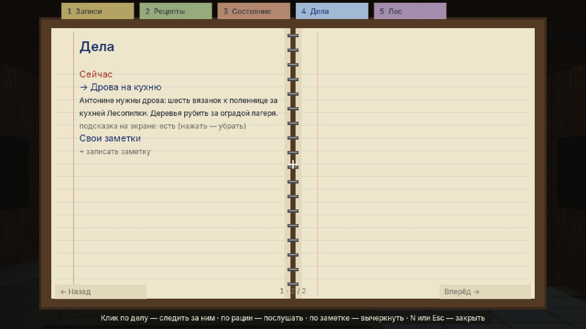

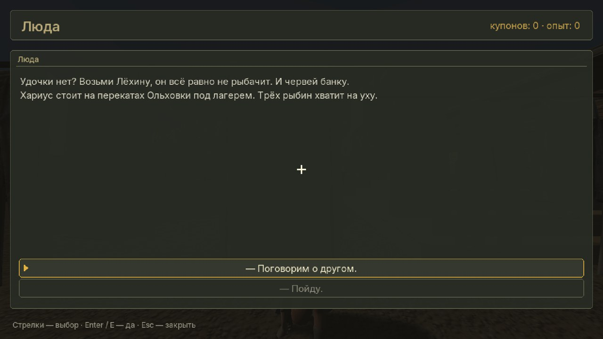

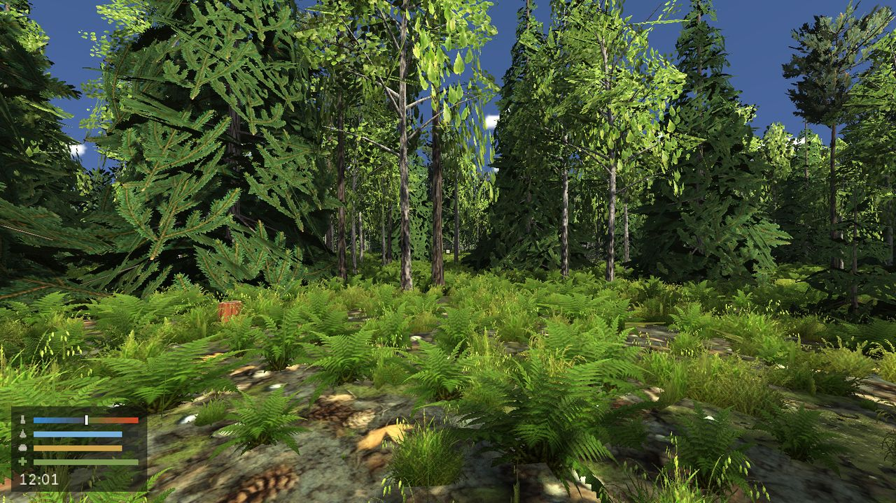

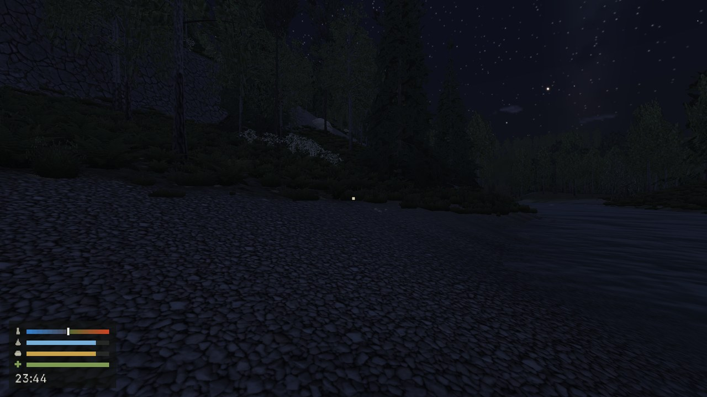

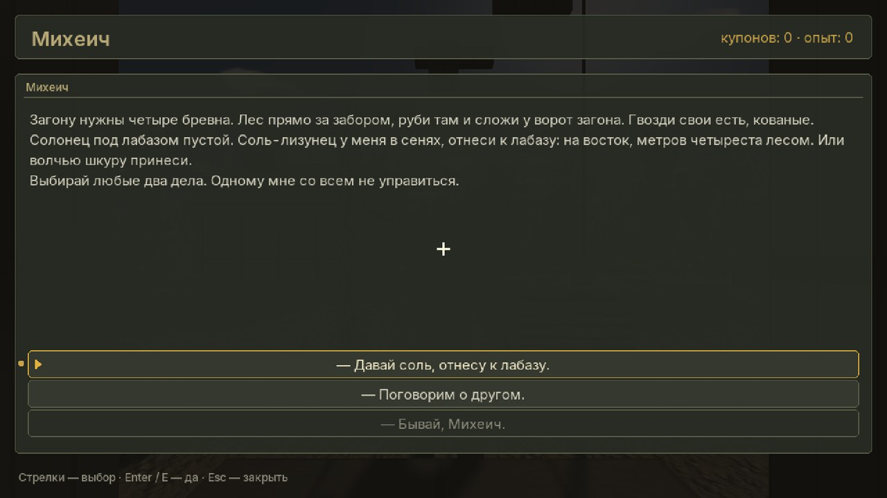

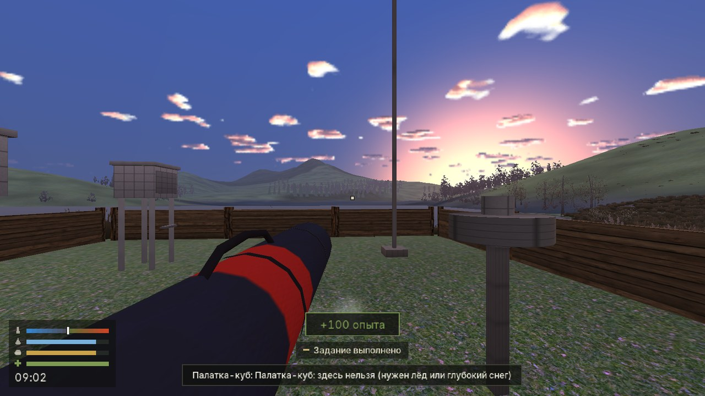

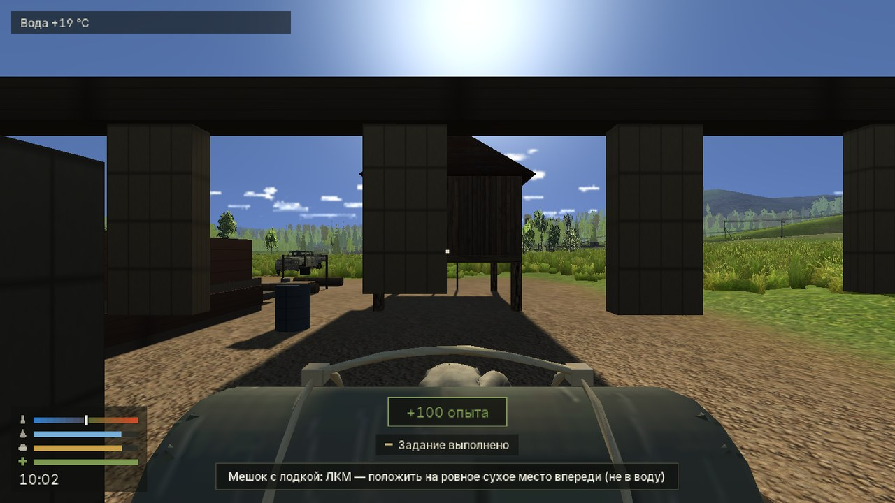

## 274. D3D12: убраны фризы до 2,8 с, снег в постоянных буферах и в несколько потоков; метель 1,5×, зимний проезд 2× в 4K

04:10 · PERF · Производительность D3D12, проход 1

Коммит: [8afd1b1639](https://github.com/shsanek/EXEcutor/commit/8afd1b1639)

Ветка: `work/peregon-perf2`

Исходная точка — HEAD после преждевременного слияния стриминга поверхностей (регрессия), а не эталон. Причина фризов: старение колеи на CPU-пути каждый тик объявляло все блоки колеи изменёнными — непрерывная пересборка грунта и травы (до 24 клеток раз в 30 кадров) и чтения блоков колеи с диска. Теперь помечаются только видимо изменившиеся колеи, трава пересобирается постепенно (4 клетки за кадр, старая рисуется), чтения кэшируются. Снежный покров живёт в постоянных GPU-буферах, загружаются только изменённые куски, один draw call; куски и укрытия строятся параллельно (байт-в-байт как однопоточно). Барьеры D3D12 сгруппированы (137–154 → 30–37 за кадр), глубина D32 без трафарета, ближний рельеф пропускает треугольники с нулевым весом слоя. Порт снега на compute D3D12 не делался: стоимость была в инвалидации, перезагрузках и однопоточной сборке. Цель владельца 1,5–2× в 4K достигнута в снегу и метели; лето/осень на месте в 4K упираются в GPU (100 %, 6,7–7,4 мс), проезды — в главный поток (99 %, 20–36 мс). Продолжение — проход PERFB.

- ✓ Тесты: vehicle, surface-stream, rhi_d3d12, snow_launch, perf_route, net, sky_occlusion, atmos_fx, nature, save — зелёные; D3D12 validation 0 ошибок
- ✓ Паритет картинки: колея ≤ 6/255, лето/осень на месте бит-в-бит, хэши симуляции идентичны; найдена и исправлена полоса из устаревших треугольников на снегу
- ✓ Трафик в GPU: зимний проезд 18,9 → 13,0 МБ/кадр, метель 9,5 → 3,2 МБ/кадр; draw calls без изменений (~1 230–1 440)
- ✗ Прежние падения: world_tests slice_layout_loads (4 зоны против 6), map_tests incremental snow mesh 12/14 — падают и на старом HEAD
- ✗ Методика: замеры на базе до ребейза; часть прогонов совпала со сборками других агентов — повторены, отброшенные сохранены
- ✗ Запас на RTX 5080: 1080p: главный поток 92–100 %, GPU 8–47 % (≈2× запас GPU); 4K на месте: GPU 100 %. Оценка для RTX 4060 (не замер): ≈8 мс 1080p, 24–27 мс 4K

| Сценарий | 1080p медиана, мс (×) | 4K медиана, мс (×) | 4K p99, мс |
| --- | --- | --- | --- |
| Метель, дорога | 14.17 → 9.32 (1.52×) | 14.43 → 9.44 (1.53×) | 30.94 → 16.76 |
| Зима, проезд по глубокому снегу | 70.35 → 36.12 (1.95×) | 73.24 → 36.22 (2.02×) | 160.95 → 92.07 |
| Зима, дорога, слежавшийся снег | 5.01 → 5.85 (0.86×) | 5.67 → 5.89 (0.96×) | 30.45 → 14.92 |
| Лето, дорога | 6.25 → 4.32 (1.45×) | 6.34 → 5.17 (1.23×) | 470.13 → 9.60 |
| Лето, проезд | 20.13 → 20.39 (0.99×) | 20.40 → 20.38 (1.00×) | 833.04 → 41.71 |
| Осень, проезд | 22.26 → 21.03 (1.06×) | 22.09 → 21.09 (1.05×) | 824.74 → 41.08 |
| Лето, на месте | 3.78 → 3.99 (0.95×, шум) | 6.76 → 6.70 (1.01×) | 8.35 → 8.56 |
| Осень, на месте | 4.35 → 4.49 (0.97×, шум) | 7.42 → 7.32 (1.01×) | 8.82 → 8.90 |

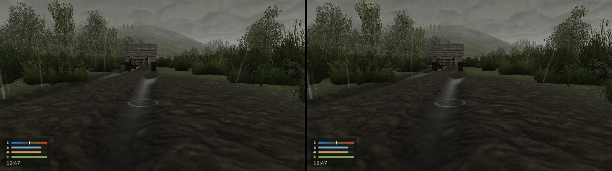

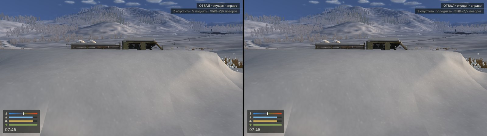

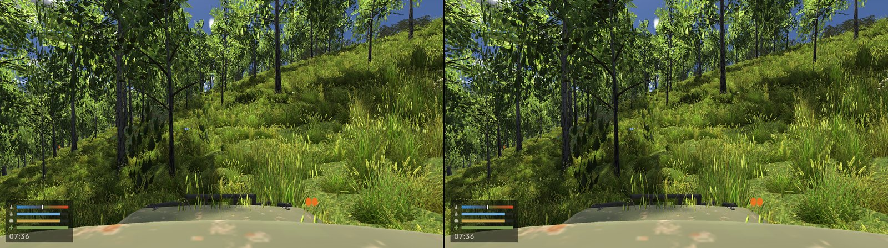

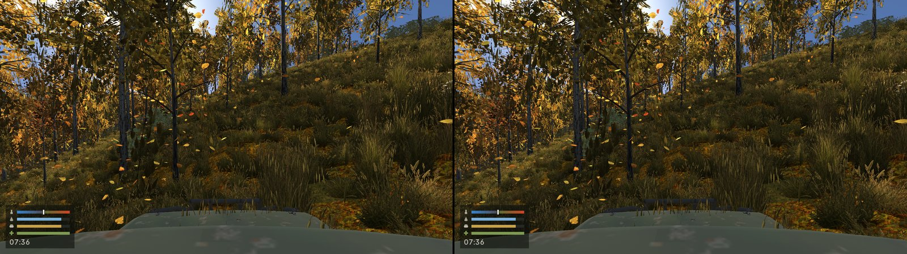

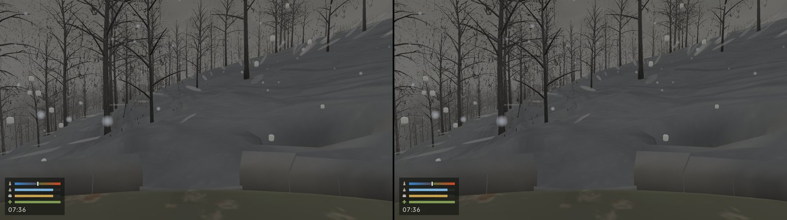

## 275. Займ солярки при баке &lt; 30 %, обязательный квест «Долг за солярку», канистра 40 л и держатель за топором

03:15 · FUEL · Долг за солярку и канистры

Коммит: [57eda16555](https://github.com/shsanek/EXEcutor/commit/57eda16555)

Ветка: `work/peregon-fuel-loan`

При топливе ниже 30 % любой взрослый житель с экраном разговора предлагает 20 л — в канистру в руках или в бак, если машина ближе 25 м; дети (Света, Толик, Маша) и рейдеры не одалживают. Долг один на игру в литрах, вернуть можно любому взрослому: из канистр или бака (не ниже 30 %), частями или купонами по 6 за литр. Пока долг открыт, все начинают с реплики про солярку, пустые разговоры скрыты, а магазины, услуги и квестовые действия остаются — без блокировок. Квест «Долг за солярку» обязательный, отслеживается у всех игроков, сохраняется и работает в коопе с хоста. Канистра SURV стала пустой 40-литровой: заполнение шагами 5 л хранится в предмете, вес 6 кг + 0,84 кг/л (от 25 л — двумя руками); 50 купонов у Антонины или у Гриши, заправка канистр на колонке, залив в бак удержанием E у горловины. Держатель за топором на борту кузова: E вешает или снимает канистру, состояние сохраняется. Данные займа — care.txt [loan], диалог — data/story/fuel_loan.txt.

- ✓ ctest: story 62/62, care 20/20, cargo 26/26, inventory 23/23, save 20/20, survival 35/35, economy 17/17, loc 9/9, coop_audit 25/25, play_care 43/43, play_dialogue 58/58, play_cargo 68/68, play_story 23/23
- ✗ play_journal 18/19: нет подписей целей у новых заданий QUESTS (sm_mushrooms, sm_woodshed, sm_fish, sm_wolves, b16_efim_tea) — передано агенту UI
- ✗ Открыто: горловина бака — мелкая цель; иконки канистры старые до пересборки атласа; вес канистры на держателе не учитывается в массе машины; шаг заполнения 5 л

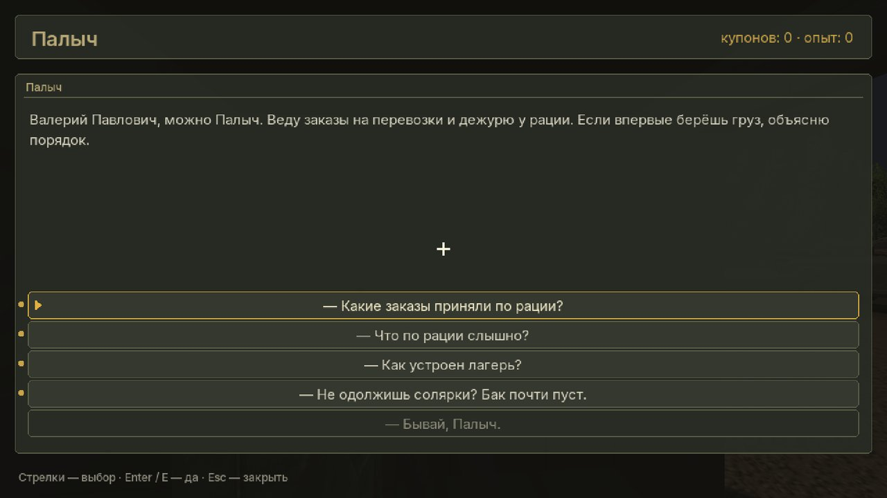

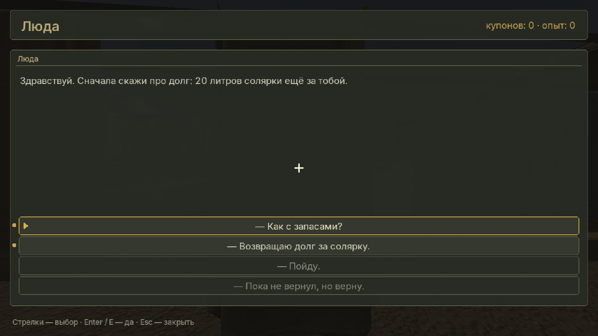

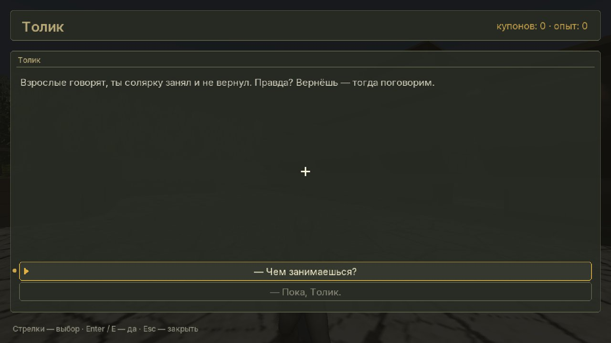

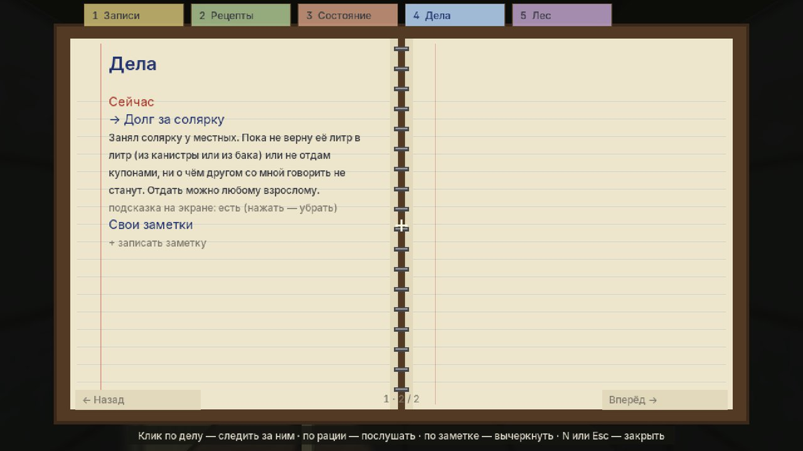

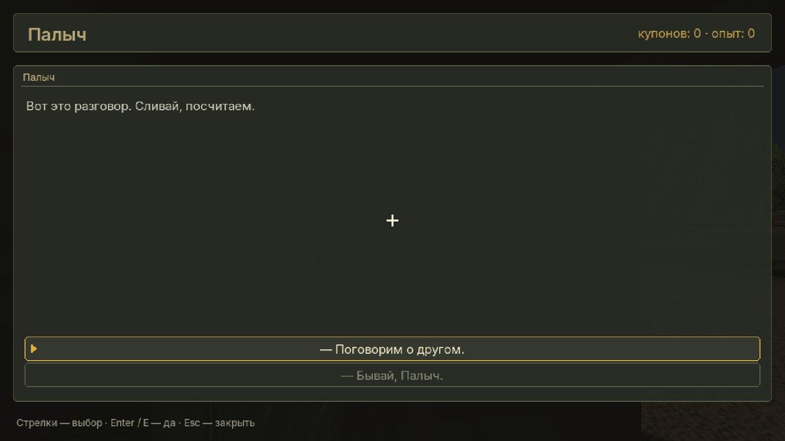

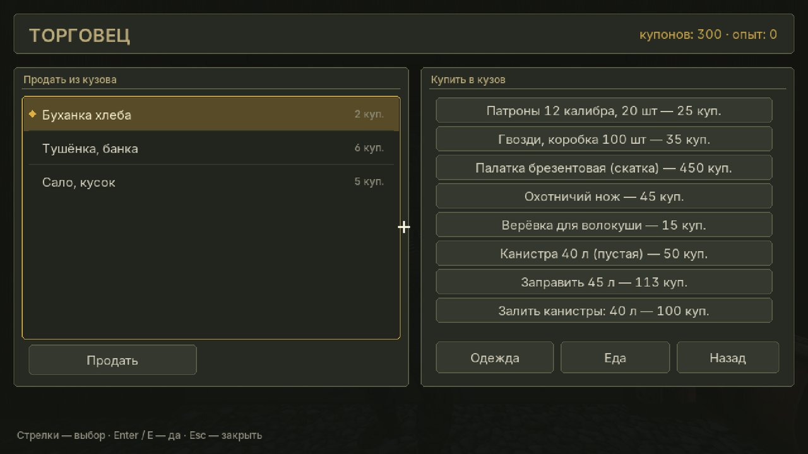

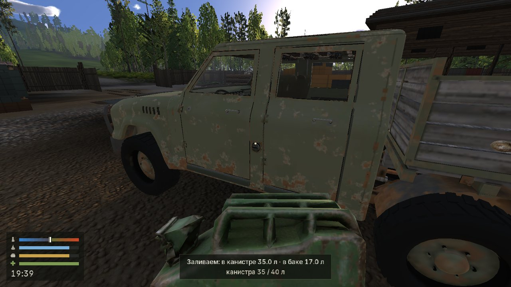

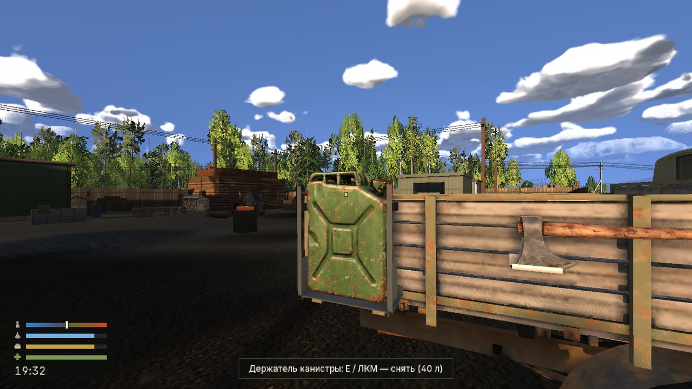

## 276. Сложность ориентирования без меток, описание дороги в каждом задании, подписи рек вдоль русла и гор на карте-атласе

04:05 · MAPNAV · Ориентиры и карта

Коммит: [36ad24c6bd](https://github.com/shsanek/EXEcutor/commit/36ad24c6bd)

Ветка: `work/peregon-mapnav`

В настройках «Погружение» — «Сложность ориентирования»: Лёгкая (метки заданий на карте), Обычная (по умолчанию, без меток) и Суровая; переименованный переключатель «Метки заданий на карте» убирает карандашные метки, линию направления и цель на обзорной карте. В блокноте «Дела» под каждой активной стадией и следующей точкой принятой работы — «Дорога: …»: 24 маршрута от Лесопилки в data/story/routes.txt, собраны инструментом route_directions.py по дорожному графу (дороги, повороты со стороной, броды, переезды, ЛЭП, развилки, сёла) и отредактированы вручную; story_lint не пропустит стадию с местом без описания (покрыты все 95). Бумажная карта: названия рек идут вдоль сглаженного русла и повторяются каждые 6,5–10 км, у ручьёв мельче, «р.»/«руч.» только у первой подписи; 8 сопок долины и 12 вершин с отметками высот, «оз. Горловое», населённые пункты как в атласе 1986 года; игровые и самодельные места не подписаны. Названия — tools/paper_map/toponyms.json (19 ручьёв и 27 рек получили имена). Без меток задания в сумме дольше на 7 % (703 → 755 мин, оценка); подняты 4 награды.

- ✓ ctest: story 63/63, save 21/21, immersion 9/9, journal 19/19, paper_map 17/17 (+15 Python), play_story 23/23, play_dialogue 58/58; story_lint 0 ошибок
- ✓ Перепечка: не понадобилась — пересобран только лист бумажной карты
- ✗ Открыто: на доске объявлений дорога видна только после принятия работы; описания от Лесопилки; «р.» дважды у Рогозихи; часть подписей на главной карте пересекает извилистое русло; последняя строка настроек прижата к «Назад»

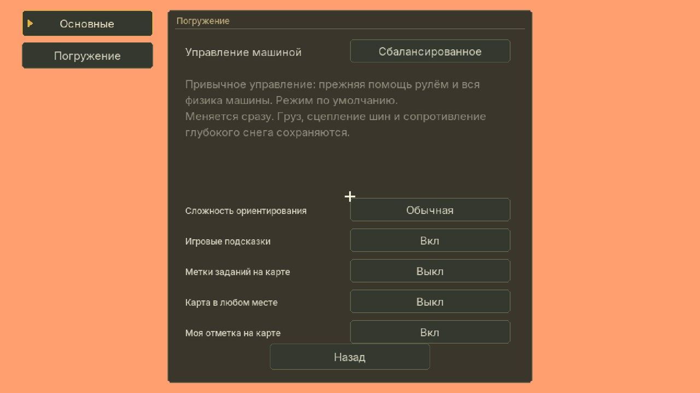

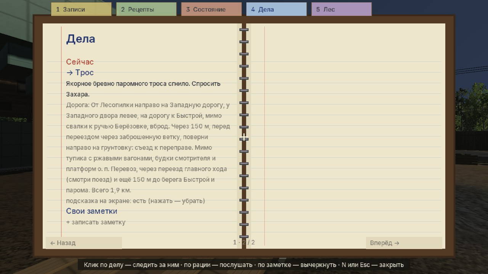

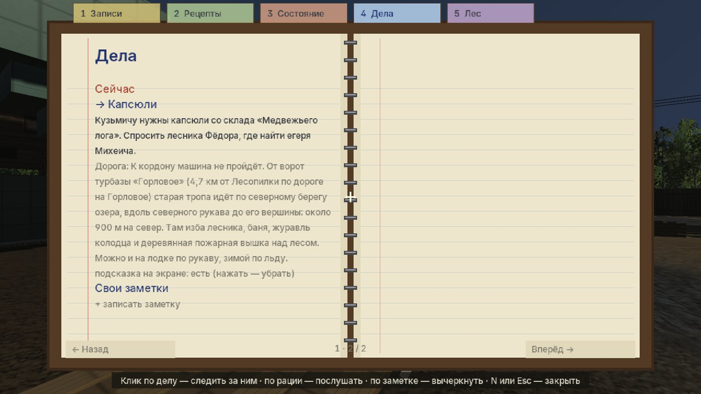

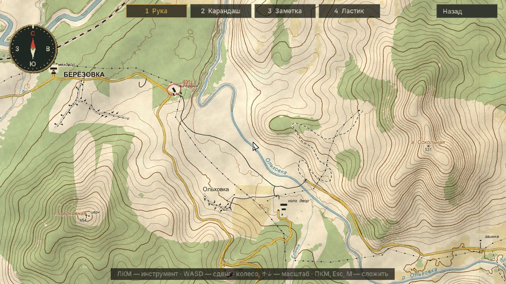

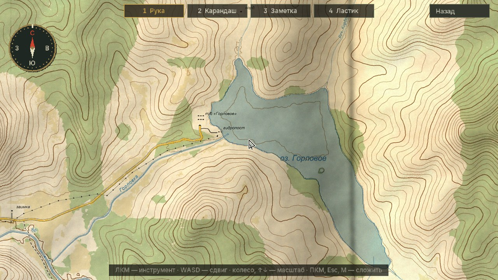

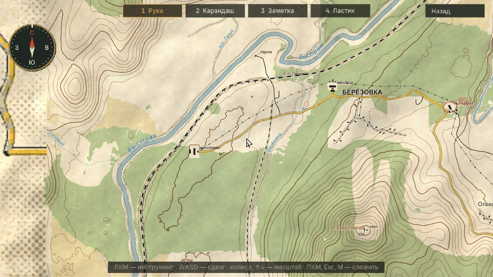

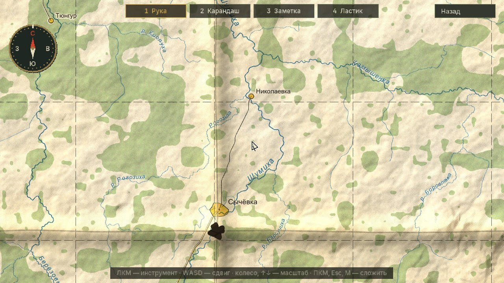

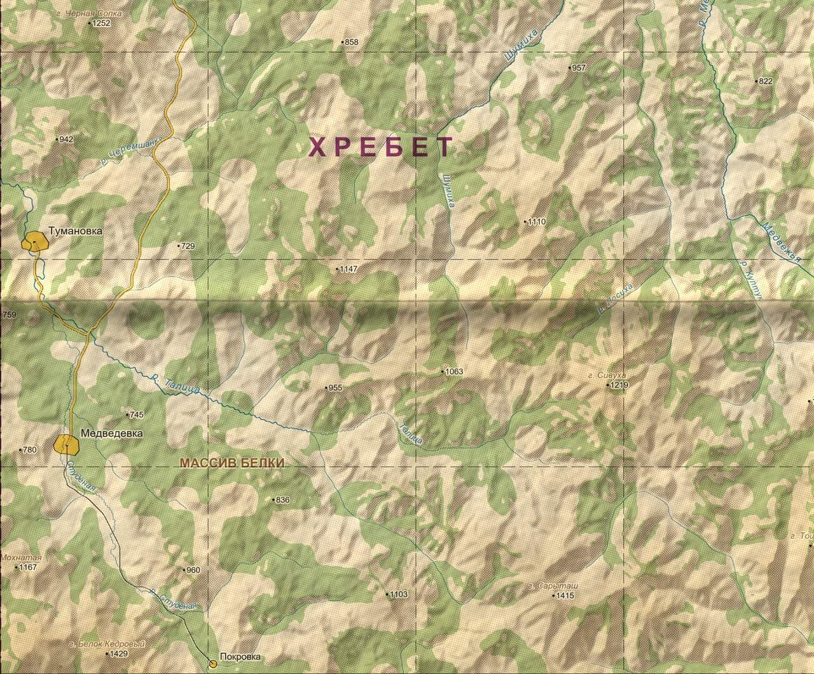

## 277. Охота без меток: читаемые следы, голоса зверя, рассказы жителей и страница «Зверь» в блокноте

05:20 · HUNT · Как найти зверя

Коммит: [4bf466a1d7](https://github.com/shsanek/EXEcutor/commit/4bf466a1d7)

Ветка: `work/peregon-hunt-discovery`

Все подсказки берутся из настоящей симуляции фауны, в мире, на HUD и карте ничего нового не рисуется. Следы, помёт, лёжки, порои и кровь в 3,4 м можно рассмотреть (E / ЛКМ): чей след, сколько зверей (следы одного прохода группируются в линии), шагом или бегом, направление по компасу и свежесть по реальному возрасту; кровь говорит, куда попал (лёгкие, брюхо, задняя часть, нога). Голоса зверя записываются с направлением и дальностью, утки на зорьке и вечером крякают втрое чаще; увиденное — раз в час на стадо. Места называются по бумажной карте и словам местных («у ручья Лосиного», 51 ориентир). Жители, егерь и лесник рассказывают свежие новости по каждому виду (стада, вой, набеги, задранные, где кряквы); у взрослых с новостями — «Зверя поблизости не видали?», у Михеича — «Где сейчас зверь ходит?» и «А как его самому найти?». Новая страница блокнота «Зверь»: последнее по каждому зверю и дни. Новости хоста передаются клиентам (протокол 19).

- ✓ ctest: 16/16: fauna, hunt_play 14/14, hunt, story, story_lint, play_dialogue, play_journal, food, food_play, save, coop_audit, audio, fauna_play, play_story, net, loc
- ✓ Стоимость: 2,9–5,1 мкс на задачу фауны (раз в 6 тиков), подсказка 2,7 мкс/кадр, новых draw calls нет
- ✗ Открыто: нет снимка, где видны утки (стая за камышом — несколько пикселей; лог подтверждает стаю в 156 м); бинокля нет; манок, отдельные декали следов, ветер — в бэклоге; видимость не учитывает деревья; новости не сохраняются (восстанавливаются после загрузки)

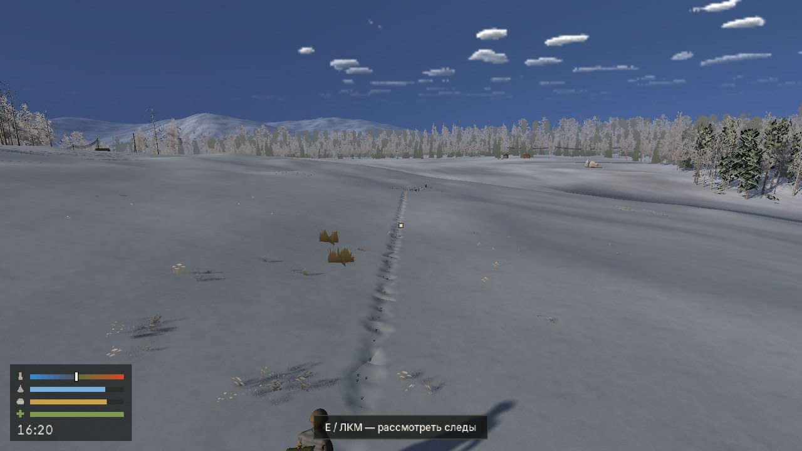

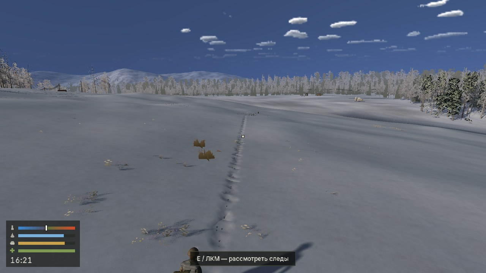

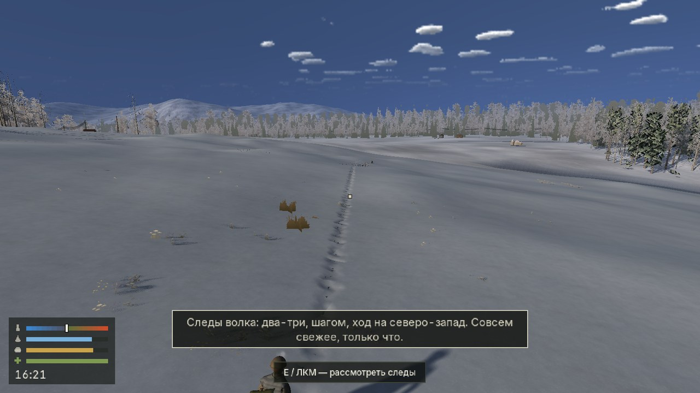

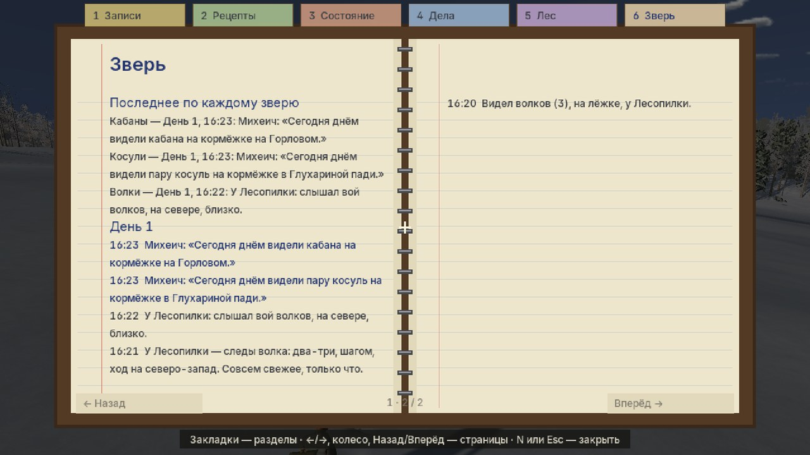

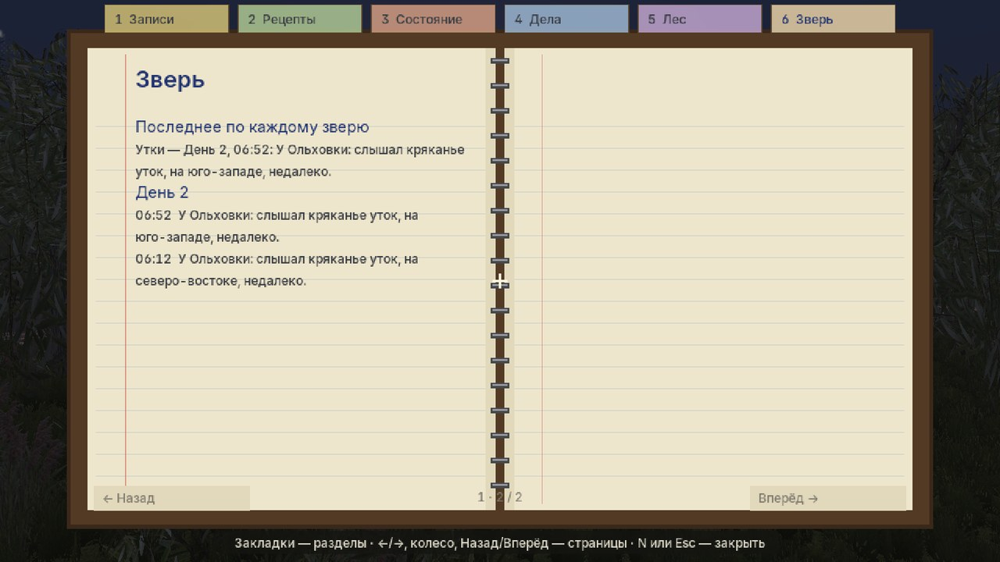

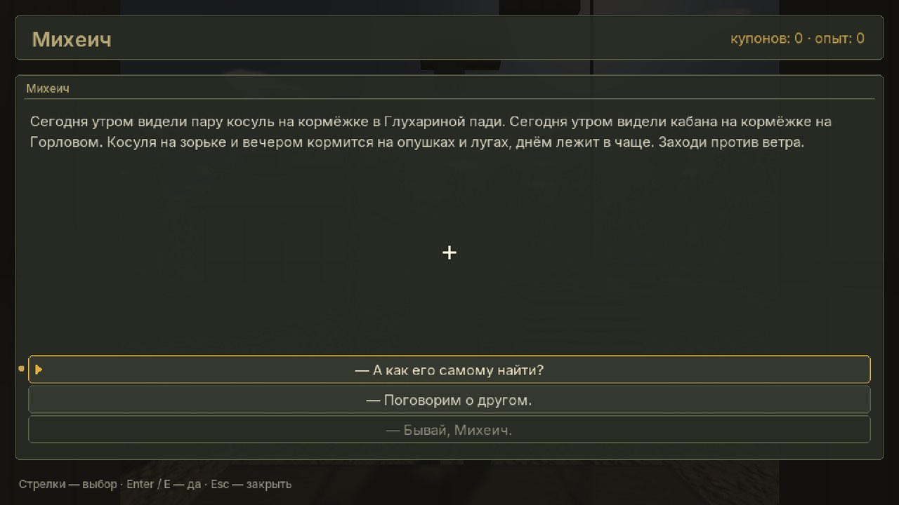

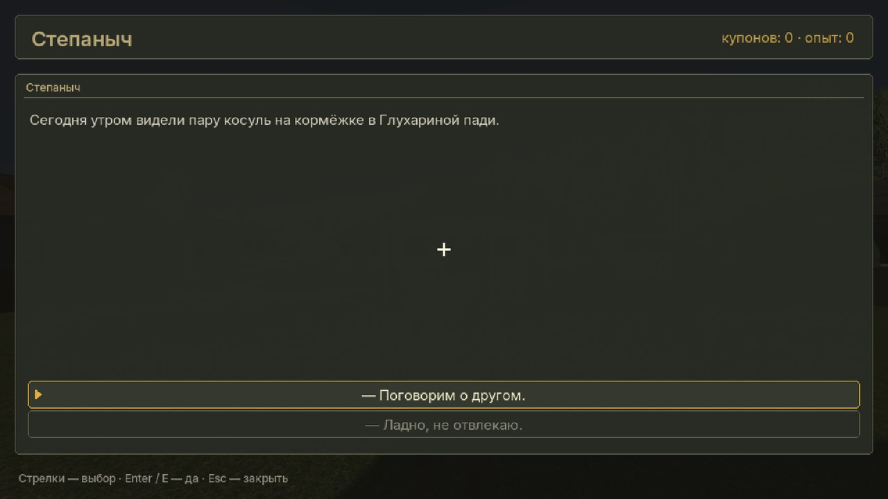

## 278. Грунт раскисает после дождя, колея углубляется, рама скручивается, грязь держит колесо; прокачка с реальными цифрами

05:45 · PHYSICS · Физика грузовика

Коммит: [21324921a7](https://github.com/shsanek/EXEcutor/commit/21324921a7)

Ветка: `work/peregon-physics`

Исследование (docs/vehicle-physics.md): SnowRunner/MudRunner — сочленённые твёрдые тела на пружинных связях, раздельное трение по дороге и грязи, деформация грязи эмпирическая; по механике грунтов мокрая глина теряет 80–95 % жёсткости, а у нас дождь снимал 35 % везде — поэтому земля оставалась плотной. До изменений: на ровном мягком поле крен 0,05°, дождь увеличивал осадку только 18 → 33 мм, повторные проезды не углубляли колею (14,6 мм после 1–5 проходов), на диагональных ямах колесо отрывалось на всех подвесках. Добавлено (только героический грузовик, старые эталоны не тронуты): размокание по типу поверхности (грунт и луг сильно, грязь слабо, гравий твёрдый; вода в колее размягчает дно; талый снег мочит как дождь), углубление колеи проездами в дождь и уплотнение в сухую, неоднородная прочность грунта и 2–5 см микрорельефа только в физике, бульдозерное сопротивление вала перед колесом, засасывание стоящего колеса в мокрой глине, сползание колеса в колею, скручивание рамы до 5° (передаётся в кооп, протокол 20), мягче стабилизаторы Т2/Т3. У механика справа — описание выбранного узла: текущий и следующий уровень и все меняющиеся физические величины, посчитанные той же физикой (шины Т1→Т3: давление 61 → 37 кПа, осадка в пойме 21,8 → 16,8 см, трогание в пойменной грязи 2,0 → 32,7 м за 8 с); тексты в data/vehicle/upgrades.txt.

- ✓ ctest: vehicle 119/119 (8 новых), snow_launch, surface_stream, play_cargo, net_world, coop_audit, timewarp, play_care, net_menu, net — 10/10
- ✓ Стоимость: физика 73–83 → 78–87 мкс на тик
- ✗ Решения владельца: на сухих дорогах карты крен вырос лишь на 5–14 %, тангаж на 16–22 % (карта гладкая, нужна перепечка с рельефом); раскачка в ливень даёт 2–9 м вместо 15+; пойма в сухую на Т1 легче: 14,4 вместо 10,6 км/ч
- ✗ Открыто: кабина и кузов рисуются жёсткими — скручивание видно только по колёсам

| Случай | До | После |
| --- | --- | --- |
| Грунтовка после дождя: осадка / колея | 36 / 19 мм | 87 / 44 мм |
| Та же дорога, колея после 4 проходов в дождь | 19 мм | 62 мм |
| Осадка на мокром поле | 33 мм | 65 мм |
| Диагональные ямы 0,25 м: скручивание рамы | 0° | 3,0° (на Т3 колесо не отрывается) |
| Срыв в грязи после 30 с стоянки | 6,3 кН | 7,3 кН |

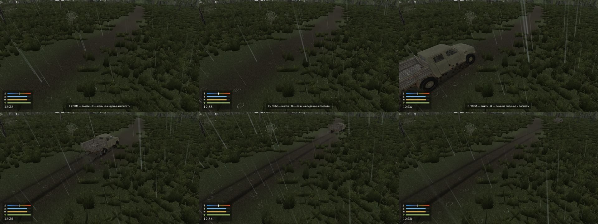

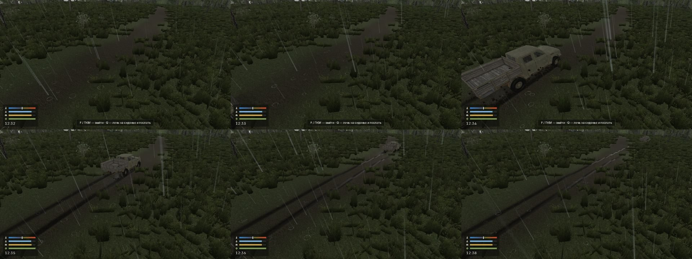

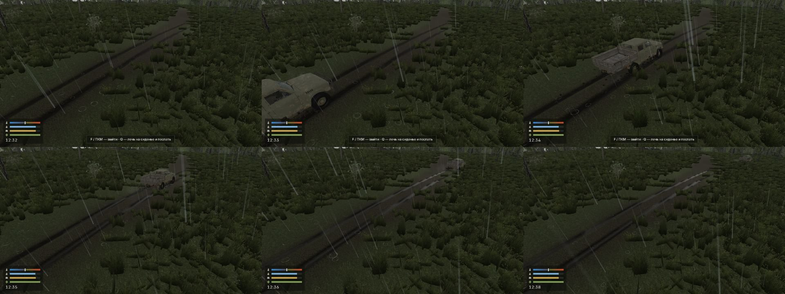

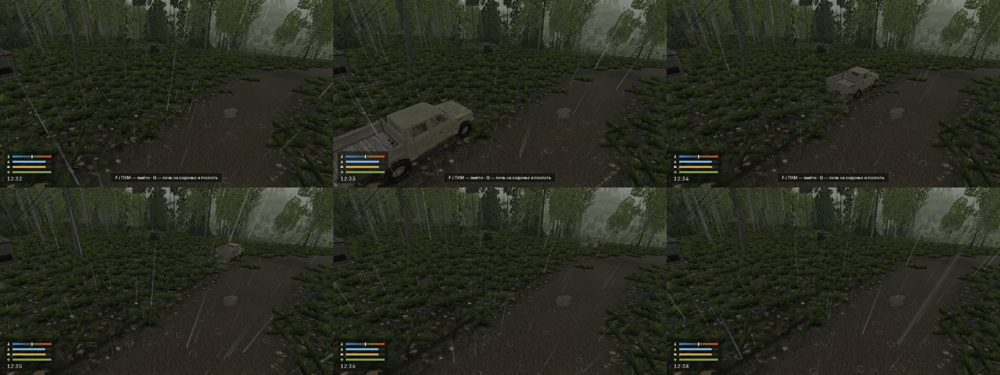

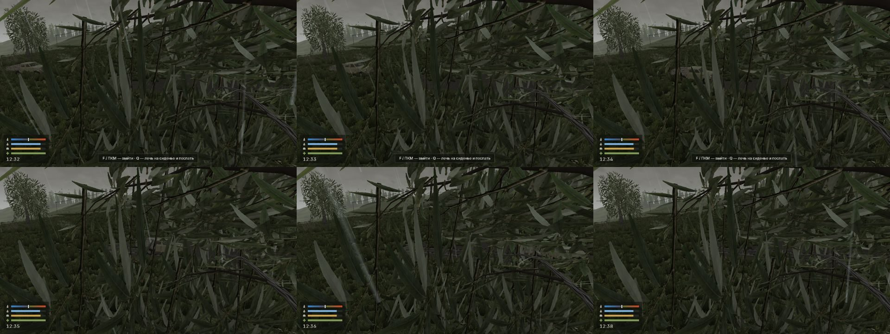

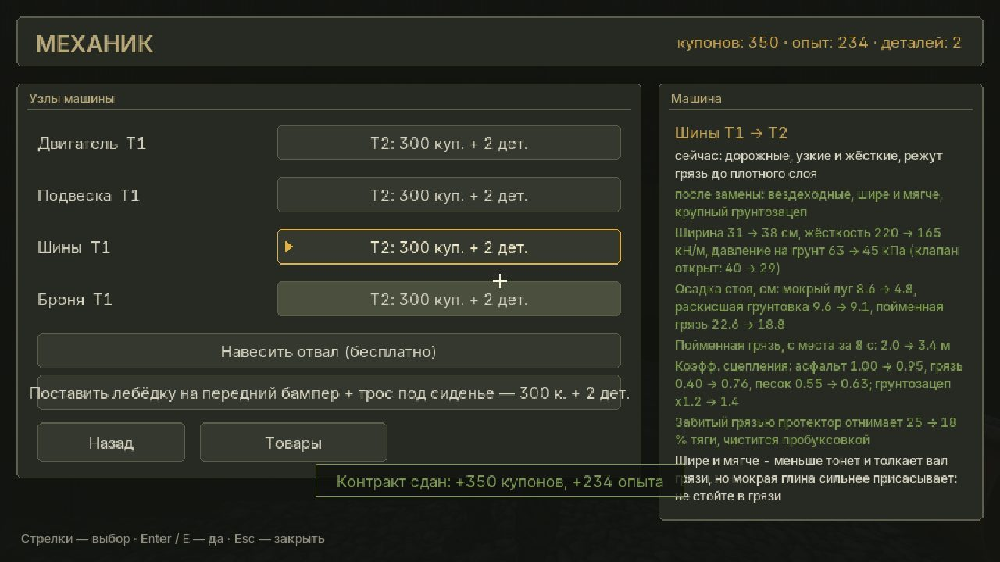

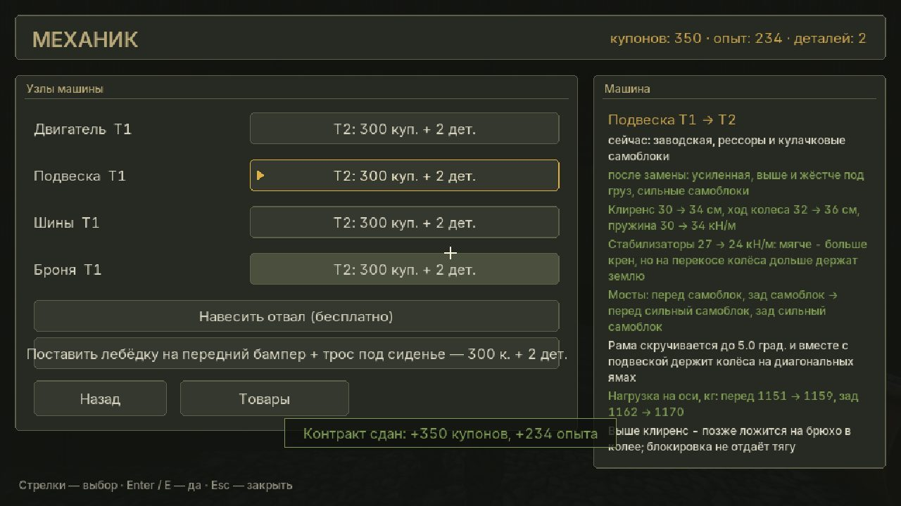

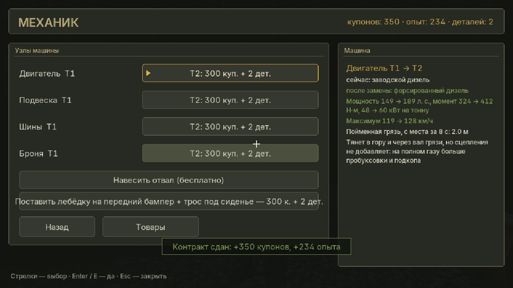

## 279. Радио заиграло: две станции СВ/ДВ, шум и свист настройки, редкие помехи, звук АМ-приёмника; музыка — только локально, лицензии купить до релиза

06:35 · RADIO · Радио в кабине

Коммит: [17f823c3e5](https://github.com/shsanek/EXEcutor/commit/17f823c3e5)

Ветка: `work/peregon-radio-audio`

Песни владелец кладёт сам в games/peregon/assets/audio/radio/music/ (в git только manifest.txt, README и .gitignore); манифест уже содержит 30 советских дорожных и эстрадных песен с пометкой license = «UNLICENSED - buy before release». WAV во всех сборках, на win64 ещё MP3/M4A/WMA/FLAC через Media Foundation (MP3 не проверен — файла не было). Две станции на 0,30 и 0,72 шкалы (data/audio/cab_radio.txt), фиксированное перемешивание на общем эфирном времени — включил радио и попал в середину песни; в коопе хост передаёт семя и часы (протокол 21). Между станциями — шум и свист, на станции редкие короткие помехи (0,7 в минуту в открытом поле, до 4,5 в лесу, в низинах и у ЛЭП, 0,12–0,9 с); фильтр 300 Гц – 4,2 кГц с лёгкой перегрузкой; громкость от ручки, питание от тумблера, ключа и электрики; радиопереговоры приглушают музыку до 22 %. Музыка больше не приглушает звук машины. Ползунок настройки при удержании больше не останавливается. ЛИЦЕНЗИИ: музыка нелицензионная, только для локальной игры, не распространяется; перед любым релизом лицензии купить (LICENSES-TODO.md); package.sh не возьмёт трек без отметки licensed и ссылки на лицензию.

- ✓ ctest: radio 16/16 (новый), audio 45/45, coop_seats 25/25, play_care 43/43, play_cargo 68/68, net_world 10/10, coop_audit 25/25, coop_slots 13/13, net 18/18, net_menu 3/3; selftest лицензионного фильтра
- ✓ Уровни (тестовая мелодия, ручка 50 %): станция −30,3 dBFS, холостой мотор −27,2, станция с мотором −25,3, шум между станциями −32,0; фильтр: 100 Гц −19,2 дБ, 1 кГц −0,4, 4 кГц −2,4, 6,5 кГц −16,8
- ✗ Открыто: никто ещё не слушал в игре — уровни по замерам; MP3 не проверен; две записи списка песен на проверку; на macOS/EXEcutor только WAV; два писателя громкости радио до слияния UI

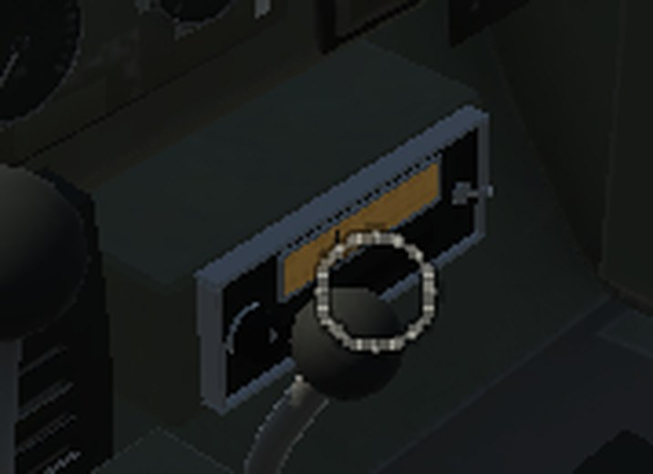

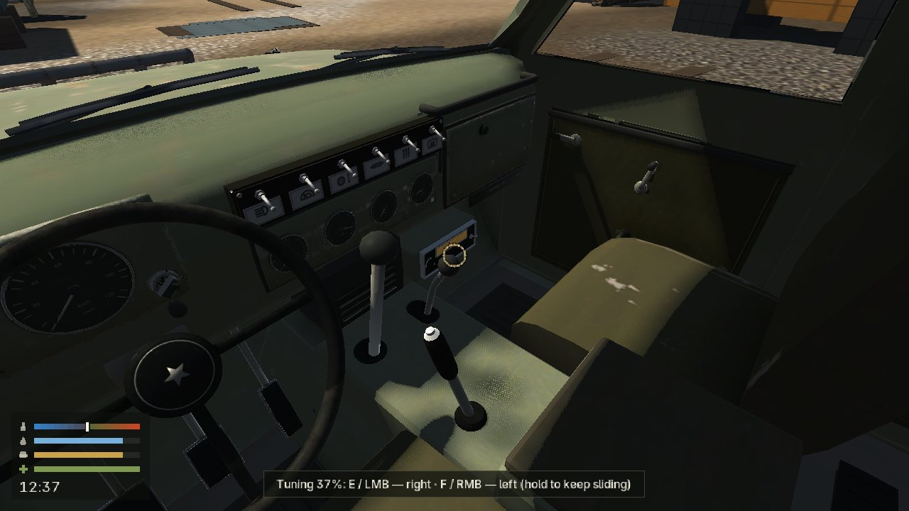

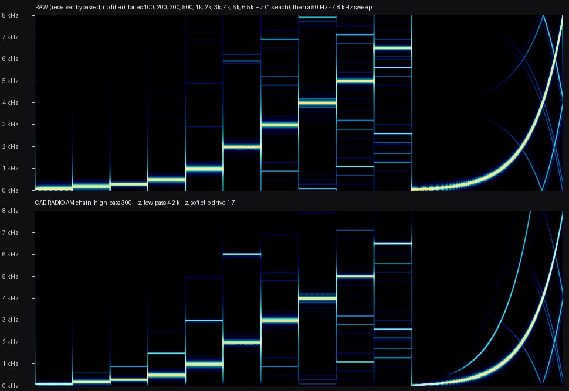

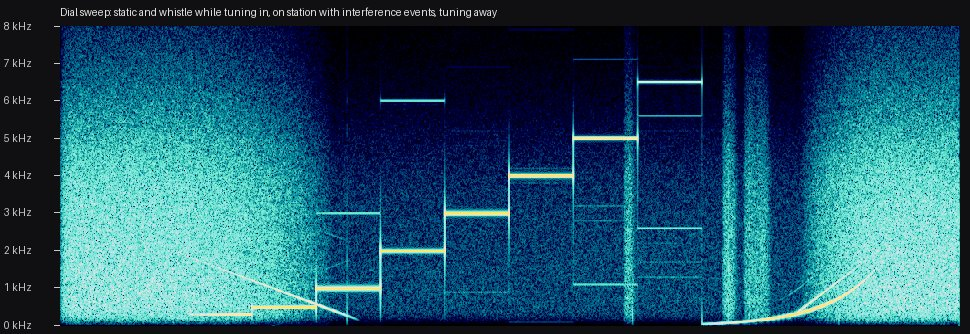

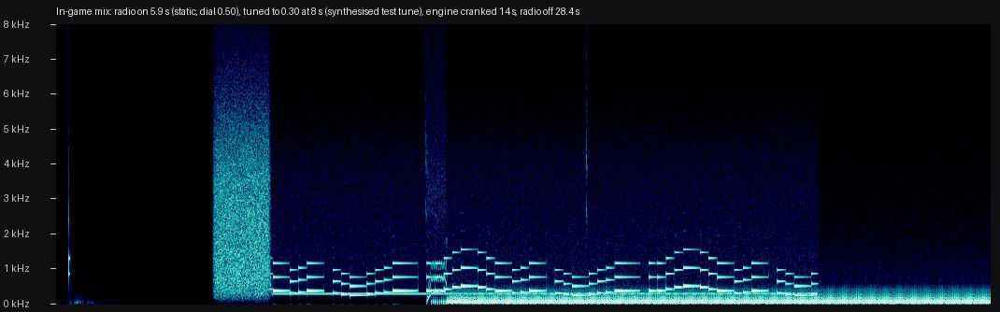

## 280. Цель 1,5–2× достигнута: в 4K от 1,50× до 4,5× во всех сезонах относительно исходного HEAD, в 1080p от 1,59× до 5,5×

06:55 · PERF · Производительность D3D12, проход 2

Коммит: [f2444c4f8d](https://github.com/shsanek/EXEcutor/commit/f2444c4f8d)

Ветка: `work/peregon-perf3-pass2`

Сравнение с исходным HEAD (после преждевременного слияния стриминга) и с первым проходом, 3 + 3 чередующихся повтора, база замера 36ad24c6bd. Изменения: общий пул задач; параллельные шаги стекла кабины, запросы небесной окклюзии, ячейки разброса природы и подлеска, теневые маски; объединённые группы материалов ближнего рельефа на D3D12 (две групповые проходки вместо слоёв); растительность и трава перед наложением грунта, снег перед растительностью; отбраковка отбрасывателей теней по прогону; блочный кэш вырезов снега; кэш видимости стёкол и пропуск замёрзших; O(1) проверка пустоты колеи для травы. Что ограничивает кадр теперь: 4K на месте — GPU (≈4,1–4,3 мс: трава 1,25, растительность 1,0, базовый сплат 0,8, небо/облака 0,9); зима и слежавшаяся дорога — главный поток (93–97 %); 1080p — главный поток (симуляция ≈1,0–1,3 мс, подготовка теней 0,8–1,5, бэкенд D3D12 ≈1 мс на 1 230–1 440 draw). Процесс использует 3,4–4,7 из 16 логических ядер. Оценка для RTX 4060 (пересчёт, не замер): ≈9 мс в 4K на месте, ≈2,5 мс в 1080p. Следующий шаг — путь GPU для снега и колеи на D3D12 по хендоффу владельца (без пересборки меша на CPU).

- ✓ ctest: rhi_d3d12, world, nature, map, surface_stream, vehicle, net, net_world, save, play_cargo, glass_weather, sky_occlusion, forage_play, winterplow, snow_launch; shaderc golden 511 файлов; ночной и дневной двор, сезоны — попарно
- ✗ Прежние падения: world_tests slice_layout_loads (4 зоны против 6), map_tests incremental_snow_mesh 12/14
- ✗ Не сделано: путь GPU для поверхности на D3D12 (идёт), многопоточная запись команд (RHI однопоточный), пропуск тени сплата на D3D9 (не влезает в ps_2_0)

| Сценарий | 4K медиана, мс (HEAD → сейчас) | 4K × к HEAD | 1080p сейчас, × к HEAD |
| --- | --- | --- | --- |
| Лето, на месте | 6.76 → 4.15 | 1.63× | 2.38 мс, 1.59× |
| Лето, проезд | 20.40 → 10.92 | 1.87× | 8.67 мс, 2.32× |
| Лето, дорога 40 км/ч | 6.34 → 4.12 | 1.54× | 2.76 мс, 2.27× |
| Осень, на месте | 7.42 → 4.29 | 1.73× | 2.70 мс, 1.61× |
| Осень, проезд | 22.09 → 12.39 | 1.78× | 9.84 мс, 2.26× |
| Зима, дорога, слежавшийся снег | 5.67 → 3.79 | 1.50× | 3.12 мс, 1.61× |
| Зима 0,75 м + метель, на месте | 9.80 → 5.39 | 1.82× | 4.04 мс, 2.29× |
| Зима 0,75 м + метель, проезд | 73.24 → 16.27 | 4.50× | 12.80 мс, 5.50× |
| Метель, дорога | 14.43 → 5.55 | 2.60× | 4.51 мс, 3.14× |

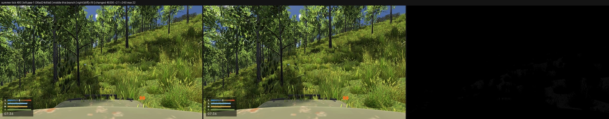

## 281. Блокнот листается A/D и с закладками, записи по заданиям сгруппированы с архивом, рация слышна везде, вкладка «Доработки» оружия, вкладка «Звук»

07:30 · UI · Блокнот, рация, оружие, звук

Коммит: [8a4ba53d80](https://github.com/shsanek/EXEcutor/commit/8a4ba53d80)

Ветка: `work/peregon-ui-notes`

Блокнот: A/D листают страницы (удержание не листает), справа закладки по разделам с красной точкой непрочитанного — «Дела»: Сейчас / Рация / Узнал / Архив / Заметки; «Записи»: по дням; «Рецепты»: Знаю / Не знаю; «Лес»: Грибы / Ягоды. Записи по заданиям сгруппированы (story::note_groups): сначала отслеживаемое, затем по последней активности с числом новых строк и строкой «Дорога: …»; находки под своим заданием, слухи — «Разное»; выполненные и проваленные — в «Архиве», свёрнуты в одну зачёркнутую строку и раскрываются кликом. Работа из радиорубки сразу отслеживается у взявшего игрока (и в коопе). Звонки по рации слышат все бодрствующие игроки где угодно, субтитры поверх любого экрана, активное задание не меняется, метка «◆ В блокноте новое по рации: N» до открытия блокнота, после звонка — «записал в блокнот». Инвентарь: вкладка «Доработки» — что стоит на ружье, что даёт каждая доработка, заряд в стволах, заказ у Кузьмича, таблица «завод / сейчас / разница» по 10 характеристикам. Настройки: вкладка «Звук» — общая, техника, поверхности (шаги и шины), животные, рация; новые шины микшера surface и fauna, вся техника на шине engine; меняется сразу, сохраняется в settings.txt; единственный писатель громкости рации.

- ✓ ctest: story 64/64, play_journal 21/21, play_story 23/23, audio 46/46, radio 16/16, save 22/22, immersion 10/10, gunsmith 11/11, play_gunsmith 9/9, inventory 23/23, loc 9/9, play_cargo 68/68; story_lint 0 ошибок
- ✗ Открыто: в шрифте нет ✓ и ▸ — заменены на ◆ и «»; заказы рыбной лавки отслеживаются вручную; голос рации — синтетическое бормотание; меню W12 показывает только общую громкость и рацию

## 282. Универсальные лыжи: ход, спуск с прыжками и бугель, который крутит грузовик на роликовом стенде

08:10 · SKI · Лыжи и бугель

Коммит: [a340ea4e4d](https://github.com/shsanek/EXEcutor/commit/a340ea4e4d)

Ветка: `work/peregon-ski`

Одна пара лыж для хода, спуска и бугеля (у Зины на озере осенью и зимой, 180 талонов; Q — надеть/снять, P — за спину/в руки, в кабину — снимаются сами). Классический ход: W в такт (0,55–1,15 с) — полный толчок, удержание — 85 %, Shift — толчок палками; в гору ёлочкой выше 9° и лесенкой выше 20°. Скорость по состоянию снега из маленькой модели погоды: пух, слежавшийся, накатанный, наст, мокрый, лёд, голая земля; давление лыж 2,9 кПа — наст держит, сапоги проваливаются; по голой земле 0,6 м/с с износом. Спуск: гравитация и сопротивление воздуха, повороты ограничены сцеплением кантов, плуг (S), стойка (C), прыжки с сугробов и бугров с оценкой приземления, падения без рэгдолла, удар о дерево с уроном; камера чуть шире и дрожит на скорости, шорох лыж по типу снега. Бугель: роликовый стенд (900) и верхний блок с тросом (450); правила установки — 25–320 м, уклон 5–28°, трос без горбов и провисаний, без деревьев и построек, стенд на ровном. Грузовик заезжает на ролики, мотор заведён, игрок выходит и жмёт E: ручной газ держит трос на 2,6 м/с, колёса видимо крутятся со снежной пылью, жжётся своя солярка; трос встаёт при пустом баке, заглохшем моторе, если кто-то сел в кабину или машина съехала. Спуск на время от вершины — 60 талонов, если обогнать уговор Лесопилки. Сохранение и кооп с хоста (протокол 22).

- ✓ ctest: ski 13 (новый), ski_play 8 (новый, вкл. кооп по UDP), survival 35, play_cargo 68, inventory 23, save 22, net 18, net_world 10, coop_audit 25, vehicle 119, view 55
- ✓ Замеры: сапоги в 90 см снега 0,32 м/с против лыж 1,12 м/с; накатанная лыжня 3,99 м/с; гора 110 м 16° — 43 км/ч, полёт до 0,60 с; удар о дерево на 12 м/с — здоровье 100 → 63; стенд: трос 2,65 м/с, ≈2540 об/мин, 0,5 л солярки за подъём
- ✗ Открыто: модели — примитивы (стенд, блок, бугели, лыжи, палки) → задача SKIART в Blender; лыжник скользит в стоячей позе; чужой шорох лыж не слышен; клиент в коопе на лыжах повторяет позицию хоста с задержкой; на карте нет готовых склонов и трамплинов; иконки дорисованы в атлас скриптом — риск конфликта бинарного атласа

## 283. Опыт тратится на навыки: семь веток, скромные бонусы и навыки-знания, вкладка «Навыки» в блокноте

08:45 · SKILLS · Навыки

Коммит: [0cc9ccf057](https://github.com/shsanek/EXEcutor/commit/0cc9ccf057)

Ветка: `work/peregon-skills`

data/survival/skills.txt: 7 веток и 29 узлов с русским и английским названием, точным эффектом, ценой, предпосылками. Тело (Выносливость, Сила, Закалка по три ступени), Дорога (расход топлива, лопата, лебёдка), Механика (ручка, сифон, «Слух на мотор» — износ мотора и заряд по щупу), Стоянка (костёр, сырая вода, готовка, голод), Лес (удары топором, взмах, колка, перенос брёвен), Охота и рыбалка («Читать след» — возраст следа до часа, разброс и отдача дробовика, разделка, подсечка, леска), Лыжи. Бонусы 5–25 % на узел, всего не больше −15 % расхода сил, +6 кг рюкзака и 3 °C к холоду. Эффекты идут через существующие значения в месте использования. Вкладка 7 «Навыки» в блокноте с боковыми закладками; два клика — выбрать и выучить. Опыт общий у артели, каждый игрок тратит его на себя; ранги считают весь опыт; изучение — команда на хосте, сохранение и кооп (протокол 23). Всё дерево — 10 700 опыта: ≈24 ч в темпе сюжета, ≈18 ч смешанно, 10–12 ч на одной доске; сюжет даёт ≈75 % дерева (оценки по данным, не замер).

- ✓ ctest: skills 7/7 и skills_play 5/5 (новые); survival, care, food, hunt, ski, save, net, woodcut, hunt_play, play_cargo, coop_audit, net_world, play_care, food_play, inventory, coop_slots, play_water, play_gunsmith, play_journal, fauna_play, ski_play
- ✗ Открыто: часы игры — оценка; эффекты оружия только для дробовика в руках; баннер «Выучено» скрыт при открытом блокноте; сброса навыков нет (по замыслу); работа «дрова» даёт мало опыта в час

## 284. Долг солярки — тому, кто одолжил; без брони у механика; вернулись осмысленные поездки; дороги втрое короче; без чёрных точек на сгибах карты

09:20 · OWNERFIX · Правки владельца

Коммит: [1340a77354](https://github.com/shsanek/EXEcutor/commit/1340a77354)

Ветка: `work/peregon-ownerfix`

Займ запоминает заимодавца (сохранение и кооп); вернуть солярку или купоны можно только ему, остальные напоминают и называют его («Палыч на Лесопилке всё ждёт свои 20 л»; «Не мне… Палыч, на Лесопилке. Туда и вези»), хост отклоняет чужой возврат. Квест и цель на экране называют заимодавца и его дом. Запасной путь: если он в отъезде по расписанию — принимает взрослый из того же дома; если дома никого нет и займу 24 игровых часа (care.txt) — любой взрослый; старые сохранения — любой взрослый. Броня у механика скрыта флагом в upgrades.txt, команда отклоняется и у клиента, сохранения с бронёй грузятся как были. Пересмотрены все сокращения QUESTS (таблица quests.md §13.1): возвращены поездки, знакомящие с миром — удочка Толика у Лукича на турбазе (Толик отказывается от чужой удочки), весенняя клюква у Горлового, печная труба в мастерских разреза, стёкла у Степаныча (перепродажа Сыча — платный короткий путь); награды подняты; пустые поездки на Лесопилку остались короткими. Все 25 описаний дорог переписаны: по-русски в среднем 106 знаков вместо 319, по ориентирам, без метров («Мимо свалки вниз, вброд через ручей; у переезда через заброшенную ветку направо. За главным ходом — паром»); предел 320 знаков, проверка покрытия сохранена. Карта: на пересечениях сгибов скрипт старения пробивал дыры, сквозь которые был виден тёмный фон — теперь потёртая бумага.

- ✓ Тесты (запуском exe из games/peregon): story 65/65, care 21/21, save 22/22, paper_map 17/17 (+15 Python), play_dialogue 58/58, play_story 23/23, play_journal 21/21, play_care 44/44, coop_audit 25/25, coop_seats 25/25; story_lint 0 ошибок
- ✗ Найдено: под ctest тесты, которым нужна карта R1, молча пропускаются — отдано агенту CTESTFIX
- ✗ Открыто: одолженная удочка забирается сразу по окончании ухи, где бы игрок ни был; строки про заимодавца без родовых глаголов; подпись лебёдки у механика вылезает за кнопку

## 285. Солнце на рассвете — настоящий диск вместо пятна на полнеба, лучи сквозь деревья, заметная дымка, трава вблизи из травинок

09:40 · VISUAL · Солнце, лучи, дымка, трава

Коммит: [3ad5672983](https://github.com/shsanek/EXEcutor/commit/3ad5672983)

Ветка: `work/peregon-visual`

Причины «пятна»: ореол неба ≈29° и игнорировал свою силу, диск в 2,5 раза больше и всегда белый, всё ярче белого обрезалось в белое. Теперь диск 0,53°, у горизонта оранжевый, ореол ≈13° с ярким кольцом 3°; яркие участки неба и облаков сохраняют оттенок (без изменений шейдеров D3D9); облака у низкого солнца растворяются в сиянии, кромки золотые. Лучи солнца (только D3D12): радиальное размытие к зрителю в половинном разрешении, их перекрывают деревья, кабина, руки и облака; выключены, когда солнца нет в кадре, ночью или с --perf-off 65536; новая функция RHI копирования глубины (интерфейс 6). Дымка светлее и плотнее, гуще в летнюю жару и прозрачнее в мороз: в ясный полдень 43 % на 1 км (было 36 %) и 74 % на 2,4 км; бледная полоса у горизонта, зенит синий. Трава до 6,5 м — 300 травинок на м² пучками: гнутся, качаются, темнеют к корню, светятся на просвет, принимают тени; карточки в этом кольце уменьшены до 40 %; вытаптывание, иней и увядание как у карточек. Облака: перечитаны Schneider (Horizon Zero Dawn, Nubis) и Hillaire (Frostbite), 10 улучшений, сделаны три; дальнейшие эффекты с ценой — docs/visual.md §8.

- ✓ Тесты: rhi, rhi_d3d12 26/26 (новый тест копирования), light 35/35, nature, shaderc; 159 шейдеров D3D12 собираются fxc; D3D9 собирается, лимиты ps_2_0 соблюдены; хэши симуляции не изменились
- ✓ Цена (RTX 5080, GPU мс/кадр): 4K лето 13:20 4,12 → 4,14; 4K лето 20:40 4,10 → 4,13; 4K осень с лучами 4,19 → 4,50; 1080p 1,49 → 1,51; проход травы ≈1,02 → 1,00; лучи ≈0,17 + две копии глубины ≈0,12
- ✗ Открыто: Metal не собирался на этой машине, лучей там нет; дымка у солнца может обрезаться без HDR-цели; у травинок нет GI; нет настроек графики для лучей и травинок; пределы дымки HZ1 в light_tests смягчены по просьбе владельца

## 286. Тесты с картой R1 больше не проходят молча без карты: путь передаёт ctest, пропуск виден, сбой запуска региона — падение

10:10 · CTESTFIX · Тесты с картой

Коммит: [4e4b5db688](https://github.com/shsanek/EXEcutor/commit/4e4b5db688)

Ветка: `work/peregon-ctestfix`

Пропуск давал код выхода 0, и ctest показывал «Passed»; play_dialogue_tests под ctest не находил карту и пропускал 57 тестов; region_stream_check и region_static_check на win64 не регистрировались (защита if(NOT WIN32) от старой кросс-сборки); в fauna, hunt, play_*, net_world, play_care и scrap любая ошибка запуска региона маскировалась под «нет карты». Теперь: кэш-переменная PEREGON_TEST_MAP_DIR и функция peregon_map_test() (PEREGON_MAP_DIR, SKIP_RETURN_CODE 77, метка map) для всех 14 модулей; общие помощники в tests/peregon_test.h, MAP_UNAVAILABLE пропускает только при реально отсутствующем pak, иначе падение; раздел «Map-backed tests» в BUILD.md (ctest -L map).

- ✓ ctest -L map: 13/14: region_static_check, play_care 44/44, net_world 10/10, scrap 5/5, road_return 2/2, play_gunsmith 9/9, play_story 23/23, play_journal 21/21, play_dialogue 58/58 (8 704 проверки), forage_play 12/12, play_lake 14/14, fauna_play 11/11, hunt_play 14/14
- ✗ Реальное падение: region_stream_check: нет физической земли в 300 м через 50 мс в ≈10 точках — отдано агенту STREAMFIX

## 287. region_stream_check на Windows: ошибка была в тесте, не в игре; добавлена проверка задержки готовности физики

10:45 · STREAMFIX · Проверка стриминга региона

Коммит: [b94f18147f](https://github.com/shsanek/EXEcutor/commit/b94f18147f)

Ветка: `work/peregon-streamfix`

sleep_for(500 мкс) в Windows округляется до Sleep(1) ≈ 15,6 мс, поэтому за 50 мс тест успевал поставить 3–4 тайла (на Mac сон ≈ 0,5 мс). Почти все «провалы» — прыжки 600–5 800 м между несвязанными дорогами, где игра сама грузит землю синхронно (ensure_ground). Проверка земли и синхронная подгрузка вынесены в общие функции play::region_ground_ready / region_ensure_ground (поведение игры не изменилось); тест применяет ту же подгрузку на прыжках, ждёт без Sleep и проверяет задержку готовности физики против запаса при 200 км/ч. Код стримера не менялся с до первого прохода оптимизации.

- ✓ Тесты: region_stream_check 3/3 и под ctest, region_static_check, net_world, play_cargo; map_tests 50/51 и world_tests 35/36 — только прежние падения
- ✓ Замеры (3 прогона, 32 км): ожидание в движении до 24 мс (бюджет 50); синхронные подгрузки до 40 мс; готовность физики в среднем 17 мс, максимум 60 мс при запасе 21,2 с

## 288. Снег и колея рисуются из данных в видеопамяти без пересборки меша на CPU: метель на дороге ×4 к испорченному HEAD и ×2 к неиспорченному билду (промежуточные цифры)

12:30 · PERF · GPU-путь снега и колеи на D3D12 (промежуточно)

Коммит: [4ca1036e2e](https://github.com/shsanek/EXEcutor/commit/4ca1036e2e)

Ветка: `work/peregon-perf3`

По хендоффу владельца (surface-streaming-handoff-2026-10-14.md §3): в D3D12 добавлены compute и буферы хранения; погода, проекция вершин и чтения для снимков — на GPU без копирования атласа на каждый вызов; постоянная геометрия снега не зависит от глубины, глубину, нормали, отсечение, колею, воду и грязь в колее считает видеокарта; диспатч только при изменившихся входах; продвижение контакта только для движущихся машин (5 м), Superhot удерживается 30 кадров; шапки снега следуют глубине на GPU. Первый замер метели на дороге 1080p: 4,59 → 3,50 мс против CPU-пути той же сборки, пересборок кусков снега 117 тыс. → 8 тыс., загрузок 1,87 → 0,33 ГБ, без блокирующих чтений в кадре. Исправлен давний map_tests incremental_snow_mesh. Таблица ПРОМЕЖУТОЧНАЯ: 3 повтора для HEAD, прохода 2 и GPU-пути (a8f3925c8c), 1 повтор неиспорченного d2d7321b62, 2 + 2 в 4K после ребейза, клетки 1080p после ребейза оценены по отношению 4K. Полный прогон — ночью (tools/render_matrix.sh).

- ✓ Тесты: rhi_d3d12, surface_stream, vehicle, net, net_world, save, play_cargo, snow_launch, winterplow, world — 10/10; map_tests 52/52 (incremental_snow_mesh исправлен, новый тест постоянной геометрии); короткий D3D12-прогон метели — отладочный слой 0 ошибок
- ✗ Промежуточно: часть клеток оценена; лето/осень к проходу 2 ≈1,0 (GPU-путь их не касается); полный прогон 4K + 1080p ночью

| Сценарий | × к испорченному HEAD (4K / 1080p) | × к неиспорченному билду | × к проходу 2 |
| --- | --- | --- | --- |
| Метель, дорога | 4,06 / 4,12 | 1,98 / 2,00 | 1,31 / 1,33 |
| Зима, проезд по снегу | 6,07 / 6,08 | 1,96 / 1,90 | 1,10 / 1,12 |
| Зима, на месте | 2,33 / 2,50 | 1,68 / 1,85 | 0,99 / 1,10 |
| Дорога, слежавшийся снег | 1,84 / 1,64 | 1,45 / 1,36 | 1,04 / 1,04 |
| Лето и осень | 1,49–2,22 | 1,25–1,75 | 0,97–1,00 |

## 289. Возвращено прежнее рассветное зарево, но в ≈0,4 прежнего радиуса, без оранжевого шара и кольца; плавные переходы LOD; настройки лучей, травинок и переходов

12:00 · VISUAL2 · Рассвет и плавные LOD

Коммит: [5f66df0dbe](https://github.com/shsanek/EXEcutor/commit/5f66df0dbe)

Ветка: `work/peregon-visual2`

По замечанию владельца («солнце стало хуже — оранжевый шар с кругом; старый рассвет нравился, но занимал полнеба»): вид зарева до VISUAL восстановлен и ограничен ≈0,4 прежнего радиуса, солнце — мягкий бело-тёплый диск без оранжевого шара и кольца, у рассвета персиковый, а не пурпурный оттенок, днём над головой маленькое белое солнце. Плавные переходы между LOD (D3D12/Metal, дизеринговое растворение): деревья, кусты и камни; объекты и подлесок (LOD и дальность отсечения); рельеф (LOD кусков, режим тайлов, растворение свежеподгруженных тайлов); текстурный LOD построек на 90 м. В настройках графики — переключатели лучей солнца, травинок вблизи и плавных переходов. Цена всех частей: 4K лето на месте 4,17 → 4,27 мс GPU, 1080p 1,52 → 1,56.

- ✓ Тесты: light, nature, save, rhi, rhi_d3d12, world, shaderc
- ✗ Открыто: переходы снега и колеи (зона PERF) не трогались; на D3D9 растворения нет

## 290. Шина героя: 30 радиальных спиц от жёсткого диска × 3 сектора + боковины, давление по газовому закону, скелет шины — смятие видно в игре

13:10 · WHEEL · Шина со спицами

Коммит: [a55f78e33a](https://github.com/shsanek/EXEcutor/commit/a55f78e33a)

Ветка: `work/peregon-wheel`

src/vehicle/tyre.cpp: каждая спица начинается на жёстком диске (0,26 м) и только укорачивается к нему; при пробое шина садится на диск как на твёрдый упор, диск не деформируется. Элемент давит давлением газа (идеальный газ — давление растёт при уменьшении объёма) на свою площадь плюс жёсткость каркаса; опрашиваются только элементы у земли (13 запросов грунта на колесо). Нормаль — направление суммы сил элементов, точка контакта — центр по силам; плечо может нести больше нагрузки и кренить колесо; колесо наполовину в колее частично проседает; боковина, прижатая стенкой колеи или бревном, толкает ступицу вбок. Выпучивание только у нагруженных спиц, на несколько см; размер шины от давления не растёт. Параметры колеса — data/vehicle/wheels.txt (диск, число спиц, сектора, кольца боковин, давление, объём, жёсткости, затухание; горячая перезагрузка через PEREGON_WHEELS_FILE), три уровня шин — три конфигурации; старая модель — model = 0 (остальные грузовики). Blender, стадия 45: 211 костей на колесо, диск/ступица на жёсткой кости; экспорт 8 шин как скин-мешей, деформация на CPU (90 мкс/кадр); передаётся в кооп (протокол 24). У механика для шин — давление воздуха, прогиб и давление на грунт.

- ✓ ctest: vehicle 129/129 (10 новых тестов шины), view 56/56, snow_launch 7/7, play_cargo 68/68, play_care 44/44, net 18/18, net_world 10/10, coop_audit 25/25, coop_seats 25/25, save 22/22, timewarp 10/10, winterplow 7/7, ski_play 8/8, road_return 2/2
- ✓ Стоимость: физика 78,9 → 84,3 мкс/тик (+7 %); первая версия была 213 мкс
- ✗ Изменения поведения — проверка владельцем: стенки самовыкопанной ямы держат: Т1 + 600 кг в пойме задним ходом не выбирается, раскачка в ливень &lt; 2 м (лебёдка и лопата работают); трогание Т3 в пойме за 8 с 32,7 → 14,8 м; с открытым клапаном машина ниже на 1,6–2,6 см
- ✗ Открыто: свойства грунта, тяга и боковое сцепление пока на колесо целиком, радиус качения номинальный — задача WHEEL2; камни карты не являются опорой для шины (снимок «камень» слабый, случай доказан лабораторным тестом); нет GPU-скиннинга шин

| Уровень | Воздух, клапан закрыт / открыт | Прогиб, закрыт (открыт) | Давление на грунт, закрыт (открыт) |
| --- | --- | --- | --- |
| Т1 | 50 / 18 кПа | 3,1 (5,6) см | 59 (39) кПа |
| Т2 | 37 / 13 кПа | 3,5 (6,1) см | 45 (31) кПа |
| Т3 | 31 / 10 кПа | 3,8 (6,5) см | 38 (26) кПа |

## 291. Травинки освещаются и окрашены как карточная трава, редеют по той же формуле, втрое гуще у ног, приминаются ногами и колёсами; «Дальность травы» 0–300 %

15:40 · GRASS · Травинки как трава, дальность травы

Коммит: [575654a441](https://github.com/shsanek/EXEcutor/commit/575654a441)

Ветка: `work/peregon-grass`

Причины «блеска»: у травинок были своя нормаль с wrap-освещением (до 1,15× солнца и мерцание при повороте на ветру), подсветка на просвет до 2,4× у кончиков на низком солнце, плоский салатовый цвет насыщеннее карточек, нет варианта с GI и прохода теней фар, субпиксельные кончики искрили. Теперь шейдер травинок построчно повторяет формулу карточек (включая GI и фары), цвет каждой травинки — непрозрачный тексель из атласа карточек, ширина не меньше ≈1 пикселя. Плотность по формуле затухания карточек до 12 м: 900/м² у ног (втрое больше), 560 на 2 м, 240 на 4 м, 77 на 6 м. Карточки под густыми травинками уменьшаются и по ширине (раньше выглядели примятыми ковриками). Ноги игрока и колёса грузовика приминают траву (раньше только звери, туши и грибы) — одинаково для карточек и травинок. «Дальность травы» 0 (выкл) … 300 %, сохраняется, применяется сразу.

- ✓ Совпадение материала: средняя разница яркости карточки/травинки 3,4 % (от −9,2 до +5,0 %); выбросы: золотой час на уровне глаз −9 %, луч фар ночью +17 % — геометрия, не освещение
- ✓ Цена (RTX 5080): 4K маршрут 4,28 → 4,28 мс при 100 %, 4,67 мс при 300 %; луг 4K 3,39 → 3,42 / 4,19; 1080p 1,60 → 1,60 / 1,81
- ✓ Тесты: nature, save, light, shaderc, rhi_d3d12, rhi, world, diffuse_gi, net_world; golden шейдеров и fxc (165 программ)
- ✗ Открыто: приминание прореживает, а не гнёт; 4 слота толкателей на всех; травинки только D3D12/Metal; rhi_d3d9_tests падают в двух SM2-тестах на этой машине (не трава); на крупном плане отдельные травинки заметно ярче/жёлтее соседних

## 292. Спуск шины теперь виден: нормали следуют деформации, шина стоит на земле, пятно контакта нужной длины

16:10 · TYREVIS · Видимый спуск шины

Коммит: [89bc6ceeff](https://github.com/shsanek/EXEcutor/commit/89bc6ceeff)

Ветка: `work/peregon-tyrevis`

Кран в кабине работал (давление 51,8 → 22,5 кПа, смятие в физике 3,1 → 5,4 см), но три ошибки отрисовки в src/view/tyre_skin.cpp прятали результат: нормали не обновлялись (тёмная резина освещалась как круглая), нарисованная шина утопала примерно на 1 см (плечи физической шины ниже, а протектор меша плоский), пятно контакта было на 25–30 % короче (линейное смешивание между костями через 12°). Теперь нормали и касательные поворачиваются с деформированными гранями, смятие поправлено на выпуклость протектора, каждая вершина берёт поле под своим углом с прямой линией земли между касающимися спицами; выпучивание боковины продолжено в пятне спущенной шины. Результат в тесте: ступица — низ шины 40,0 → 37,5 см, пятно 33,5 → 43,6 см, боковина у земли 16,8 → 17,6 см полуширины; совпадает с физикой в пределах 3 мм. Рекомендация: закрытое давление сделать дорожным (Т1 85 кПа: 1,8 → 5,7 см) — передано WHEEL2.

- ✓ Тесты: view 57/57 (тест нормалей), play_cargo 69/69 (новый hero_rendered_tyre_squats_when_the_cab_valve_is_open)
- ✓ Стоимость: скиннинг шин ≈90 мкс/кадр, ≈145 мкс во время стравливания
- ✗ Открыто: закрытая шина уже мягкая (18–19 % высоты боковины против 10–15 % на дороге) — WHEEL2 калибрует давление; меш шины грубый (32 сегмента), на склонах нижняя вершина протектора на 3–5 мм в грунте

## 293. Грязь учитывается по всей шине: грунт и тяга по секторам; радиус качения от прогиба; реалистичное дорожное давление 85/65/55 кПа

16:40 · WHEEL2 · Грунт по секторам шины, радиус качения, дорожное давление

Коммит: [ac87ccb00a](https://github.com/shsanek/EXEcutor/commit/ac87ccb00a)

Ветка: `work/peregon-wheel2`

Тип поверхности, мокрость (дождь и таяние), вода в колее, модификаторы грунта и брёвна берутся под каждым из трёх секторов протектора (по две точки); осадка, бульдозинг, присасывание, заглубление, уплотнение и сопротивление качению — по сектору с его грунтом и долей нагрузки (sector_soil = 0 даёт прежнее поведение бит-в-бит). Тяга: у каждого сектора своя ёмкость сцепления, закон проскальзывания считается один раз на сумму (устойчиво и детерминированно), сила делится по ёмкостям и приложена в точке сектора — моменты рыскания и развала следуют. На однородном грунте суммы совпадают со старой моделью в пределах 0,2 %; плечо на гравии тянет, плечо в глине проседает в 1,9 раза и уводит колесо к грязи. Эффективный радиус = свободный − треть прогиба: в проскальзывании, моменте, логике переключений; спидометр кабины теперь по вращению колёс (показывает пробуксовку); спущенная шина проходит 41,4 см на радиан против 42,7. Дорожное давление 50/37/31 → 85/65/55 кПа (Т1/Т2/Т3): прогиб 10,5–12,2 % закрыто, 33–38 % открыто; видимое приседание от крана 3,8–4,4 см вместо 2,4.

- ✓ Тесты: vehicle 132/132 (3 новых), snow_launch, play_cargo (вкл. тест приседания TYREVIS), play_care, net, net_world, coop_audit, save, ski_play, view
- ✓ Стоимость: физика 84,2 → 89,9 мкс/тик (бюджет 100)
- ✓ Выход из грязи от самой модели (ансамбли 6–18 прогонов): раскачка из своей ямы 14,9 → 16,3 м, лопата 16,5 → 17,1 м, лебёдка 8,4 → 9,4 м — не тяжелее
- ✗ Решение владельца — дорожное давление в грязи: с открытым краном всё как раньше; с закрытым: пойма Т1 18 → 2,9 км/ч, Т1 + 600 кг застревает, Т2 в ливень застревает, Т2/Т3 сами не трогаются; лопата 3,8 м (открыт 71 м), раскачка 4,6 м (открыт 52 м). Вариант — промежуточное положение крана (дорога/грязь/песок)
- ✗ Открыто: заглубление, ползучесть, уплотнение и забивание протектора — одно состояние на колесо; спидометр клиента в коопе по номинальному радиусу; на R1 нет прямой полосы грязи вдоль дороги у лагеря — сцена кромки на мокрой траве

## 294. Из-под колёс летит то, на чём стоит каждая треть протектора: камешки на щебне, пыль, комья, вода, снег; не больше пяти отрисовок

16:40 · FX · Брызги из-под колёс по поверхности

Коммит: [76f52f4ebb](https://github.com/shsanek/EXEcutor/commit/76f52f4ebb)

Ветка: `work/peregon-fx`

Раньше все мягкие поверхности (щебень, трава, песок, сухой грунт) кидали одинаковые бурые кубики — «грязь на гравии»; вторая система в эффектах атмосферы добавляла тёмные пятна на щебне и траве при мокром мире; капли были непрозрачными серыми кубами; каждая частица — отдельная отрисовка (до 600 в грязи); клиенты в коопе не получали проскальзывание, мокрость и глубину воды. Теперь каждая из трёх полос протектора выбрасывает своё: щебень — камешки, на сухом крошка и пыль, на мокром капли, никогда не грязь; сухой грунт — крошки и пыль, мокрый — комья; грязь — комья и мутная вода; лужи и броды — вода; трава — ошмётки, мокрая — капли; снег — комья на укатанном, пыль на свежем. Количество от пробуксовки плюс малая доля от качения (на щебне 40 км/ч ≈5 камешков в секунду на колесо); камешки отскакивают и ложатся, комья шлёпаются и прилипают к крыльям и днищу кузова на 0,5–2 с. Один общий буфер, до 5 пакетов (1–2 в кадрах), капли — полупрозрачные штрихи; пулы на 1000 твёрдых и 700 капель выделяются один раз. Кооп: 24 байта на колесо в новой версионной части потока физики (протокол не меняется).

- ✓ Тесты: vehicle 139/139 (7 новых), spray_render (новый), atmos_fx, net_world, coop_seats, coop_audit, play_cargo
- ✓ Счётчики (под нагрузкой, ориентировочно): пробуксовка в мокрой грязи: 636 твёрдых, 191 капля, 2 отрисовки, 36 мкс CPU; щебень 35 км/ч: 74, 2 отрисовки, 3 мкс; брод: 170 капель, 1 отрисовка
- ✗ Не измерено: время GPU не мерилось (плейтест владельца) — задача FXPERF, A/B через PEREGON_SPRAY_DRAW_OFF=1
- ✗ Открыто: камешки мелкие и плохо видны на фоне щебня; снежные комья белое на белом; сцена лужи на редких клетках карты, камыш закрывает; прилипшая грязь может висеть там, где кузов уже коробки; грязь на кузове не остаётся

## 295. Карты нормалей грунта были сломаны (инвертирован зелёный канал) — исправлены; параллакс с самозатенением вблизи, трипланар на склонах, камешки по образцу Decima, настройка «Рельеф поверхности»

17:40 · SURFDETAIL · Рельеф поверхностей

Коммит: [bc97cec706](https://github.com/shsanek/EXEcutor/commit/bc97cec706)

Ветка: `work/peregon-surfdetail`

Диагностика по assets/ground/runtime: у всех исходных карт нормалей грунта инвертирован зелёный (V) канал — при солнце с севера или юга бугры освещались как ямки (изгиб поля в 2,5–4 раза больше, чем у исправленных; высоты из исправленных нормалей коррелируют с альбедо +0,42…+0,87 против −0,36…+0,17). Карты были наклонены в среднем (трава 11°, песок 7°, грунт и щебень ≈5°), грязь, лесная подстилка, грунт и асфальт почти плоские; высоты брались из яркости альбедо (тёмные камни — ямы); на D3D12 хук выборки обходил 4× анизотропию; крутые склоны растягивали текстуру. Новый tools/ground/ground_relief.py исправляет соглашение, убирает наклон, задаёт силу по слою и строит высоты из нормалей (для всех бэкендов, включая D3D9). На D3D12 вблизи: параллакс (3–8 шагов) с коротким самозатенением к солнцу, затухание 14–22 м; трипланар на крутых склонах; затенение впадин по высоте; вода собирается во впадинах; анизотропия; слои с нулевым весом не выбираются. Рассыпанные камешки до 36 м (только графика). Настройка «Рельеф поверхности» (выкл/низкий/высокий). Death Stranding: публичного доклада о земле нет; Decima расставляет камни и мусор на GPU по правилам плотности (Horizon), у DS2 камни — плотные меши; взяты правила рассыпания камешков, слои по высоте, марш по полю высот вблизи вместо тесселяции, затенение по высоте.

- ✓ Цена (RTX 5080): «высокий» +0,14…+0,32 мс в 4K (гравийная площадка на весь экран — ровно на пределе 0,3), грунтовка ≈+0,22, лес +0,14; 1080p +0,05…+0,11; «низкий» +0,01…+0,06
- ✓ Тесты: shaderc, nature (новый тест камешков), light, rhi_d3d12, save (новый тест настройки), play_cargo; шейдеры D3D9 в лимитах
- ✗ Найдено, не связано: map_tests: 6 падений на униформе terrain_splat lodfade (c18) — есть и на стартовом c903cee0ab; нативный D3D9 play_region падает на старте при создании программы spot_cookie — задача REGRESS
- ✗ Открыто: D3D9/Metal получают только исправленные текстуры, без рельефа; на крутых склонах нормали боковой проекции не переориентированы; камешки размещаются на CPU, по отрисовке на ячейку; настоящих карт высот нет — восстановлены из нормалей

## 296. «Зверь» в блокноте: одна строка на зверя, без спама от повторов, записи живут два игровых дня

18:00 · HUNTNOTES · Страница «Зверь»

Коммит: [1d74993c41](https://github.com/shsanek/EXEcutor/commit/1d74993c41)

Ветка: `work/peregon-huntnotes`

Новый признак обновляет строку своего вида: день и время, место, что замечено. Приоритет: прочитанный след &gt; увиденное &gt; рассказ местных &gt; услышанный голос; более слабый признак заменяет сильный, только если строке больше 2 игровых часов. Повтор того же признака (то же место, направление, число) ничего не меняет 60 игровых минут, затем только сдвигает время. Строки старше 48 игровых часов исчезают сразу, хост чистит данные каждые 10 игровых минут; старые сохранения при загрузке сжимаются (тестовое сохранение с 334 записями о зверях — 2 строки), записи журнала остаются. Значок «◆» только при новой строке или новых сведениях, отдельно у каждого игрока. Параметры — data/fauna/signs.txt [notes].

- ✓ Тесты: coop_audit, play_journal, fauna_play, save, fauna; 3 новых теста (120 кряканий за 4 часа = 1 строка; срок 2 дня и сжатие старых сохранений; клиент в коопе)
- ✗ Чужое падение: hunt_play 16/17: hunt_stock_rope_is_removable_saved_and_loads_an_adult_boar_alone падает и на исходной точке ветки — в списке REGRESS (на паузе по решению владельца)
- ✗ Открыто: у клиента в коопе обновлённая строка доходит до ≈3 с при полном блокноте; длинной истории охоты нет (бэклог HS-6)

## 297. Трава без резкой границы и до 1800 м на 300 %, растёт под ногами, ветер пятнами порывов; на D3D12 — постоянный пул ячеек и инстансинг

18:20 · GRASSGPU · Трава: дальность, ветер, инстансинг

Коммит: [a548bf1b6c](https://github.com/shsanek/EXEcutor/commit/a548bf1b6c)

Ветка: `work/peregon-grassgpu`

Граница травы: дальние ячейки 128 м брали минимум высоты из пяти точек в ±5,3 м — на склоне 30 % трава уходила на 1,6 м под землю (голая прямая линия на холмах), теперь минимум, нейтральный к уклону; на стыке ближней и дальней травы дальние ячейки покрывали треть — предел расширения пучков 3 → 6. «Дальность травы» 0–300 %: на 300 % трава до 1800 м (4,5× от 100 %, 1,5× старых 300 %), количество как у старых 300 % (+1–4 % треугольников), растягивается только хвост; за 1600 м дальние ячейки строятся по грубой карте; плотность у границы ≈0 на любой настройке. Выреза под ногами больше нет, у глаз трава ограничена по высоте. Ветер: одно мировое поле шума для карточек и травинок, пятна порывов 28 м движутся с ветром погоды и чуть светлее при наклоне, лёгкое дрожание, изгиб к кончику без изменения длины, в штиль почти неподвижно; параметры в grass.txt; D3D12/Metal (D3D9 — старое качание). Инстансинг D3D12: RHI set_vertex_storage и draw_indexed_instanced; данные ячеек в постоянном GPU-слоте, пишутся только при постройке или изменении снега; общие значения раз за кадр, свет и туман ячейки считает шейдер; отсечение на CPU, отрисовка группами по тайлу маски теней и корзине числа пучков. Попиксельно не бит-в-бит: 1,24 % пикселей, среднее 0,07/255 (иное округление скомпилированного кода).

- ✓ Тесты: rhi_d3d12 27/27 (новый тест инстансинга), shaderc (golden + тест шума), nature, light, save, world, diffuse_gi
- ✗ Открыто: D3D9 не запускается на этой машине (программа теней фар — CreateVertexShader failed; было и до изменений) — в списке REGRESS; Metal не компилировался; на 300 % после телепорта дальнее кольцо заполняется ≈10 с

| Случай | Отрисовки | Загрузка в GPU/кадр | CPU трава, мс | GPU трава, мс |
| --- | --- | --- | --- | --- |
| 1080p 100 % | 75 → 35 | 282 КБ → 14 КБ | 0,18 → 0,10 | 0,41 → 0,39 |
| 1080p 300 % | 482 → 78 | 1,8 МБ → 46 КБ | 0,84 → 0,34 | 0,62 → 0,62 |
| 4K 100 % | 75 → 35 | 282 КБ → 14 КБ | 0,20 → 0,12 | 1,25 → 1,18 |
| 4K 300 % | 482 → 78 | 1,8 МБ → 46 КБ | 0,87 → 0,35 | 1,62 → 1,57 |

## 298. Брызги воды по касательной к протектору и скорости машины: хвост при буксовке, веер в лужах, носовая волна в броде; капли — штрихи, а не «тарелки»

18:45 · FXWATER · Вода из-под колёс

Коммит: [235c248bfd](https://github.com/shsanek/EXEcutor/commit/235c248bfd)

Ветка: `work/peregon-fx-water`

Причина жалобы: капли рисовались жёсткими серыми пятнами 7–17 мм прямо у объектива («тарелки»), носовые капли летели вперёд и вбок со скоростью машины, отрисованные лужи на дорогах не брызгали. Теперь капля вылетает со скоростью ступицы плюс касательной скоростью протектора в мировых координатах: катящееся колесо оставляет воду почти на месте, буксующее бросает «петушиный хвост» назад, в стоячей воде веер в стороны, в броде глубже 12 см носовая волна у бампера (задним ходом — у задка); баллистика с сопротивлением по размеру капли. Вид: тонкие полупрозрачные штрихи по экранному движению, медленные — круглые, блик солнца, бурые только на грязи, гаснут у объектива; белая водяная пыль у колеса, пена на воде брода, кольца от падающих капель — всё в одной отрисовке атмосферы, пулы прежние. Количество от пройденного по воде, глубины и пробуксовки. Лужи на дорогах и вода в колее теперь считаются стоячей водой под шинами. Камни, пыль, грязь и снег не менялись.

- ✓ Тесты: vehicle 142/142 (новый тест направления: 3 курса, вперёд/назад, качение/буксовка, передние/задние), atmos_fx 20/20, spray_render 2/2, net_world 10/10, coop_audit 25/25, play_cargo 69/69
- ✓ Замеры (юнит): лужа 8/20/40 км/ч: 31/119/256 капель/с на колесо; брод 16 км/ч: 98 % капель позади машины
- ✗ Открыто: время GPU не мерилось (F-B9); поверхность воды сама не поднимается волной (F-B6); мягкое затухание у земли на CPU (F-B7); вид настроен по 720p — нужен плейтест

## 299. Капли воды летят по настоящей баллистической дуге и рисуются каплей со следом вдоль дуги; крупные разбиваются при ударе

20:05 · FXWATER2 · Капли по дуге

Коммит: [3bd9e50739](https://github.com/shsanek/EXEcutor/commit/3bd9e50739)

Ветка: `work/peregon-fx-water2`

Ошибки интегрирования не было: гравитация и сопротивление применялись к текущей скорости каждой капли. «Постоянный угол и скорость» давали линейное сопротивление (самые мелкие капли за 0,35 с выходили на падение 3,4 м/с и дальше летели под одним углом), короткая жизнь 1,05–1,4 с (капли пропадали в воздухе) и прямой эллипс, торчащий вперёд по касательной. Теперь: капли 1–5 мм с предельной скоростью по размеру (4,0/6,5/8,0/9,1 м/с), квадратичное сопротивление g/vt² (шаг 60 Гц в пределах 0,4 % от точного решения), средняя капля протектора 2 мм, жизнь до 2,4 с — до земли, воды или кузова. Капля ≥ 2,6 мм при ударе быстрее 2 м/с даёт 2–3 мелкие брызги (пока пул заполнен меньше чем на 75 %). След — реальные прошлые положения капли за 22 мс, два отрезка, изгибается вдоль дуги и лежит позади; круглая яркая головка, след сужается до 35 %; одна отрисовка, пиксельный шейдер 55 из 64 слотов ps_2_0.

- ✓ Тесты: vehicle 144/144 (3 новых: баллистическая дуга, разворот и дробление в луже 40 км/ч, изгиб следа), atmos_fx 21/21, spray_render 2/2, play_cargo 69/69; golden шейдеров
- ✓ Замеры: высокий вылет на 40 км/ч: угол 71° → −75…−81°, скорость 7,2 → 1,1–1,8 → 3,4–5,5 м/с, вершина 106–184 см; 1639 капель повернули вниз в среднем на 44°
- ✗ Открыто: в камере погони собственная скорость камеры почти выпрямляет быстро уходящие капли (F-B10, нужен плейтест); капли не сносит ветром (F-B11); время GPU не мерилось

## 300. Трава гнётся дугой по ветру: постоянный ветерок, два слоя порывов Перлина, мягкие порывы с запаздыванием, своё покачивание у каждой травинки; 6/4 секций изгиба

20:35 · WIND + GRASSBEND · Ветер в траве

Коммит: [f2eb4565f1](https://github.com/shsanek/EXEcutor/commit/f2eb4565f1)

Ветка: `work/peregon-wind, work/peregon-grassbend`

WIND (24a44a310b, 04b99f6ddc): ветер есть всегда, в плохую погоду плавно сильнее и быстрее; поле порывов — сумма двух слоёв Перлина разного масштаба и скорости с направлениями ±15–18° от ветра, медленно гуляющими. Настройка владельца (89ef892f33): ветерок 0,95 рад, шторм 1,5, гибкость 1,0/1,2, степень изгиба 1,4. GRASSBEND: число секций в grass.txt — травинки 6 (вдали 3), карточки 4 (вдали 1), изгиб плавной дугой с сохранением длины, дальние упрощения на той же кривой; изгиб ограничен склоном, вершины не уходят под землю; дрожание 0,05/0,15 рад; два мелких шума поворачивают направление изгиба каждой травинки до 5°; у каждой травинки и карточки своё покачивание 0,25–1 Гц со случайной фазой (из GrassShader.metal владельца и доклада Ghost of Tsushima) и разброс гибкости ±30 %; порывы с мягкими краями, гладкий шум, пятна 40/19 м, трава ложится за ≈0,35 с и встаёт за ≈1,1 с. Скрытая вдали трава пропускает работу вершинного шейдера.

- ✓ Тесты: nature 23/23 (новый тест длины дуги и зазора над землёй), shaderc golden 60 OK
- ✓ Резкость порыва (шторм, кадры через 0,1 с): глаза 3,2 → 1,3 %, кабина 3,9 → 0,9 %
- ✗ Открыто: в хорошую погоду из кабины волны стали слабее (1,2 %) — при необходимости поднять wind_gust; ограничение склоном только по корню; запаздывание — приближение без состояния травинки; «крест из травы» у лагеря не воспроизведён; часть замеров остановлена по указанию владельца

| Случай | GPU трава до → после |
| --- | --- |
| 4K 100 % | 1,18 → 1,30 мс |
| 4K 300 % | 1,60 → 1,80 мс |
| 1080p 100 % | 0,39 → 0,48 мс |
| 1080p 300 % | 0,64 → 0,81 мс |

## 301. Реки и озёра отражают берега, деревья, холмы и облака; вода темнее, блеск от отражения; течение главнее ветра; настройка «Отражения в воде»

20:45 · WATERREFL · Вода: отражения и цвет

Коммит: [c85f507eee](https://github.com/shsanek/EXEcutor/commit/c85f507eee)

Ветка: `work/peregon-water-refl`

D3D12: цвет и глубина сцены копируются до воды, отражение трассируется в половинном разрешении отдельным проходом, волновые нормали его искажают (течение видно по бегущим бликам); промах — небо с облаками в том же направлении, затем градиент неба. Дно видно сквозь воду с искажением волн, с глубиной уходит в тёмный буро-оливковый; у берега плавный переход и тонкая полоса пены; цвет тела воды намного темнее, яркость даёт Френель. Блик острее на тихой воде и шире при ветре или быстром течении, по течению идёт широкий блеск и мелкие искры; оранжевая заливка реки на закате исчезла. В дождь кольца размывают и гасят отражения; зимний лёд без изменений. На текущей воде течение главнее: мелкая рябь сохраняет 25 % сноса ветром, длинные волны — 0, река не бежит вверх; озёра по ветру, направление ветра из погоды. Настройка «Отражения в воде» выкл/низкие/высокие; D3D9 и Metal — дешёвое отражение только неба.

- ✓ Цена (RTX 5080, к «выкл»): большое озеро/река 4K: низкие +0,20…+0,26, высокие +0,24…+0,32 мс; 1080p +0,06…+0,09; вода за деревьями +0,07…+0,08 (две копии экрана)
- ✓ Тесты: shaderc 61 + golden, light, rhi_d3d12, save, immersion; map_tests 4 водных теста (2 новых: течение против ветра, настройка отражений); хэши состояния тура совпадают
- ✗ Открыто: нет отражений того, что вне кадра (высокие деревья, небо за камерой); копии экрана не делятся с лучами солнца; D3D9 в рантайме не проверен (не стартует и до изменений); Metal не собирался; map_tests: 6 прежних падений terrain_splat lodfade (REGRESS)

