# Перегон — 2026-10-16

[Главный отчёт](../README.md) · [Фичи и исправления](../CHANGELOG.md)

## 304. Замер 8 × 15 мин: «неиспорченная» сборка против текущей на максимуме — 1,04× (упор в GI-пробы на CPU, ≈33 FPS), без GI — 1,30× в 1080p и 1,24× в 4K

02:20 · PERFBENCH · 8 прогонов по 15 минут

Коммит: [c3dea4c73d](https://github.com/shsanek/EXEcutor/commit/c3dea4c73d)

Ветка: `work/peregon-perfbench`

Одинаковая 15-минутная сессия из 14 процессов: летние дороги днём и в сумерках, лесная колея, прогулка по лагерю лесопилки, осенний брод в дождь, зимние дороги (наст, снегопад, метель), глубокий снег, стоячие виды по сезонам. Максимальные настройки каждой сборки (текущая рисует больше: трава 300 %, отражения, рельеф, лучи, плавные переходы). Неиспорченная сборка d2d7321b62 пересобрана с патчем чтения настроек (PEREGON_BENCH_SETTINGS), иначе её нельзя запустить на максимуме. Главная находка: диффузные GI-пробы на максимуме занимают ≈24,5 мс из ≈30 мс кадра на одном потоке CPU — обе сборки упираются в ≈33 FPS в 1080p и 4K, видеокарта загружена 8–18 %. Телеметрия стоит 1,4–2,4 % FPS. Сцены: снегопад и метель на дороге 1,14× на максимуме и 1,6× без GI; глубокий снег 1,64×/1,50× без GI. Слабые места: летняя дорога 4K без GI — медиана 0,99×, p99 7,7 → 13,6 мс; лесная колея и стоячая метель на максимуме на 2–4 % медленнее.

- ✓ Прогоны: 8 × ≈16 мин, все сегменты без ошибок; + 4 коротких без GI; машина без других агентов и компиляторов
- ✗ Открыто: GI-пробы на CPU — задача GIPERF в очереди; летняя дорога 4K без GI — не разобрано; повторы записанного ввода могут расходиться при изменении физики; ОЗУ +15 %, видеопамять +7–9 %

| Метрика | 1080p: неиспорч. → текущая | 4K: неиспорч. → текущая |
| --- | --- | --- |
| Средний FPS, макс. (только FPS) | 32,8 → 34,1 (1,04×) | 32,8 → 34,0 (1,04×) |
| Медиана кадра, макс., мс | 30,66 → 28,60 | 30,67 → 28,60 |
| Кадров &gt; 50 мс | 318 → 263 | 326 → 261 |
| Средний FPS без GI | 182,7 → 237,8 (1,30×) | 161,3 → 199,8 (1,24×) |
| Медиана / p95 без GI, мс | 4,53 / 9,85 → 3,96 / 5,63 | 5,64 / 9,80 → 4,61 / 7,11 |
| ОЗУ пик, МБ | 1516 → 1751 | 1515 → 1750 |
| Видеопамять игры пик, МБ | 2374 → 2537 | 2443 → 2654 |
| Чтение игрой за сессию, МБ | 21 646 → 24 080 | 21 635 → 24 058 |

## 305. Без сна за рулём клонит в сон: клевки, микросны с чёрным экраном, пробуждение тряской мыши или ударом; вздремнуть в кабине можно днём

03:20 · DROWSY · Засыпание за рулём

Коммит: [b6f298beba](https://github.com/shsanek/EXEcutor/commit/b6f298beba)

Ветка: `work/peregon-drowsy`

Сонливость из долга сна, умноженная на ночь, тёплую кабину и однообразную дорогу (ровная скорость, мало руля). Клевки: веки опускаются, руль слегка уводит, голова никнет. Микросны: экран полностью гаснет, каждый следующий дольше (1,2 с × 1,6^k); с давления 0,85 или после трёх за поездку сам больше не заканчивается. В отключке машина держит последний газ и руль, тормоз, кнопки и обзор игнорируются (пауза работает). Будят: резкая тряска мыши (или покачивание A/D), удар или сильный толчок, Q напарника, остановка машины на 5 с; глаза открываются через 0,3–0,9 с сквозь пелену, управление возвращается за 1,5 с; 25 с (после удара 90 с) без новых эпизодов. Звук приглушён до 30 % с закрытыми глазами. Кооп: протокол 26, состояние передаётся водителю и аватарам, напарник видит «Q — растолкать водителя». Дрёма: Q в стоящей кабине с утра до 18:00 — 90 минут по обычным правилам (холостой ход, аккумулятор, остывание), минус 6 часов бодрствования. Настройка «Микросон за рулём» (по умолчанию вкл).

- ✓ Тесты: survival 39/39 (4 новых), save, immersion, play_care (дрёма), play_cargo (отключка/удар), net, net_world, coop_audit, food_play; coop_seats 24/26 — 2 прежних падения (REGRESS2)
- ✓ Замеры: в 03:00 микросны 1,22 / 1,93 / 3,08 с, четвёртый не закончился за 120 с; тряска 0,53 с будит, глаза ещё 0,92 с закрыты, полное управление через 2,9 с; вслепую на 44 км/ч газ держится, машина разгоняется до 53 км/ч до удара
- ✗ Открыто: пелена — серый туман интерфейса, не размытие; приглушение — громкость, не фильтр; в коопе настройка хоста действует на всех; гудка нет; боты могут засыпать на очень длинных маршрутах

## 306. Трава сминается под колёсами, ногами и копытами и лежит, пока колея не зарастёт; под кузовом пригибается и встаёт за ≈2 с

04:00 · GRASSCRUSH · Трава сминается

Коммит: [48e81d148c](https://github.com/shsanek/EXEcutor/commit/48e81d148c)

Ветка: `work/peregon-grasscrush`

Сила и направление смятия хранятся в двух свободных байтах ячейки колеи 10 см — следы сохраняются, стримятся и передаются в коопе вместе с колеёй. Пишет хост: шины — полная сила по направлению движения, игроки пешком по траве — слабее каждые 0,35 м, свежие следы лося, медведя, оленя, кабана и волка рядом с игроком — ещё слабее. Восстановление по часам колеи: как глубина колеи для поверхности, в дождь втрое быстрее, мёрзлая земля держит; одинаково на CPU и в ядрах D3D12/Metal. Новый вычислительный проход читает блоки колеи прямо на GPU (без копий и чтения назад) и строит карту 512×512 по 0,2 м (≈100 м вокруг камеры); трава до 0,45 м у колеи наклоняется в неё; в той же карте — пригибание под коробкой кузова каждой машины, игроками и зверями в 30 м (восстановление 0,7 с). Карточки и травинки читают карту один раз на вершину: лёгшая трава наклонена от корня, ниже на 55 % и светлее; ограничение 4 «толкателей» снято для колёс и игрока. Параметры crush_* в grass.txt, PEREGON_GRASS_CRUSH=0 выключает.

- ✓ Тесты: surface_stream 18/18 (CPU и GPU совпадают бит в бит, в т.ч. с отладочным слоем и GPU-валидацией), rhi_d3d12 27/27, vehicle 151/151, play_cargo 70/70, nature 23/23, shaderc 67 + golden; игра под отладочным слоем D3D12 — 0 ошибок
- ✓ Цена (RTX 5080): карта смятия 0,019 мс; кадр 1080p 1,423 → 1,455 мс, 4K 3,98 → 4,03 мс; проход травы не подорожал; без цикла по траве на CPU
- ✗ Открыто: одиночная тропинка пешком видна слабо; далее ≈51 м и в блоках вне GPU следов нет; карта пересобирается почти каждый кадр у стоящего грузовика; на D3D9 и Metal по-старому

## 307. Руль без полос, перекрашенная приборка, понижайка в чехле, ручник с храповиком; понижайка и подкачка покупаются у механика; свои колёса у каждого уровня шин

04:25 · CABWHEEL · Руль, приборка, рычаги, колёса по уровням

Коммит: [40e4f07e8d](https://github.com/shsanek/EXEcutor/commit/40e4f07e8d)

Ветка: `work/peregon-cabwheel`

Руль: обод развёрнут как труба на ровную бакелитовую текстуру (новый атлас 2048²). Приборка: заново запечено затенение по текущей кабине, 954 грани перекрашены цветом своей панели — следы старой панели с кнопками убраны. Понижайка: резиновый чехол с прорезью на весь ход рычага (запас 7–11 мм). Ручник: храповый, как на грузовиках той эпохи (кронштейн, зубчатый сектор, ось, рычаг с тягой собачки, рифлёная рукоять, кнопка сброса), отпущен — 18° вперёд, затянут — назад на 0,55 рад; 21 поза без столкновений. Новая машина: пластина на прорези понижайки и пробка в отверстии тумблера подкачки, «ЗАГЛУШКА…»; у механика понижайка 250 купонов + 1 деталь, клапан 200 + 1 (upgrades.txt); секция сохранения 113, старые сохранения — обе установлены; передаётся в кооп. Колёса: дорожные (ребро 12 мм), вездеходные (шеврон 21 мм), грязевые (грунтозацеп 33 мм) — по уровню шин, на скелете стадии 45; размеры как в физике (радиус 0,432 м, протектор 30,7 / 37,8 / 42,5 см на ободах 24 / 28 / 32 см), борт шины на закраине обода. Обод, диск и барабан — замкнутые тела, нормали наружу, внутренняя сторона текстурирована.

- ✓ Тесты: view 59/59, play_cargo 70/70, play_care 47/47, vehicle 151/151, save 25/25, net 18/18, coop_audit 25/25; coop_seats 24/26 (2 прежних, REGRESS2)
- ✗ Решение менеджера: ширина обода в физике оставлена 0,12 м для всех уровней: с 0,14/0,16 машина Т3 + 600 кг сама выезжает из поймы на дорожном давлении (73,7 м) — ломает баланс грязи (бэклог W-B16)
- ✗ Открыто: колесо 6,0–6,3 тыс. треугольников (было ≈4 тыс.), видимая машина ≈76 → 93 тыс., LOD колёс нет; в съёмке без локализации интерфейс на английском

## 308. Тени деревьев вдали плотные и не рябят: mip-уровни листвы в проходе теней, порог по каскадам, качание только вблизи

04:55 · TREESHADOW · Тени деревьев

Коммит: [2492a2ab26](https://github.com/shsanek/EXEcutor/commit/2492a2ab26)

Ветка: `work/peregon-treeshadow`

Причины: карточки листвы в проходе солнечной тени читали текстуру листьев только в полном разрешении — вдали один тексель тени покрывал 25–78 см листвы одной выборкой, каждая крона давала случайную рябь, менявшуюся от малейшего качания; все каскады качались с полным ветром; при пороге альфы 128 крона отбрасывала около половины контура, сквозь крону проходило 25 % солнца. Теперь тень листвы использует mip-уровни (они уже держат покрытие 50 %) — дальние кроны дают сплошные устойчивые пятна; порог альфы по каскадам 96/80/64/48 (низкое качество 96/64/48), просвет сквозь крону 25 → 15 %; качание по каскадам: полное до 36 м, четверть 36–110 м, дальше нет; мягче дальние края (минимум 2 и 2,5 текселя). Шейдеры не менялись (sun_shadow.cpp/.h).

- ✓ Мерцание неподвижной земли, 40 кадров (полдень): 30 м 0,125 → 0,044; 80 м 0,134 → 0,042; 200 м 0,091 → 0,027; сверху с 200 м 0,048 → 0,008; лесная подстилка 0,316 → 0,227 (ветер вблизи сохранён)
- ✓ Цена и тесты: каскады солнца 0,15 → 0,13 мс в 1080p и 4K; light 36/36 (новый тест), nature 23/23, rhi_d3d12 27/27, shaderc golden
- ✗ Открыто: дальние силуэты леса без тени (дальше 340 м только запечённый кэш); кроны кэша крупнее и мягче — переход виден на 300–340 м; дальние билборды бледные сверху; Metal не проверен; найден отдельный баг: облака выкл + лучи солнца на низком солнце — аварийный выход (REGRESS2)

## 309. GI-пробы на максимуме больше не ограничивают кадр: 26 → 125 FPS в 1080p и 4K, главный поток 32,8 → 2,2 мс, рывки перестройки исчезли

06:05 · GIPERF · GI-пробы без тормозов

Коммит: [90bd050bc7](https://github.com/shsanek/EXEcutor/commit/90bd050bc7)

Ветка: `work/peregon-giperf`

Куда уходило время (1080p): обновление проб 16–26 мс, захват глубины сцены на CPU 5,6–10,4 мс, выборка 2,7–3,7 мс, плюс рывок 28–97 мс при перестройке статической GI-сцены каждые 8 м. Сделано: лучший BVH (попадания те же); захват отбрасывает геометрию вне вида и мельче тексела GI, остальное растеризуется параллельными тайлами без изменения победителя по глубине; обновление проб — на пуле задач между кадрами, проход приёмников — задачей с ожиданием перед проходом карты; дальняя видимость солнца читает покадровую копию поля облачной тени; перестройка статической сцены собирается за несколько кадров, BVH строится на пуле, подменяется ровно через 8 кадров (первая сборка и прыжки камеры &gt; 64 м — синхронно). Инструменты: таймеры по этапам, PEREGON_GI_DUMP и diffuse_gi_tests --bench.

- ✓ Замер (подмножество perfbench, макс., только FPS): 1080p 38,8 мс / 25,8 FPS → 8,0 мс / 125; 4K 39,0 / 25,7 → 8,0 / 125,1; без GI 4,9 / 6,0 мс; GI на главном потоке 32,8 → 2,2 мс; пик секции света 5 мс (было 28–97)
- ✓ Картинка и тесты: офлайн-бенч 5 сцен совпадает до 1 младшего бита; кадры в игре до/после ≤ 0,028/255 в среднем; D3D9: 700 кадров без ошибок RHI; diffuse_gi 18/18 (новый тест), light, rhi_d3d12, world
- ✗ Открыто: остаток ≈2–3 мс — ожидание задачи приёмников (кандидат: compute-проход на D3D12); последовательная сборка BVH статической сцены 25–35 мс (скрыта на пуле); полный 15-минутный прогон на новой сборке не делался; nature_tests 23/24 из-за NORTHSTART (NORTHFIX)

## 310. Новый старт: палатка на поляне к северу от Лесопилки, путь вдоль реки, болота с зыбким матом, ветка дороги со знаком «Лесопилка», первые встречи

07:05 · NORTHSTART · Новый старт и болота

Коммит: [f761604c73](https://github.com/shsanek/EXEcutor/commit/f761604c73)

Ветка: `work/peregon-northstart, work/peregon-northfix`

Регион к северу от Лесопилки (ряды 47–48): поляна у реки, текущей к Лесопилке, лес, болота с кочками осоки, окнами открытой воды и сухими берёзами. Старт новой игры в палатке (внутри трава, примятая), рюкзака нет, палатка складывается в кузов; герой говорит идти на юг вдоль реки до дороги; задание «Найти лесопилку» с описанием дороги, без меток. Ветка восточной дороги от Лесопилки выходит к дороге, указатель «ЛЕСОПИЛКА» показывает налево на отворот (модель Blender, этапы 01–02), до Лесопилки не больше километра. Болота: новый тип поверхности — мат качается под нагрузкой, рвётся под колёсами, при стоянии (≈3 с) и повторных проездах; машина проваливается на раму, нужна лебёдка; пешком безопаснее, но в слабых местах можно провалиться по колено и по пояс; состояние болота сохраняется и передаётся в кооп (протокол 27). Первые встречи на Лесопилке: тебя не знают, спрашивают, кто ты, радуются машине. Бумажная карта рядов 47–48. NORTHFIX: агент NORTHSTART завис, его коммиты перенесены вручную; карта перепечена в основной копии, починена запись штампа карты и кэша теней через общие жёсткие ссылки.

- ✓ Тесты: bog 11/11, nature 23/23 (24 биотопа: zarechye_bog), story 65/65, play_story 23/23, play_dialogue 58/58, map 54/54, world 36/36, poi 9/9, tent 6/6, paper_map 17/17, save 25/25, coop_audit 25/25, net 18/18, net_world 10/10, play_cargo 70/70, vehicle 151/151
- ✗ Открыто: порог провала стоящей машины снижен до 0,15 м (проседает 0,19 м, рвёт 4 клетки); указатель не виден с 75 м; агент NORTHSTART остановлен менеджером

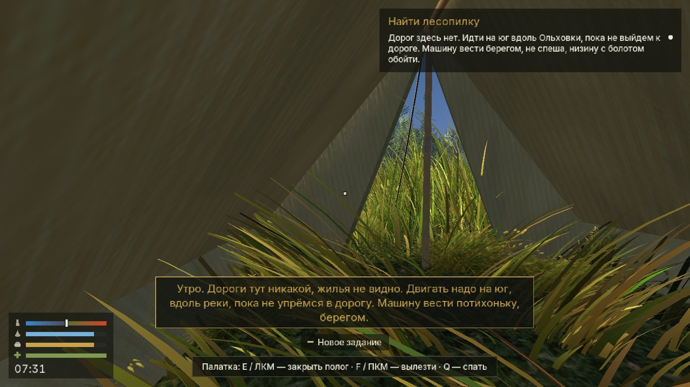

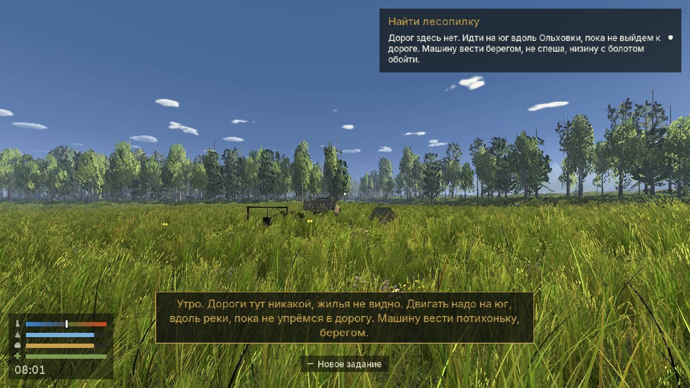

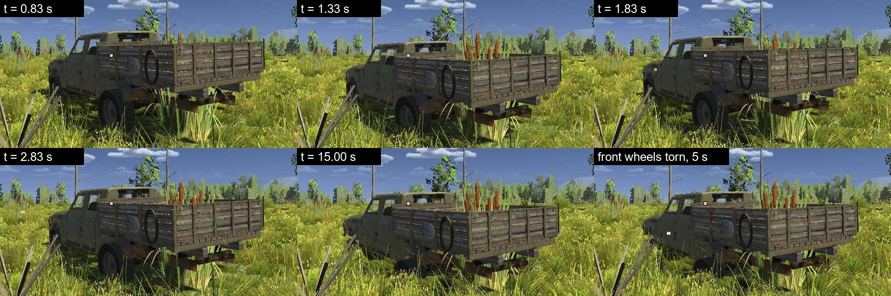

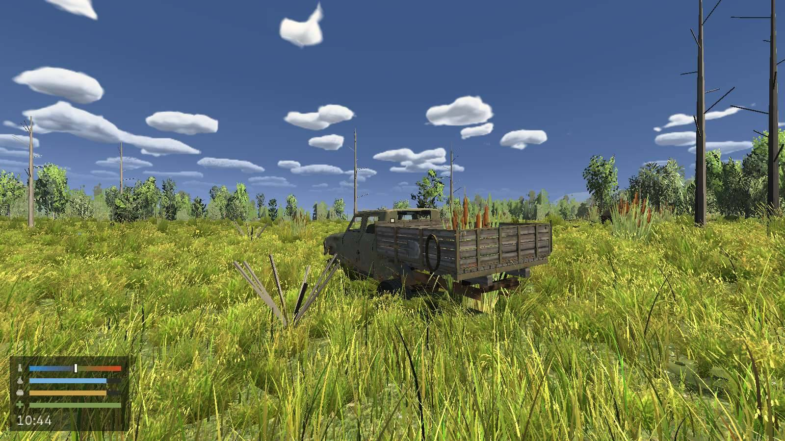

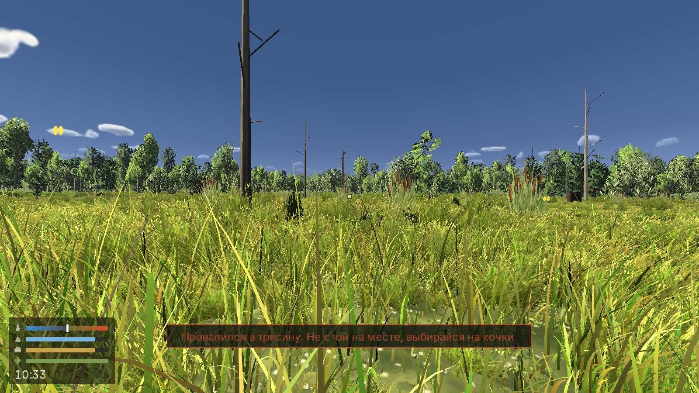

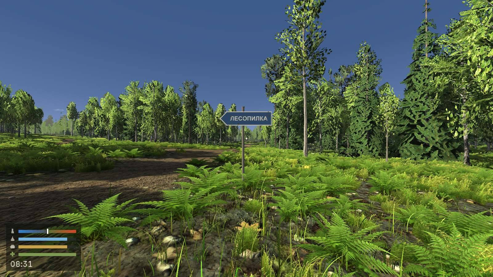

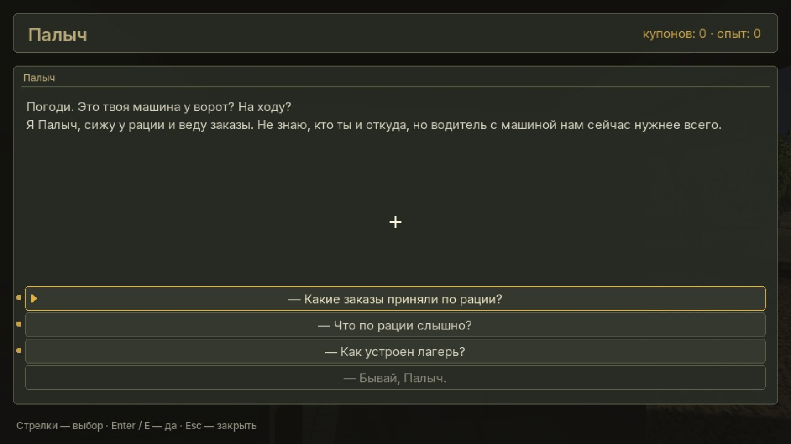

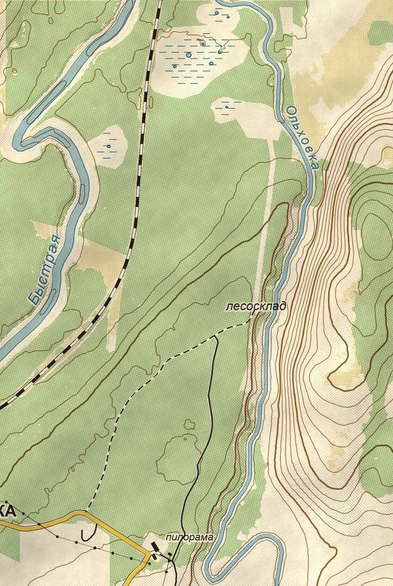

## 311. Район Плешивая: продление железной дороги, РРС с мачтой, Карлыч, вход в бункер, задание «Огни на Плешивой»

09:00 · RADIOREGION · Плешивая и РРС

Коммит: [121183b3ba](https://github.com/shsanek/EXEcutor/commit/121183b3ba)

Ветка: `work/peregon-radioregion`

Новые ряды карты 49–51. Бийская линия продлена через устье Ольховки по мосту до о. п. Плешивая с переездом. На лысом гребне (~505 м) — радиорелейная станция: 80-метровая решётчатая мачта в красно-белых полосах (Blender), ночью красные заградительные огни видны до 9 км; домик Карлыча, ветряк, забор. Дорога на РРС — гравийка по гребню (4,3 км), старая дорога к платформе — тяжёлая, петлями по крутому склону (4,9 км). В западном склоне — вход в бункер ЗКП. Приёмник в кабине молчит (только треск), пока станция не выйдет в эфир. Задание «Огни на Плешивой»: слух у Ефима → Карлыч → бункер → радиола → вечером эфир, обе станции оживают; награда 200 опыта и 80 талонов; без меток на карте. Бумажная карта: о. п. Плешивая, РРС, г. Плешивая 533. Внутренность бункера и медведь — следующие задачи.

- ✓ Тесты: story 66/66, radio 17/17, play_dialogue 59/59, coop_audit 26/26, save 25/25, world 36/36, map 54/54, poi 9/9, inventory 23/23, play_story 23/23, paper_map 17/17, story_lint 0 ошибок; rail/grade/powerline OK
- ✗ Открыто: днём мачта не видна с основных дорог (рельеф рисуется до ~3,3 км, гребень закрывает); домик Карлыча из серых блоков; бункер внутри — задача BUNKER

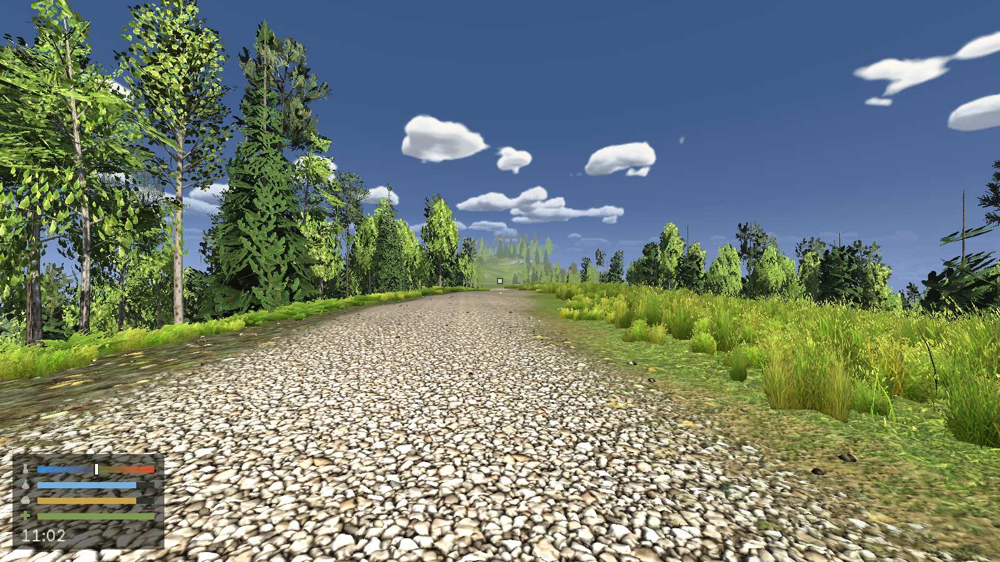

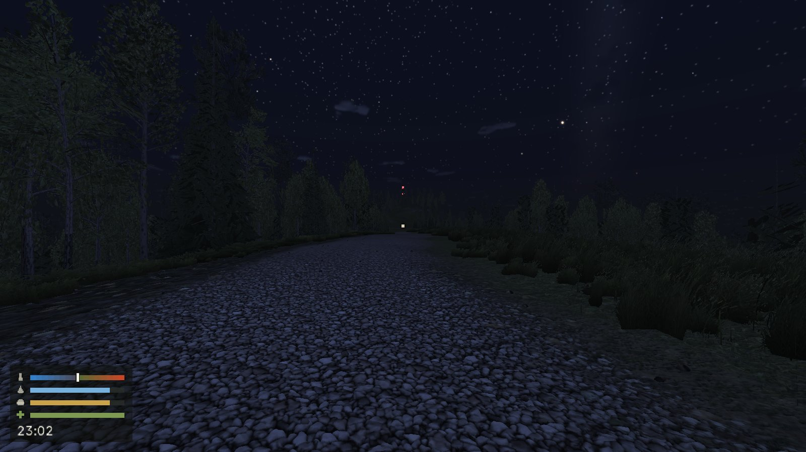

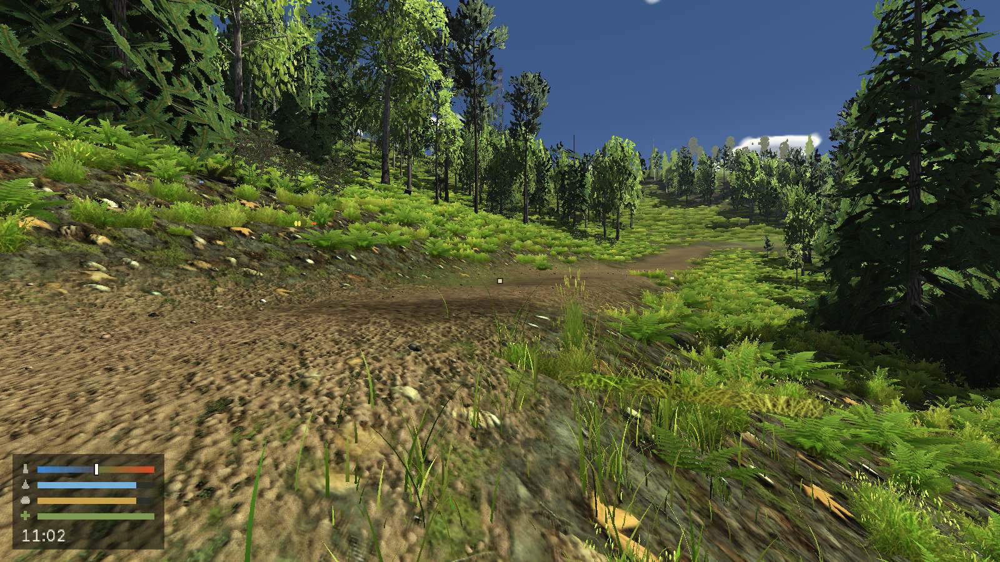

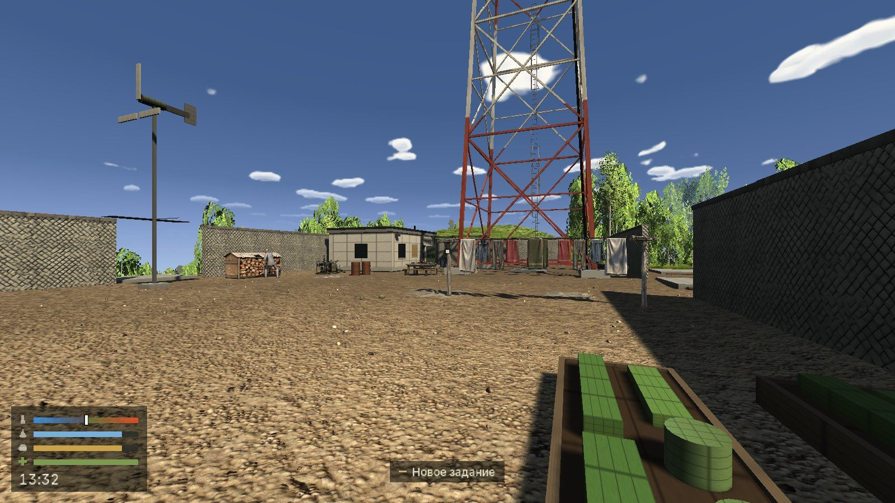

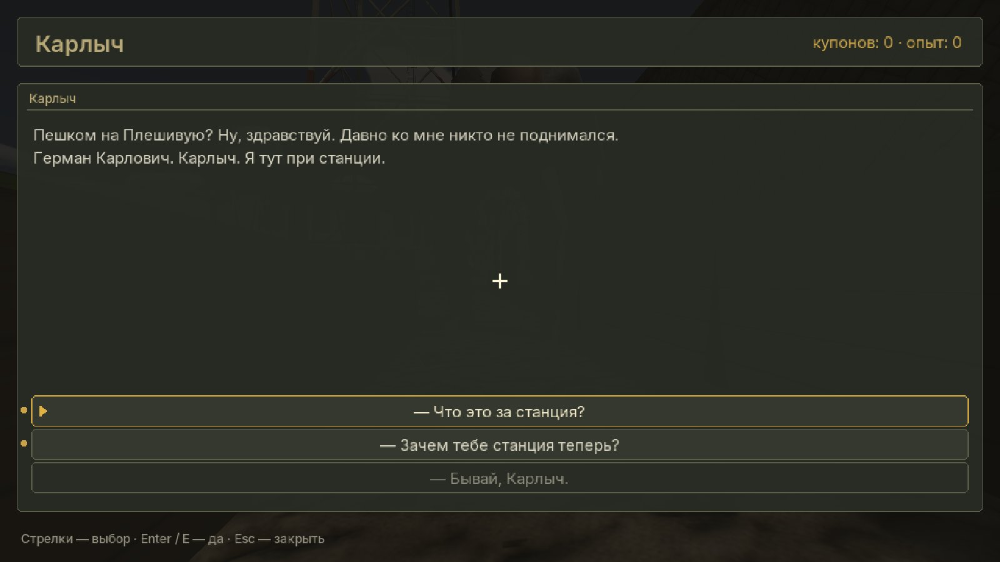

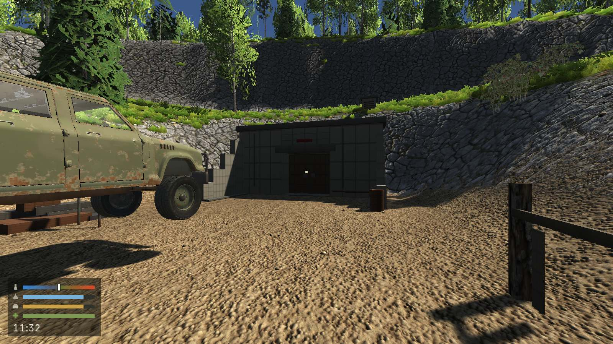

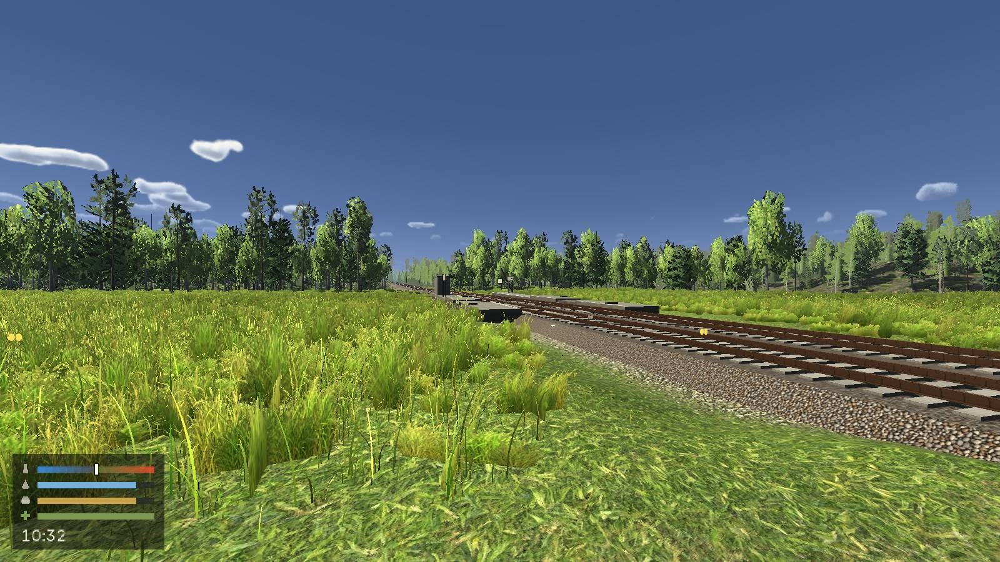

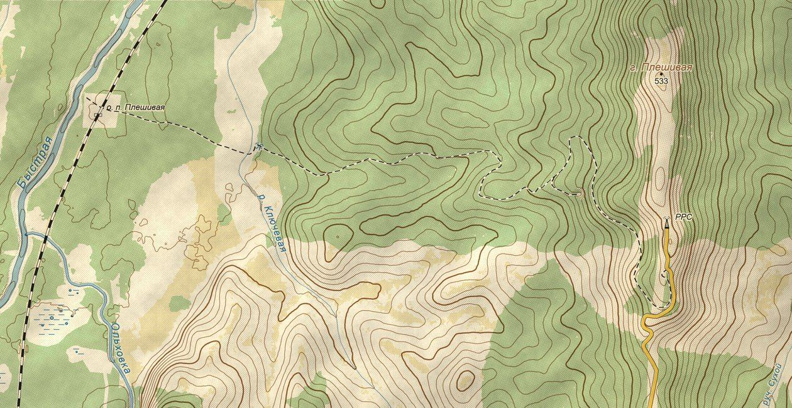

## 312. Гравийка от стартовой поляны вдоль Ольховки до развилки «Лесопилка»; убрана белая полоса

09:45 · NORTHROAD · Гравийка вдоль Ольховки

Коммит: [2d5a8fd56f](https://github.com/shsanek/EXEcutor/commit/2d5a8fd56f)

Ветка: `work/peregon-northroad`

От стартовой поляны на юг вдоль Ольховки проложена гравийная дорога (786 м): подъём по склону долины, дальше бровкой террасы над ущельем, река примерно в 25 м внизу; со стороны реки открытая луговая бровка, долину видно из кабины. Дорога доходит до указателя «Лесопилка» и переходит в лесовозку, отворот на Лесопилку налево как раньше. Стартовая поляна, палатка и машина на месте; лесосклад сдвинут на 30 м от дороги. Белая полоса с прямыми углами была прямой луговой просекой от старта (на бумажной карте всё нелесное печатается белым) — убрана, луг у лагеря стал круглой поляной. Тексты задания «Найти лесопилку» переписаны под гравийку. Бумажная карта перегенерирована, основная карта перепечена.

- ✓ Тесты: map, world 36/36, poi 9/9, paper_map 17/17, story 66/66, play_story 23/23, bog 11/11, story_lint 0 ошибок, test_grade 6/6, paper_map Python 15/15, grade_check north OK
- ✗ Открыто: первый подъём ~200 м с уклоном 9–10 % (предел гравийки); ступенька 0,72 м на стыке отворота на Лесопилку (старая)

## 313. Карта читается один раз; ленивый кэш в ОЗУ на половину памяти; колеи рядом остаются в памяти

10:20 · IOAUDIT · Чтение диска и ленивый кэш в ОЗУ

Коммит: [69585dada6](https://github.com/shsanek/EXEcutor/commit/69585dada6)

Ветка: `work/peregon-ioaudit`

«21 ГБ чтения» было одним и тем же 42-МБ файлом карты: шесть потоков карты заново читали и распаковывали тайлы, каждый тайл перечитывал восемь соседей, сканы ЛЭП и фауны проходили всю карту при старте. Теперь файл карты отображён в память и читается один раз, распакованные тайлы общие для всех потоков. Ленивый кэш в ОЗУ: половина физической памяти (8→4, 16→8, 32→16 ГБ; cache_mb в settings.txt), делится между картой, тенями и колеями/снегом, сжимается при нехватке памяти; первым вытесняется самое дальнее с учётом направления движения, ближе 2 км не вытесняется. Тени остаются в ОЗУ после выезда и подгружаются вперёд по ходу. Колеи и снег ближе 4,4 км остаются в памяти, на диск уходят только дальше 5,5 км, неизменённые блоки не переписываются. Запуск: 1690 → 6 МБ чтения, 6,9 → 4,2 с. 10 минут езды: 4190 → 8 МБ, рывков &gt;100 мс 57 → 5. Маршрут 86 км туда-обратно с петлями: 16,4 ГБ → 27 МБ, повторных перечитываний карты нет. Цена: +0,4 ГБ ОЗУ при запуске, +1,1–1,4 ГБ в езде.

- ✓ Тесты: surface_stream 21/21, map 56/56, world 37/37, save 26/26, net_world 10/10, region_static_check, region_stream_check OK; одинаковый хэш состояния до/после
- ✗ Открыто: IO-B5 кэш реагирует на один замер памяти; IO-B6 дальние колеи периодически перечитываются; IO-B3 загрузка сохранения пишет колеи во временный файл; IO-B4 cache_mb нет в меню; IO-B7 перемерить длинный маршрут на свободной машине

## 314. Проруби: топор, лом, лопата, выстрелы; пить, набирать воду, рыбачить; прорубь затягивается

11:00 · ICEHOLE · Проруби

Коммит: [03629d4861](https://github.com/shsanek/EXEcutor/commit/03629d4861)

Ветка: `work/peregon-icehole`

Лёд можно прорубить топором, ломом (монтировкой) или лопатой; число ударов зависит от толщины льда (25 см — 14 ударов топором, 19 ломом), слишком толстый лёд инструмент не берёт, игра подсказывает, чем рубить. Выстрелы тоже ломают лёд: дробь до ~8 см, пуля Полева до 45 см. Видно, как растёт работа: выбоина с ветвящимися трещинами, крошка, стук и треск. Готовая прорубь: неровный край, голубой срез льда по толщине, тёмная вода с крошкой, осколки и мокрый снег вокруг. Из проруби можно напиться (Q), набрать котелок или термос, работают зимняя удочка и ледобур. На морозе прорубь затягивается: через 20 минут тонкая корка (проламывается ногой), позже лёд, через несколько дней прорубь исчезает. Зашёл в прорубь — провалился в ледяную воду и выбрался мокрым; колесо грузовика на тонком льду проламывает лёд. Проруби сохраняются и видны всем в кооперативе (протокол 28).

- ✓ Тесты: water 30/30, river_ice 10/10, play_water 23/23, coop_audit 27/27, net_world 10/10, food_play 21/21, woodcut 14/14, play_cargo 70/70, icetent 5/5, inventory 23/23, loc 9/9, net 18/18, world 37/37, cab_lighting 6/6, glass_weather 19/19
- ✗ Открыто: прорубь рисуется поверх льда без настоящей глубины, рябь не анимирована; у лома нет анимации замаха; крошку видит только бьющий игрок; мокрое пятно сероватое

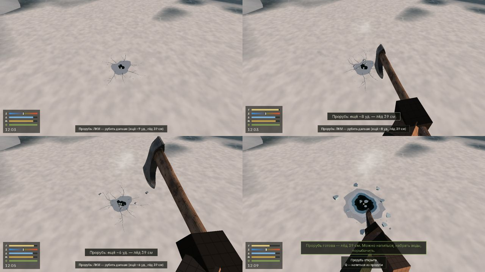

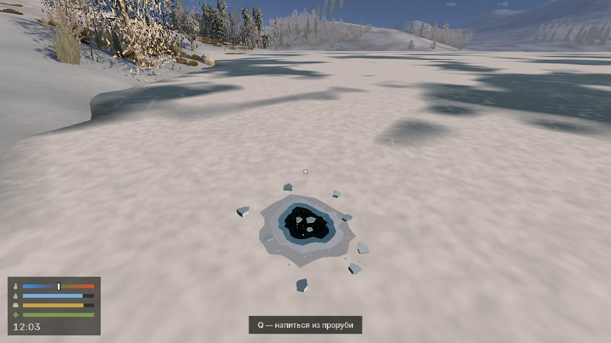

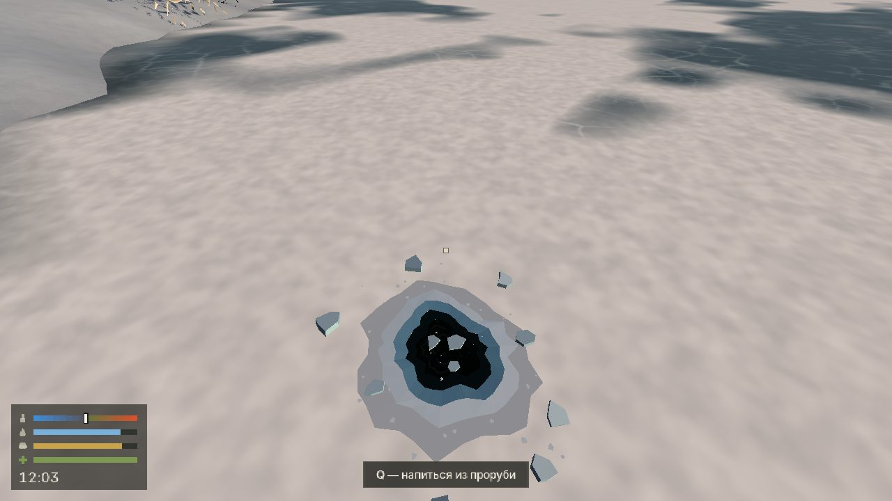

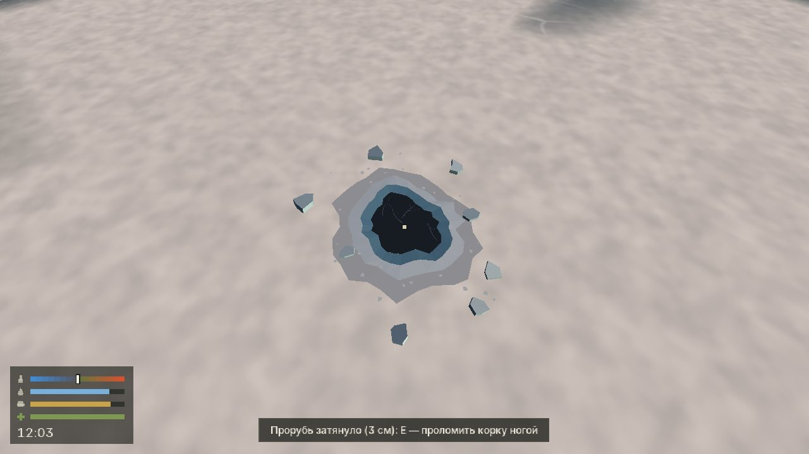

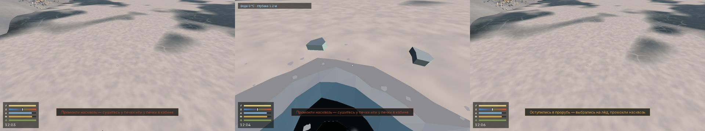

## 315. Вылет D3D12 с лучами без облаков, ползущая машина без ручника, тесты кооп-мест и занятий жителей

11:30 · REGRESS2 · Регрессии

Коммит: [befa868a8b](https://github.com/shsanek/EXEcutor/commit/befa868a8b)

Ветка: `work/peregon-regress2`

Солнечные лучи при выключенных облаках читали несуществующую текстуру облаков — D3D12 аварийно завершал игру на низком солнце; теперь подставляется прозрачная заглушка, лучи работают и без облаков, добавлен тест D3D12. Грузовик без ручника больше не ползёт и не раскачивается (было до 2,3 м за минуту при 3,2 км/ч): сопротивление качению удерживает стоящее колесо; на крутом склоне без тормоза машина по-прежнему скатывается, езда и грязь не изменились; эталонные хеши и 24 повтора W2 перезаписаны. Тесты кооп-мест снова 26/26 (оба теста были неверны). Жители получили занятия «козы», «баня», «мачта», «стол»; две метки в лесных постройках переименованы.

- ✓ Тесты: rhi_d3d12 28/28, vehicle 152/152, character 19/19, coop_seats 26/26, play_cargo 71/71, water 30/30, river_ice 10/10, play_water 23/23, snow_launch 7/7, folk 6/6, hunt_play 17/17
- ✗ Открыто: грузовик, поставленный place_truck, около секунды подпрыгивает (W-B17); новые занятия на общих анимациях; surface_stream один раз упал на временном тесте IOAUDIT

## 316. Кэш не пугается всплесков памяти, дальние колеи не перезаписываются, загрузка сохранения без временного файла, вкладка «Память»

12:20 · IOFIX · Хвосты кэша

Коммит: [03b6075beb](https://github.com/shsanek/EXEcutor/commit/03b6075beb)

Ветка: `work/peregon-iofix`

Бюджет кэша смотрит на последние 5 секунд свободной памяти и уступает её постепенно, не ниже запаса для ближних тайлов: в пробной поездке тени выгружались 16 раз вместо 236, декодировались 234 раза вместо 390. Далёкие колеи, уже записанные на диск и неизменённые, больше не перечитываются и не перезаписываются — их читают один раз, когда они должны были полностью зарасти. Загрузка сохранения держит колеи в памяти в сжатом виде, не пишет их во временный файл. В настройках вкладка «Память»: «Кэш мира в памяти» — Авто (половина ОЗУ) или 1–32 ГБ, сохраняется и применяется сразу. Длинный замер маршрута перенесён на ночную сессию PERFBENCH2.

- ✓ Тесты: surface_stream 23/23, world 39/39, save 27/27, immersion 11/11, loc 9/9, map 56/56, net_world 10/10, snow_launch 7/7, winterplow 7/7, region_static_check, region_stream_check OK
- ✗ Открыто: IO-B7 длинный замер — ночью; IO-B8 колеи, уходящие за 5,5 км, один раз пишутся во временный файл; SS-B12 снимки коопа пишут запись на каждый изменённый блок

## 317. Бункер ЗКП: тёмный советский лабиринт, фонарь с тенями, жуткие звуки, добыча, рюкзак РД-54, радиола для квеста

13:00 · BUNKER · Бункер ЗКП под Плешивой

Коммит: [b476bd65ef](https://github.com/shsanek/EXEcutor/commit/b476bd65ef)

Ветка: `work/peregon-bunker`

Под Плешивой — запасной командный пункт: шлюз со стальными дверями, лестница на 40 ступеней, два уровня, 15 помещений (спальня, дизельная, узел связи с радиолой, фильтровентиляционная, склад, кабинет командира, аккумуляторная, умывальник, затопленный тупик), плотно обставленные советским хламом, табличками и отсылками к STALKER. Внутри темно: фонарь с тенями и мягким тёплым лучом, мигающие лампы, блики и рябь на воде; капель, скрипы, сквозняк, гул, стуки вдали. 22 предмета бесплатной добычи появляются при первом входе. Армейский рюкзак РД-54 даёт пятый ряд, налобный фонарь светит без рук. Радиола 32 кг — двумя руками и шагом, везётся в кузове; квест «Огни на Плешивой» проходится до выхода станции в эфир. В кооперативе игроки внутри и снаружи друг друга не видят (протокол 29). Залы и узкие комнаты размечены для будущего медведя.

- ✓ Тесты: bunker 7/7, poi 10/10, survival 39/39, story 66/66, story_lint 0 ошибок, play_story 23/23, play_dialogue 59/59, inventory 23/23, save 27/27, coop_audit 27/27, coop_slots 13/13, net 18/18, net_world 10/10, play_cargo 71/71, world 39/39; владелец посмотрел — понравилось
- ✗ Открыто: замер кадра внутри (BZ-2, короткий); вода без зеркального отражения, нет реверберации и затемнения при переходе; внешние углы площадки у входа поднимаются до 1,18 м

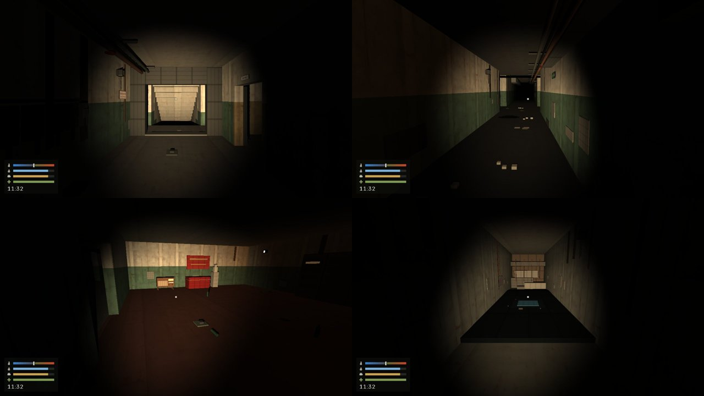

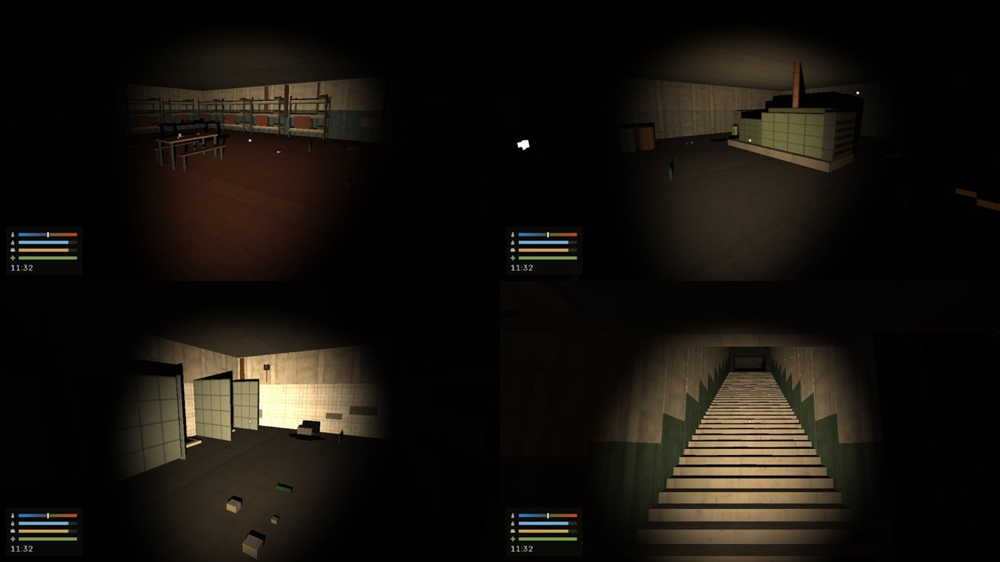

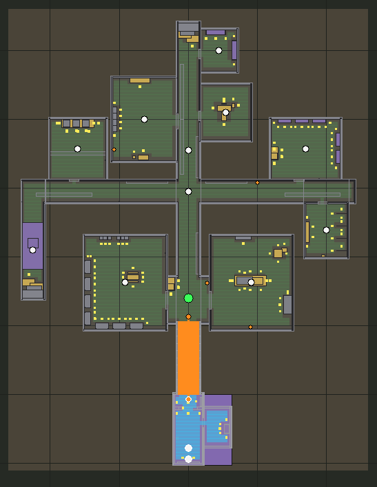

## 318. Грузовик: новая развёртка 3× чётче без чёрной обводки, ржавчина отдельным материалом, доски, вмятины, фары, жалюзи капота, антенна, ручник, кабина

13:40 · TRUCKART · Грузовик: текстуры, материалы, детали (3 круга)

Коммит: [8bb54ab41f](https://github.com/shsanek/EXEcutor/commit/8bb54ab41f)

Ветка: `work/peregon-truckart`

Чёрная обводка дверей была от старой текстуры (6,6 % листа на чёрном фоне) — новая развёртка 54 % листа, 421 px/м на кабине вместо 142. Кузов перекрашен: краска, грязь снизу, сколы, рельеф в нормалях; ржавчина — отдельный тайловый материал (пороги, низ дверей, арки), также дерево, краска и винил. Доски кузова с болтами и полосами, шесть вмятин, детали кабины. По замечаниям владельца (3 круга): фары со стеклом и хромом, белый эмалевый значок, номер; рёбра и настоящие жалюзи на капоте; панель под стеклом вровень с дверью; из текстуры дверей убраны запечённые ручки; диск перекрашен, борт шины у обода жёсткий; антенна на стойке водителя одним штырём; детали дверей выведены из плоскости кузова, кромки дверей одним цветом без ржавых и чёрных штрихов; ручник короче и в опущенном положении почти лежит. Вдали с 28 м — упрощённая модель.

- ✓ Тесты: view 65/65, play_cargo 71/71, play_care 47/47, vehicle 152/152, coop_seats 26/26; владелец принял третий круг
- ✗ Открыто: TA-B1 антенна видна сквозь лобовое (найдено, исправление в работе); TA-B2 двери местами мигают (тени/фланцы); TA-B3 проверить полную пересборку

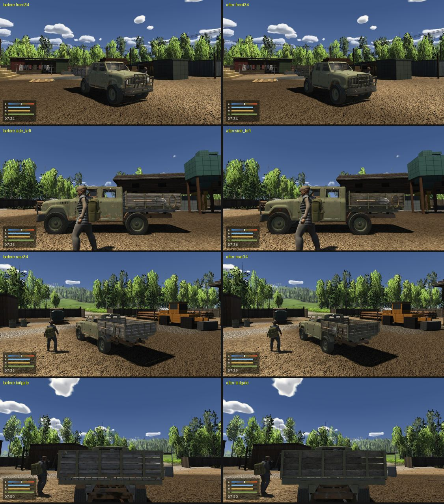

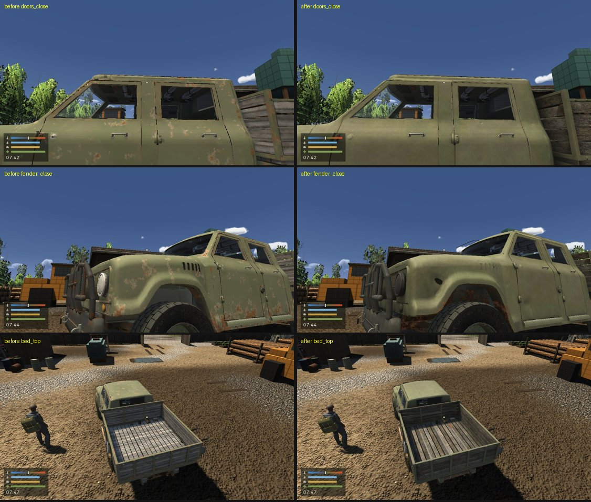

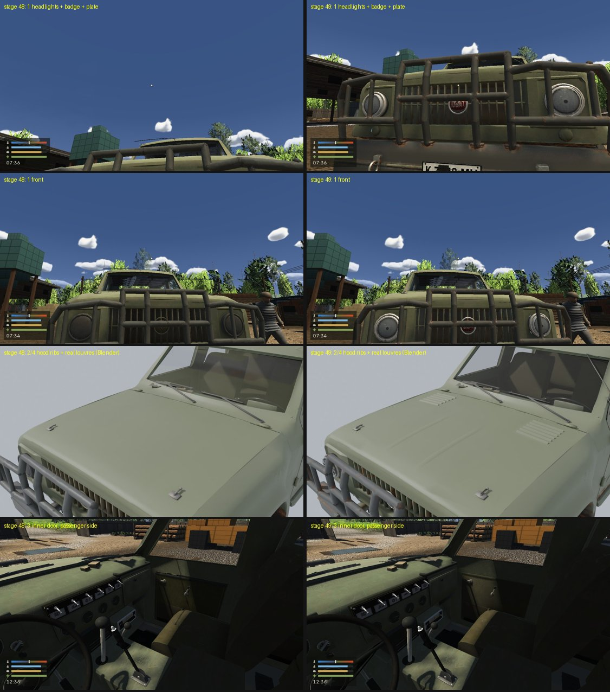

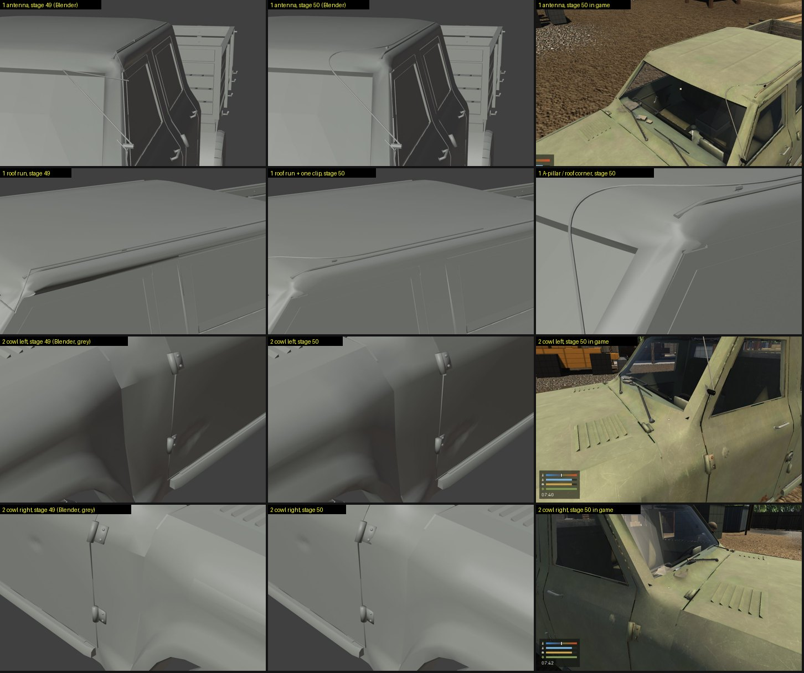

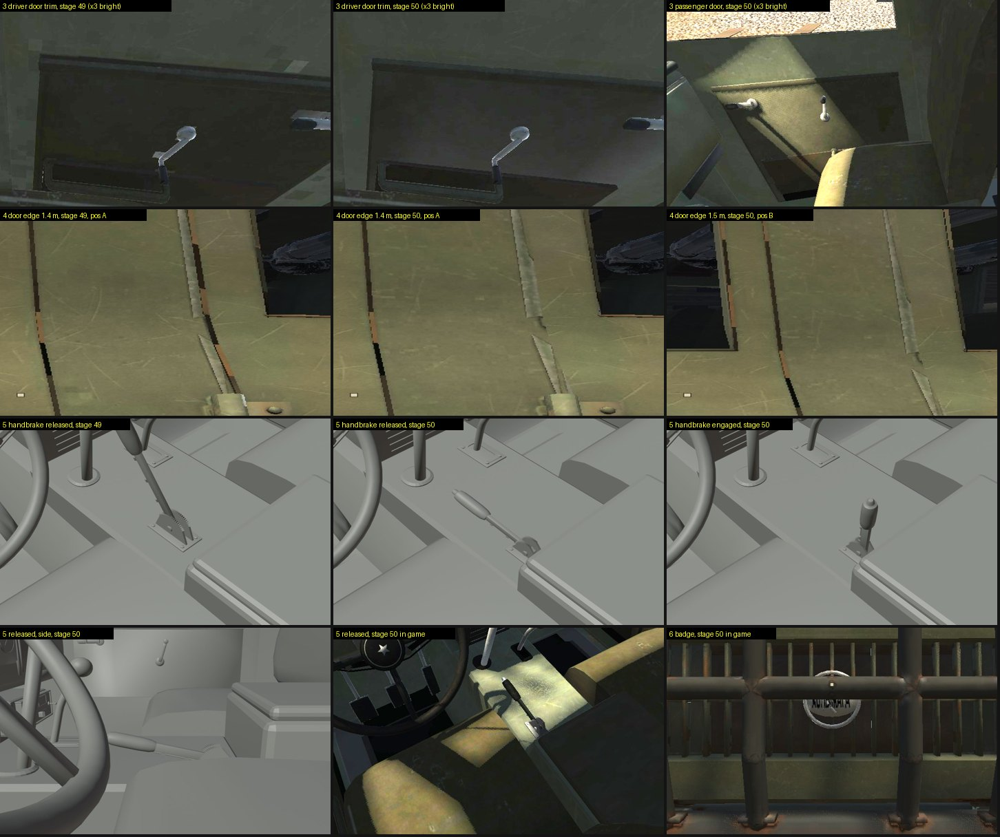

## 319. Оверлей --remap nordic: деревья, кусты, камни, брёвна, трава и грунт из пакета Nordic Conifer Biome; новое освещение растительности

13:40 · NORDIC · Нордический лес (владелец)

Коммит: [27213bb264](https://github.com/shsanek/EXEcutor/commit/27213bb264)

Ветка: `claude/peregon-nordic`

Работа владельца, слита в основную ветку. Карта остаётся в терминах каталога, а флаг --remap nordic меняет то, чем рисуются его элементы: деревья, кусты, поваленные стволы, папоротники, камыш, мох и цветы — нордические модели; камни, скалы, пни, корни и брёвна — 38 импортированных пропсов; атлас травы и шесть слоёв грунта из пакета. Новое освещение растительности (Metal/D3D12): карты нормалей, блеск, просвечивание листвы, двустороннее освещение, переход ствола в почву, блеск травинок. Кэш теней с --remap нужно перепечь (--bake-shadows).

- ✓ Слияние: claude/peregon-nordic + claude/peregon-design + TRUCKART без конфликтов, сборка win64 release

## 320. Лесопилка естественно врастает в рельеф: плавные склоны вместо уступов, неровная земля во дворе, колеи и тропинки

15:30 · CAMPBLEND · Лесопилка без «вставки»

Коммит: [c9bd6c29bf](https://github.com/shsanek/EXEcutor/commit/c9bd6c29bf)

Ветка: `work/peregon-campblend`

Площадка Лесопилки больше не выглядит вставленной в рельеф: обрывистые края насыпей и выемок заменены плавным переходом в окружающий склон, внутри лагеря земля слегка неровная, к стоянке ведут накатанные колеи, к костру и кухне — тропинки. Серые заглушки колей и луж из чертежа убраны. Пока только Лесопилка (одобрено владельцем); остальные лагеря не тронуты. На основной карте появится после общего перепекания вместе с RIDGEDIRT.

- ✓ Тесты: play_cargo 71/71, play_story 23/23, world 39/39, map 56/56, poi 10/10; poi_export Лесопилки без изменений
- ✗ Открыто: колеи читаются одной полосой (сетка 2 м), парные колеи отложены (CB-B2); r1check падает на rr_bunker_portal и устаревшие штампы nr_sign_sawmill/nr_start_camp — не из этой ветки

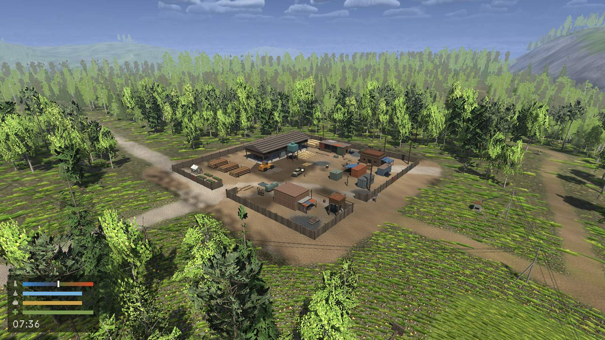

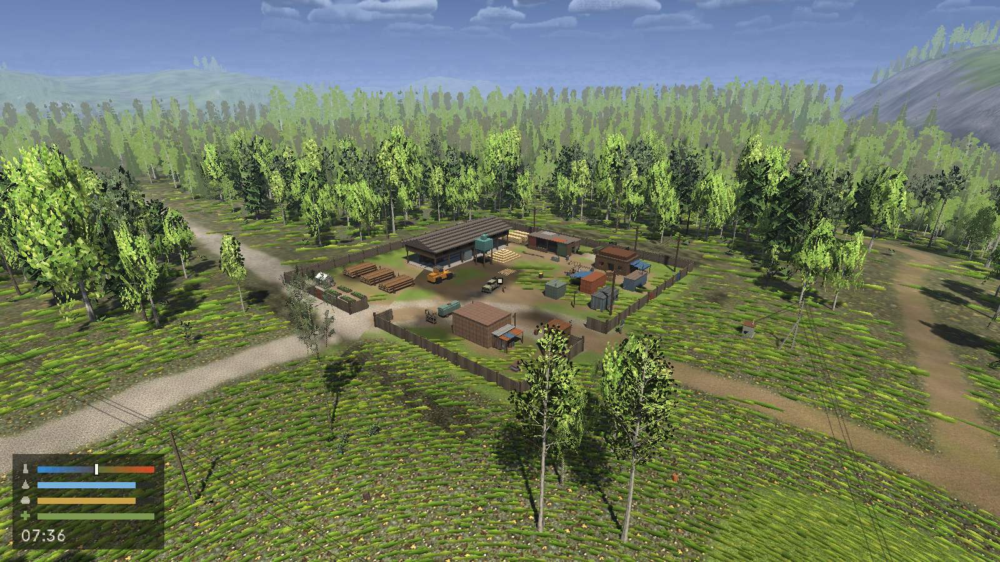

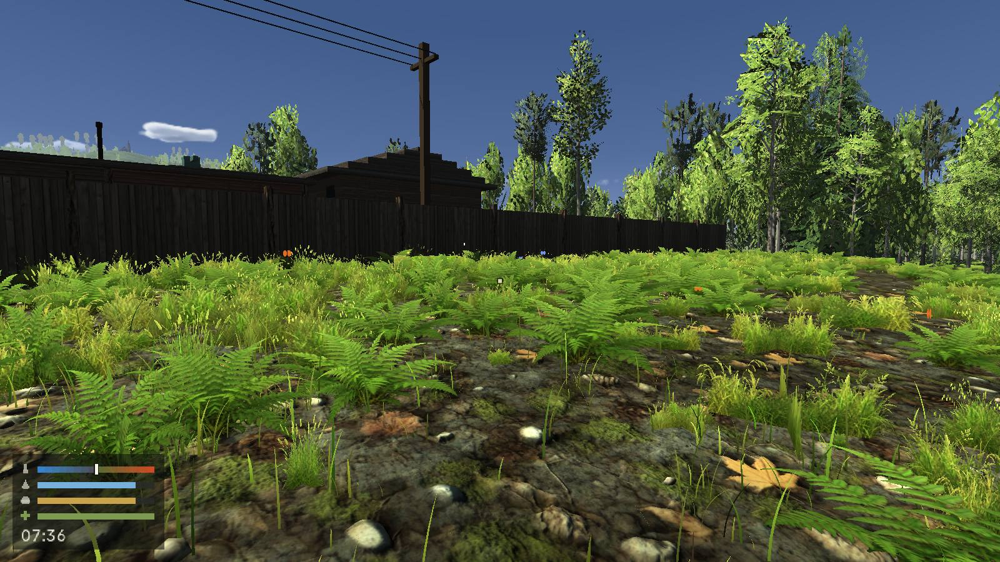

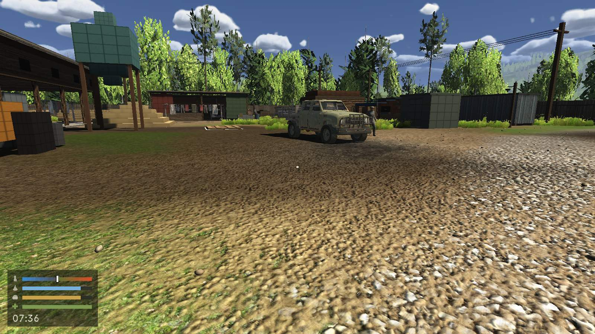

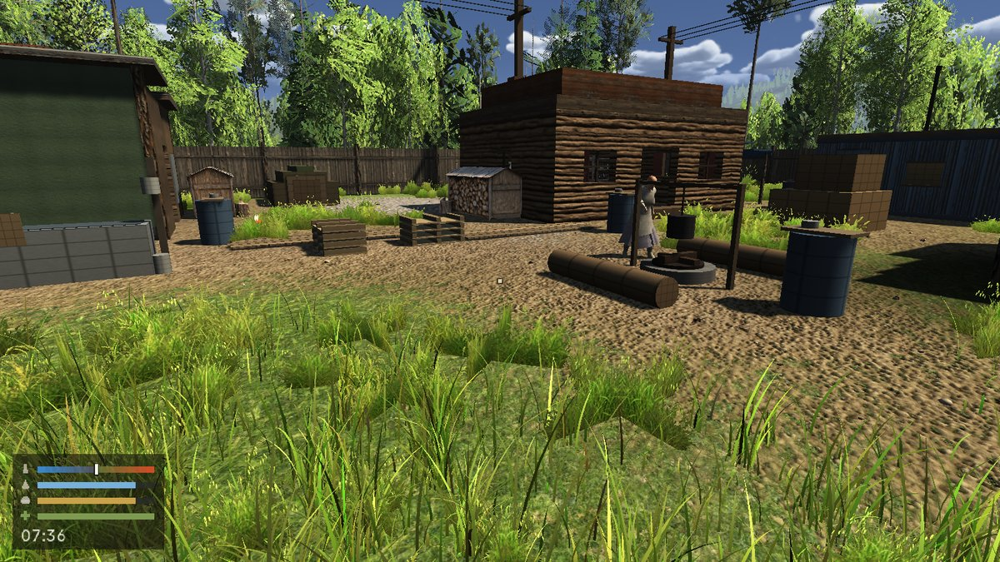

## 321. Грузовик пачкается в грязи и отмывается в воде: брызги, сохнущая корка, дворники, мытьё ведром

15:45 · TRUCKDIRT · Грязная машина

Коммит: [85f03b8843](https://github.com/shsanek/EXEcutor/commit/85f03b8843)

Ветка: `work/peregon-truckdirt`

Езда по грязи пачкает грузовик: жидкая грязь даёт больше брызг, на кузове копится слой по сторонам и зонам, в арках налипают комья. Мокрая грязь блестит, высохшая светлеет и матовеет. Брод и реки отмывают машину. Лобовое стекло забрызгивается, дворники расчищают свою дугу; опускание стёкол и скребок чистят окна, через открытые окна грязь летит в кабину. Ведром (F/ПКМ «мыть») можно отмыть машину, набрав воду в реке. Грязь сохраняется и видна всем в кооперативе (протокол 30). Стоимость: на GPU ниже шума замера (&lt;0,1 мс в 4K), на CPU 175 мкс раз в 6 тиков в жидкой грязи.

- ✓ Тесты: vehicle 168/168, view 66/66, coop_audit 31/31, play_cargo 71/71, net_world 10/10, play_care 47/47, bunker 7/7, rhi_d3d12 28/28
- ✓ Стоимость: GPU D3D12 4K: вкл−выкл в пределах шума (&lt;0,1 мс); CPU: 175 мкс (p95 239) в грязи, 48 в броде, 29 на стоянке, раз в 6 тиков
- ✗ Открыто: D3D9 показывает чистую машину; мытьё кабины изнутри, брызги при мытье и отваливающиеся комья — в бэклоге; ночной замер TD-2b

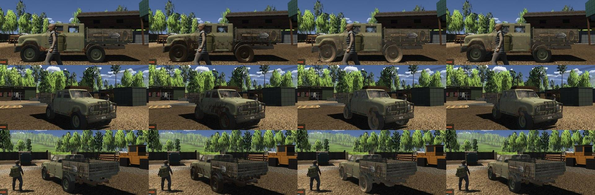

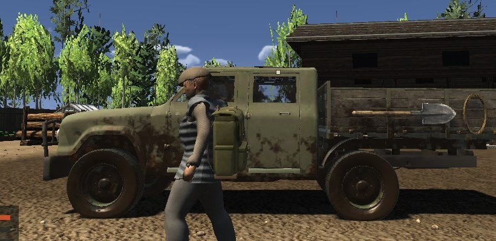

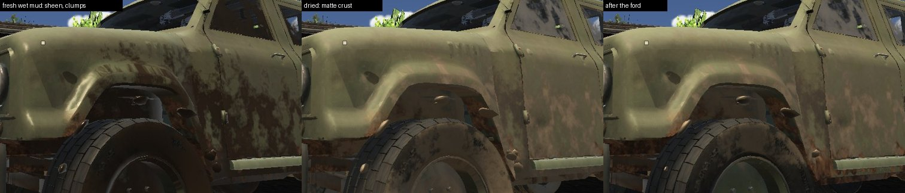

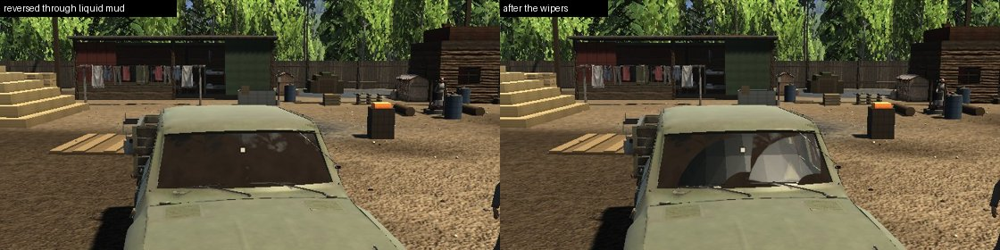

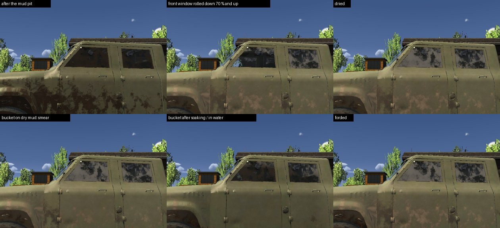

## 322. Дорога на РРС — настоящая грунтовка: грязь, лужи, корни и камни на подъёмах

16:20 · RIDGEDIRT · Грунтовка на РРС

Коммит: [69d3b332e2](https://github.com/shsanek/EXEcutor/commit/69d3b332e2)

Ветка: `work/peregon-ridgedirt`

Дорога от озера через гребень к Плешивой и радиорелейной станции теперь не гравийка, а грунтовка: 3,8 км, уклоны до 15 %, без глубокой выемки. На ней четыре участка грязи, лужа, два скальных уступа, ямы, промоины и колеи, на подъёмах 23 корня и камня — колёса переезжают их как кочки. В дождь стоковый грузовик проходит всю дорогу примерно за 9 минут без пониженной и лебёдки, но заметно трясёт и буксует (30 км/ч против 36,6 по гравийке, вертикальные перегрузки вдвое выше). На бумажной карте дорога нарисована как грунтовая; текст маршрута, журнал и приветствие Карлыча обновлены.

- ✓ Тесты: story 66/66, poi 10/10, world 39/39, map 56/56, paper_map 17/17, play_story 23/23, play_dialogue 59/59, paper map python 15/15, story_lint 0 ошибок
- ✓ Проверки карты: powerline_check OK (15 линий, 286 опор), rail_check OK, grade_check OK
- ✗ Открыто: сделать дорогу труднее (RR-8); машина на дев-стадии у подъёма к Плешивой взлетает на ~60 м (было и раньше); основная карта перепекается отдельно

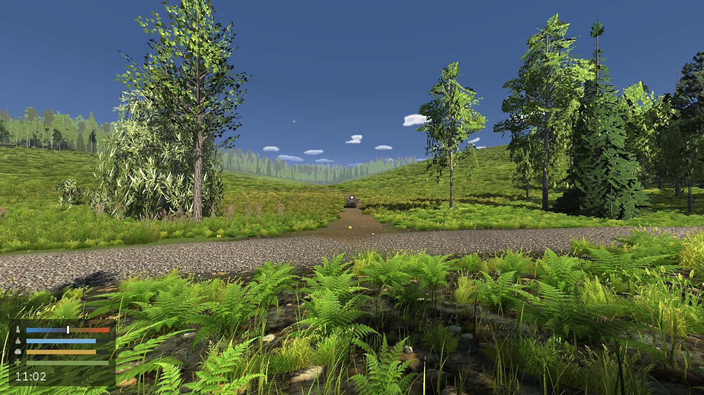

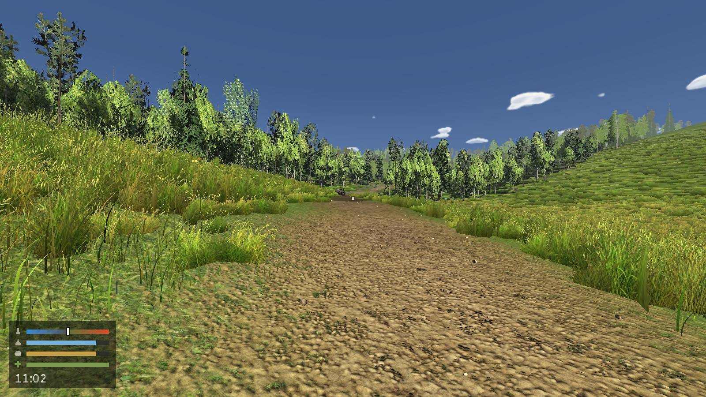

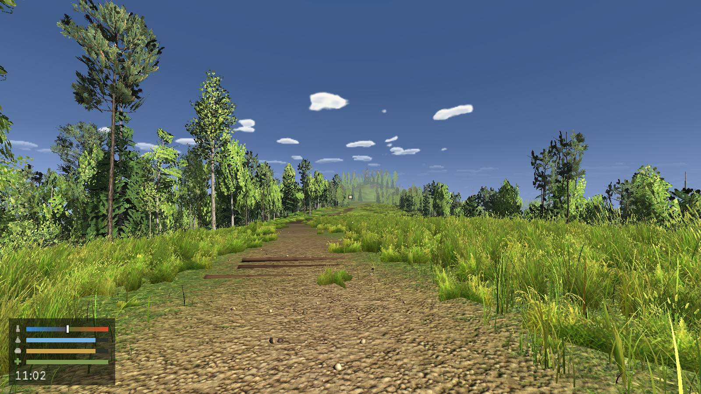

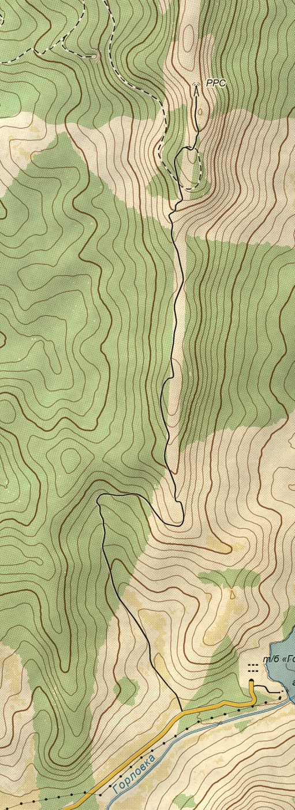

## 323. Грузовик, раунд 4: антенна не видна через лобовое, щели дверей — ровная тёмная линия

16:30 · TRUCKART · раунд 4

Коммит: [c8b69e9ac6](https://github.com/shsanek/EXEcutor/commit/c8b69e9ac6)

Ветка: `work/peregon-truckart`

Модель грузовика перепечена только скриптами, без ручных правок в Blender — сборка воспроизводима. Штырь антенны идёт снаружи стойки и уходит назад за верхнюю рамку стекла: из глаз водителя и пассажиров через лобовое он не виден (сборка модели падает, если виден). Через стекло водительской двери антенна видна вдоль стойки. Щели дверей покрашены темнее (0,32 от цвета кузова): на солнце щель передней двери читается одной тёмной линией. Грязь (TRUCKDIRT) держится на новой модели.

- ✓ Тесты: view 66/66, play_cargo 71/71, play_care 47/47, vehicle 168/168, coop_seats 26/26
- ✗ Открыто: светлая кромка задней двери с выемкой у замка (геометрия); если щели мерцают — TA-B4, смещение теней в шейдерах грузовика

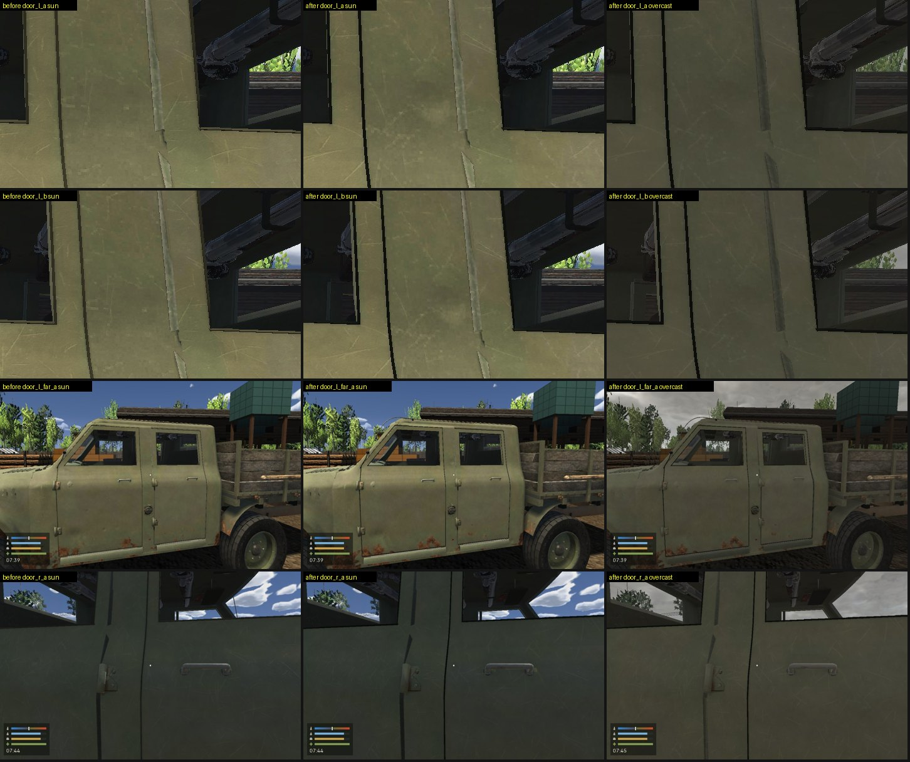

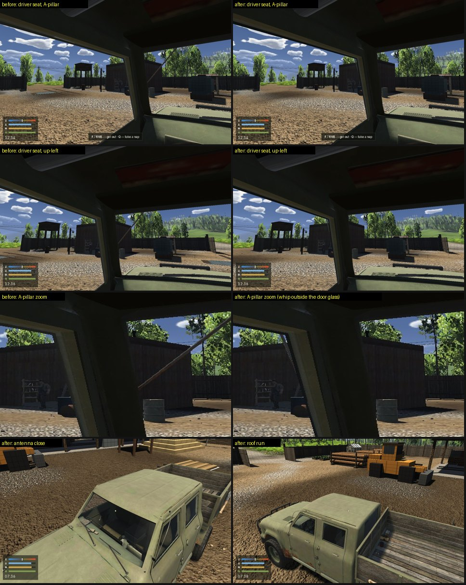

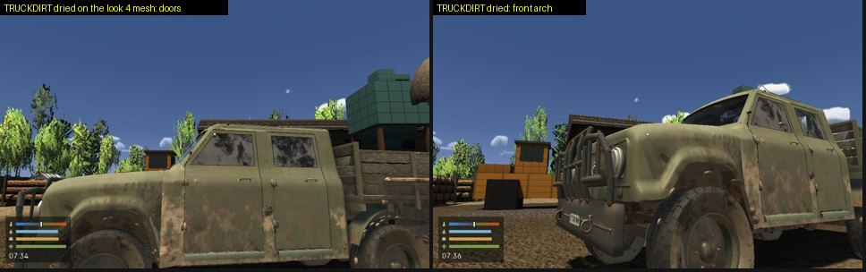

## 324. Нордический лес по решениям владельца: LOD деревьев от LOD1 пака, камни и скалы с LOD2, цвет пропсов починен, цветокоррекция леса и травы

19:28 · NORDICFIX · Нордический лес: LOD и цвет

Коммит: [71389ff170](https://github.com/shsanek/EXEcutor/commit/71389ff170)

Ветка: `work/peregon-nordicfix`

Доработка оверлея --remap nordic по решениям владельца, вместе с его исправлением импорта (7bd7cfdba0, слито через 071e7bf6a2). Чёрные камни, пни, брёвна и корни: Blender умножал цвет на альфу текстуры, где пак хранит маску; повторный импорт владельца берёт цвет без альфы, импортёр теперь сам помечает такие текстуры, а тест test_masked ловит ошибку. Деревья: LOD0 пака удалён, наш LOD0 — LOD1 пака, прореженный в Blender до 1/2 треугольников, LOD1 — до 1/4, дальше импостор, как раньше; стволы и крупные ветви сохраняются, мелкие ветки уходят. Камни и скалы начинаются с LOD2 пака, их текстуры уменьшены вдвое по стороне. Под --remap nordic валуны (gb_boulder_m/l, gb_rock_boulder_*) и камыш с рогозом остаются стоковыми. Цвет: послойная коррекция data/world/grade_nordic.txt (деревья ярче и зеленее, трава приглушена, грунт чуть темнее) и новые оттенки травы в grass_nordic.txt; шейдеры не менялись. Отрисовка растительности задаёт позицию глаза и слот 4 на всех бэкендах — nature_tests снова проходят. Для разработчиков: --lod-sheet (NORDICSHEET) снимает каждый заменяемый элемент, стоковый и нордический, на каждом LOD за один запуск D3D12 и строит HTML/CSV-отчёт с треугольниками и размерами текстур.

- ✓ Импорт: test_masked: старый импортёр 39 % чёрных текселей, средняя яркость 0,21 — FAIL; исправленный 0,2 %, 0,37 — PASS
- ✓ Тесты: nature_tests 23/23 (на ветке, fa338d463f)
- ✓ LOD-лист (--lod-sheet, D3D12): деревья 12437/6282 → 3137/1576 треуг. (сток 1500/207); камни и скалы 2990/1129 → 529/179, ptex 131,3 → 36,0 МиБ; pmesh деревьев на диске 64,5 → 19,5 МиБ
- ✗ Не проверено: производительность новой цепочки не мерили (I24); скриншоты цветового тура (лето, пасмурно, осень) и LOD-лист лежат в evidence/NORDICFIX на машине агента и в отчёт не перенесены; прогон тестов после слияния в отчёте не зафиксирован
- ✗ Открыто: LOD1 крон редкий у берёз и сухостоя на 30–50 м (I23); осенью трава оливковая (I22); скалы ниже нужного из-за stretch 0.3 (I18); текстуры брёвен, пней и корней 51 МиБ (I19); корни грунтовки РРС под --remap остаются цилиндрами (I25)

## 325. Канон мира на три года, диалоги под знания игрока, разговор на острове через вопросы, полная локализация текстов

19:41 · CANON · Канон и диалоги (владелец)

Коммит: [e5a84ad077](https://github.com/shsanek/EXEcutor/commit/e5a84ad077)

Ветка: `codex/peregon-dialogue-canon-20261016`

Работа владельца, слита в основную ветку. Канон в design/01-bible.md и 03-concept.md: мир спустя три года, большинство жителей — недавние переселенцы из современного общества; внутренняя библия персонажей и план сюжета в docs/story-plan.md (52 персонажа реестра). Все 32 файла сюжета переписаны: живая современная речь без нравоучений и пересказа мотивов, вопросы опираются на то, что игрок видел или узнал, журнал не расшифровывает инициалы сам. Разговор с Колей на острове раскрывается через вопросы игрока: признание — отдельным вопросом, обвинение — только после него. Сюжетные правки: обращение к Сычу требует опознания Тамары и личной находки; задание Люды — разведка места, награда после трёх уловов за доклад, удочку нужно вернуть; из-за долга за солярку разговоры откладывает только заимодавец. Локализация: названия всех 217 предметов, описания доработок у механика, заказы с одним названием на доске, в блокноте и на экране, подписи мест на большой карте — на русском и английском. Идентификаторы заданий, предметов, награды, расписания и формат сохранений не менялись. Конфликты слияния: приветствие Карлыча (rr_radio.txt) — текст канона; в en/ru оставлены ключи мойки машины из TRUCKDIRT, play.help.reset — текст канона; дублей ключей нет. Скриншотов нет: изменения только в текстах и данных.

- ✓ Тесты (после слияния, native-release): story_lint, story_tests, loc_tests, radio_tests, cargo_tests, care_tests, play_cargo_tests, vehicle_tests, gameplay_vehicle_followups_tests проходят
- ✓ Игровые тесты (карта r1 основной ветки): play_story 23/23, play_dialogue 59/59, play_journal 21/21, play_care 47/47
- ✗ Не проверено: render_perf_route_tests.cpp:8 не компилируется (-Werror, нет поля path) — было на claude/peregon-design до слияния, слияние его не трогало; производительность не мерили; интерфейс вживую и полное прохождение не смотрели; скриншотов нет

## 326. Каталог паков Unreal/Fab: 10 паков, 1386 записей, поиск компонентов по видам

20:48 · UECATALOG · Каталог паков Unreal/Fab

Коммит: [cc7dea00f0](https://github.com/shsanek/EXEcutor/commit/cc7dea00f0)

Ветка: `work/peregon-uecatalog2`

Инструмент для разработки, игрок его не видит. Два слияния: 74f5fd5a49 (PostSoviet Village и European Forest, 348 записей) и cc7dea00f0 (ещё восемь паков: Birches, Old Gas Station, Trash, Abandoned Basement Bunker, Rural Post Soviet Interior, Industrial Catwalks, Abandoned Factory + Factory Machines и glTF-набор Rusty Scrap Props — всего 1386 записей). Реестр паков снимается без интерфейса Unreal, записи классифицируются правилами: категория, теги, размеры, треугольники по LOD, материалы и текстуры, коллизия, куда подходит в игре (fits), бюджет, лицензия, пометка off_style для западных надписей и предметов. Машинный список — data/kit/ue_catalog.json, человеческий указатель с разделом «компоненты по видам» — docs/ue-catalog.md. Модели и текстуры в репозиторий не кладутся: модель обрабатывается только когда нужна (OUTPOSTLIVED — первые десять). Превью 256 px из миниатюр пакетов лежат вне репозитория (peregon-ue-work/catalog_previews, 1928 файлов); ниже — несколько из них.

- ✓ Каталог: 1386 записей в 10 паках; сборщик каталога сверяет каждое имя в fits с kit.txt, nature.txt и blueprints.txt
- ✗ Не проверено: игровые тесты не запускались (игра не менялась); превью — миниатюры из пакетов Unreal, не рендер движком игры

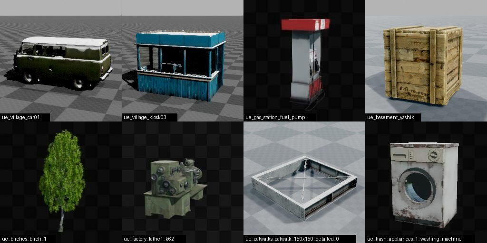

## 327. Заправка Ржавых на отроге: не в яме, гаражи, будка дани, УАЗ-452, фонари; общие детали — настоящими моделями

21:14 · OUTPOSTLIVED · Заправка на отроге обжита

Коммит: [b2dcf33cc4](https://github.com/shsanek/EXEcutor/commit/b2dcf33cc4)

Ветка: `work/peregon-outpostlived`

Продолжение обжитой заправки Ржавых на полке outpost_shelf. Земля: вместо площадки, вырезанной в склоне со скальными стенами 6–10 м с трёх сторон, — переход рельефа (camp_blend) до 50 м в склон, небольшие неровности, проезды к колонкам, навесу, разборке и гаражам, десять тропинок налётчиков, восемь вытоптанных дворов, трава только у стен. Новое: два советских стальных гаража на ленточном фундаменте, будка сбора дани у «зубьев» с полом, проёмом и местом для охранника, УАЗ-452 «буханка» вместо кузова «Жигулей», три 11-метровых деревянных столба с эмалированными фонарями. Общие детали теперь рисуются моделями из паков во всех местах, где стоят: топливные колонки, армейские ящики, шины, поддоны, бочки, бочки-костры, люк, стены из профлиста. Обработано 10 моделей паков (УАЗ 14393 → 8000 треугольников, будка 6426 → 5000, столб 4197 → 2399 и др., таблица в docs/outpost-lived.md), у колонки закрашены английские надписи. Проверка логики: кровати только в бараке с печью; неотапливаемый нижний контейнер стал складом Ржавых (картошка-дань, консервы, патроны). У новых деталей коллизия по модели: грузовик не въезжает под крышу гаража, кузов УАЗа до земли. Свет пока только данными (19 источников), финальный проход — после LIGHTBAKE.

- ✓ Тесты: poi_tests 10/10 (123 детали, 247 коллизий); ctest native: poi, character, world, map, play_story, play_cargo, region_static, region_stream
- ✓ Сборка на запечённой земле: 0 ошибок, 0 предупреждений, физика против рисунка 0 см; проверка висящих объектов: 0 из 23025 проб
- ✓ Стадия outpost_gate: PASS, контакт PASS для всех стадий outpost_*
- ✗ Не проходит: outpost_board, outpost_load, outpost_camp_unload, outpost_handin не достигают цели — так же на ветке до слияния; r1check: допуск уклона 1,7 для outpost_shelf ждёт согласия владельца; rr_bunker_portal падает и до слияния
- ✗ Открыто: финальный свет после LIGHTBAKE (OL-B1); остов грузовика на разборке ещё серый ящик (OL-B2); у будки нет двери и печки (OL-B3); производительность не мерили

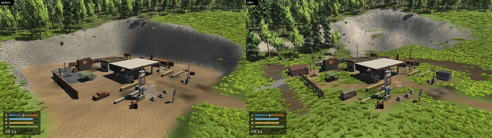

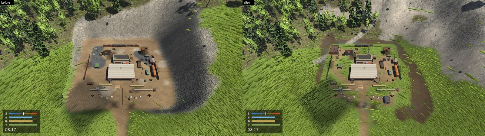

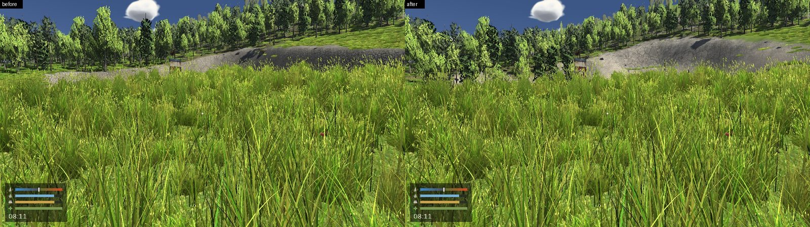

## 328. Свет лагерей запекается с мягкими тенями в объём места; Лесопилка заново освещена ночью

21:39 · LIGHTBAKE · Запечённый свет лагерей

Коммит: [fdf361ff8b](https://github.com/shsanek/EXEcutor/commit/fdf361ff8b)

Ветка: `work/peregon-lightbake`

Огни мест (лампы набора light_NN, новые отдельные огни light_NN в чертежах, свет из окон от светящихся панелей — новый вид window, яркость и цвет) при загрузке запекаются с 8 мягкими теневыми лучами по коробкам места в объём света этого места (ячейки 0,35 × 0,4 м). Результат кэшируется в peregon_lights_&lt;место&gt;.bin и перепекается только при изменении (--bake-lights — принудительно). 34 освещаемых шейдера читают объём попиксельно (Metal/D3D12), движущиеся объекты тоже берут свет из него; D3D9 остаётся на старом пути «два ближайших огня», байткод SM2 не менялся. Ночное включение и общее мерцание; светящиеся коробки ламп видны до 600 м. Лесопилка переосвещена: 32 запечённых огня — 17 из набора, 5 новых фонарей на кольях, 4 огня чертежа (лампы пилорамы, вышка, дверь мастерской), 6 пятен света из окон. Стоимость по таймерам запекания, без бенчмарка: первое запекание всех 25 мест 0,97 с на 12 потоках (Лесопилка 411 мс); кэш 33 МБ на диске; в видеопамяти один объём за раз (Лесопилка 12,6 МБ, элеватор 18,1 МБ); ночью внутри объёма на пиксель 16 выборок текстуры и около 60 ALU-операций.

- ✓ Тесты: light_bake_tests 8/8 (native и win32 в EXEcutor), poi_tests 11/11, light_tests 36/36, world_tests, nature_tests, rhi_metal_tests, sun_shadow_render_check
- ✓ Шейдеры и сборки: компилятор шейдеров + эталоны (588 файлов); win32 D3D9 рендерер и world собираются; сборка Лесопилки 0 ошибок
- ✗ Падает и до слияния: cab_render_check, diffuse_gi_render_check, spot_shadow_render_check (uniform never set), win32 play_net.cpp под mingw 15.2 -Werror, rhi_d3d9_tests layout_version — так же на неизменённой базе
- ✗ Не проверено: D3D12 не запускался (нет Windows-машины) — нужен один ночной снимок на Windows; производительность не мерили
- ✗ Открыто: активен один объём: из лагерей ближе 600 м друг к другу освещён только ближний; рельеф и деревья не дают теней от огней; вода и декали не освещаются; кэш можно сжать; лампы пилорамы делают штабеля бруса яркими — оценит владелец

## 329. Сенокосная заимка Фомы и Клавы Шубиных обжита; грузовик сталкивается с заборами всех мест, а не только Лесопилки

22:01 · FARMLIVED · Заимка обжита

Коммит: [7de346eb17](https://github.com/shsanek/EXEcutor/commit/7de346eb17)

Ветка: `work/peregon-farmlived`

Заимка (r3_farmstead) из серых коробок стала жилым хозяйством Фомы и Клавы Шубиных. Земля как на Лесопилке: колея для грузовика и телеги от ворот мимо колодца к сеновалу и прицепу, 11 тропинок, 7 вытоптанных дворов, там где не ходят — высокая трава. Дом: резные наличники, кирпичная труба над изразцовой печью внутри, кровать, лампа, фонарь у двери, связки сушёных грибов; палисадник с цветами, лавка у крыльца, светящиеся окна. Сеновал пересобран из набора амбара European Forest, с сеном и вилами. Жердевые заборы, брошенный лесовозный полуприцеп под стог, придавленный листами профлиста, телега (модель Blender bl_telega), навес для кобылы Зорьки с яслями, костёр и стол сенокосчиков, поленница с колодой и топором, бельё, уборная, грядки, ящики с картошкой. Четыре новых места занятий и распорядок дня Фомы и Клавы. Проверка логики: кровать и печь в закрытом доме, готовят на костре во дворе, в сеновале нет огня, телега убрана с колеи, висящая дверь уборной удалена. Восемь керосиновых огней для запечённого света (сеновал, стога и загон тёмные). Обработано 23 модели (полуприцеп 29066 → 9999, кровать 24878 → 4999, печь 5590 → 3000, окно 9068 → 2500 и др.; худшее совпадение силуэта 0,969, 2 см — таблица в docs/farm-lived.md). Исправление движка: Game::refresh_tree_obstacles давал грузовику только коробки Лесопилки, через заборы остальных мест он проезжал; теперь препятствия берутся от всех ближних мест — контакты грузовика у всех мест меняются, это намеренно.

- ✓ Тесты: poi_tests 11/11; story_tests, story_lint, folk_tests, character_tests, play_story, play_dialogue, play_journal, play_lake, play_cargo, map_tests, region_static, region_stream, world_tests 39/39
- ✓ Сборка места: 0 ошибок, 0 предупреждений, физика против рисунка 0 см; навигация проходит; проверка висящих объектов 3421 проба: 0/0/0; r1check заимки: неровности 0,14 м, уклон 0,11
- ✗ Полный ctest (без рендера и перфа): 94/98: net_menu_tests падает и на origin; glass_weather_tests падает на валидирующем Metal-устройстве; economy_tests и save_tests вылетели по таймауту под нагрузкой и проходят по отдельности
- ✗ Открыто: сено — коробки и цилиндры набора (нет модели сена); у Зорьки нет модели животного (владелец: животных не моделируем); стены дома — текстурированные коробки; poi_export перезаписывает метки других мест (не закоммичено); вид освещения — на оценку владельцу; D3D12 и производительность не проверялись

## 330. Берёзовка (15 участков) и церковный холм ожили: дома из пака на склоне, журавль колодца, обжитая трапезная Тамары, дом Сыча

22:29 · R2VILLAGE · Берёзовка и церковь

Коммит: [acfd5f6b75](https://github.com/shsanek/EXEcutor/commit/acfd5f6b75)

Ветка: `work/peregon-r2village`

Земля: новый склоновый режим camp_blend — выравнивается только площадка каждого дома на своей высоте и плавно сходит в склон до фундамента, двор сохраняет естественный уклон с вытоптанными тропинками, колеями телег сборщиков металла и отросшей травой; церковный двор вписан в вершину холма с тропинками Тамары вместо старой подсыпки. Дома из пака PostSoviet Village: разобранные срубы (стропила под рваным рубероидом, заколоченные резные окна) на участках 1, 3, 6, 9, 12; провалившиеся — 2, 4, 10, 15; пятистенки — 5, 8, 11, 13, 14; участок 7 — новый чертёж hill_yard_d, единственный целый дом, где вырос Сыч: синий почтовый ящик, сюжетная дверная рама в проёме. Лавки, берёзовые веники на бане, штабеля досок, кучи хлама. Колодезный журавль переделан (владелец: «сломанная палка»): рогатый столб, 7-метровый шест с осью на трети, противовес, очеп с ведром над срубом с крышкой — так же на кордоне, у сторожки и на заимке. Церковь: трапезная Тамары обжита (окна с занавесками и светом, дверь, труба печи, дрова, кровати, бельё, лавка, бочка, фонарь на колу), три новых места занятий и более полный день; новые могильные кресты и сюжетная свежая могила. Логика: трапезная — единственная жилая комната (дверь, печь внутри, свет); в пустых домах нет кроватей и печей — их вывезли сборщики. Свет: окна трапезной и фонарь; сама деревня по сюжету тёмная. Модели (пак → LOD0): izba_stripped_8x6 100202 → 9991, izba_stripped_10x7 125902 → 9985, izba_ruin_8x6 69508 → 8999, izba_roofed_8x6 99356 → 9991, заборы 1,9–4,3 тыс. → 0,7–1,4 тыс., журавль 7045 → 3000, кресты, дверная рама, хлам двора (Rusty Scrap) 5944 → 2500; ошибка поверхности p99/max — в docs/r2-village-lived.md (худшая 22/47 мм).

- ✓ Тесты: poi_tests 11/11, play_story_tests 23/23, story_tests 74/74, story_lint 0 ошибок, character_tests 19/19, folk_tests 6/6, map_tests 56/56, region_static_check
- ✓ Сборка на запечённой земле: все 20 комплексов R2: 0 ошибок, 0 предупреждений, физика против рисунка 0 см
- ✗ r1check --r2: площадки домов в пределах 0,05 м; FAIL по двум пунктам, одинаковым на старой карте: край церковного двора 0,69 на конусе вершины, rr_bunker_portal
- ✗ Не запускалось: тест проезда и прохода (физика), отдельная проверка висящих объектов; D3D12 и производительность
- ✗ Открыто: церковь — всё ещё серая коробка; сараи, бани и уборные — серые коробки; нет крылец и дверных полотен; у пятистенка средний LOD выступает ~0,5 м с ~45 м

## 331. Лес под --remap nordic из четырёх паков: настоящие берёзы, сухие и поваленные берёзы, подлесок; 10 новых элементов природы

22:36 · FORESTPACK · Лес из четырёх паков

Коммит: [a715f99527](https://github.com/shsanek/EXEcutor/commit/a715f99527)

Ветка: `work/peregon-forestpack`

Оверлей --remap nordic теперь собран из Nordic Conifer Biome, European Forest, Birches Pack и PostSoviet Village. Из 51 элемента растительности: 10 перемаплены (все 4 берёзовых элемента — настоящие берёзы из Birches Pack вместо нордических осин; 3 лиственницы и пихта — ели-шпили European Forest, лиственницы нет ни в одном паке; карагана, шиповник), 3 впервые получили модели (сухой куст, камыш, рогоз), у 6 появились варианты (молодая сосна, ель, сухостой, бревно, папоротники, цветы), 23 оставлены, 3 пока неверные (ивы остаются осинами — модели ивы нет), 6 травяных элементов стоковые по замыслу. 10 новых элементов N075–N084: умирающая берёза, сухая молодая берёза, обломанный ствол, поваленная берёза, берёзовый подрост, сухой бурьян, лесная подстилка, черника, мухоморы, осока; они идут после камней, поэтому существующая расстановка не меняется — в окне запекания примерно на 13 тыс. крупных объектов больше (+3,4 %). Оверлей: 52 элемента, 116 мешей (64 нордических, 52 новых из 47 мешей паков). Отклонены после просмотра: 4 сосны European Forest (бледные), берёзы European Forest и Village, заснеженная ель Village, берёзы с плющом, сухой клён на 98,7 тыс. треугольников. Бюджеты (средние по LOD-листу, было → стало): деревья 3137/1576 → 2707/1382, кусты 317/158 → 264/137, брёвна 2780/1166/321 → 2502/1049/321, напочвенный покров 543/126 → 362/152; текстуры деревьев на диске 44,9 → 42,3 МиБ, меши 19,5 → 23,7 МиБ. Атласы природы ограничены 4096²: первая сборка переполнила их, и игра не запускалась; исправлено уменьшением 7 текстур листвы нордического покрова до 512 и новых кор до 256–512, атласы заполнены примерно на 80 %. Хэш nature.txt меняет ключи пропсов и кэша теней (кэш теней перепечён локально с --bake-shadows --remap nordic, не закоммичен); пак карты не изменился.

- ✓ Тесты: nature_tests 23/23, map_tests 56/56, asset_tests, poi_tests, region_stream_check, region_static_check; check_nature_kit 0 ошибок
- ✓ map_nature_check (всё окно запекания): 383 007 крупных объектов: 0 на дорогах, 0 на площадках и рядом, 0 в воде
- ✗ world_tests 38/39: prop_rules_load_and_every_mesh_is_embedded падает из-за пропсов, добавленных слияниями мест (не FORESTPACK); менеджер чинит отдельно
- ✗ Не проверено: производительность не мерили; D3D12 не запускался
- ✗ Открыто: нет модели ивы; атласы почти полны — для новых видов нужна вторая страница атласа; умирающие берёзы редкие на пределе бюджета; у старой сосны один меш, у сосны два

## 332. Поваленная секция забора лежит плашмя; world_tests снова 39/39

22:51 · PROPCHECK · Поваленный забор

Коммит: [61bc2def78](https://github.com/shsanek/EXEcutor/commit/61bc2def78)

Ветка: `work/peregon-propcheck`

Модель ue_village_fence_fallen_4 была собрана с наклоном 4° поперёк и 2,5° вдоль и опиралась на один угол: висела на 0,48 м, что прятало заглубление 0,15. Пересобрана плашмя (r2village_props.py), переимпортирована, коробка и заглубление в props.txt исправлены. Это и было причиной падения prop_rules_load_and_every_mesh_is_embedded после слияний мест. Скриншотов нет.

- ✓ Тесты: world_tests 39/39, poi_tests 11/11
- ✓ Сборка мест: каждое место с этим забором: 0 ошибок, 0 предупреждений, 0 см

## 333. Колхозный двор и деревенские участки обжиты: мастерская и вагончик Кости, страдный стан на току, козий двор; сено — настоящие модели

23:04 · KOLKHOZLIVED · Колхоз и деревня обжиты

Коммит: [7d263bd61e](https://github.com/shsanek/EXEcutor/commit/7d263bd61e)

Ветка: `work/peregon-kolkhozlived`

По канону колхоз пуст и оживает только в страду. Ангар МТС — мастерская Кости: кран-балка для двигателя, сверлильный станок, металлический верстак с тисками, пожарный шкаф, бочки, подвесная рабочая лампа; его закрытый вагончик-бытовка с дверью, окном, лампой, нарами, печью с трубой через крышу и столом, где он ест. Ток — страдный стан: кострище, мешки, поддоны, летний стол, бочка с водой, уборная, прицеп с сеном. Разобранные коровники (железо в штабелях, шифер в траве, новая скирда), заколоченная контора, открытые стальные гаражи с председательским УАЗом, мёртвые фонари. Удалено 33 серых коробки колей и луж, земля переходит в рельеф как на Лесопилке. Деревня: двор a (участки 04/05/09) — дом с заколоченными окнами и взломанной дверью, труба, сарай, штакетник, лавка, уборная, бельё; двор b (02/03/07) — развалины с провалившейся крышей и уцелевшей трубой, шифер, поломанные заборы; новый двор c (участок 06) — козий двор: сенник на столбах, загон, водоразборная колонка, мёртвый фонарь. Новый режим camp_blend core_shape: footprints — выравниваются только дом, сараи и линия забора на высоте своего участка, дальше мягкий спуск в склон. Сено по просьбе владельца — новые модели Blender: стог, скирда, воз, куча, копна; ими заменены и коробки сена на заимке. Обработано 25 моделей (сверлильный станок 22246 → 4000, коровники ~10 тыс. → 3 тыс., гараж 9548 → 4995, сено 5,6–7,6 тыс. → 0,9–2,4 тыс. и др.; отклонение ≤ 8 мм у моделей паков, ≤ 57 мм у сена, IoU ≥ 0,968), 9 взяты из общего кэша; новый tools/kit_mesh_fit_check.py. Свет для LIGHTBAKE: окно и лампа вагончика, рабочая лампа ангара, фонари на кольях, костры.

- ✓ Тесты: poi_tests 11/11, world_tests 39/39, character, map, play_story, region_static, nature, light — проходят
- ✓ Ранее, до последних слияний: play_journal, play_dialogue, play_cargo, asset_tests прошли в полном прогоне; после последних слияний не перезапускались
- ✓ r1check: колхоз и 7 участков в пределах; оставшиеся FAIL — rr_bunker_portal (база), r2_church и r2_village_well (из R2VILLAGE)
- ✗ Под нагрузкой: region_stream_check один раз вылетел по таймауту, отдельно проходит
- ✗ Не проверено: D3D12 и производительность
- ✗ Открыто: лампа и костёр страдного стана горят весь год (KL-B1); загон без козы; у гаража LOD1 = LOD0; ступенчатые края травы (клетки 2 м, CB4 — делает TERRAINBLEND); днём в ангаре темно; сено бледное в полдень

## 334. Лесопилка по логике: закрытая семейная комната и барак, застеклённая кухня, отапливаемая радиорубка; костёр с котелком и бревенчатыми лавками во всех лагерях

23:21 · SAWMILLFIX · Логика Лесопилки

Коммит: [0119139a11](https://github.com/shsanek/EXEcutor/commit/0119139a11)

Ветка: `work/peregon-sawmillfix`

Замечания владельца по логике мест, на примере Лесопилки. F1: семейная комната в пилораме — нары стояли в открытых пролётах, а труба печи кончалась под крышей; теперь закрытая комната (дощатые стены, потолок, пол, два застеклённых светящихся окна, дверь 1,2 м), двуспальная кровать, нары, шкаф, табурет, лампочка, труба выведена через стену за свес крыши. F2: двор барака зашит досками, два светящихся окна, щели закрыты, дощатая дверь. F3: ворота мастерской Гриши закрыты, в них калитка (своя копия для Лесопилки, на свалке без изменений). F4: окна кухни застеклены. F5: в радиорубке светящиеся окна, труба печи, лампа над дверью. F6: бак с водой у кухни на подставке. F7: пожарный щит с вёдрами и ящиком песка. F8: смоделированы корыто и умывальник. Едят за столами в помещении (летний стол — дополнительно), к каждому месту есть свободный подход; три новых места сна и обогрева, кровати достижимы от двери. По просьбе владельца общий костёр — настоящая модель (Blender ue_bl_camp_fire, 1780 треугольников: каменное кольцо, поленья, котелок на перекладине над рогатинами) с двумя бревенчатыми лавками (ue_bl_log_bench, 338) в общем элементе cook_fire — все 11 лагерей с этим костром собираются чисто; свет и угли сохранены, у пламени и котелка нет коллизии. Другие модели: пожарный щит 3004 → 1800, бочка для воды 2834 → 1999, верстаки, шкаф, табурет 678 → 400, ящик пожарного щита; из кэша — кровать, дощатая дверь, сверлильный станок, тиски, шина и металлическая бочка, которой теперь рисуется каждая rain_barrel. Физика: стены и двери не пропускают, мебель сталкивается до верха; ширина дверей поправлена, чтобы комнаты были достижимы.

- ✓ Тесты: poi_tests 11/11, light_bake_tests, character_tests, play_care, play_story, story_tests, story_lint, play_dialogue, play_cargo, map_tests, region_static, region_stream
- ✓ Сборка Лесопилки: 0 ошибок, 0 предупреждений; проверка висящих объектов: 23465 проб, 0 проблем (по float_report_after.txt)
- ✗ Под нагрузкой: world_tests и survival_tests вылетели по таймауту, отдельно проходят
- ✗ Не проверено: D3D12 и производительность
- ✗ Открыто: заборы, ворота, штабеля брёвен, вышка, погрузчик и фонарные столбы — всё ещё текстурированные коробки (текстура забора из кэша выглядела неверно); дверные полотна закреплены открытыми; сидения и анимации — в задаче NPC; 5 устаревших меток в других местах на ветке

