# Перегон — 2026-10-16

[Главный отчёт](../README.md) · [Фичи и исправления](../CHANGELOG.md)

## 304. Замер 8 × 15 мин: «неиспорченная» сборка против текущей на максимуме — 1,04× (упор в GI-пробы на CPU, ≈33 FPS), без GI — 1,30× в 1080p и 1,24× в 4K

02:20 · PERFBENCH · 8 прогонов по 15 минут

Коммит: [c3dea4c73d](https://github.com/shsanek/EXEcutor/commit/c3dea4c73d)

Ветка: `work/peregon-perfbench`

Одинаковая 15-минутная сессия из 14 процессов: летние дороги днём и в сумерках, лесная колея, прогулка по лагерю лесопилки, осенний брод в дождь, зимние дороги (наст, снегопад, метель), глубокий снег, стоячие виды по сезонам. Максимальные настройки каждой сборки (текущая рисует больше: трава 300 %, отражения, рельеф, лучи, плавные переходы). Неиспорченная сборка d2d7321b62 пересобрана с патчем чтения настроек (PEREGON_BENCH_SETTINGS), иначе её нельзя запустить на максимуме. Главная находка: диффузные GI-пробы на максимуме занимают ≈24,5 мс из ≈30 мс кадра на одном потоке CPU — обе сборки упираются в ≈33 FPS в 1080p и 4K, видеокарта загружена 8–18 %. Телеметрия стоит 1,4–2,4 % FPS. Сцены: снегопад и метель на дороге 1,14× на максимуме и 1,6× без GI; глубокий снег 1,64×/1,50× без GI. Слабые места: летняя дорога 4K без GI — медиана 0,99×, p99 7,7 → 13,6 мс; лесная колея и стоячая метель на максимуме на 2–4 % медленнее.

- ✓ Прогоны: 8 × ≈16 мин, все сегменты без ошибок; + 4 коротких без GI; машина без других агентов и компиляторов
- ✗ Открыто: GI-пробы на CPU — задача GIPERF в очереди; летняя дорога 4K без GI — не разобрано; повторы записанного ввода могут расходиться при изменении физики; ОЗУ +15 %, видеопамять +7–9 %

| Метрика | 1080p: неиспорч. → текущая | 4K: неиспорч. → текущая |
| --- | --- | --- |
| Средний FPS, макс. (только FPS) | 32,8 → 34,1 (1,04×) | 32,8 → 34,0 (1,04×) |
| Медиана кадра, макс., мс | 30,66 → 28,60 | 30,67 → 28,60 |
| Кадров &gt; 50 мс | 318 → 263 | 326 → 261 |
| Средний FPS без GI | 182,7 → 237,8 (1,30×) | 161,3 → 199,8 (1,24×) |
| Медиана / p95 без GI, мс | 4,53 / 9,85 → 3,96 / 5,63 | 5,64 / 9,80 → 4,61 / 7,11 |
| ОЗУ пик, МБ | 1516 → 1751 | 1515 → 1750 |
| Видеопамять игры пик, МБ | 2374 → 2537 | 2443 → 2654 |
| Чтение игрой за сессию, МБ | 21 646 → 24 080 | 21 635 → 24 058 |

## 305. Без сна за рулём клонит в сон: клевки, микросны с чёрным экраном, пробуждение тряской мыши или ударом; вздремнуть в кабине можно днём

03:20 · DROWSY · Засыпание за рулём

Коммит: [b6f298beba](https://github.com/shsanek/EXEcutor/commit/b6f298beba)

Ветка: `work/peregon-drowsy`

Сонливость из долга сна, умноженная на ночь, тёплую кабину и однообразную дорогу (ровная скорость, мало руля). Клевки: веки опускаются, руль слегка уводит, голова никнет. Микросны: экран полностью гаснет, каждый следующий дольше (1,2 с × 1,6^k); с давления 0,85 или после трёх за поездку сам больше не заканчивается. В отключке машина держит последний газ и руль, тормоз, кнопки и обзор игнорируются (пауза работает). Будят: резкая тряска мыши (или покачивание A/D), удар или сильный толчок, Q напарника, остановка машины на 5 с; глаза открываются через 0,3–0,9 с сквозь пелену, управление возвращается за 1,5 с; 25 с (после удара 90 с) без новых эпизодов. Звук приглушён до 30 % с закрытыми глазами. Кооп: протокол 26, состояние передаётся водителю и аватарам, напарник видит «Q — растолкать водителя». Дрёма: Q в стоящей кабине с утра до 18:00 — 90 минут по обычным правилам (холостой ход, аккумулятор, остывание), минус 6 часов бодрствования. Настройка «Микросон за рулём» (по умолчанию вкл).

- ✓ Тесты: survival 39/39 (4 новых), save, immersion, play_care (дрёма), play_cargo (отключка/удар), net, net_world, coop_audit, food_play; coop_seats 24/26 — 2 прежних падения (REGRESS2)
- ✓ Замеры: в 03:00 микросны 1,22 / 1,93 / 3,08 с, четвёртый не закончился за 120 с; тряска 0,53 с будит, глаза ещё 0,92 с закрыты, полное управление через 2,9 с; вслепую на 44 км/ч газ держится, машина разгоняется до 53 км/ч до удара
- ✗ Открыто: пелена — серый туман интерфейса, не размытие; приглушение — громкость, не фильтр; в коопе настройка хоста действует на всех; гудка нет; боты могут засыпать на очень длинных маршрутах

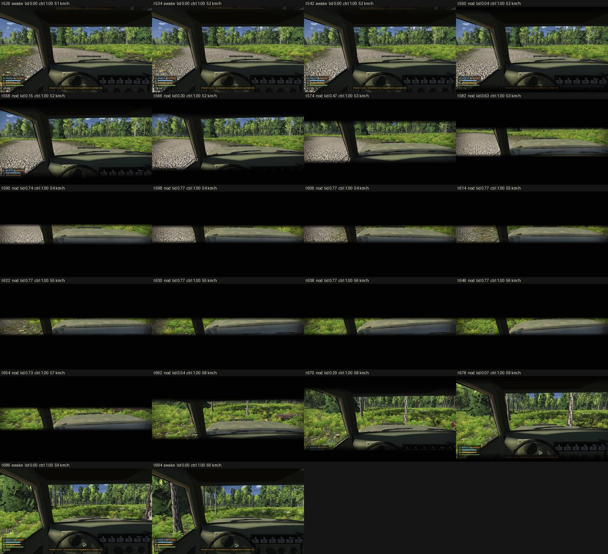

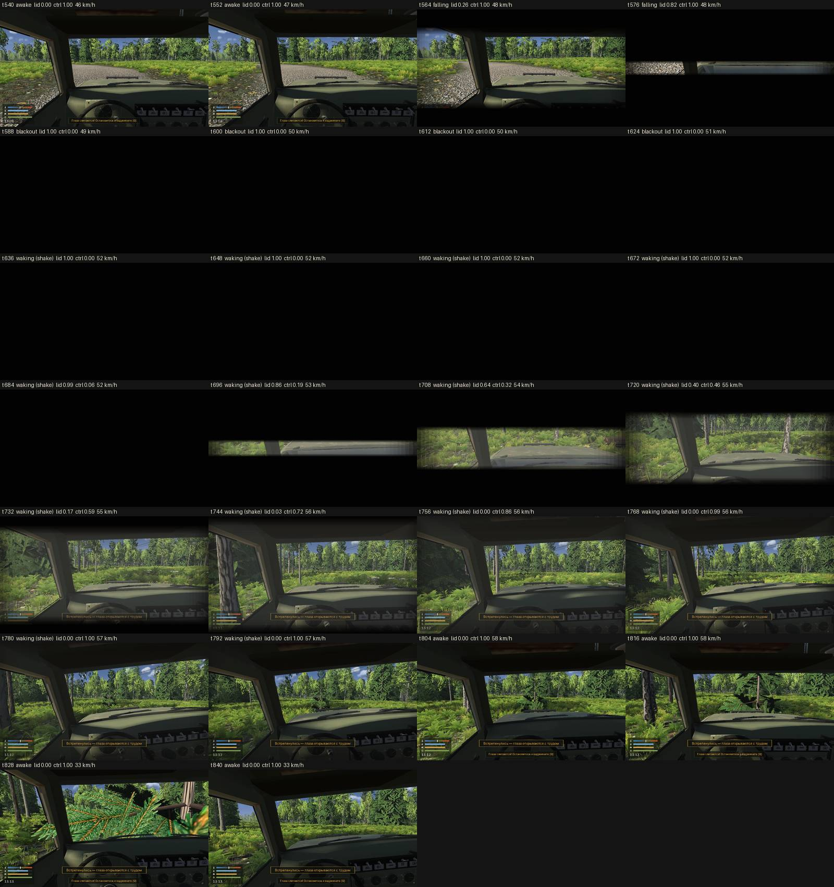

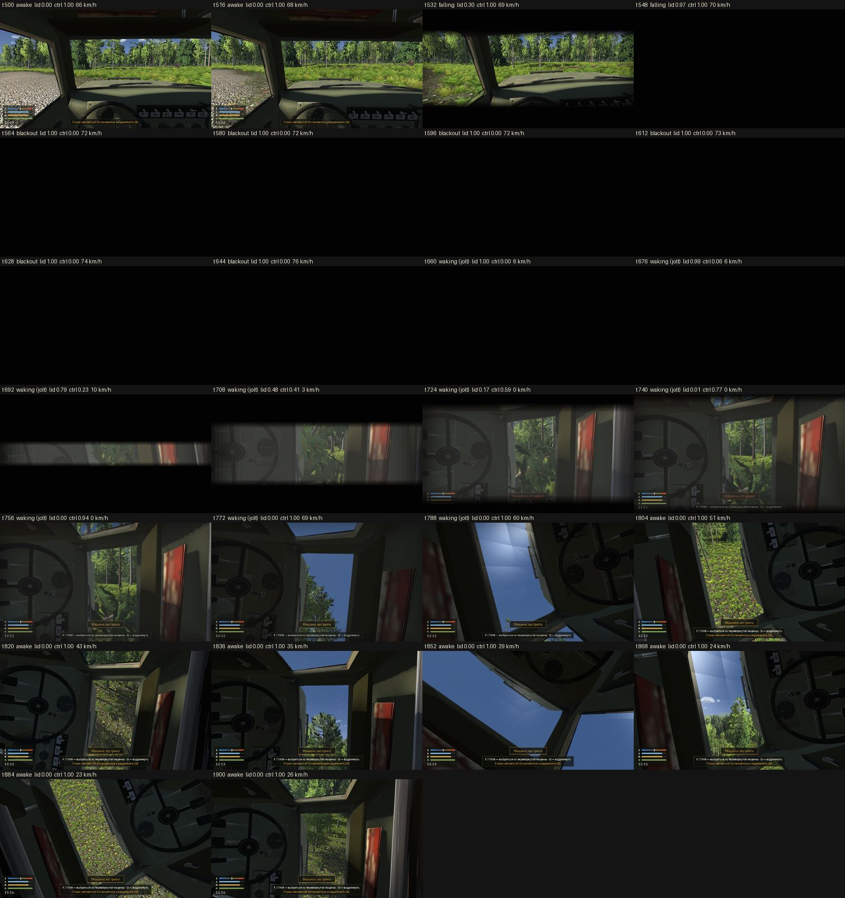

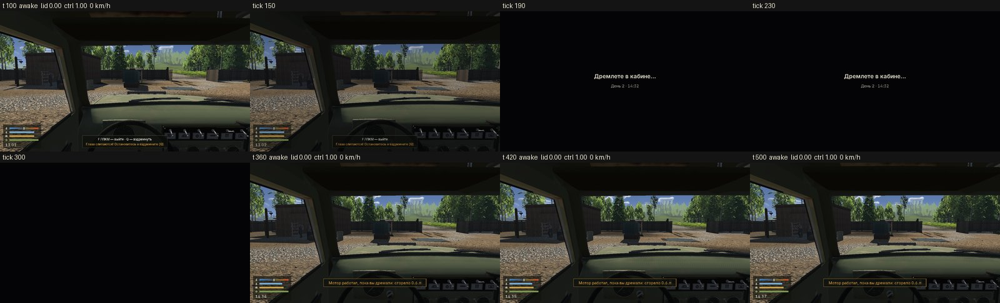

## 306. Трава сминается под колёсами, ногами и копытами и лежит, пока колея не зарастёт; под кузовом пригибается и встаёт за ≈2 с

04:00 · GRASSCRUSH · Трава сминается

Коммит: [48e81d148c](https://github.com/shsanek/EXEcutor/commit/48e81d148c)

Ветка: `work/peregon-grasscrush`

Сила и направление смятия хранятся в двух свободных байтах ячейки колеи 10 см — следы сохраняются, стримятся и передаются в коопе вместе с колеёй. Пишет хост: шины — полная сила по направлению движения, игроки пешком по траве — слабее каждые 0,35 м, свежие следы лося, медведя, оленя, кабана и волка рядом с игроком — ещё слабее. Восстановление по часам колеи: как глубина колеи для поверхности, в дождь втрое быстрее, мёрзлая земля держит; одинаково на CPU и в ядрах D3D12/Metal. Новый вычислительный проход читает блоки колеи прямо на GPU (без копий и чтения назад) и строит карту 512×512 по 0,2 м (≈100 м вокруг камеры); трава до 0,45 м у колеи наклоняется в неё; в той же карте — пригибание под коробкой кузова каждой машины, игроками и зверями в 30 м (восстановление 0,7 с). Карточки и травинки читают карту один раз на вершину: лёгшая трава наклонена от корня, ниже на 55 % и светлее; ограничение 4 «толкателей» снято для колёс и игрока. Параметры crush_* в grass.txt, PEREGON_GRASS_CRUSH=0 выключает.

- ✓ Тесты: surface_stream 18/18 (CPU и GPU совпадают бит в бит, в т.ч. с отладочным слоем и GPU-валидацией), rhi_d3d12 27/27, vehicle 151/151, play_cargo 70/70, nature 23/23, shaderc 67 + golden; игра под отладочным слоем D3D12 — 0 ошибок
- ✓ Цена (RTX 5080): карта смятия 0,019 мс; кадр 1080p 1,423 → 1,455 мс, 4K 3,98 → 4,03 мс; проход травы не подорожал; без цикла по траве на CPU
- ✗ Открыто: одиночная тропинка пешком видна слабо; далее ≈51 м и в блоках вне GPU следов нет; карта пересобирается почти каждый кадр у стоящего грузовика; на D3D9 и Metal по-старому

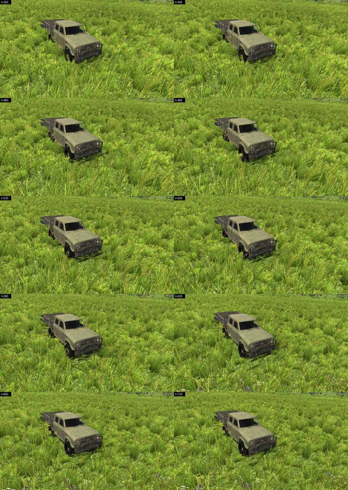

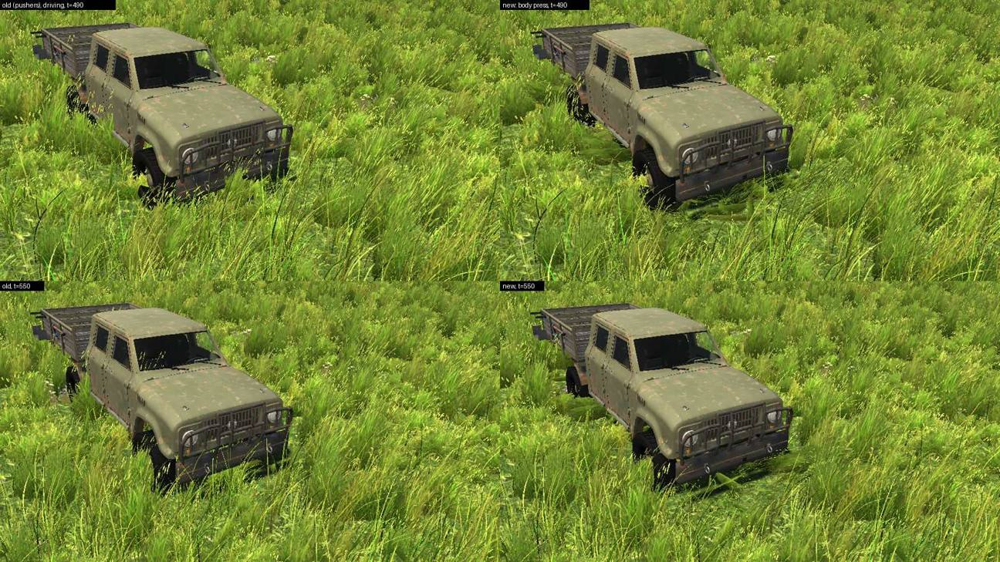

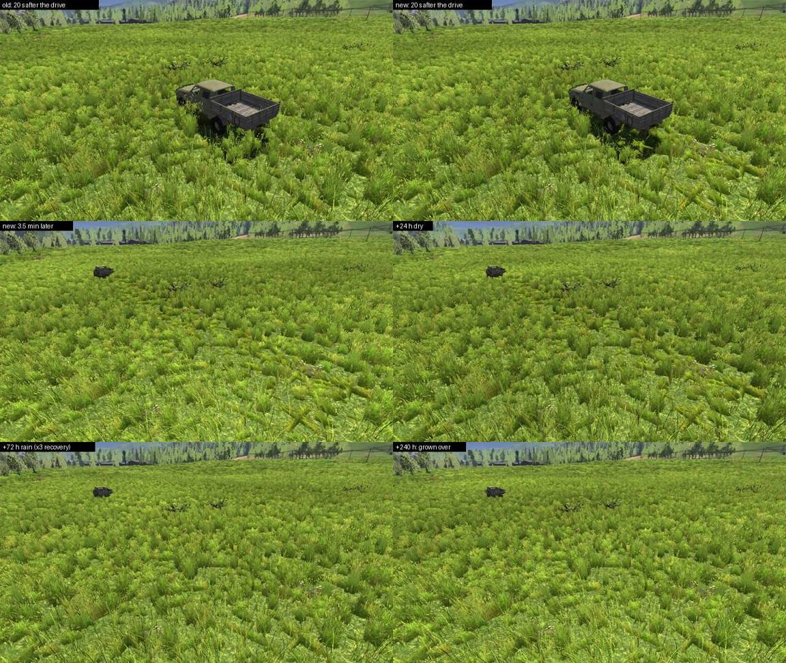

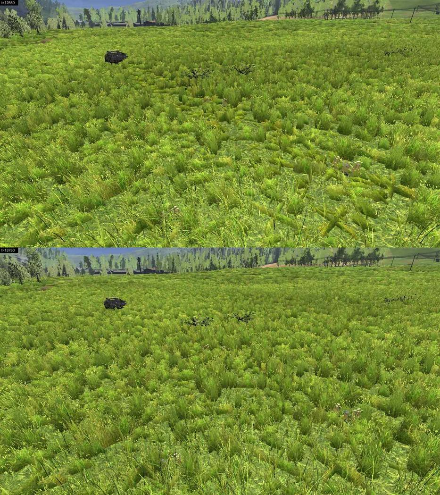

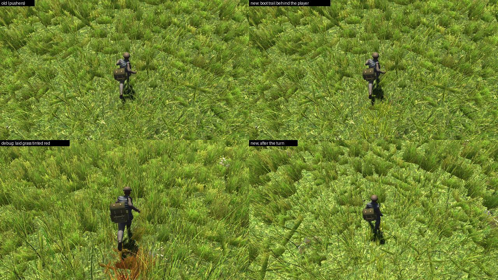

## 307. Руль без полос, перекрашенная приборка, понижайка в чехле, ручник с храповиком; понижайка и подкачка покупаются у механика; свои колёса у каждого уровня шин

04:25 · CABWHEEL · Руль, приборка, рычаги, колёса по уровням

Коммит: [40e4f07e8d](https://github.com/shsanek/EXEcutor/commit/40e4f07e8d)

Ветка: `work/peregon-cabwheel`

Руль: обод развёрнут как труба на ровную бакелитовую текстуру (новый атлас 2048²). Приборка: заново запечено затенение по текущей кабине, 954 грани перекрашены цветом своей панели — следы старой панели с кнопками убраны. Понижайка: резиновый чехол с прорезью на весь ход рычага (запас 7–11 мм). Ручник: храповый, как на грузовиках той эпохи (кронштейн, зубчатый сектор, ось, рычаг с тягой собачки, рифлёная рукоять, кнопка сброса), отпущен — 18° вперёд, затянут — назад на 0,55 рад; 21 поза без столкновений. Новая машина: пластина на прорези понижайки и пробка в отверстии тумблера подкачки, «ЗАГЛУШКА…»; у механика понижайка 250 купонов + 1 деталь, клапан 200 + 1 (upgrades.txt); секция сохранения 113, старые сохранения — обе установлены; передаётся в кооп. Колёса: дорожные (ребро 12 мм), вездеходные (шеврон 21 мм), грязевые (грунтозацеп 33 мм) — по уровню шин, на скелете стадии 45; размеры как в физике (радиус 0,432 м, протектор 30,7 / 37,8 / 42,5 см на ободах 24 / 28 / 32 см), борт шины на закраине обода. Обод, диск и барабан — замкнутые тела, нормали наружу, внутренняя сторона текстурирована.

- ✓ Тесты: view 59/59, play_cargo 70/70, play_care 47/47, vehicle 151/151, save 25/25, net 18/18, coop_audit 25/25; coop_seats 24/26 (2 прежних, REGRESS2)
- ✗ Решение менеджера: ширина обода в физике оставлена 0,12 м для всех уровней: с 0,14/0,16 машина Т3 + 600 кг сама выезжает из поймы на дорожном давлении (73,7 м) — ломает баланс грязи (бэклог W-B16)
- ✗ Открыто: колесо 6,0–6,3 тыс. треугольников (было ≈4 тыс.), видимая машина ≈76 → 93 тыс., LOD колёс нет; в съёмке без локализации интерфейс на английском

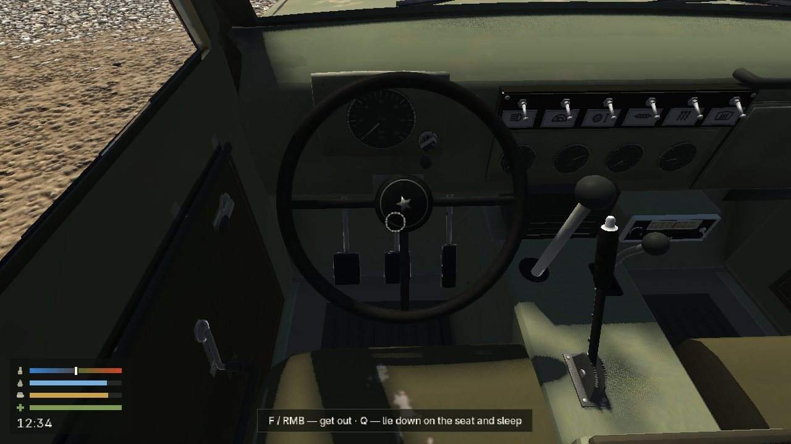

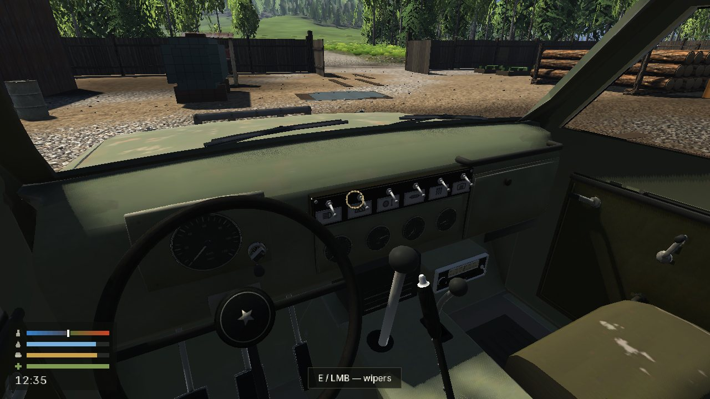

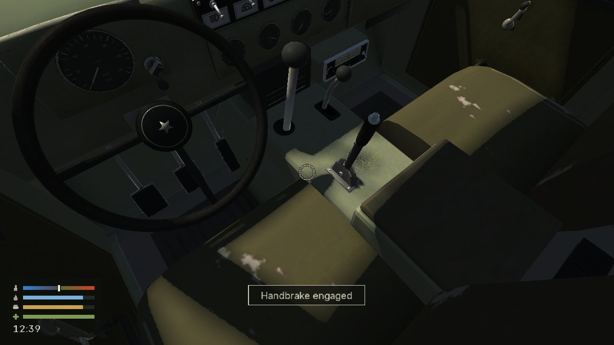

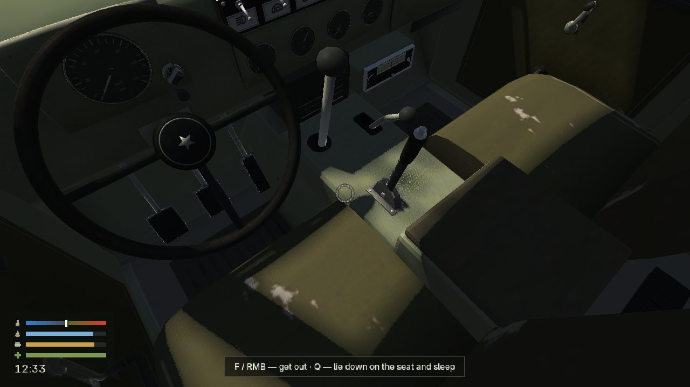

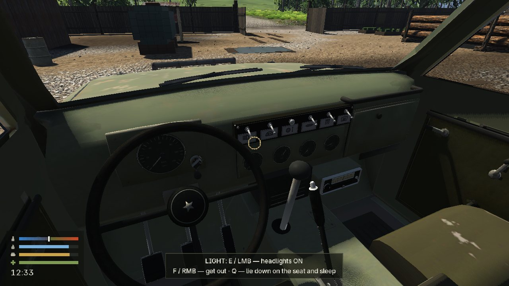

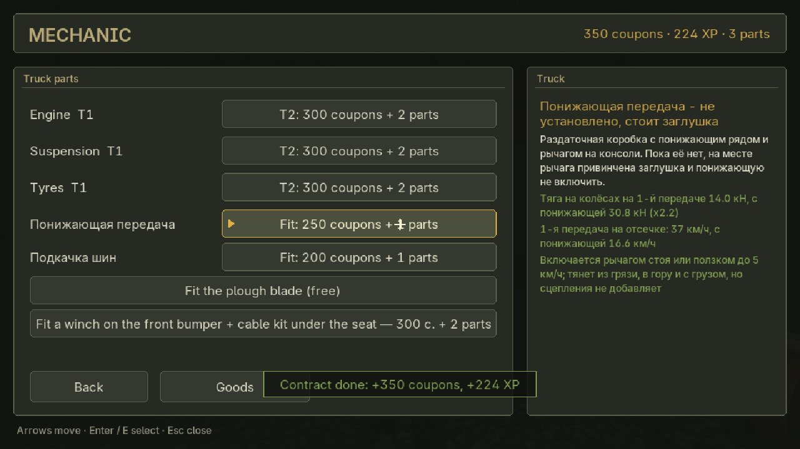

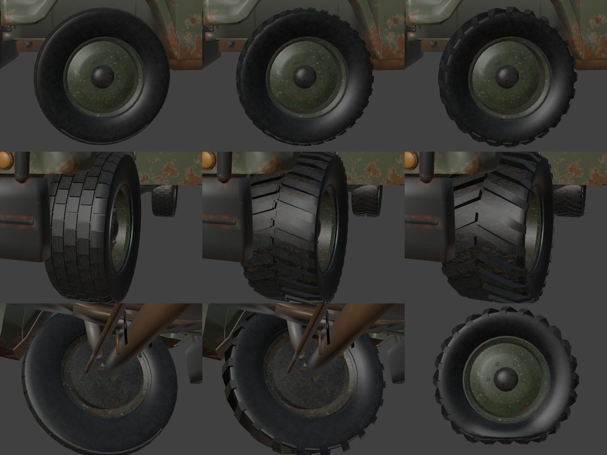

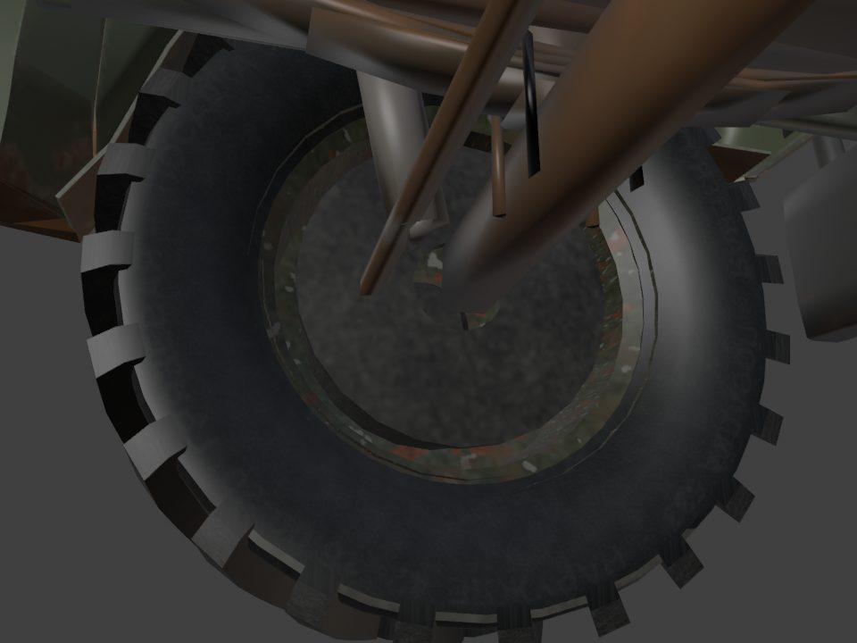

## 308. Тени деревьев вдали плотные и не рябят: mip-уровни листвы в проходе теней, порог по каскадам, качание только вблизи

04:55 · TREESHADOW · Тени деревьев

Коммит: [2492a2ab26](https://github.com/shsanek/EXEcutor/commit/2492a2ab26)

Ветка: `work/peregon-treeshadow`

Причины: карточки листвы в проходе солнечной тени читали текстуру листьев только в полном разрешении — вдали один тексель тени покрывал 25–78 см листвы одной выборкой, каждая крона давала случайную рябь, менявшуюся от малейшего качания; все каскады качались с полным ветром; при пороге альфы 128 крона отбрасывала около половины контура, сквозь крону проходило 25 % солнца. Теперь тень листвы использует mip-уровни (они уже держат покрытие 50 %) — дальние кроны дают сплошные устойчивые пятна; порог альфы по каскадам 96/80/64/48 (низкое качество 96/64/48), просвет сквозь крону 25 → 15 %; качание по каскадам: полное до 36 м, четверть 36–110 м, дальше нет; мягче дальние края (минимум 2 и 2,5 текселя). Шейдеры не менялись (sun_shadow.cpp/.h).

- ✓ Мерцание неподвижной земли, 40 кадров (полдень): 30 м 0,125 → 0,044; 80 м 0,134 → 0,042; 200 м 0,091 → 0,027; сверху с 200 м 0,048 → 0,008; лесная подстилка 0,316 → 0,227 (ветер вблизи сохранён)
- ✓ Цена и тесты: каскады солнца 0,15 → 0,13 мс в 1080p и 4K; light 36/36 (новый тест), nature 23/23, rhi_d3d12 27/27, shaderc golden
- ✗ Открыто: дальние силуэты леса без тени (дальше 340 м только запечённый кэш); кроны кэша крупнее и мягче — переход виден на 300–340 м; дальние билборды бледные сверху; Metal не проверен; найден отдельный баг: облака выкл + лучи солнца на низком солнце — аварийный выход (REGRESS2)

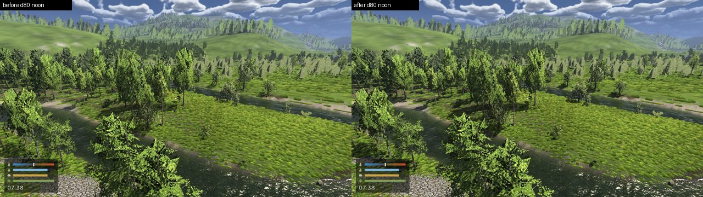

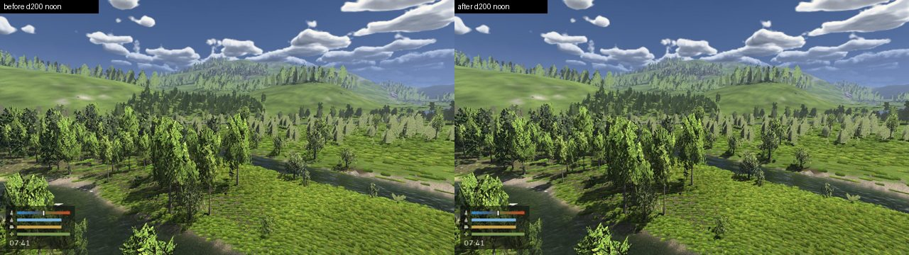

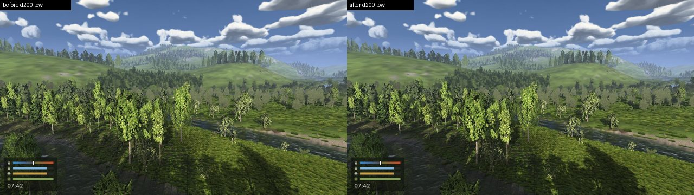

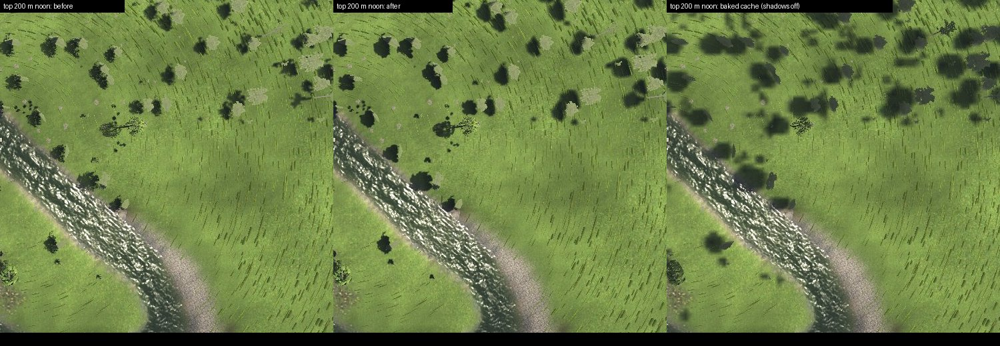

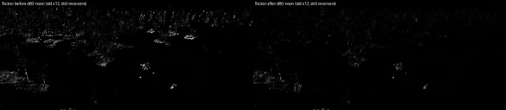

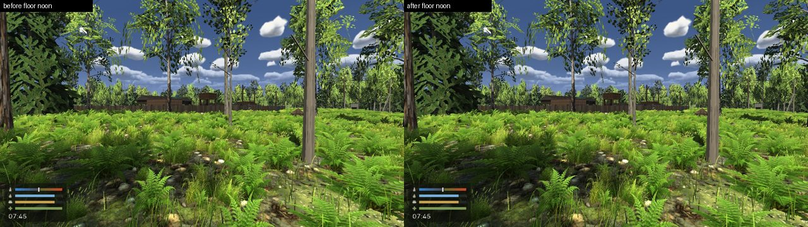

## 309. GI-пробы на максимуме больше не ограничивают кадр: 26 → 125 FPS в 1080p и 4K, главный поток 32,8 → 2,2 мс, рывки перестройки исчезли

06:05 · GIPERF · GI-пробы без тормозов

Коммит: [90bd050bc7](https://github.com/shsanek/EXEcutor/commit/90bd050bc7)

Ветка: `work/peregon-giperf`

Куда уходило время (1080p): обновление проб 16–26 мс, захват глубины сцены на CPU 5,6–10,4 мс, выборка 2,7–3,7 мс, плюс рывок 28–97 мс при перестройке статической GI-сцены каждые 8 м. Сделано: лучший BVH (попадания те же); захват отбрасывает геометрию вне вида и мельче тексела GI, остальное растеризуется параллельными тайлами без изменения победителя по глубине; обновление проб — на пуле задач между кадрами, проход приёмников — задачей с ожиданием перед проходом карты; дальняя видимость солнца читает покадровую копию поля облачной тени; перестройка статической сцены собирается за несколько кадров, BVH строится на пуле, подменяется ровно через 8 кадров (первая сборка и прыжки камеры &gt; 64 м — синхронно). Инструменты: таймеры по этапам, PEREGON_GI_DUMP и diffuse_gi_tests --bench.

- ✓ Замер (подмножество perfbench, макс., только FPS): 1080p 38,8 мс / 25,8 FPS → 8,0 мс / 125; 4K 39,0 / 25,7 → 8,0 / 125,1; без GI 4,9 / 6,0 мс; GI на главном потоке 32,8 → 2,2 мс; пик секции света 5 мс (было 28–97)
- ✓ Картинка и тесты: офлайн-бенч 5 сцен совпадает до 1 младшего бита; кадры в игре до/после ≤ 0,028/255 в среднем; D3D9: 700 кадров без ошибок RHI; diffuse_gi 18/18 (новый тест), light, rhi_d3d12, world
- ✗ Открыто: остаток ≈2–3 мс — ожидание задачи приёмников (кандидат: compute-проход на D3D12); последовательная сборка BVH статической сцены 25–35 мс (скрыта на пуле); полный 15-минутный прогон на новой сборке не делался; nature_tests 23/24 из-за NORTHSTART (NORTHFIX)

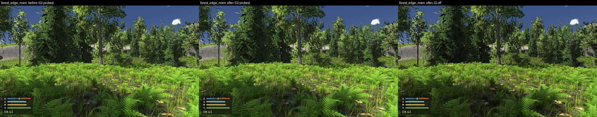

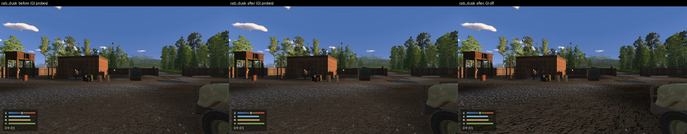
