# Перегон — 2026-10-17

[Главный отчёт](../README.md) · [Фичи и исправления](../CHANGELOG.md)

## 336. Мельница Миронова работает: ветряк на козлах крутит жернова через ремни; у семьи мельника настоящий дом и распорядок дня

00:41 · MILLLIVED · Мельница Миронова

Коммит: [9589b08298](https://github.com/shsanek/EXEcutor/commit/9589b08298)

Ветка: `work/peregon-milllived`

Земля: camp_blend — спуск к речной террасе, проезд для грузовика от ворот к складу с отворотом к приёмному навесу, 7 тропинок, 8 вытоптанных дворов, трава 0,4; старая подсыпка убрана. Для мельницы отдельный предел уклона в r1check 0,6: терраса за домом падает на 12–14 м, уклон кольца 0,55 (подтверждает владелец). Новые модели Blender: мельница-столбовка на срубе (сдвинута на 4 м, чтобы шкив встал на линию), трансмиссионный вал на 3 м с ремнями вверх к ветряку и вниз к новым жерновам в складе (камни в кожухе, ковш, мучной лоток и ларь, шестерни); мёртвый колхозный электромотор (Rusty Scrap), мешки с мукой, десятичные весы, подвесная керосиновая лампа. Дом развёрнут ко двору: железная кровать родителей и нары сыновей (4 места на 4 человек), кирпичная печь с трубой через крышу, стол в доме, полка, табурет, двустворчатая дверь, светящееся окно, бочка, уборная. Своя весовая будка и приёмный навес без меток налётчиков с элеватора; текстурированные стены склада, дома и будки. Распорядок: мужчины едят за столом в доме; Галина летом готовит на костре во дворе, а зимой и в дождь — у печи (первый распорядок еды с учётом сезона), работает в весовой. Новая dev-стадия r2_mill_drive. Исправления логики: жерновов не было, мельник работал во дворе, ремни не могли работать (шкивы на одной оси); место ремонта убрано из-под крыльев; электрический фонарь у ворот (электричества нет со времён Выброса) заменён керосиновым на колу; в доме были кровати на двоих из четырёх, не было печи, стола и двери, семья ела на улице; не было уборной. Модели: bl_post_windmill 4032 → 4000 (13 мм), bl_millstones 1756 → 1700 (10 мм), ue_rustyscrap_engine 3994 → 2368 (9,7 мм; ниже ломаются рёбра); из кэша — мешки с зерном и табурет. Огней 5 → 11, мест занятий 14 → 19.

- ✓ Сборка и навигация: poi_tests 11/11 с навигацией; 0 ошибок / 0 предупреждений / 0 см; проверка висящих объектов 4134 пробы 0/0/0; kit_mesh_fit_check OK
- ✓ Тесты: world_tests 39/39, light_bake_tests 8/8, folk 6/6, story 74/74, story_lint, play_dialogue 59/59, play_story 23/23, play_journal 21/21, map 56/56, region_static
- ✓ Проезд: грузовик останавливается о ветряк, стену склада, столбы ларя и столб ворот; r1check мельницы проходит (известные FAIL: r2_church, r2_village_well, rr_bunker_portal)
- ✗ Не запускалось: живой тест входа пешком; D3D12 и производительность
- ✗ Открыто: грузовик прямо по проезду застревает между приёмным навесом и столбами ларя (было и раньше); крылья и ремни неподвижны; десятичные весы — белая коробка; остовы трактора и комбайна — серые коробки; текстуры стен общих grain_store_14x30 и lab_cabin_lived_9x5 видны и на элеваторе; склад внутри почти пуст; у скрытого чердака мельницы нет места занятий

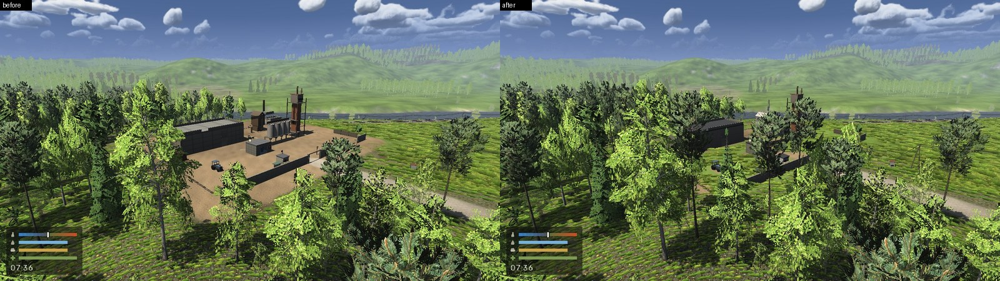

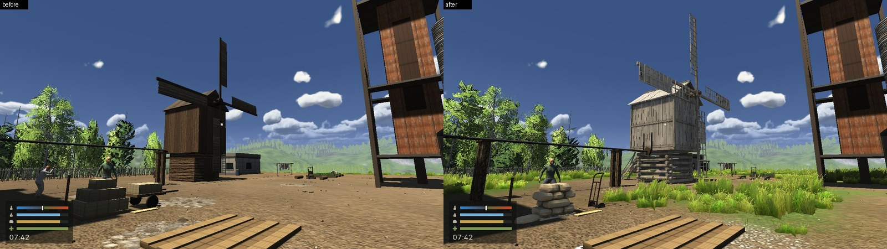

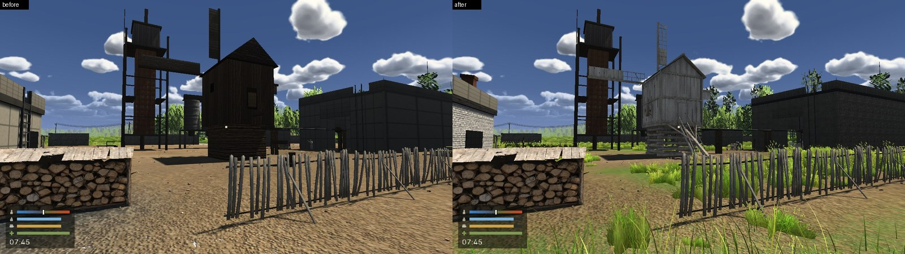

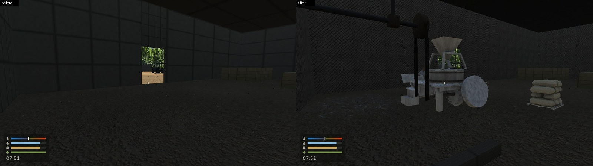

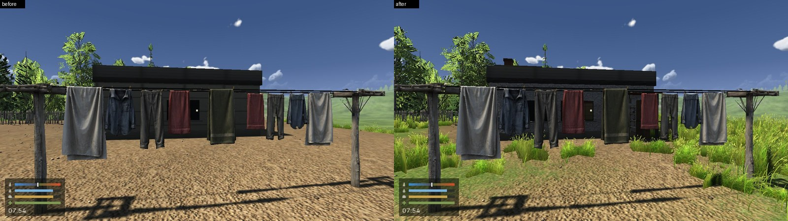

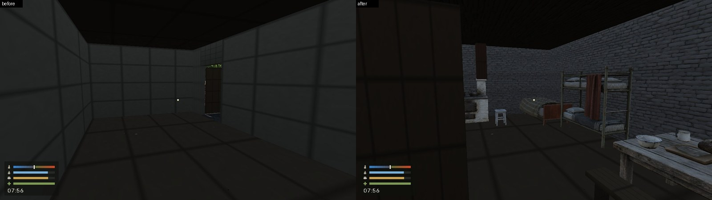

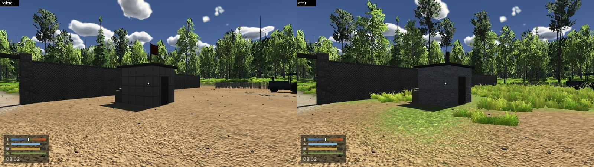

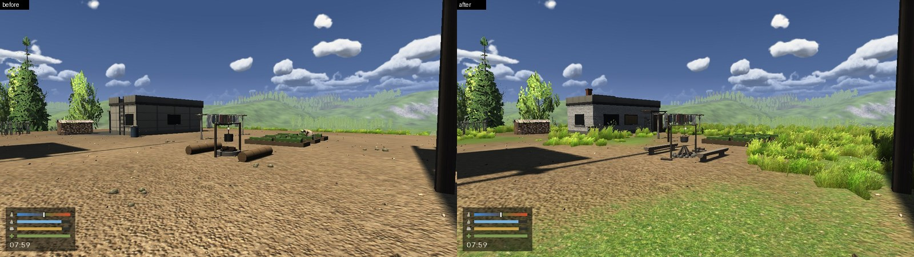

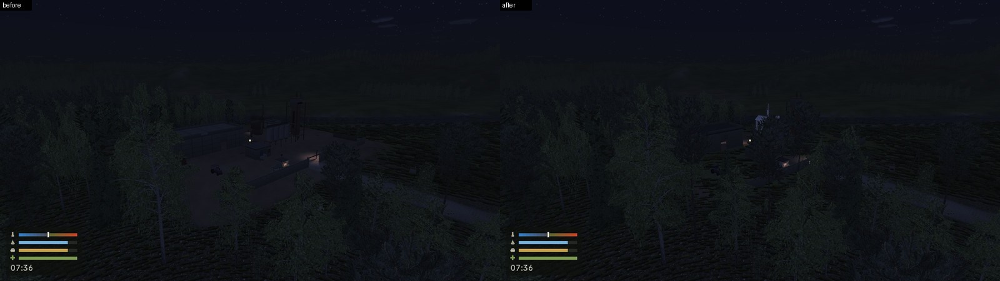

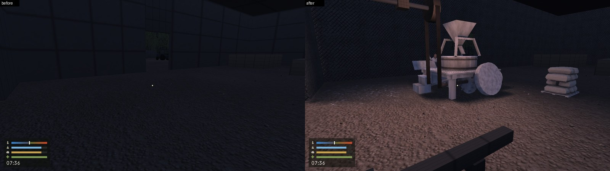

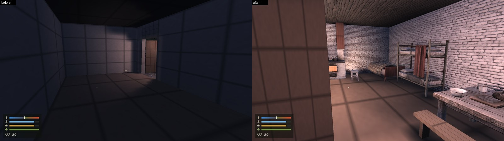

## 337. Свалка — рабочий бизнес Сыча: весы, порезка под козловым краном, сортированный лом, склад цветмета; остовы машин, ПАЗ и ГАЗ-53 — модели во всех местах

01:02 · SCRAPLIVED · Свалка Сыча

Коммит: [eef59d8ed0](https://github.com/shsanek/EXEcutor/commit/eef59d8ed0)

Ветка: `work/peregon-scraplived`

Земля: camp_blend и файл земли, проезды для грузовика, тропинки бригады, рабочие дворы, вытоптанная трава; уклон кольца 0,32 → 0,13. Приёмка: десятичные весы у ворот, бытовка Сыча (кровать, стол, табурет, печь под трубой через крышу, светящиеся окна, лампа над дверью). Порезка: козловой кран над кузовом машины, газовая тележка. Сортированный лом: тяжёлые и лёгкие кучи, стеллаж для труб, чугунные батареи. Контейнер-склад цветмета (ящики под медь, алюминий, латунь, аккумуляторы), деревянная будка (без собаки). Контейнер-ночлежка бригады, тёплый угол, уборная, фонарь во дворе. Общие элементы теперь везде рисуются моделями Blender (в том числе на заправке на отроге): кузова «Жигулей», штабеля машин, стена из кузовов, автобус ПАЗ, остов ГАЗ-53, кучи лома — коллизия подогнана. Распорядок: Сыч взвешивает на весах, Бурый режет под краном, Кузьмич ест в помещении за столом бригады. 18 запечённых огней. Исправления логики: бригада спала в контейнере с открытыми обеими створками и без тепла — одна створка закрыта, печь с трубой через крышу, лампочка, стол; Сычу негде было спать — бытовка; закрытый контейнер стал складом цветмета (ценное под крышей); еда Кузьмича — с дивана на улице за стол бригады; мангал, топливо генератора и газовые баллоны разнесены; в мастерской печь; добавлена уборная; две 4-метровые дыры в стене закрыты (ворота одни); улика с почтовой сумкой в ПАЗе перенесена к задней двери автобуса, замотанной проволокой. 20 моделей Blender (большинство 550–2500 треугольников; газовая тележка 5564 → 2500, кучи 9684 → 3000 и 14440 → 2935 собраны из деталей Rusty Scrap; обработано 43 записи Rusty Scrap). Важная находка (открыта, высокий приоритет, менеджер берётся следующей): импортированные модели рисуются зеркально по X относительно коробок коллизии набора (дверь бытовки Сыча оказывалась не с той стороны); для элементов свалки исправлено локально отражением их коробок, мебели и огней; асимметричные модели в других местах, вероятно, тоже затронуты — следующей будет общая правка в импорте или расстановке пропсов.

- ✓ Сборка и проверки: poi_tests 11/11; проверка висящих объектов 7274 пробы, 0 проблем; r1check свалки OK (неровности 0,15, кольцо 0,13); свалка, заправка на отроге и элеватор: 0 ошибок / 0 см
- ✓ Тесты: world, map, region_static, region_stream, scrap, economy, contracts, play_story, story, story_lint, play_dialogue, play_gunsmith, gunsmith, folk, character, play_journal, light_bake, play_cargo, nature — проходят (3 вылетели по таймауту под нагрузкой, отдельно проходят)
- ✓ Физика: грузовик останавливается о створку ворот, весы, бытовку, остов грузовика, автобус, машину под краном, кучу, стену из кузовов; пешком не проходит ни через один новый элемент, входит в бытовку и оба контейнера
- ✗ Штабеля машин: проба проезда к штабелю машин катится при появлении — штабеля проверены только пешком
- ✗ Зеркальные модели: импортированные модели зеркальны по X относительно коллизии; на свалке исправлено локально, общая правка — следующая задача менеджера
- ✗ Не проверено: D3D12 и производительность
- ✗ Открыто: контейнеры, мастерская, избушка Кузьмича и вышки — коробки набора; машины низкополигональные; слабая полоса на текстуре бытовки; место у стеллажа труб не используется; места бригады не учитывают сезон (задача NPC)

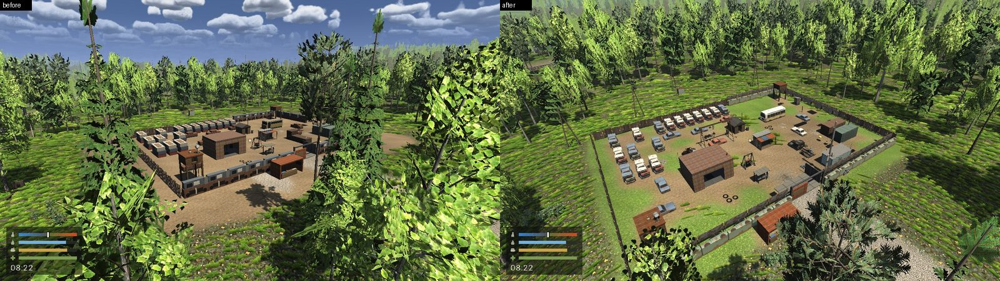

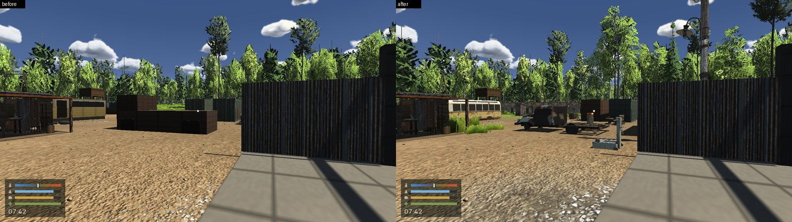

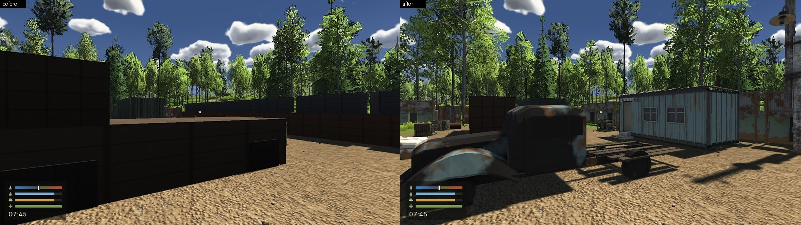

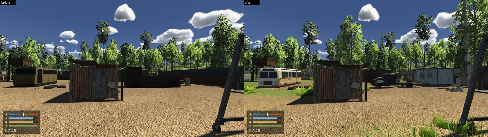

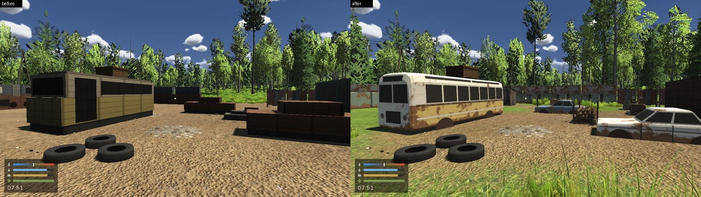

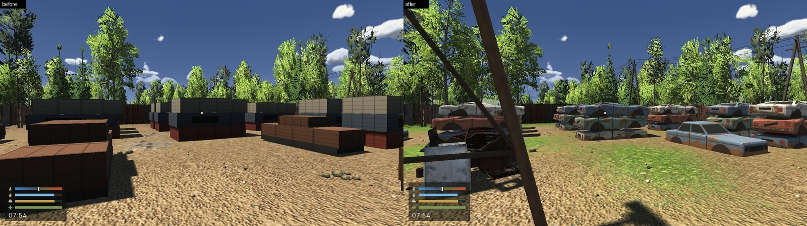

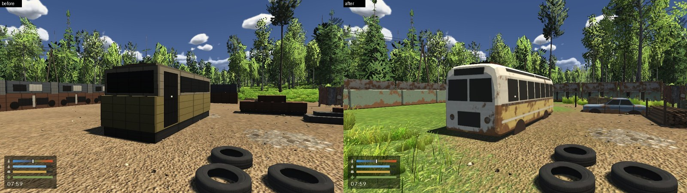

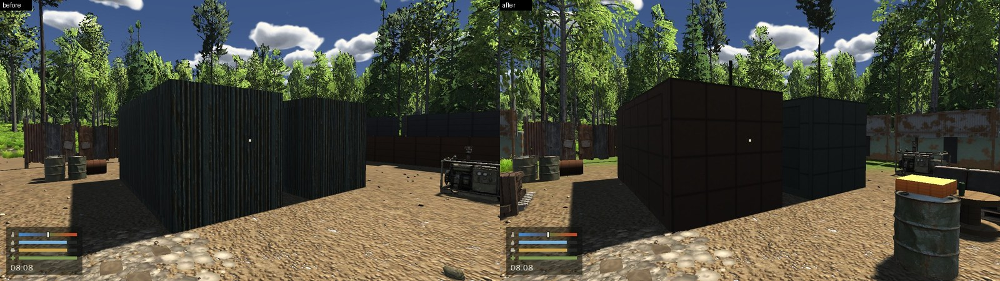

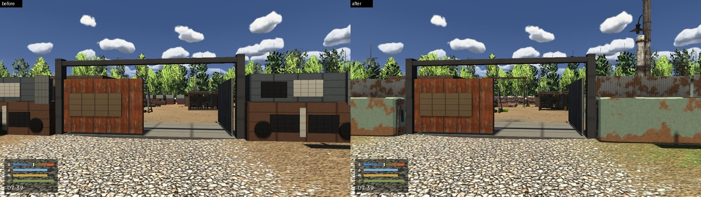

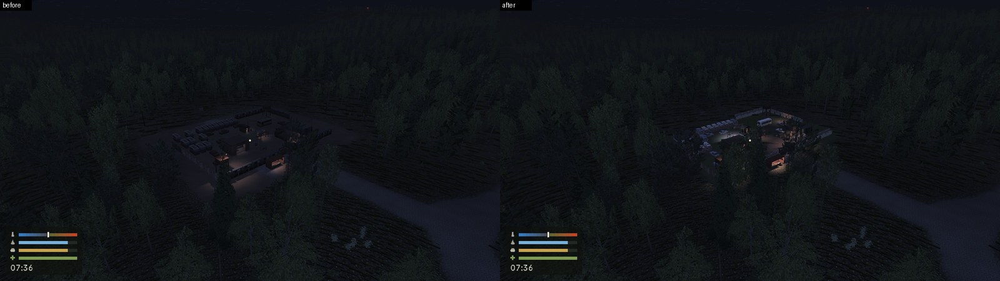

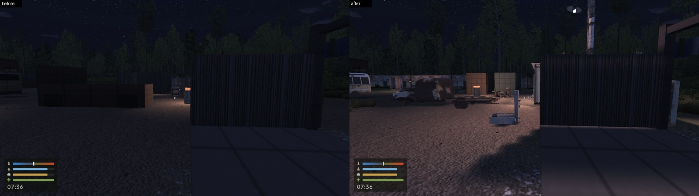

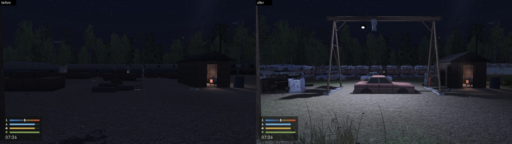

## 338. Переправа Захара: паром вытащен на берег, лебёдка троса, штормовой фонарь, било; избушка — настоящее жильё; лодки, сети и вешала — модели во всех лагерях

01:23 · FERRYLIVED · Переправа Захара

Коммит: [fb5fd40e2e](https://github.com/shsanek/EXEcutor/commit/fb5fd40e2e)

Ветка: `work/peregon-ferrylived`

Место повёрнуто (yaw 290 → 320), чтобы трос шёл поперёк реки (r2_ferry.json и play_region.cpp). Новая опция camp_blend ramps: 4,6-метровый земляной съезд по берегу (~15 %), полка у уреза воды, слип в реку, срезы плавно уходят в естественный берег (без края площадки со стороны воды). Пристань: понтон на один грузовик, 6 × 14 м, вытащен на полку и стоит на брусьях (линия Захара про осмотр днища), столб троса с ручной лебёдкой на бровке, провисший в реку трос (сюжетное место с якорным бревном перенесено вместе с ним), три причальные сваи, красный штормовой фонарь на шесте у слипа, подвешенный рельс-било, чтобы звать с того берега, рыбацкий стул. Движок: в навигации poi.cpp лестница, стоящая основанием на более низкой земле, считается уровнем земли (палуба понтона достижима); dev-старты r2_ferry_ramp, _gate, _landing. Логика: избушка Захара была пустой коробкой с непроходимым проёмом 0,9 м — теперь дверь 1,2 м, нары, печь под трубой, стол, табурет, лампа, светящиеся окна; он ест дома, а в дождь и зимой чинит снасти у печи; поленница перенесена к избушке; электрическая лампа убрана (на реке нет электричества), фонарь пристани из диалога теперь есть; фонарь у ворот убран с проезда. Дом у переправы (Роман и Нина): кровать и печь внутри, едят дома, стол во дворе — только летом. 13 моделей Blender, все в бюджете (понтон 2092/1046, избушка 1384/689, столб троса 948, вешала 628, сети 448, бочка с дёгтем 416, лодка 308, перевёрнутая лодка 244, свая 228, шест с фонарём 212, нары 168, било 144, стол 136); лодка, перевёрнутая лодка, вешала и сети заменили серые коробки и в других лагерях; из кэша — рыбацкий стул, табурет, кровать.

- ✓ Тесты: poi_tests 11/11, world_tests 39/39, light_bake 8/8, light 36/36, folk 6/6, character 19/19, play_story 23/23, play_dialogue 59/59, play_journal 21/21, story 74/74, story_lint 0, map 56/56, play_water 23/23, play_lake 14/14, play_cargo 71/71, nature 23/23, asset 7/7, region_static и region_stream OK
- ✓ Проверки места: проверка висящих объектов 3332 пробы, 0 ошибок; метки перегенерированы
- ✓ Физика: грузовик вниз по съезду останавливается о корпус понтона, от ворот — о шесты сетей; пешком по сходне на палубу, перила не пускают
- ✗ Не проверено: D3D12 и производительность
- ✗ Открыто: грузовик не может заехать на паром (нет коллизии сходни, механики переправы E12 нет); зеркальные несовпадения оставлены для MIRRORFIX (стойки блоков понтона, стойка била, бочка с дёгтем, кровать в доме у переправы); брусья под понтоном со стороны реки до ~0,65 м; коптильня и общий дом у переправы — серые коробки

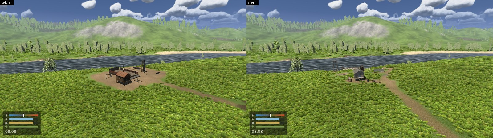

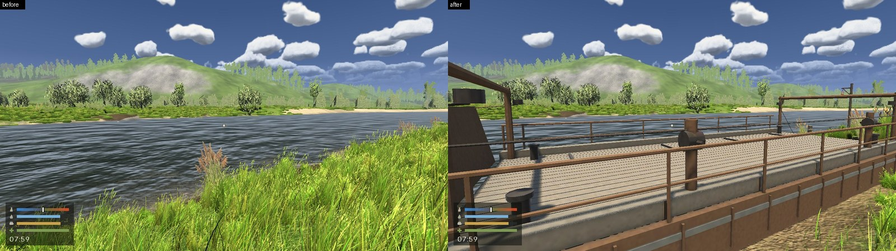

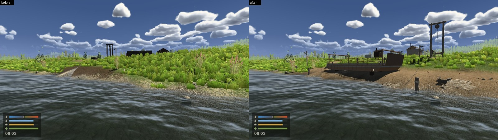

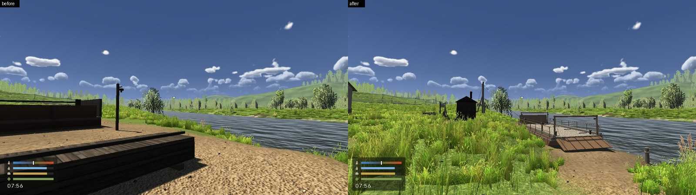

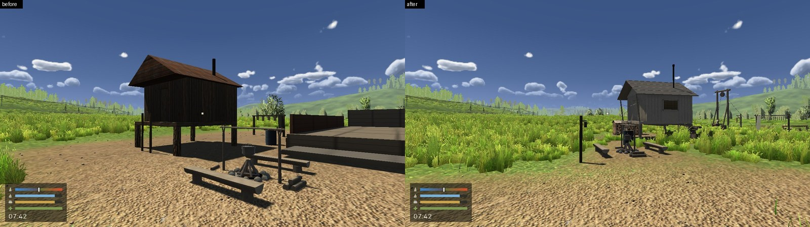

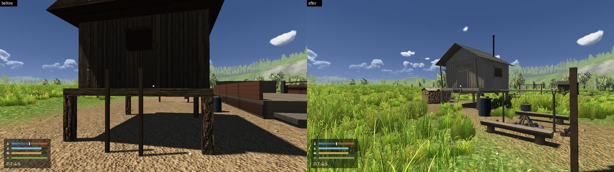

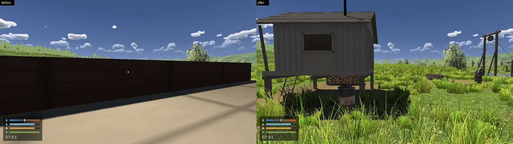

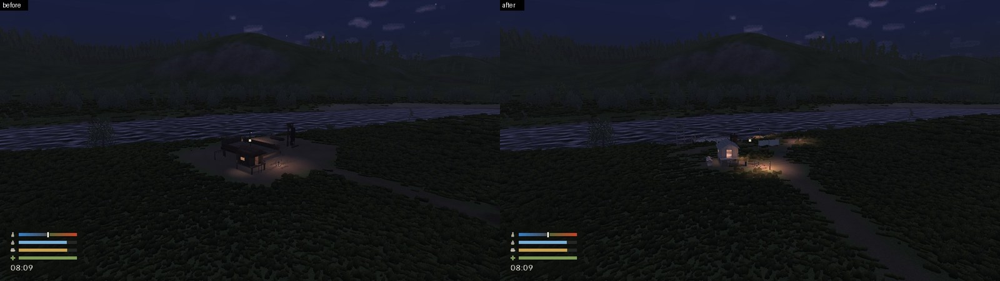

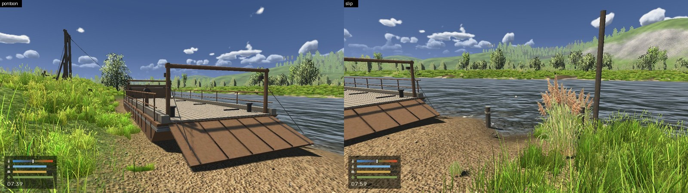

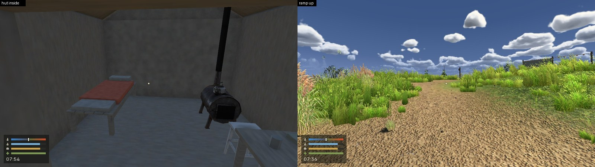

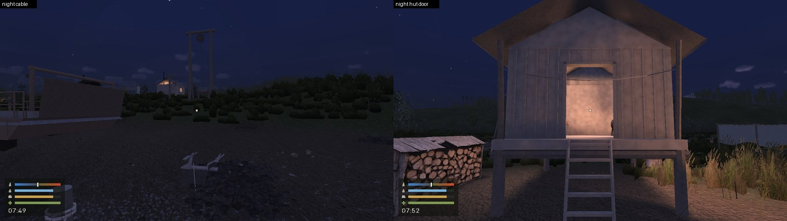

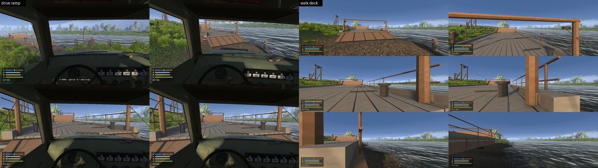

## 339. Озёрный лагерь — обжитая рыболовецкая артель: обставленные домики, приёмка-столовая с весами, коптильня, лодки на козлах, «Казанка» на пляже; без песчаного обрыва к пляжу

01:44 · LAKELIVED · Рыболовецкая артель на озере

Коммит: [ca942336a7](https://github.com/shsanek/EXEcutor/commit/ca942336a7)

Ветка: `work/peregon-lakelived`

Земля: camp_blend в r3_camp.json, старая подсыпка убрана; крутой 4-метровый песчаный гребень между лагерем и пляжем стал склоном 20–28 м в естественный пляж; проезд от ворот к грузовой площадке, 12 тропинок, 8 вытоптанных дворов, короткая трава (козы); новая опция camp_blend clear_m (трава прорастала сквозь полы домиков); лодочная станция сдвинута на 8 м к урезу воды (без ступени 3 м); мелководье, пляж и причал естественные. Пляж: шесты сетей и вешала были зарыты в крутой берег — перенесены вдоль берега; мостки для стирки, котёл со смолой, фонари, удочки, табуреты. Логика: пустые жилые домики получили кровать, печь-бочку под уже стоявшей трубой, стол, табурет, открытую дверь, светящиеся окна, жильцы распределены по канону; столовая стала приёмкой артели и обеденным залом (открытая дверь, прилавок и весы, кухонная печь под трубой, под которой раньше ничего не было; уличный стол и место еды eat_02 перенесены внутрь); электрические фонари во дворе заменены керосиновыми на кольях (электричества нет); вода и дрова у кухни; у места ремонта лодок — лодка на козлах и котёл со смолой; двуспальная кровать и печь ferry_yard убраны, потому что общий домик теперь обставлен; бани нет (по канону она на кордоне). Модели Blender: «Казанка» 288, лодка на козлах 312, коптильня 732, котёл со смолой 284, пляжный грибок 340, кабинка для переодевания 148; удочка 7512 → 2500 с рогатиной и кольями под комель (исправляет падение world_tests по контакту, на которое наткнулась FERRYLIVED); рыбацкий стул 1232; из FERRYLIVED — лодки, вешала, сети. Огни: лагерь 11 → 22, пляж 0 → 3.

- ✓ Сборка: lake_camp 0/0, lake_beach 0/0 (было 2 ошибки «зарыто»), ferry_yard 0/0, 0 см; poi_tests 11/11; world_tests 39/39
- ✓ Проверка висящих объектов: 22 ракурса, 7929 проб: 0 неба, 0 щелей, 1 «выше» на неизменённом закрытом домике
- ✓ Физика и тесты: play_lake_tests 15/15 с новым случаем проезда и прохода (грузовик останавливается о домик, коптильню, лодку на козлах, «Казанку», лодочную станцию; пешеход проходит в двери столовой и домика); story, dialogue, journal, cargo, map, region_static, light — проходят
- ✗ r1check: r3_camp проходит с отдельным пределом уклона 1,8 (кольцо 1,73 в оползневом шраме, где естественный склон уже 1,2–1,4); оценит владелец — как 1,7 у заправки, 1,4 у элеватора, 0,6 у мельницы
- ✗ Не проверено: D3D12 и производительность
- ✗ Открыто: проверки зеркальности для MIRRORFIX (топка коптильни против свечения, изголовье кровати); грузовик может заехать между столбами веранды, кабина окажется под крышей (у крыши нет коллизии); стены домиков и столовой, клуб, арка ворот, водонапорная башня — серые коробки; реквизиту зимней рыбалки нужен слой только для зимы

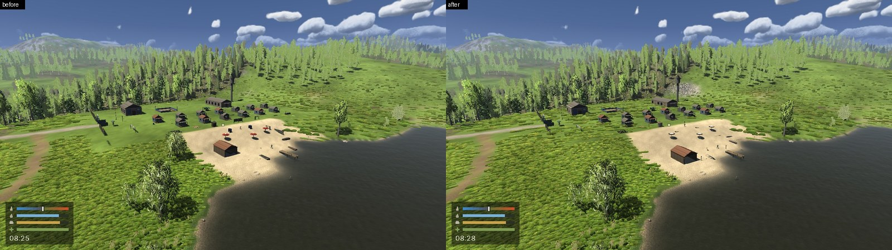

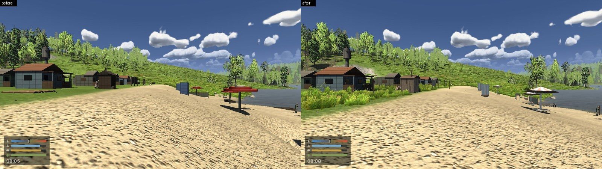

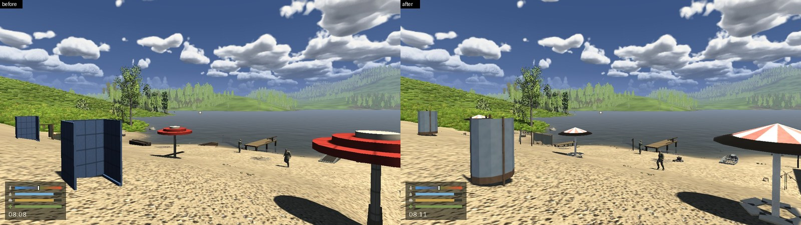

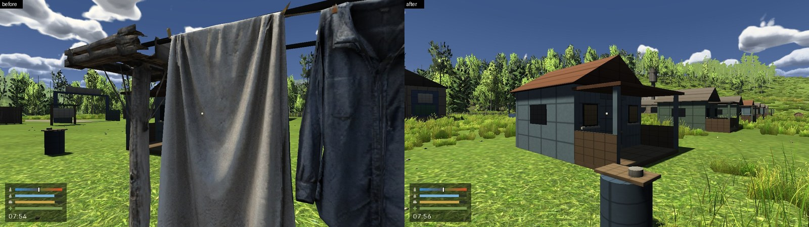

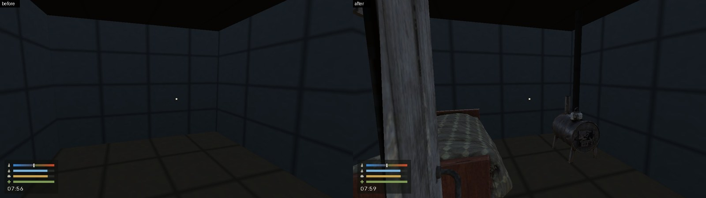

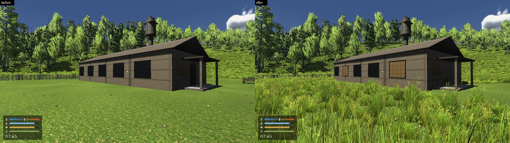

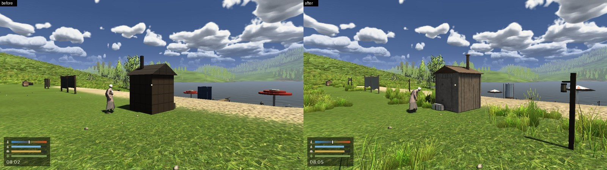

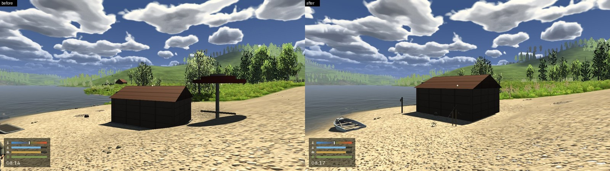

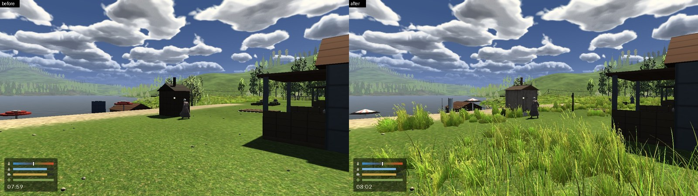

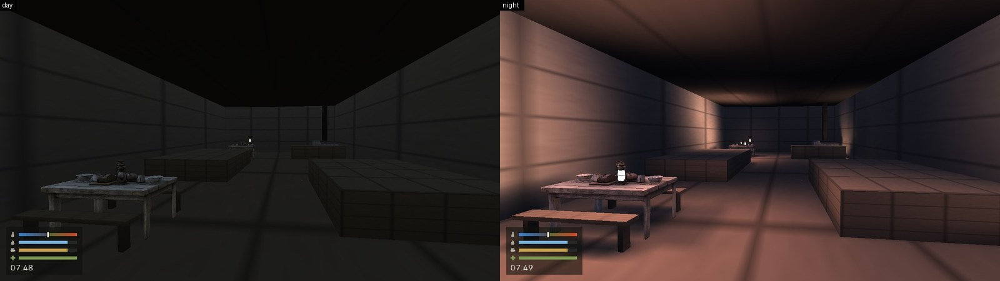

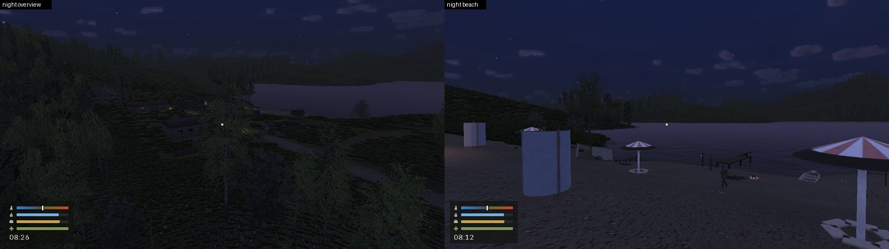

## 340. Раскладки элементов набора совпадают с нарисованными моделями: 22 зеркальных элемента исправлены, проверка kit_mesh_mirror

02:30 · MIRRORFIX · Раскладки в системе модели

Коммит: [a7baa6fda6](https://github.com/shsanek/EXEcutor/commit/a7baa6fda6)

Ветка: `work/peregon-mirrorfix`

SCRAPLIVED сообщил, что импортированные модели рисуются зеркально по X относительно коллизии. Причина другая: модели никогда не рисовались зеркально — единственный разворот x при загрузке pmesh — правильный переход из правой системы координат в левую (текст дорожного знака читается верно, кабина БелАЗа со стороны водителя). Ошибка была в импортёре: сырые числа glTF он называл «системой набора» (коробки kit_piece.txt, docs §1, K() в make_mill_kit), поэтому раскладки, снятые с Blender/glTF (проёмы дверей, ступени, мебель, огни, шкивы), получались зеркальными. Доказательство — новый тест импорта test_lshape: стойка на +X в Blender рисуется на x −0,85 набора; старый срез коллизии +0,50 падает, новый −0,50 проходит. Расстановщик пропсов не разворачивали (это отразило бы настоящую геометрию). Исправление: импортёр пишет коробки kit_piece.txt в системе набора; новые tools/kit_mesh_mirror.py и ctest kit_mesh_mirror (падает на любом элементе с пометкой MIRRORED), tools/kit_mirror_piece.py. Больше 20 раскладок отражены на свои модели: дома и развалины в Берёзовке (проём стоял под нарисованным окном → проём к западной стене), будка дани на заправке (дверь во двор), тельфер козлового крана на свалке, фонарный столб, бак с водой, корыто, хлам во дворе, БелАЗ, дорожный знак, поддон с мешками, тележка с мешками, стойки блоков понтонов на переправе и озере, лебёдка троса, било, бочка с дёгтем, вешала, шесты сетей; ветряк и жернова мельницы пересобраны в системе набора (шкивы ремней снова смотрят на вал); тропинки и дворы у дверей на всех 15 участках, тропинка к будке, сюжетная дверная рама на участке 7; файлы земли переэкспортированы, карта перепечена, кэш обновлён. Убирать обходные решения не пришлось.

- ✓ kit_mesh_mirror: 257 правил с моделями: 34 OK, 0 MIRRORED (было 22), остальные симметричны или не определены
- ✓ Тесты: ctest world, poi, asset, light_bake, story, story_lint, play_story, play_dialogue, scrap, region_static, map, play_lake, kit_mesh_mirror; test_import.py (с test_lshape)
- ✓ Сборка мест: 94 комплекса собираются так же, как раньше: каждое готовое место 0/0/0 см; 7 комплексов угольного карьера и разъезда сохраняют прежние ошибки
- ✓ Физика: пешком проходит через двери бытовки, будки дани, домов всех трёх типов, развалин, дома мельника, семейной комнаты Лесопилки, столовой элеватора; стены у будки (южная) и дома на участке 7 (восточная) не пускают
- ✗ Не проверено: производительность; render_perf_route_tests не компилируется (было и раньше); D3D12
- ✗ Открыто: у деревенских домов нет настоящей двери на уровне земли (порог 0,55–0,7 м, а проём коллизии до земли); подушки bed_family не проверены; fallen_birch_road под --remap nordic рисуется бревном ели, корневая пластина 2,4 м над коллайдером 0,9 м (ошибка сопоставления); эвристика не видит мелких деталей в симметричных коробках; входные данные импортёра всё ещё в системе glTF

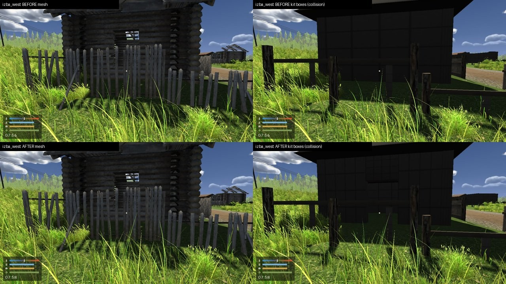

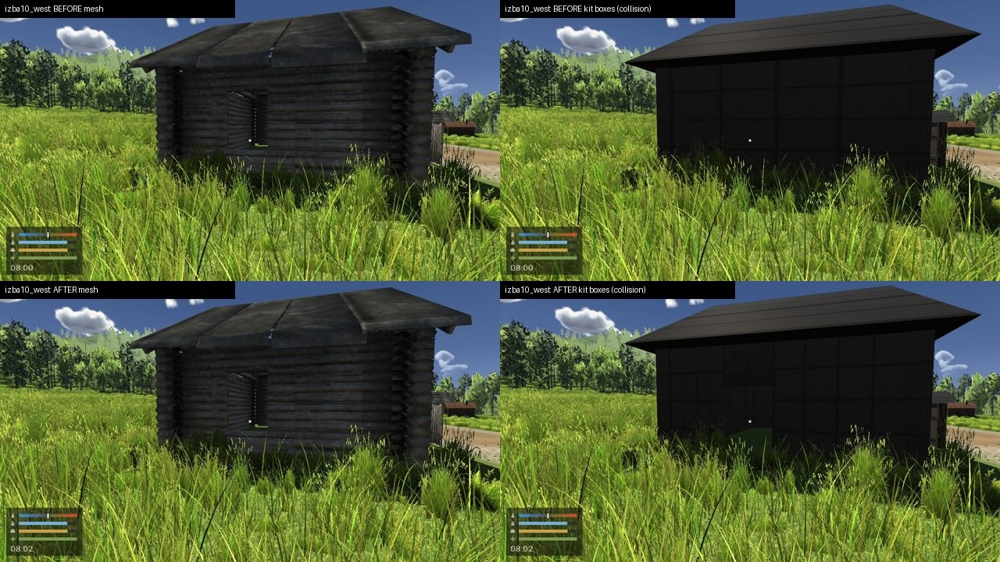

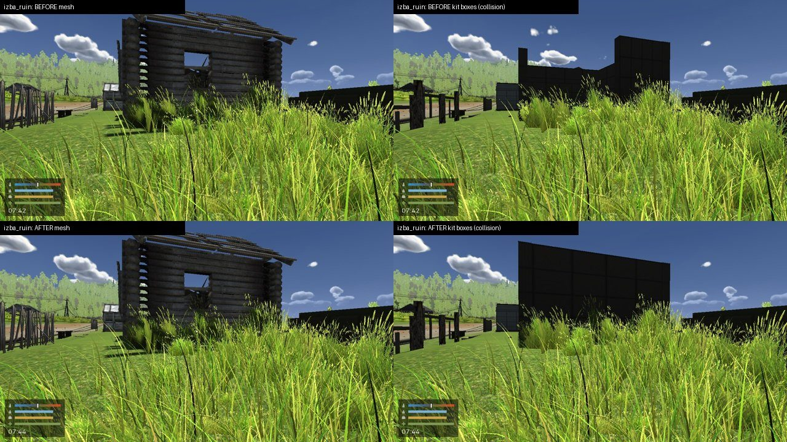

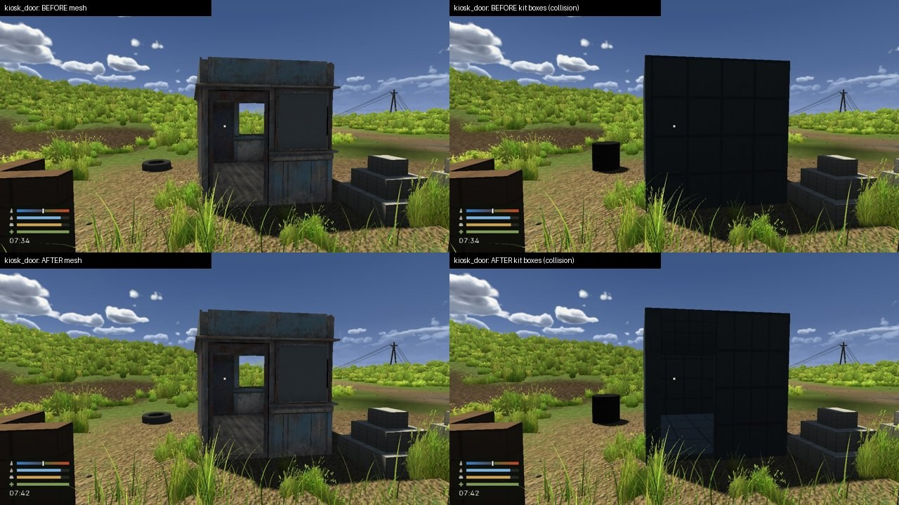

## 341. Адаптивное сопряжение лагерей с землёй: без валиков вдоль заборов, вытоптанная полоса вместо контура площадки, тропинки и колеи во дворах

02:44 · TERRAINBLEND · Лагеря врастают в землю

Коммит: [a515361dfa](https://github.com/shsanek/EXEcutor/commit/a515361dfa)

Ветка: `work/peregon-terrainblend`

Ветка включает два коммита владельца с пилотом адаптивного рельефа (перенесены как ac4b1a59e0 и f7c128454a, только рельеф, без файлов редактора одежды). Жалоба владельца: сглаживание лагерей недостаточно плавное и адаптивное, на краях с малым перепадом площадка всё ещё читается, вдоль участков мелкие валики, во дворах везде текстура травы и нет тропинок. Найденные причины: (1) штампы валиков у заборов — каждый забор или стена поднимали полосу 1 м на 15 см над площадкой, обводя лагерь гребнем (70–100 % краёв с малым перепадом; Лесопилка 60 валиков, заправка на отроге 36, заимка 25); (2) неровности двора доходили до края — порожек до 15 см на ровном месте; (3) ширина считалась заново в каждой точке — склон изгибался у ближних гребней и ям; (4) идеально гладкое кольцо и ровный двор на фоне неровной земли при низком солнце читаются как контур; (5) двор закрашен травой против лесной подстилки или луга, а карточки травы выключены на первой 4-метровой клетке снаружи; (6) тропинки шириной 1,0–1,6 м размывались 2-метровыми клетками цвета с размытием 1,9 м. Новая модель включается автоматически для каждого camp_blend (в том числе slope, footprints, ramps, floor, clear_m): ширина решается по направлениям от рельефа (метод пилота: авторские min + per·|перепад| как нижняя граница ×1,25, меньше на крутых берегах, целевой уклон относительно уклона местности), гладко по всему кругу, без швов на углах и у ворот; земля сохраняет свои неровности до двора, неровности двора затухают до края; неровная вытоптанная полоса 3–8 м шириной, вдавленная на 0–20 см, только на краях с малым перепадом (никогда на проездах и воротах); валики у заборов лагеря уменьшены до пятнистых 0–4 см; трава двора переходит в окружающую землю за несколько метров и продолжается за забором; деревенские участки плавно обходят прежние площадки домов (фундаменты не закапываются и не поднимаются); тропинки и проезды запекаются в новый слой карты — рендерер рисует вытоптанную землю с рваными краями (на проездах остаётся полоса травы между колеями) и прореживает траву, резче всего в пределах 32 м; старые сборки слой игнорируют. Цифры (запечённая карта, валик-провал = подъём &gt; 5 см): Лесопилка, малые края — провалов 43/62 → 1, макс. валик 13,4 → 5,9 см, макс. кривизна 0,122 → 0,039, край цвета и травы 41 → 9; средние и большие края 63/82 → 0, ≤ 18,8 → ≤ 4,7 см. Заправка на отроге, большая выемка: 58/134 → 6, 19,1 → 6,0 см, кривизна 0,258 → 0,123, край цвета 57 → 19, ширина 14–63 м, самый крутой 1,70 → 1,58. Заимка: 125/144 → 7, 13,6 → 7,1 см, кривизна 0,130 → 0,079. Участок 3 в Берёзовке на склоне: 7/144 → 7, 19,2 → 12,3 см (верх подсыпки). Элеватор: 132/144 → 3, 18,0 → 6,4 см. Одна полная перепечка (генератор изменился); изменение настроек лагеря теперь перепекает около 22 тайлов.

- ✓ Тесты: юнит-тесты инструментов карты, в том числе 7 новых тестов camp_blend; poi_tests, map_tests (новый тест слоя тропинок), world_tests, region_static, region_stream, nature_tests; map_nature_check R1 OK
- ✓ Сборка мест: как на origin: все лагеря 0 ошибок, 0 см
- ✓ r1check — улучшения: неровности двора у переправы 0,78 → 0,12 м (теперь проходит), проезд у ворот элеватора 0,114 → 0,100; площадка элеватора закреплена на уровне origin (pad_m 308,63)
- ✗ r1check — как на origin: кольцо церкви 0,69, кольцо переправы 0,64 (0,61 на origin), портал бункера, колодец в деревне 0,30 м
- ✗ r1check — новый провал: выемка дороги r1_trunk у элеватора крутизной 2,17 (на origin 1,37 плюс провал придорожного кармана) из-за более широкой подсыпки со стороны долины — задача на исправление уже идёт
- ✗ Не проверено: D3D12 и производительность
- ✗ Открыто: режим footprints в колхозе всё ещё на старом сопряжении (слой тропинок, мягкие валики и край цвета получает); тропинки на 2-метровой сетке высот — одна ложбина без двух колей; дальше 32 м тропинки расплываются в мягкие полосы

## 342. Гидропост Гурова работает: метеоплощадка с будками, осадкомером и флюгером Вильда, рейки в озере, обходы три раза в день; дом — настоящее жильё

03:49 · HYDROLIVED · Гидропост Гурова

Коммит: [94b083ab18](https://github.com/shsanek/EXEcutor/commit/94b083ab18)

Ветка: `work/peregon-hydrolived`

Земля: camp_blend в r3_hydropost.json и файл земли; один проезд от западных ворот, 7 тропинок (метеоплощадка, будки, осадкомер, береговые рейки, поленница, уборная, огород), 4 двора; раньше берег озера строил старый уклон площадки, теперь берег — это сопряжение, max_m 16 держит урез в пределах ~1,5 м. Дом (hydro_izba_8x6, сруб из пака со стёклами): дверь на запад к воротам, три светящихся южных окна; рабочий стол с набором из Blender (журналы, барограф, рация), керосиновая лампа, стул; старые журналы наблюдателей в шкафу, ящик с приборами; кровать, печь с кирпичной трубой в дымоход, обеденный стол с табуретом. Метеоплощадка (Blender): психрометрические будки, осадкомер Третьякова, флюгер Вильда на 10-метровой мачте; осадкомер заменил и серые коробки у сюжетных осадкомеров Гурова на кордоне и на заимке. Мачта антенны с проводом к фронтону; водомерная рейка в 0,5 м воды у берега и ряд из 4 свайных реек; уборная, лавка у крыльца, бочки, грядки, 3 фонаря на кольях. День Гурова: наблюдения в 8:00, 13:00 и 19:00 (рейка, будки, осадкомер, флюгер), записи за столом, еда и готовка дома, отдельные планы на дождь и зиму. Система набора: модели пересобраны по соглашению MIRRORFIX, раскладка дома перенесена на нарисованную модель (дверь на запад), kit_mesh_mirror — 0 зеркальных. Исправления логики: в доме не было кровати, печи, стола, двери и света — теперь закрытая комната со всем этим; дверцы метеобудок повёрнуты на север (канон); рейка перенесена с 4 м от берега в 2,6 м воды к берегу; еда в доме; добавлена уборная; лодка больше не закопана в берег; утро начинается у рейки (play_story ждёт его на посту в 8:30). Модели: метеобудка 840, осадкомер 1004 → 1000, флюгер 880 → 876, водомерная рейка 1440, свайная рейка 116, мачта антенны 376, набор журналов 492, стул из Rural Interior 1656 → 1000 (IoU ≥ 0,987). Огни: 0 → 6 керосиновых и 3 светящихся окна.

- ✓ Сборка: poi_tests 11/11; 0/0/0 см; kit_mesh_fit_check 7/7
- ✓ Тесты: world_tests 39/39, light_bake 8/8, folk 6/6, character 19/19, story 74/74, story_lint, play_story 23/23, play_dialogue 59/59, play_journal 21/21, play_lake 15/15, map 57/57, region_static OK
- ✗ r1check: пост проходит с новым пределом уклона 0,75 для северного берега озера (замер 0,71); оценит владелец — вместе с 1,7 у заправки, 1,4 у элеватора, 0,6 у мельницы, 1,8 у озера
- ✗ Проверка висящих объектов: 10 из 11 ракурсов чистые; в одном 45 проб «небо» — в кадре ещё не подгрузился ближний рельеф
- ✗ Не запускалось: производительность; тест проезда грузовика — любой грузовик, появившийся на посту, при появлении улетает вверх (так же с бинарником другой ветки на старой карте, эта работа ни при чём; HL-B1); D3D12
- ✗ Открыто: HL-B1; нет гидрометрической люльки (её нет в каноне); рейка не показывает текущий уровень озера; флюгер не вращается; нет холодных сеней; нет причала для лодки

## 343. Лесной кордон и сторожка Михеича обжиты; мёртвый лесоучасток, зимовья, лабаз и развалины — настоящие модели

04:30 · CORDONLIVED · Кордон и лесные места

Коммит: [5b09ea27ca](https://github.com/shsanek/EXEcutor/commit/5b09ea27ca)

Ветка: `work/peregon-cordonlived`

Кордон (Фёдор): сруб из пака Village с печью под кирпичной трубой, железная кровать, шкаф, стол с двумя табуретами, светящиеся окна, дверь на запад с фонарём; дощатый сарай, открытый дровяник, уборная, поленница с колодой у двери; баня с каменкой и двухъярусным полком; бревенчатая вышка с лестницей к застеклённой будке; солонец, лавка, бочка под свесом, два фонаря на кольях; сопряжение с землёй только с тропинками (без дороги для грузовика). Сторожка (Михеич): новый сруб 10 × 7 м из модулей Village (23453 → 9983 треугольников, 49 мм), такая же обстановка, лосиные рога над западной дверью; баня развёрнута ко двору; козы в дощатом сарае; пустая деревянная будка (собаки больше нет); уборная; колея для телеги свободна; кольцо травы сужено, лес подходит ближе. Лесоучасток (мёртвый): вагончики-балки, трелёвочный трактор, лесовоз ЗИЛ-131 с роспуском, серые штабеля и кучи брёвен моделями; света нет. Зимовья: низкие избушки из кругляка с печкой-бочкой, нарами, столом, табуретом, дверью 1,2 м (избушка у ручья светится, над дверью капканы); избушки и холм пожарной вышки — на террасах, врезанных в склон. Засидка: лабаз на четырёх столбах над солонцом; развалины: разрушенный дом из Village с уцелевшей русской печью, стол Клавдии достижим. Логика: Фёдор и Михеич едят в доме, в дождь и зимой сидят у печи (стол во дворе — только летом); дверь бани у сторожки смотрела со двора; горящая лампа на мёртвом лесоучастке убрана; в избушках не было нар и печи, двери были слишком узкими; тесты проезда и прохода нашли ящики, бельевую верёвку и фонарь на колее у сторожки, топливный бак на колее лесоучастка, бочку перед дверью кордона — перенесены; два места для разговора внутри стен исправлены; места Фёдора в доме переименованы (совпадали с местами Петровича). Модели Blender, все в бюджете: пожарная вышка 2288, лабаз 932, солонец 164, зимовье 1684/1744, баня 1628, печь-каменка 268, полок 240, трелёвочник 1200, штабель брёвен 864, куча брёвен 256, балок 908, ЗИЛ-131 1020, роспуск 280. Собраны в системе MIRRORFIX; kit_mesh_mirror проходит.

- ✓ Сборка: poi_tests 11/11; все 15 мест кордона и леса — 0/0/0 см
- ✓ Тесты с картой: 23/23 в одном последовательном прогоне (story, dialogue, journal, lake, hunt, folk, world, nature, light, light_bake, map, region, loc), также после слияния HYDROLIVED; map_nature_check леса и R3 OK
- ✓ Физика: tools/cordon_physics_check.py, новые dev-стадии fr_lodge_drive и fr_logging_drive: грузовик останавливается о дом сторожки, склад, доску бригады, трелёвочник; пешком на кордоне — о лавку, ногу вышки, поленницу, сарай, через дверь до шкафа
- ✓ Висящие объекты (кордон): 2616 проб, 0 щелей
- ✗ Висящие объекты (лес): не определено: тур без интерфейса снял места до загрузки рельефа; в световом туре ничего не висит
- ✗ r1check: лес a/b: террасы избушек и вышки получили свои допуски уклона 0,5 / 0,65 / 0,5 (кольца 0,45 / 0,60 / 0,44 на склонах 1:3–1:4); оценит владелец вместе с остальными допусками
- ✗ Не проверено: производительность; D3D12
- ✗ Открыто: Фёдор всё ещё стоит под дождём на улице (у жителей озера поддерживается только план на зиму); белые коробки: стальная пожарная вышка, склад сторожки, блокпост, почтовый ящик, велосипед, сруб колодца у развалин, доска объявлений; кордон стоит на открытом лугу, а не на лесной поляне; балки с глухого торца простые

## 344. Угольный разрез переделан: АБК с проходом внутрь, мастерские с кран-балкой и станками, склад ВМ в обваловке; драглайн, БелАЗы и бункер на своих местах; все комплексы без ошибок

04:52 · COALLIVED · Угольный разрез

Коммит: [9f018972a0](https://github.com/shsanek/EXEcutor/commit/9f018972a0)

Ветка: `work/peregon-coallived`

Все 10 комплексов разреза и 8 сюжетных мест собираются с 0 ошибок (раньше ошибки были у 7). Канон (story-plan §4.7): живут здесь только Степан (в драглайне) и Людмила (маркшейдерский пост); артель Галины и Ахмет — будущие планы, поэтому остальное заброшено — темно, без костров и еды. Земля: погрузочный двор, мастерские, АБК, склад ВМ и маркшейдерский пост вписаны в естественный рельеф с технологическими дорогами, тропинками и дворами (на погрузочном дворе остаётся отвальный грунт, без вытоптанной полосы); небольшие выровненные площадки под драглайном, экскаватором и утонувшим БелАЗом; стены, уступы и съезды карьера не тронуты. Исправления: БелАЗ на съезде был закопан на 1,1 м наполовину в дорогу → на дне карьера у подножия съезда; утонувший БелАЗ лежал на 13–27 м под водой, закопанный на 5,3 м, и был невидим → на мелком затопленном уступе, колёса в воде; погрузочный бункер стоит на опорах над подъездным путём (был закопан на 1,2 м). Первый этаж АБК открыт: вход через стальную дверь, коридор, диспетчерская (стол, стул, информационный стенд, телефон, электрошкаф), ламповая со стеллажами зарядки и окном выдачи, зал с плакатом, раздевалка с пятью рядами стальных шкафчиков и лавкой, душевая с двумя рядами душей и котлом бани; труба за зданием. Мастерские: кран-балка в ангаре, разобранный БелАЗ над смотровой ямой; тракторный цех с двумя токарными станками, сверлильным станком, верстаком с тисками, электрошкафом, плакатом, пожарным ящиком. Склад ВМ: стальная дверь, земляная обваловка с трёх сторон, красный знак «ОПАСНО! СКЛАД ВМ» у проезда. Маркшейдерский пост: уборная, старый геодезический репер, керосиновый фонарь на колу. Свет только у двух жилищ (пост — 4 огня и свечение окна; драглайн — лампа в окне дома, лампа кабины, костёр). Логика: следы артели у АБК убраны (стол, костёр, бочка с водой, светящиеся окна; АБК исключён из списка poi_tests «в каждом лагере есть бочка с водой»); фонарные столбы у заброшенных мест — мёртвые фонари. Давний баг драглайна: модель рисовалась примерно в 26 м от своей коллизии (дом, сквозь который можно пройти, и невидимый дом) → модель отцентрована по раскладке, затем зеркальная раскладка исправлена через kit_mirror_piece; двор Степана, лампа кабины и сюжетное место со свитером перенесены вслед; огонь печи драглайна был внутри сплошной коробки → свечение окна и лампа снаружи; коллизия кабины экскаватора перенесена на нарисованную сторону; у Людмилы появилась уборная, зимой она ест дома; бочка с топливом в 22 м от костра Степана. Модели: токарный 1К62 44122 → 7999/3994/1991, кран-балка 17910 → 3999/1999/999, стол бункера, стул, стенд, стальная дверь, шкафчики Blender (из деталей Rusty Scrap) 4592 → 3000, ряд душей 792, знак ВМ 108, плакат переэкспортирован со вторым LOD; совпадение силуэта ≥ 0,994, ≤ 15 мм.

- ✓ Сборка: coal_poi_report 0 ошибок; poi_tests 11/11; kit_mesh_mirror; coal_check.py OK
- ✓ Тесты: world_tests 39/39; light_bake, play_story, story, story_lint, folk, play_dialogue, play_journal, loc, map, region_static, scrap
- ✓ Физика: 16 проб проезда и прохода верны: грузовик останавливается о стены, остовы, обваловку, знак, опору бункера; пешком входит через вход АБК, ворота цеха, дверь будки
- ✗ Драглайн: проверен только пешком — грузовик появляется там перевёрнутым
- ✗ r1check: провалов по разрезу нет; маркшейдерскому посту отдельный допуск 0,85 (сопряжение 0,82 там, где склон холма был 0,51) — принято по решению владельца, пересмотр позже
- ✗ Не проверено: производительность; D3D12
- ✗ Открыто: у Степана нет места для еды в помещении (внутри драглайна нельзя ходить, стол во дворе — только летом); окна первого этажа АБК нарисованы на сплошных стенах (днём в комнатах темно), коробки зданий простые; генераторы coal_kit.py, coal_blueprints.py, coal_places.py больше не воспроизводят данные (правились вручную, это написано в заголовках)

## 345. Места на железной дороге: подстанция СЦБ с домиком управления, будка переезда Бубнова, теплушка беженцев из Берёзовки; платформы остановок целые и собираются без ошибок

05:02 · RAILLIVED · Железная дорога

Коммит: [51a7c53c4c](https://github.com/shsanek/EXEcutor/commit/51a7c53c4c)

Ветка: `work/peregon-raillived`

Ошибки сборки остановок исправлены (дело было не в системе координат): каждая сторона состояла из двух 20-метровых половин на разной высоте насыпи, лестницы на стыке вели в настил другой половины, концевые лестницы висели на 0,6–1,3 м над кюветом → одна 40-метровая платформа на сторону с потрескавшимся, чуть просевшим участком, настил 0,55 м (на прежний 0,38 м заезжал грузовик), концевые ступени — отдельные элементы на земле (подъём через каждые 10 см подогнан под текущую карту); остановка Плешивая (rr_halt) получила свой чертёж и таблички с названием; площадку земли под платформами пробовали и откатили (она переуклоняла путь на 2,8 м). Подстанция: по канону линия не электрифицирована → подстанция СЦБ: трансформаторы, портал, разъединители, молниеотвод, кирпичный домик управления с проходом внутрь, электрошкафами и столом дежурного, пожарный щит, уличный шкаф, таблички «высокое напряжение» на заборе, сопряжение гравийного двора. Будка переезда (Бубнова): комната с проходом внутрь, раскладушка, печь под трубой, стол с лампой, табурет, переездный звонок; поленница, бочка, уборная на маленькой выровненной площадке, двор на естественном склоне; придумано: соседи держат лампу у него в окне и фонарь у двери (единственный свет на железной дороге). Тупик: теплушка (дверь приоткрыта, ступени, двухъярусные нары, холодная печь с трубой через крышу), хоппер, цистерна (крючок канона про цистерну); придумано: семьи, бежавшие из Берёзовки, и среди них Бобровы, зимовали в ней, прежде чем перебраться на элеватор. Расписание остановки — жестяная доска на столбе лицом к платформе. Логика: будка и домик управления были сплошными коробками, вагон закрыт → двери и интерьеры; нары только в закрытых помещениях; печи в помещениях с трубами через крышу; фонарный столб во дворе будки убран (электричества нет); остановки тёмные. 17 моделей (Blender: крытый вагон 2450, теплушка 3230, хоппер 2124, цистерна 2136, трансформатор 1320, портал 3048, разъединитель 1224, молниеотвод 936, домик подстанции 622, будка переезда 1044, павильон остановки 336, таблички 928/976, столб расписания 216, платформа 628, табличка ВН 332 → 300; из паков — звонок 1166, большой электрошкаф 1436), в системе MIRRORFIX. play_region.cpp: PEREGON_STAGE_FROM работает для мест без связи с дорогой; rr_halt использует новый чертёж.

- ✓ Сборка: 0/0 для всех 5 мест (у остановок было по 10 ошибок); в регионе мест с ошибками было 7, стало 5 — остальные к этой работе не относятся, угольные с тех пор исправил COALLIVED
- ✓ Тесты: poi_tests 11/11; world_tests 39/39 (с железнодорожной сетью); kit_mesh_mirror --all: 370 правил, зеркальных нет; rail_check.py OK; map, region static/stream, light bake, story, dialogue, journal, story_lint
- ✓ Висящие объекты и физика: 5116 проб: 0 неба, 0 «выше» (104 «щели» — открытое место под рамами вагонов); грузовик останавливается о каждое сооружение, игрок заходит в будку, домик управления, теплушку, поднимается и спускается на обе платформы
- ✗ net_world_tests 9/10: расхождение слоя колей у хоста и клиента — не из-за этой ветки: так же падает на claude/peregon-design со свежей перепечкой карты (на карте до TERRAINBLEND проходит); передано в TERRAINFIX
- ✗ Не проверено: производительность; D3D12
- ✗ Открыто: подъём ступеней остановок подогнан под текущую перепечку; внешние края платформ читаются как подпорные стенки (нужен инструмент железной дороги); забор подстанции — серая коробка; 4 посторонние устаревшие метки

