# Перегон — 2026-10-19

[Главный отчёт](../README.md) · [Фичи и исправления](../CHANGELOG.md)

## 361. Деревья, кусты и ветки рисуются инстансами: растительность занимает ~80 МБ видеопамяти вместо 6.9 ГБ

10:13 · VRAM · Инстансинг деревьев и учёт видеопамяти

Коммит: [cc5b13f2f8](https://github.com/shsanek/EXEcutor/commit/cc5b13f2f8)

Ветка: `claude/peregon-vram`

Каждое дерево раньше запекалось в вершины клетки полной копией меша (175–285 КБ на дерево, 177 тыс. экземпляров). Теперь общий меш на вид×вариант×LOD и запись экземпляра; клетки только складывают экземпляры, один вызов на меш. Сохранены ветер, затенение по горизонту, смена LOD, неравномерное пожелтение каждого дерева, сезонные атласы и тени. Добавлены учёт видеопамяти по владельцам (21 метка, дамп ресурсов) и сценарий замеров PERF-SCENARIO v2 (19:45, все сезоны и погоды) с отчётами.

- ✓ Видеопамять, 5080 4K Макс: 9.1 → 3.0 ГБ; деревья 5.8 ГБ → 83 МБ
- ✓ FPS 5080 4K Макс: 100.7 → 142.6, 1% low 26.5 → 45.9 (база была с GI)
- ✓ 3060 Ti 1440p Макс: shared 1.7 ГБ → 0.2, 1% low 2.1 → 16.9, фризов нет
- ✓ Скриншоты: 7 из 10 точек побитово совпали, остальные — до 16 пикселей
- ✗ Не сделано: инстансинг только D3D12; срубленные деревья и дальний лес остались запечёнными

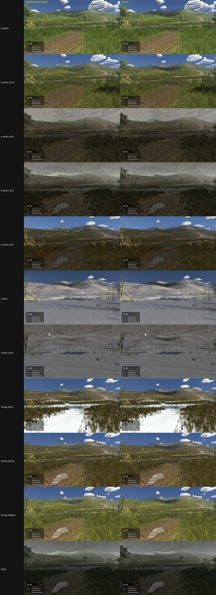

## 362. Влиты белые коробки заправки, элеватора и колхоза, ассеты вынесены из exe; ускорения сборки карты и теней перенесены на Windows

10:17 · WB-FUEL-ELEV-KOLKHOZ · Белые коробки и ускорения на Windows

Коммит: [5248849aa3](https://github.com/shsanek/EXEcutor/commit/5248849aa3)

Ветка: `claude/peregon-wb-fuel-elev-kolkhoz`

Ветка с Mac влита в дизайн. Для Windows: нативный бэкенд генерации карты собирается через clang из Visual Studio и даёт побайтно тот же результат, что Python; распаковка тайлов бумажной карты в процессах-воркерах; запасной путь к папке ассетов. Локальные сборки читают ассеты из исходников, peregon_resources.pak собирается только при экспорте.

- ✓ Карта R1 целиком: ~9 мин → ~3 мин (экстраполяция по тайлам)
- ✓ Бумажная карта: 424 → 93 с, побайтно те же файлы
- ✓ Тени (CPU, 7800X3D): 359 → 26 с
- ✓ peregon.exe: 1.73 ГБ → 44 МБ; папка сборки 1.5 ГБ, 95 с
- ✓ Тесты: 99/103, только известные падения

## 363. Рассеянный GI удалён из игры полностью

11:22 · NOGI · Рассеянный GI удалён

Коммит: [aa5c68be55](https://github.com/shsanek/EXEcutor/commit/aa5c68be55)

Ветка: `claude/peregon-vram`

Убраны сетки probes, процессорный трассировщик SSGI, текстуры приёмников, задачи и ожидание главного потока, 14 вариантов шейдеров *_gi, ключ diffuse_gi в настройках (старые файлы грузятся), флаг --gi (игнорируется с предупреждением), пункт меню, GI в скриптах замеров и документации. Трава всегда рисуется инстансами.

- ✓ Тесты: 98/102, только известные
- ✓ Скриншоты против сборки без GI: побитово, кроме 10–14 пикселей в кабине
- ✓ Смоук 5080: 217.9 FPS против 216.8

## 364. Солнечные тени запекаются при сборке карты, игра их только загружает

11:56 · SHADOWBAKE-OFFLINE · Тени печёт сборка карты

Коммит: [1747d7a0b6](https://github.com/shsanek/EXEcutor/commit/1747d7a0b6)

Ветка: `claude/peregon-shadowbake-offline`

r1_fresh.sh печёт peregon_shadows.bin после карты и пропускает шаг, если ключ совпал; экспорт кладёт файл в data/. Без файла игра пишет предупреждение и идёт без запечённых теней.

- ✓ Старт игры: 59.4 с → 26.7 с первый, 8.7 с тёплый
- ✓ Перепечь только тени: 27 с
- ✓ Тесты: только известные падения

## 365. В инвентаре E всегда действие предмета, F всегда взять в руку / убрать из руки

12:09 · INV-HAND · E — действие предмета, F — руки

Коммит: [d9d797b23d](https://github.com/shsanek/EXEcutor/commit/d9d797b23d)

Ветка: `claude/peregon-inv-hand`

Строки всегда в порядке E, F, остальное; у предметов без своего действия строки E нет. Еду в руке можно съесть через E. Подсказки, локализация и тесты обновлены.

- ✓ Тесты: inventory 24/24, food 21/21, loadout 10/10, net_menu 3/3
- ✗ Не проверено: геймпад

## 366. Лагерь новой игры: палатка на земле, вытоптанная поляна, машина к дороге, без котелка и брёвен

12:10 · NEWGAMECAMP · Лагерь новой игры

Коммит: [53a3c87d9e](https://github.com/shsanek/EXEcutor/commit/53a3c87d9e)

Ветка: `claude/peregon-newgame-camp`

Палатка и машина заново ставятся на настоящий рельеф после загрузки тайлов (раньше высота бралась с грубого дальнего рельефа, −0.54 м). Ключ trample задаёт вытоптанную поляну, в палатке травы нет. Машина стоит носом по дороге. Новый очаг camp_fire_ring из Blender. В 820bd9104f трава на поляне примята (постоянный след ботинок), а не выкошена.

- ✓ Тесты: bog 11/11, tent 6/6, poi 11/11
- ✗ В бэклоге: NS-9: голова героя в палатке видна сквозь крышу снаружи

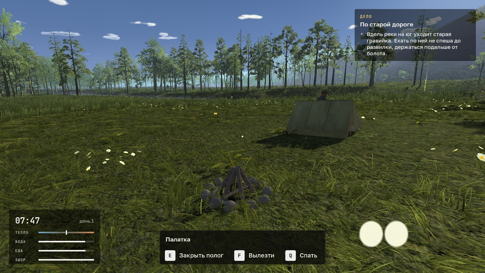

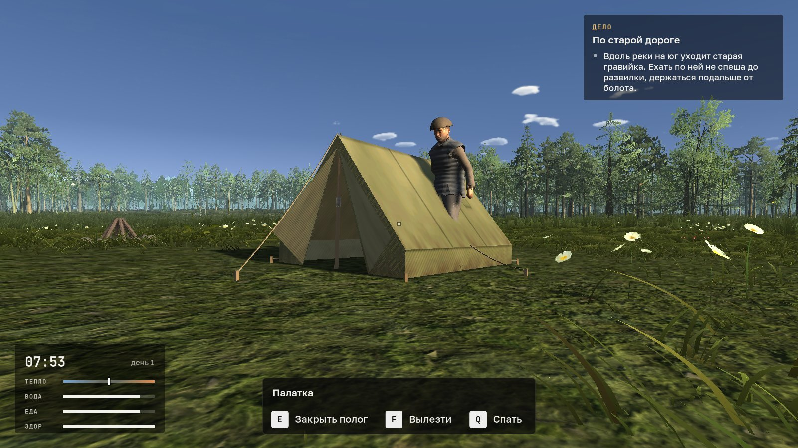

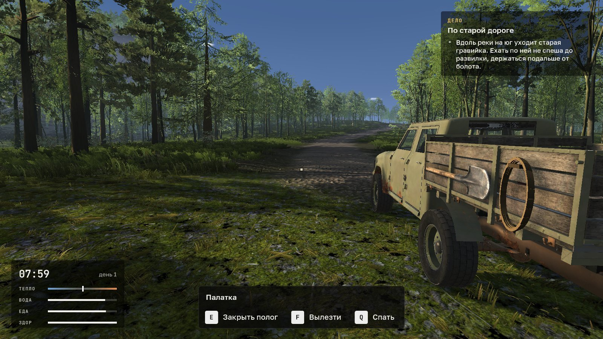

## 367. Экспортный zip собирается через bsdtar (Zip64)

12:27 · PACKAGE-ZIP · Архив экспорта больше 2 ГБ

Коммит: [04bc912ed7](https://github.com/shsanek/EXEcutor/commit/04bc912ed7)

Ветка: `claude/peregon-design`

Compress-Archive из Windows PowerShell 5.1 не умеет файлы больше 2 ГБ, а peregon_resources.pak весит 2.27 ГБ. Распакованная вне репозитория сборка прошла сценарий из 35 отрезков без ошибок.

- ✓ Архив: 1.13 ГБ, проверка целостности ok

## 368. Локальный свет мест запекается при сборке карты в peregon_lights.bin, игра только загружает

13:06 · LIGHTBAKE-OFFLINE · Свет мест печёт сборка карты

Коммит: [379dd6fd53](https://github.com/shsanek/EXEcutor/commit/379dd6fd53)

Ветка: `claude/peregon-lightbake-offline`

Один файл кэша на 23 места (54 МБ) вместо файла на место; ключ по каждому месту. Без файла — предупреждение и два ближайших динамических света. Экспорт без файла падает.

- ✓ Старт игры: 13.1 → 8.6 с
- ✓ Ночные скриншоты лесопилки: побайтно совпадают
- ✓ Тесты: light_bake 8/8

## 369. Пачка правок по игре: дремота после кабины, талоны в инвентаре, термос у торговца, масло не еда, авто-надевание рюкзака и ножа, частичная заправка

14:50 · PLAYFIX · Дремота, талоны, термос, масло, рюкзак, нож, заправка

Коммит: [efd4fd1a1f](https://github.com/shsanek/EXEcutor/commit/efd4fd1a1f)

Ветка: `claude/peregon-design`

Дремота считается по часам бодрствования, ночь в кабине добавляет 4 ч, пробуждение сбрасывает эффект. Инвентарь показывает талоны. Торговец лесопилки продаёт термос (40). Моторное масло ушло со страницы «Еда». Подобранный или купленный рюкзак/нож надевается, если слот пуст. На колонке 25/50/75/100 %, по умолчанию полностью, платишь только за залитое.

- ✓ Тесты: новый тест на каждую правку; полный набор — только известные
- ✓ Игра: после ночи в кабине эффекта нет, давление 0

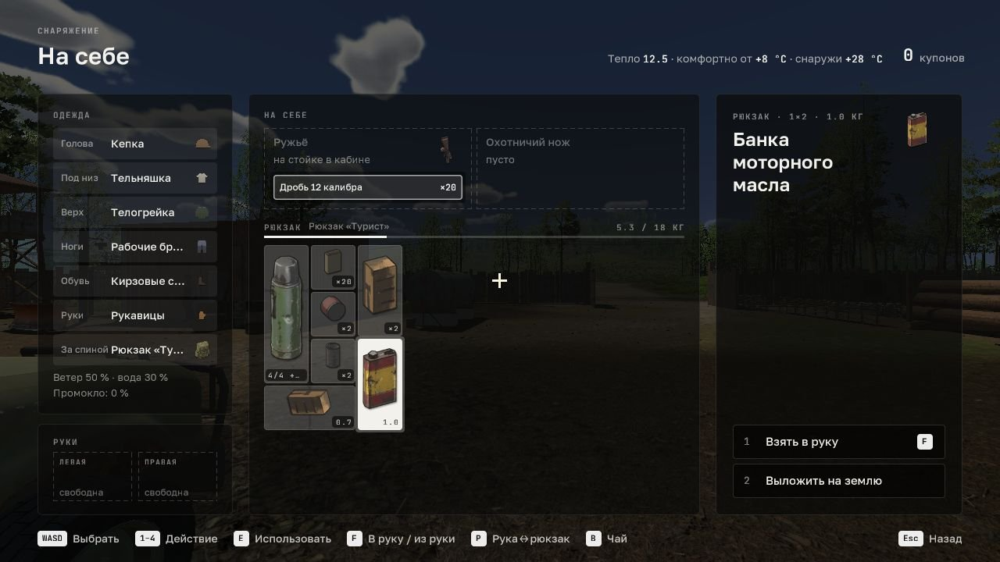

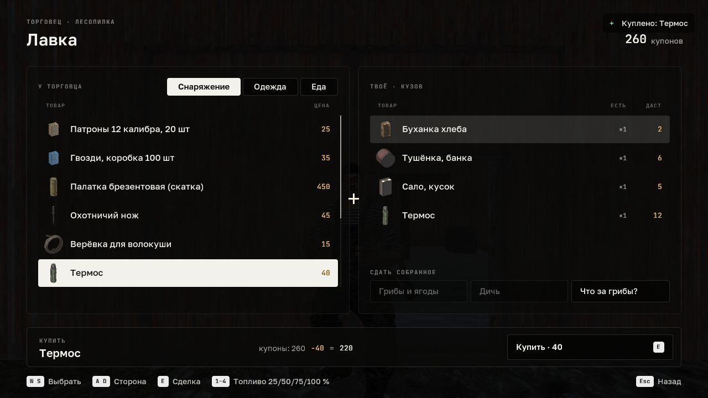

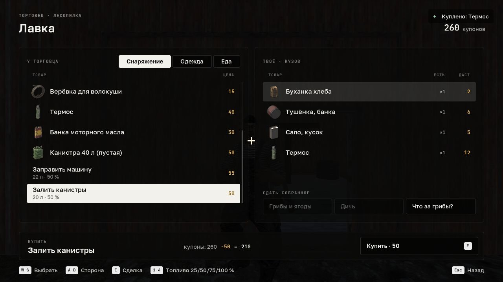

## 370. Босс «Плешивый медведь» влит; в тесной радиорубке он подходит вплотную, а не кружит

16:31 · BEAR · Медведь в бункере

Коммит: [09be2a18bc](https://github.com/shsanek/EXEcutor/commit/09be2a18bc)

Ветка: `work/peregon-bear`

Ветка медведя (12 коммитов от 16.10) перенесена на нарезанные исходники, конфликты в 14 файлах. На пути владельца (взять радиолу) медведь не нападал: для рывка нужно 7 м прямой. Теперь без места для рывка он сближается. Позже владелец решил перенести медведя в лес как легендарного, а бункер отдать бандитам.

- ✓ Тесты: boss 21/21; bunker: атака через 23 с после радиолы
- ✓ Игра: три удара за 0:32–0:40

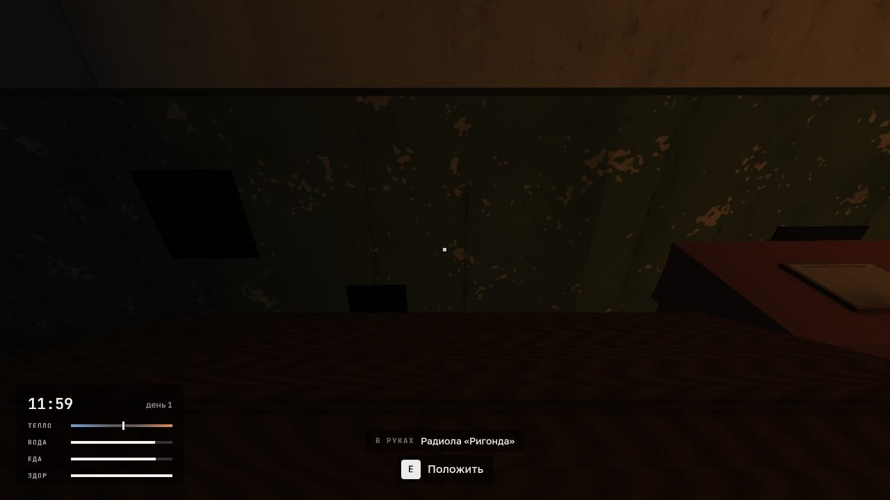

## 371. Зимой лиственные голые, ромашки не цветут: сезонные текстуры для деревьев ft_/nt_, лиственницы и цветов

16:35 · WINTERLOD · Сезоны у новых деревьев и цветов

Коммит: [e05e81a8d9](https://github.com/shsanek/EXEcutor/commit/e05e81a8d9)

Ветка: `claude/peregon-winter-lod`

Новые деревья из FORESTPACK не имели сезонных версий, и загрузчик молча брал летние. Запечены 387 текстур, добавлены классы ground_plants/leaf_grass/leaf_fern, у лиственницы свой материал. Тест: у каждого сезонного материала есть все версии.

- ✓ Тесты: nature, season

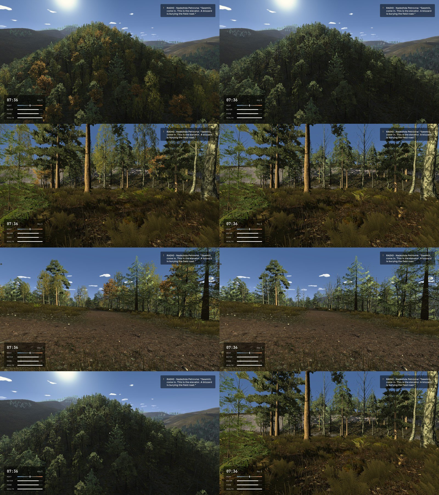

## 372. Мухомор собирается как гриб; колесо мыши и полоса прокрутки работают во всех списках

18:50 · AMANITA+UI · Мухомор и мышь в меню

Коммит: [d18698acd2](https://github.com/shsanek/EXEcutor/commit/d18698acd2)

Ветка: `claude/peregon-ui-tester1`

Декоративные мухоморы больше не расставляются — каждый мухомор теперь гриб из системы сбора; с оружием в руках E тоже подбирает. Общий список больше не возвращает вид к выбранной строке каждый кадр: колесо и перетаскивание полосы работают в лавке, у оружейника, на доске, в диалогах; список услуг механика прокручивается; залита только активная вкладка; курсор в меню — стрелка.

- ✓ Тесты: ui, forage, nature, dialogue, contracts и др.
- ✗ Отдельно: inventory_tests: размер иконки не совпадает с клеткой — падает и на базе

## 373. Черновик новой истории (беглые бандиты, освобождение района) и план задач M1–M4

19:09 · STORY-LIBERATION · Черновик истории и план

Коммит: [90b8102e2c](https://github.com/shsanek/EXEcutor/commit/90b8102e2c)

Ветка: `claude/peregon-design`

Бандиты из колонии охотятся за грузовиком героя и узнают о нём постепенно; элеватор → заправка → свободный набор → битва за переправу как финал региона с катсценами; засады и погони только в неосвобождённых зонах. План: эпики A–L, ~75 задач, вехи M1–M4.

- ✓ Документы: docs/story-liberation-draft.md, docs/story-liberation-plan.md

## 374. Дальний лес больше не бирюзовый и меняется по сезонам как ближний

19:22 · FARLOD · Дальний лес

Коммит: [affe1460f1](https://github.com/shsanek/EXEcutor/commit/affe1460f1)

Ветка: `claude/peregon-design`

Карточки дальних деревьев затеняли сами себя запечённой маской, импостеры были запечены уже тёмными, нормаль смотрела вверх — отсюда бирюза. Исправлено освещение, сезонные стадии импостеров перепечены с той же яркостью, голые кроны зимой — редкая серо-лиловая дымка, дымка у деревьев как у рельефа (цветокоррекция больше не красит туман).

- ✓ Цвет дальних деревьев летом: 56,71,61 → 87,106,79 при рельефе 100,110,88
- ✓ Тесты: nature, season, world, shaderc

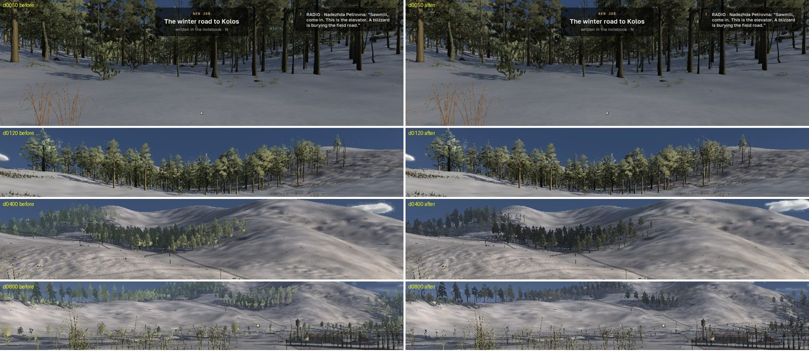

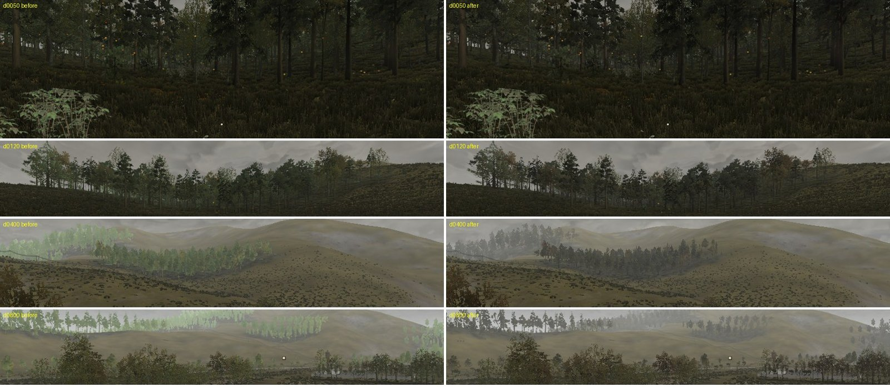

## 375. Багги бандитов патрулируют дороги к бандитским точкам и не заезжают на свои и освобождённые места

19:54 · BANDITCARS · Патрули бандитов

Коммит: [2c50fb2bf7](https://github.com/shsanek/EXEcutor/commit/2c50fb2bf7)

Ветка: `claude/peregon-bandit-cars`

ИИ-вождение включено только для бандитских багги (свой переключатель в data/world/bandits.txt). Маршруты между бандитскими точками или туда-обратно; у границы своего места машина разворачивается. Освобождение места (флаг liberated_&lt;зона&gt;) сразу убирает его маршруты; Выброс освобождённые места не захватывает. Кооп: позиции передаются хостом.

- ✓ Долгий прогон на карте: 43 200 тиков, 14 багги, 22.9 км, 0 заездов в свои зоны
- ✓ Тесты: bandit_patrol 8/8, bandit_cars_play 4/4
- ✗ Не сделано: погони с тараном; у подстанции нет дороги

## 376. Бандиты прячутся за углами, обходят с флангов и не дают зачистить лагерь рывком; добавлены скрытность и ближний бой

20:18 · COMBAT · Умные бандиты, скрытность, ближний бой

Коммит: [0dad118455](https://github.com/shsanek/EXEcutor/commit/0dad118455)

Ветка: `claude/peregon-combat-ai`

Укрытия за углами высоких объектов с выглядыванием, модель точности (поперёк прицела трудно, в лоб легко), отход и общий огонь против рывка, толчок, подавление, фланг по скрытому маршруту с выкриками. Скрытность: свет, фонарь, кусты, присед, шум, поиск с «?», найденные тела, тихое убийство ножом со спины (флаг, по умолчанию включено). Ближний бой: сильный удар, толчок, блок, выносливость.

- ✓ Элеватор, 40 сидов: рывок в лоб: 100 % → 20 % побед; осторожно: 92 %
- ✓ Тесты: combat_ai 15, только известные падения
- ✗ Открыто: полоса выносливости, анимации ближнего боя, отвлечение броском

## 377. Две багги бандитов из труб: «Шило» и «Бугай» (Blender, 3 LOD, риги с колёсами)

20:19 · BANDITBUGGY · Багги из труб

Коммит: [4784c97ca4](https://github.com/shsanek/EXEcutor/commit/4784c97ca4)

Ветка: `claude/peregon-bandit-buggy`

Скрипт tools/blender/make_bandit_buggy.py строит обе модели: каркас из труб, сиденья из легковушек, разномастные колёса, мотор сзади, канистра, у «Бугая» каркас, таран, прожектор и антенна с тряпкой. Локаторы колёс, сидений, фар и коллизии в data/vehicle/bandit_buggies.txt. Вместе с этим мержем — отладочный PEREGON_GIVE для выдачи предметов в плейтестах.

- ✓ Размеры: Шило 3.68 м ~620 кг; Бугай 4.42 м ~930 кг
- ✓ Тесты: asset

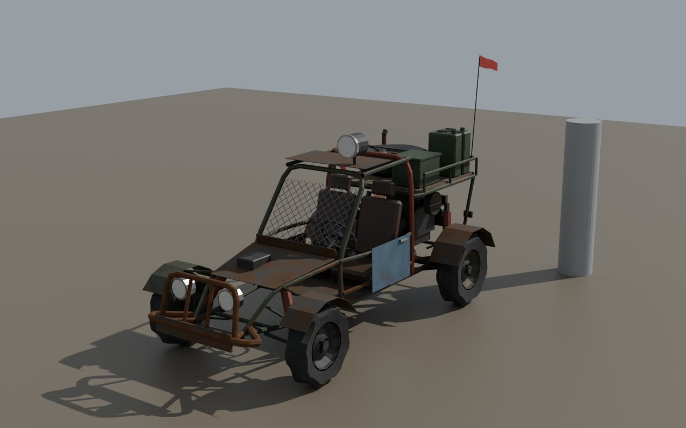

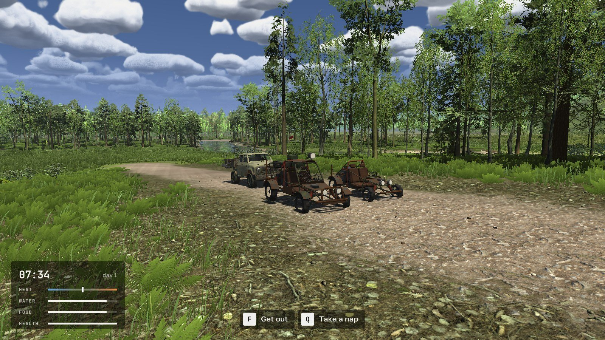

## 378. Репорты владельца сведены в таблицу; исправлены костры, поддоны и лужи крови

20:22 · OWNER-REPORTS · Разбор репортов владельца

Коммит: [b24dd2d6f8](https://github.com/shsanek/EXEcutor/commit/b24dd2d6f8)

Ветка: `claude/peregon-owner-reports`

Репорты Shift+R лежат в Downloads (JPEG с текстом в EXIF). docs/owner-reports.md: 60 строк, 43 исправлено, 12 частично, 2 не исправлено, 3 переданы бою. Исправлено: открытая бочка для огня, тёмный холмик пепла, костры горят с вечера до утра, модель поддона вместо белого прямоугольника, круглые лужи крови без висящих квадратов.

- ✓ Тесты: прошли, кроме известного view_tests
- ✗ Открыто: карта в кабине (нужна своя текстура), грязь на грузовике

## 379. Пролог новой истории: палатку надо сложить, мысли героя в дороге, «Хм, лесопилка…», разговор с Палычем ведёт к элеватору

20:50 · SL-M1 · Пролог

Коммит: [fbcc1013aa](https://github.com/shsanek/EXEcutor/commit/fbcc1013aa)

Ветка: `claude/peregon-m1-prologue`

SL-A1: первая стадия «лагерь» — пока палатка не сложена, ключ не заводит мотор и герой думает «Эх, забыл сложить палатку»; сложенная скатка сама ложится в кузов. SL-A2: стиль мыслей героя (think.ID) — очередь, без голоса, рукописный шрифт, ru/en, по разу на мир, в коопе у всех. SL-A3: три мысли по дороге вдоль реки (ушёл от погони, болота задержат, хоть бы здесь было тихо) и «Хм, лесопилка… стоит проверить.» у развилки. SL-A6: стадия «Поговорить с Палычем» — Ефим подсказывает, выбор «Возьмусь за элеватор» закрывает пролог и запускает заготовку миссии элеватора.

- ✓ story_lint: 0 ошибок
- ✓ Тесты: story, play_story с новыми тестами пролога; только известные падения
- ✓ Игра: пролог пройден целиком, 30 скриншотов ru/en
- ✗ Открыто: миссия элеватора — заготовка до SL-E1

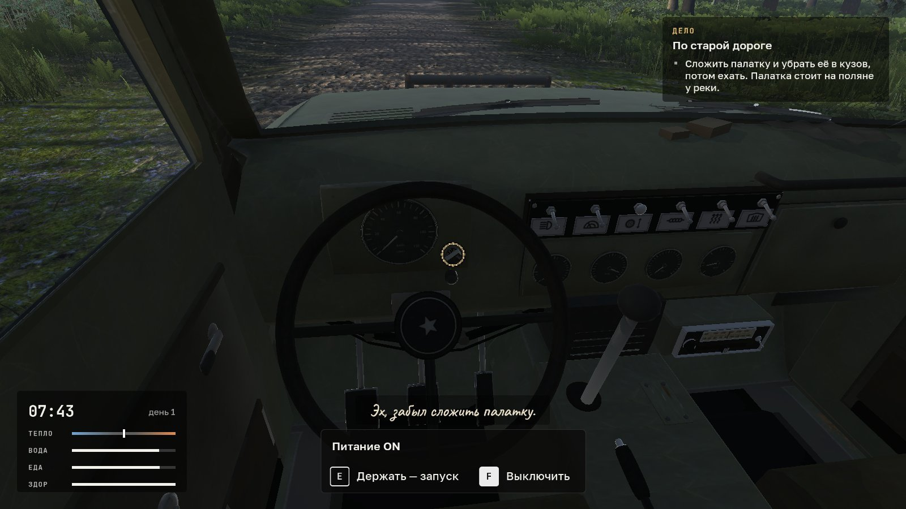

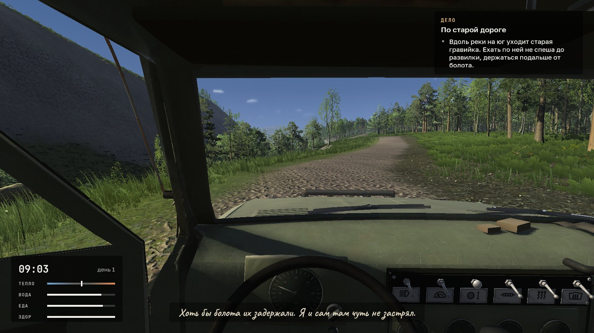

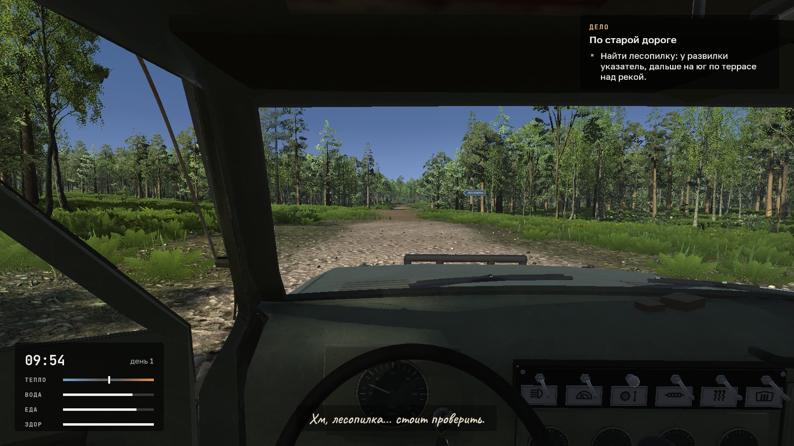

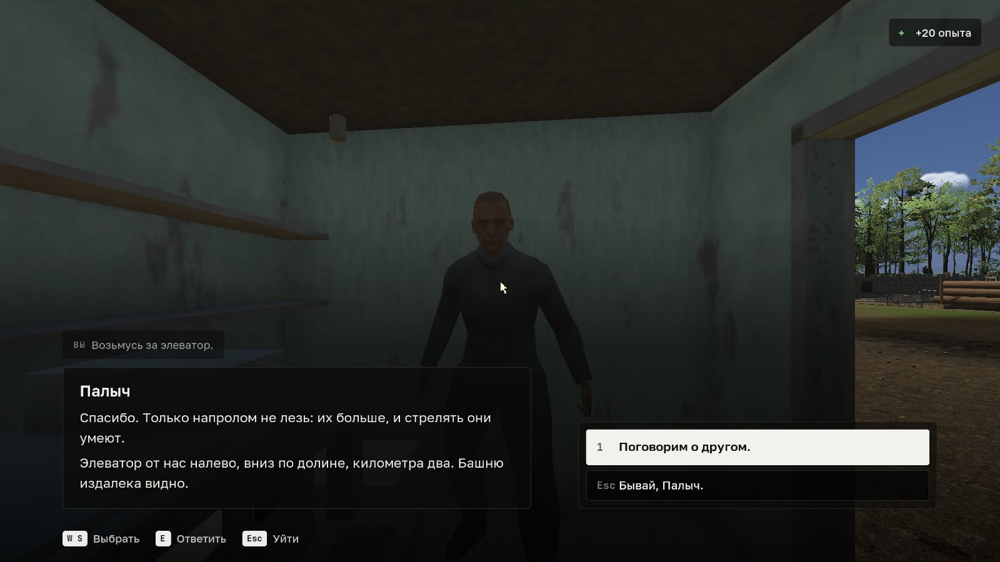

## 380. У бандитских мест есть состояние (у бандитов → бой → освобождено → обжито); элеватор начинается логовом Ржавых; патрули ездят на «Шиле» и «Бугае»

21:15 · SL-M1 · Состояния мест

Коммит: [24da07ac08](https://github.com/shsanek/EXEcutor/commit/24da07ac08)

Ветка: `claude/peregon-m1-placestate`

SL-B1: состояние места в переменной сюжета, единственный писатель set_place_state; флаг liberated_&lt;зона&gt;, патрули, директор, жители и оформление следуют за ним; квесты пишут loc.&lt;зона&gt;.&lt;состояние&gt; и читают loc.&lt;зона&gt;.state, события liberate/settle. Начало боя — «бой», поражение — снова бандиты (шум для охоты), победа — освобождено. SL-B7: Выброс не захватывает освобождённые места. SL-D1: уровень охоты 0–4 (растёт от освобождений, засветов днём, фар ночью в зоне бандитов, брошенных боёв), факт правила «3 из 4». SL-B2: новая игра — элеватор как логово, жители в отъезде; после освобождения оформление «хранители», когда рядом никого в 600 м; жители возвращаются при «обжито». Патрули рисуются новыми багги с крутящимися и поворотными колёсами.

- ✓ Тесты: places_play 8/8, story 75/75, play_story 24/24 после слияния с прологом
- ✓ Полный ctest: только известные падения
- ✗ Открыто: значки мест на карте (SL-B6); запечённые тени элеватора от оформления «хранители»

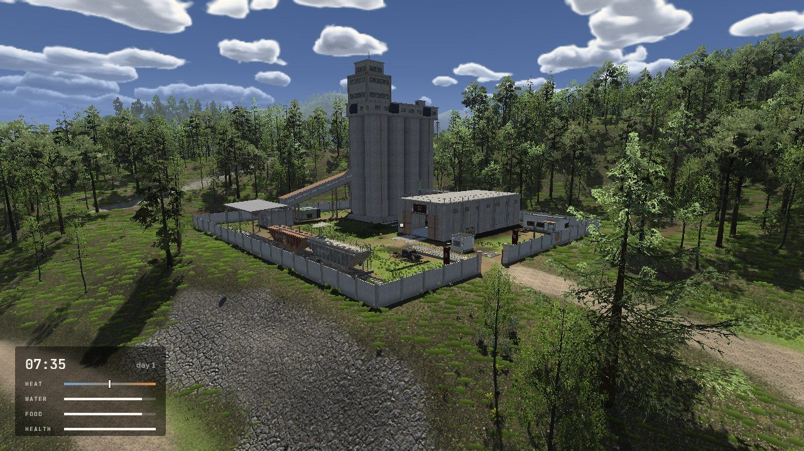

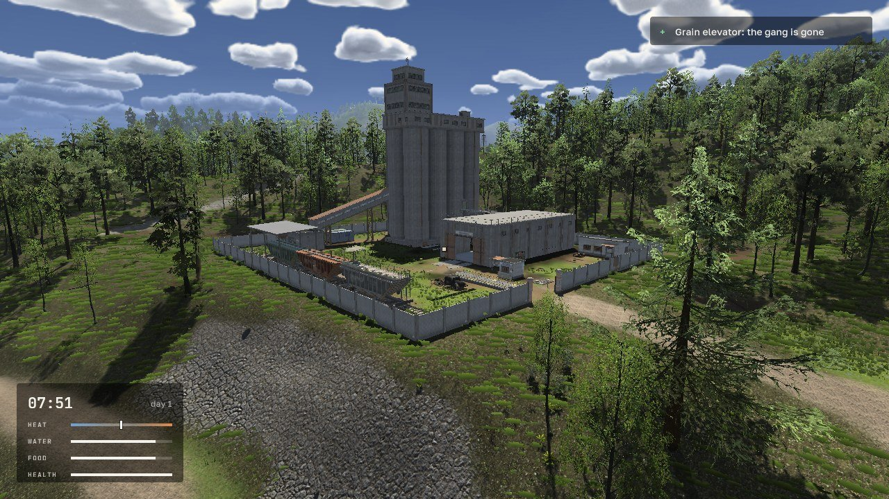

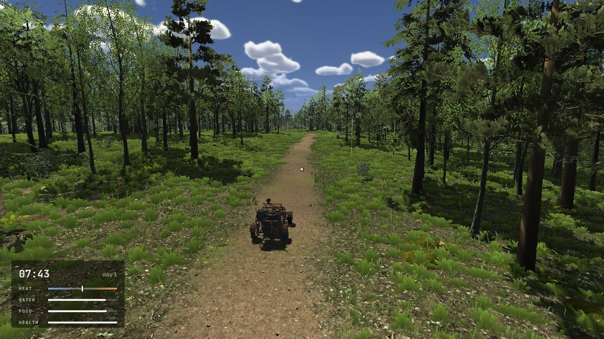

## 381. Система катсцен на движке и первая сцена К1 «Ворота лесопилки»

21:40 · SL-M1 · Катсцены

Коммит: [0fb5943aef](https://github.com/shsanek/EXEcutor/commit/0fb5943aef)

Ветка: `claude/peregon-m1-cutscene`

SL-F1: сцены в data/story/cutscenes/*.txt — камера по сплайну (цель, FOV, сглаживание, склейки), жители идут/бегут/играют клип/поворачиваются, реплики ru/en, мысли героя бледными субтитрами, анимированный шлагбаум, эффекты сюжета по таймеру. Крючки сюжета: эффект cutscene.ID, событие cutscene_end, факт cutscene.ID. Во время сцены ввод заблокирован, удерживать Пробел/Enter — пропуск, полосы сверху/снизу, HUD скрыт, грузовик тормозит, герои в безопасности, сохранение запрещено; кооп — хост рассылает тик старта. SL-F4: К1 (18 с) при первом въезде грузовика к южным воротам лесопилки: Ефим поднимает шлагбаум, люди смотрят, Света бежит к кузову, выходит Палыч.

- ✓ Тесты: cutscene 8/8, play_cutscene 3/3, story 75/75, play_story 24/24, places_play 8/8 после слияния
- ✓ story_lint: 0 ошибок
- ✗ Ограничения: жители ходят по прямой; управлять можно только жителями folk.*; клиент после пропуска ждёт конца сцены у хоста

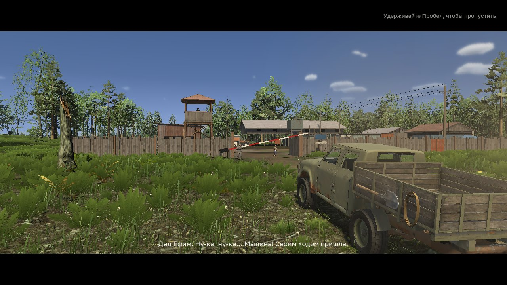

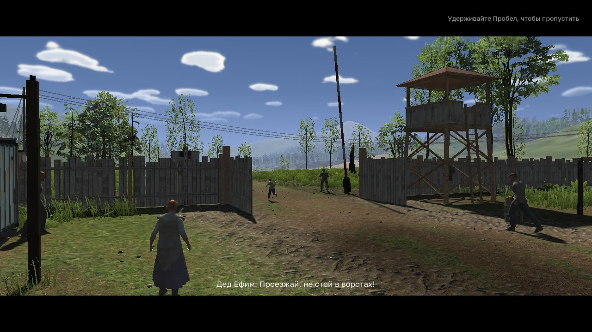

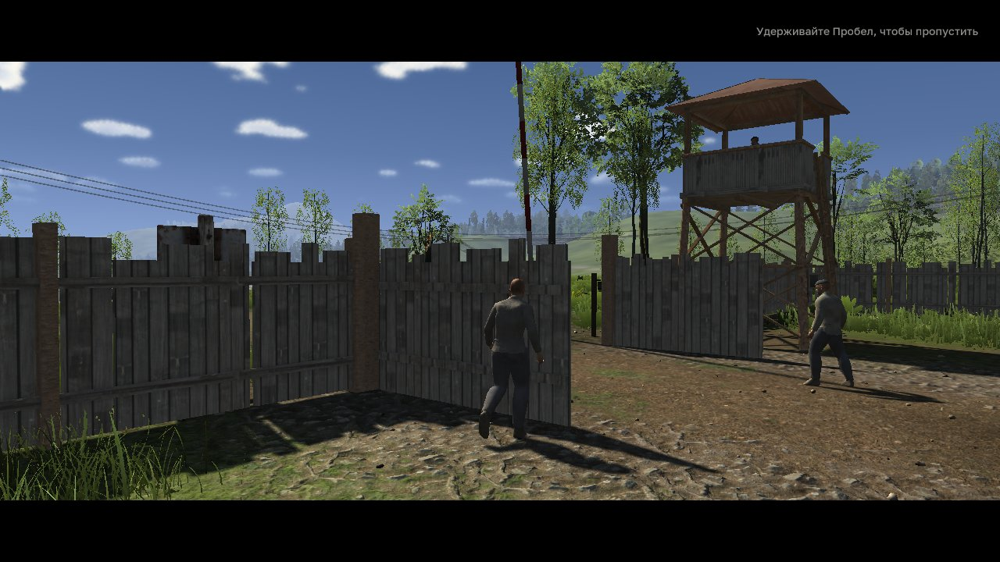

## 382. Гравийка сама сворачивает к лесопилке и упирается в ворота; прямо — узкая колея

22:00 · SL-M1 · Дорога к лесопилке

Коммит: [3f6af25f89](https://github.com/shsanek/EXEcutor/commit/3f6af25f89)

Ветка: `claude/peregon-m1-road`

SL-A4/A5: развилка отнесена на 110 м назад по речной дороге; ветка к лесопилке стала гравийкой R4, плавно уходит влево (радиус 100 м), идёт по террасе и выходит на ось ворот 0; новая полоса nr_sawmill_gate 62 м. Старая лесовозная дорога — узкая колея R5 прямо и чуть вправо; пойменная колея отходит от середины подъезда. Указатель между дорогами; зоны nr_road 160 → 45 м и nr_fork 40 → 16 м — мысль «Хм, лесопилка…» срабатывает в 9 м от знака (замечание владельца). Бумажная карта, стадии и маршрут nr_arrival обновлены.

- ✓ Проверка «еду по главной»: новая карта: до ворот за 1687 м; старая: уезжал на лесовозку
- ✓ Тесты: 11 наборов, map 57/57; overlaps чисто
- ✓ Проезд с физикой: от лагеря до лесопилки без остановок
- ✗ Ограничение: поворот в ворота радиусом 23 м (норма R4 — 50 м), мешает край террасы

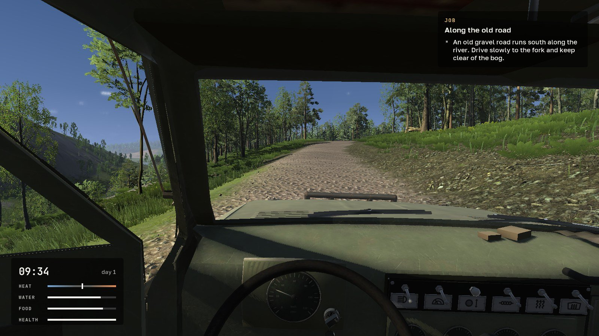

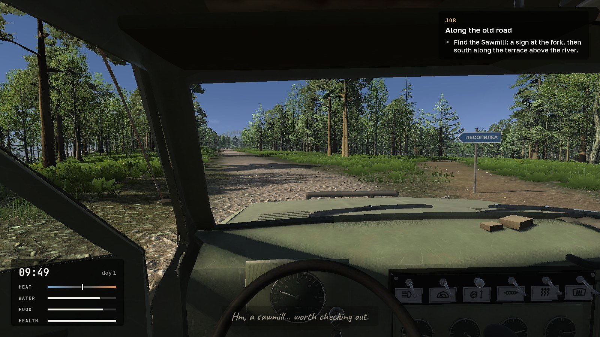

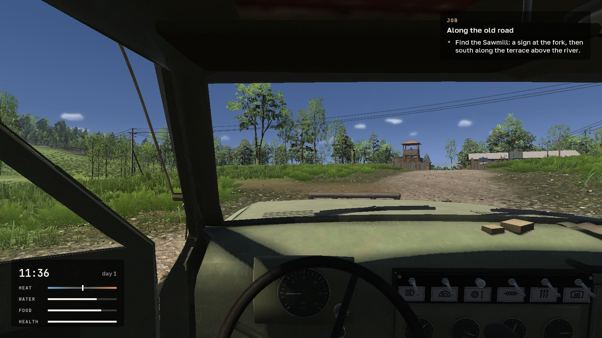

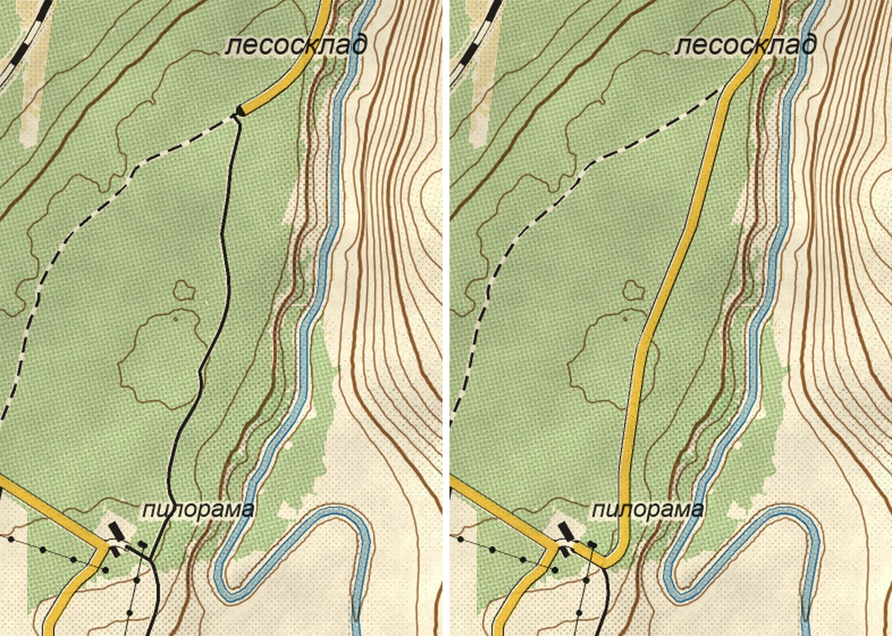

## 383. Лесопилка и ольховцы говорят о нехватке зерна и элеваторе; лагерь ольховцев у лесопилки; задания на доске ждут освобождения

22:10 · SL-M1 · Диалоги и лагерь ольховцев

Коммит: [d9aae138dd](https://github.com/shsanek/EXEcutor/commit/d9aae138dd)

Ветка: `claude/peregon-m1-dialogue`

SL-H1: в новой игре восемь ольховцев живут в палаточном лагере за пилорамой лесопилки (сюжетный объект со своими якорями, флаг sl_olkhovka_camp). SL-G1: у всех 8 жителей лесопилки и 8 ольховцев приветствия «до» и «после» элеватора, новые темы и шесть подслушанных реплик; прямо говорят, что зерна мало и элеватор надо вернуть; темы про жизнь на элеваторе скрыты, пока они в лагере. SL-G4: задания директора получили requires = &lt;флаги&gt;: работа на элеваторе ждёт liberated_elevator, солярка с отрога — liberated_outpost_shelf; до элеватора на доске две работы лагеря, после — «Первое зерно» и звонок Палыча по рации.

- ✓ story_lint: 0 ошибок
- ✓ Тесты: folk, story, director с новыми; ctest 101/106 — только известные
- ✓ Игра (ru): новая игра → пролог → лагерь и разговоры → освобождение → новые приветствия, звонок, задание
- ✗ Связка: снятие лагеря перевести на «обжито» вместе с рейсами SL-H2

## 384. Миссия элеватора целиком: бой или сдача, допрос пленного, два рейса с ольховцами, «обжито», катсцены К2 и К3

22:30 · SL-M1 · Миссия «Элеватор»

Коммит: [0ad2bd0c27](https://github.com/shsanek/EXEcutor/commit/0ad2bd0c27)

Ветка: `claude/peregon-m1-elevator`

SL-E1: data/story/sl_elevator.txt — вернуть элеватор боем или заставить банду сдаться; пленного можно допросить (ступень охоты 1) и отпустить; два рейса с Надеждой из лагеря и узлами ольховцев, второй делает элеватор «обжитым», Надежда открывает работы (sl_olkhovka_home). К2 «элеватор после боя» и К3 «возвращение» — настоящие катсцены. Лагерь у лесопилки снимается только при «обжито». c1 и работы элеватора ждут sl_olkhovka_home. SL-C1: отряды из bandits.txt (элеватор 5 = 4 + 1 на галерее, отрог 8, пикет брода 3, остальные база + 2×(N−1) + подкрепление), волны до 16, площадка до 24. SL-C2: отпущенный или оставленный пленный бросает ружьё и уходит; все сдались — место освобождено.

- ✓ story_lint: 0 ошибок
- ✓ Тесты: elevator_mission_play (бой, сдача, допрос, два рейса с сохранением, обжито, c1) + story, places, combat_ai, patrol, cutscene, journal
- ✓ Игра: миссия пройдена целиком скриптом, 24 скриншота
- ✗ Открыто: люди первого рейса видны в лагере до второго; у пленных нет добычи

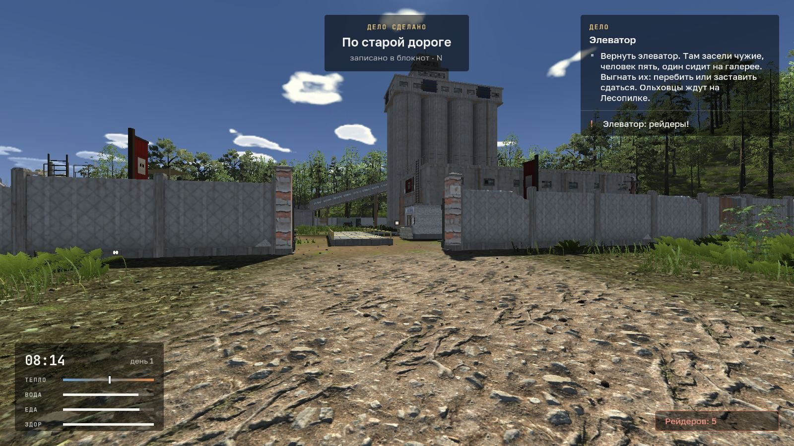

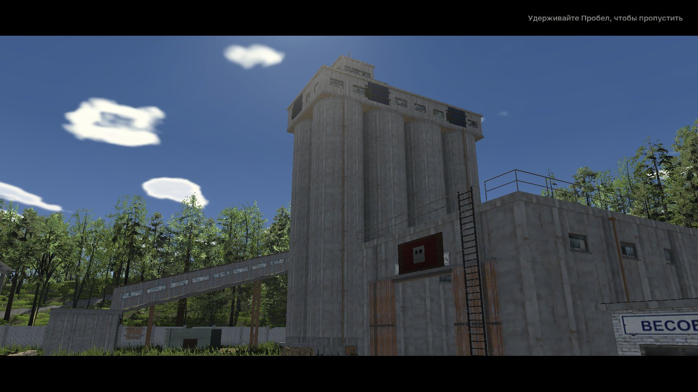

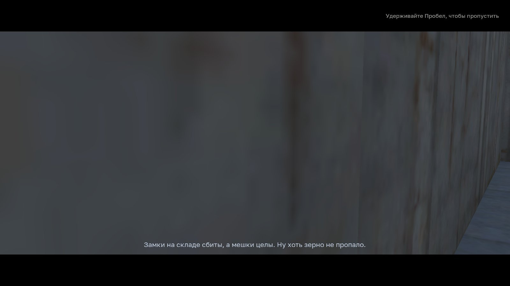

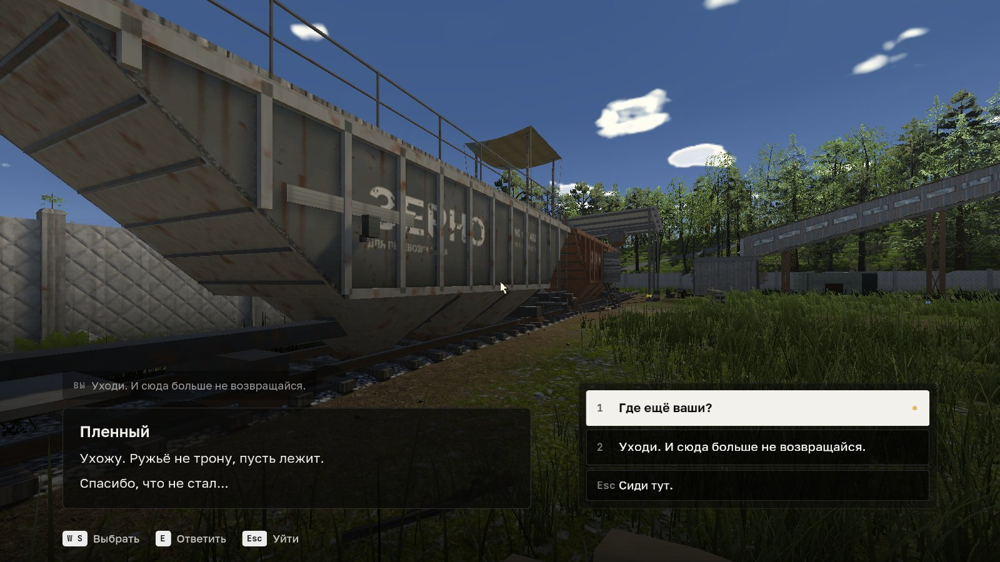

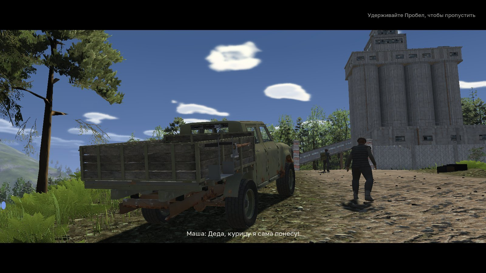

## 385. К1 встроена в пролог на новой дороге; цели пролога по замечаниям владельца; тесты всей линии M1

22:45 · SL-M1 · К1 в прологе

Коммит: [3d997bba82](https://github.com/shsanek/EXEcutor/commit/3d997bba82)

Ветка: `claude/peregon-m1-k1chain`

SL-A7: новая стадия gate между «лесопилкой» и «Палычем» ждёт конца К1; пешком или через северные ворота К1 пропускается. Зона К1 перенесена на подъезд в 19 м от ворот 0, грузовик останавливается в 18–26 м от шлагбаума. Исправлено: камеры и метки сцены брали точку въезда в зону, а грузовик докатывался ещё 4–8 м — теперь берётся предсказанная точка остановки. Цели (PB-3/PB-5): «ищем убежище — едем на юг» до знака, «проверить лесопилку» от знака, «к Палычу» только после К1. SL-J1: тесты пролога на фейковых фактах с сохранением посреди стадий.

- ✓ Тесты после слияния: story 79/79, play_story 24/24, elevator_mission 3/3, play_cutscene
- ✓ story_lint: 0 ошибок
- ✓ Игра: два прогона: первый нашёл ошибку камер, второй подтвердил

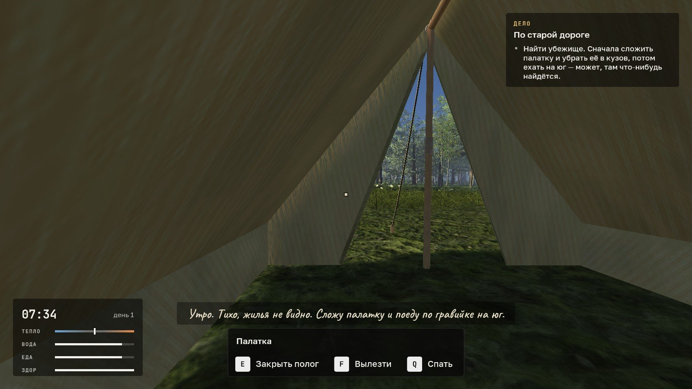

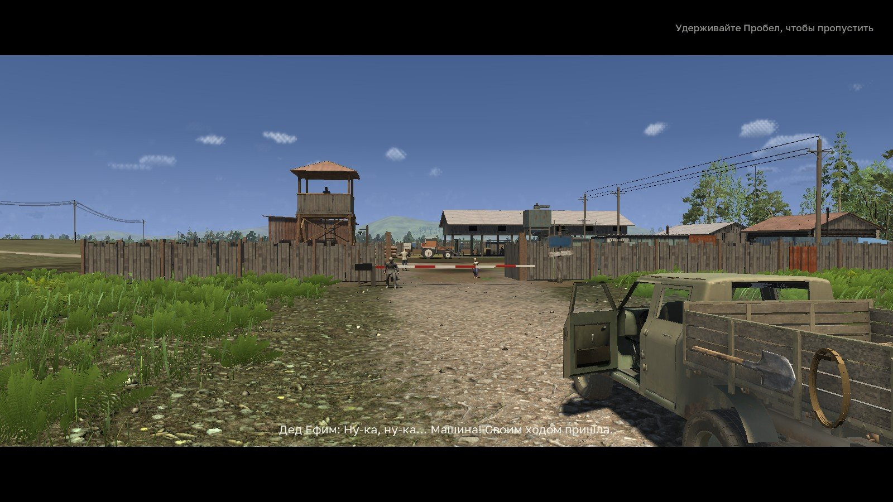

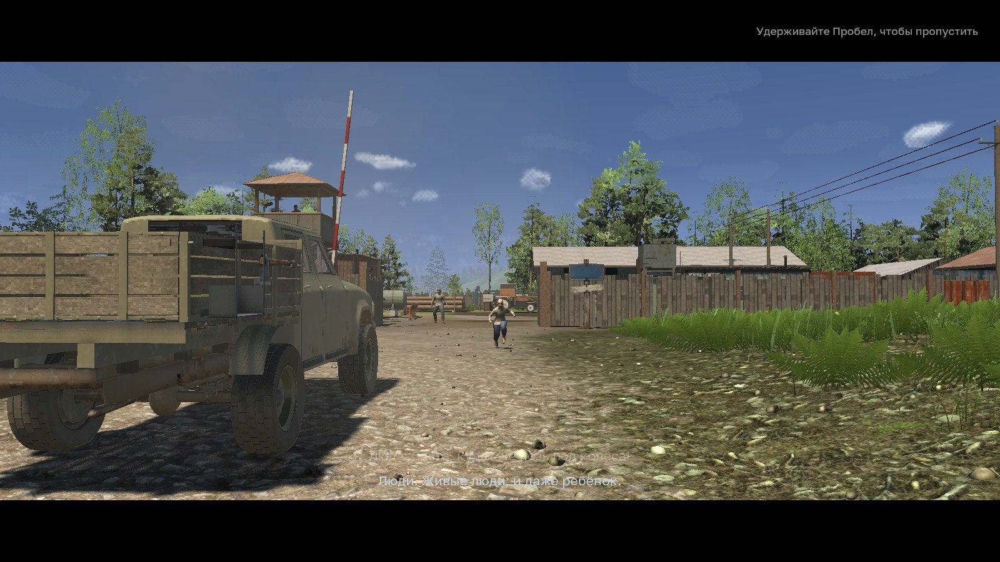

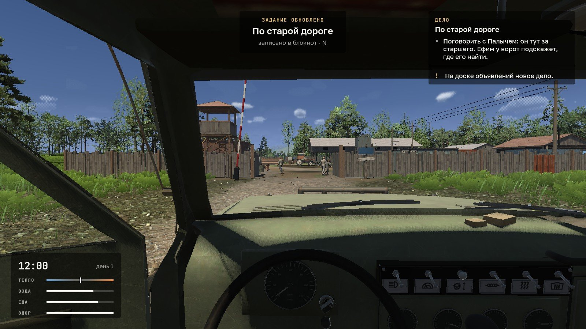
