# Перегон — 2026-10-20

[Главный отчёт](../README.md) · [Фичи и исправления](../CHANGELOG.md)

## 387. Банда охотится за грузовиком: патрули по ступени, заслоны с платой, засады с поваленным деревом, физические багги и погони с тараном

00:30 · SL-M2 · Охота за грузовиком

Коммит: [9144584d6c](https://github.com/shsanek/EXEcutor/commit/9144584d6c)

Ветка: `claude/peregon-m2-ambush`

SL-D2: патрулей 1–3 по ступени охоты; на 0 грузовик игнорируют, со ступени 2 разведчик на гребне (засвет = одно наблюдение). SL-D3: 7 заслонов на R1 (платный поворот, пикет брода — на ступени 0 пропускает даром, по одному на бандитское место); плата 6 талонов или мешок открывает все заслоны на сутки; таран шлагбаума, объезд или выход из кабины — бой; отбитый заслон остаётся снятым. SL-D4: со ступени 3 засада — поваленный ствол в 170–360 м впереди на узкой дороге, огонь с двух сторон; назад, бой, лебёдка. SL-D5: багги рядом с грузовиком — физические тела, удар от 28 км/ч их ломает; передаются в кооп. SL-D6: со ступени 4 погоня 1–3 багги с тараном в борт (износ, слетает незакреплённый груз), отваливают у безопасной зоны, через 110 с или при отрыве 260 м. SL-D8: ничего ближе 250 м к своим и освобождённым местам, в катсценах и бою; одно событие на игрока с паузами.

- ✓ Тесты после слияния: hunt_road_play 7/7, bandit_patrol 17/17, ai 26/26 (проверка погони снова включена), elevator 3/3, places 8/8, cutscene 4/4, story 79/79, play_story 24/24
- ✓ Игра: заслон с платой, засада, три тарана
- ✗ Открыто: ночной угон (SL-D7); засады на R1 редки (narrow_min); багги проходят сквозь деревья; платит только хост

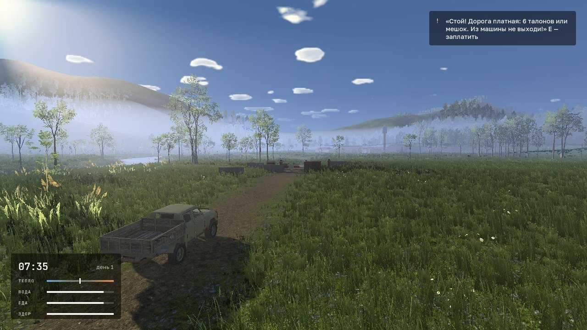

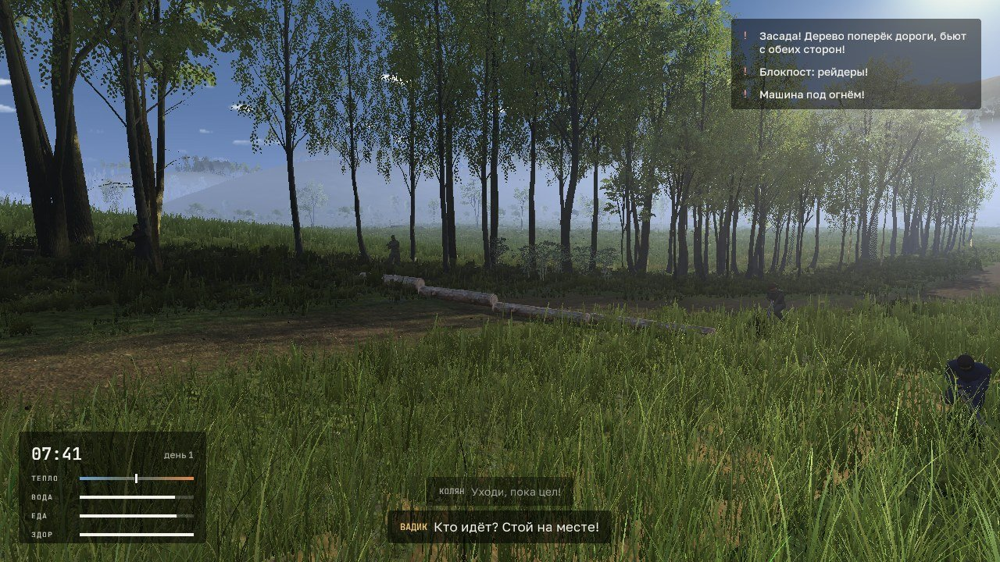

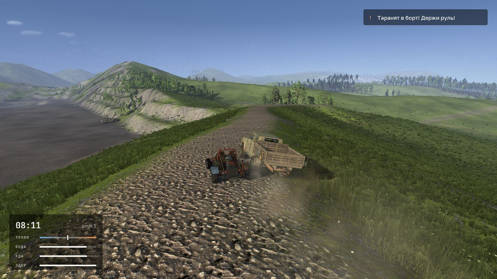

## 388. Пачка правок по плейтесту: следы попаданий по материалам, растекающаяся кровь, своя текстура карты в кабине, грязь на стёклах

00:45 · OWNER-BATCH-1 · Следы, кровь, карта в кабине, грязь

Коммит: [f821d15838](https://github.com/shsanek/EXEcutor/commit/f821d15838)

Ветка: `claude/peregon-owner-batch1`

PB-1/PB-2: новый рендер декалей FxDecalRender — следы затемняют или подкрашивают освещённую поверхность (свет, тени, туман), на земле повторяют рельеф и снег; дыры по материалу (грунт, бетон, дерево, металл с копотью, стекло), до 256 штук, гаснут за 2.5 мин. Лужа крови растекается из-под тела за 10 с с рваным краем, темнеет и гаснет за 4–7 мин; брызги по направлению выстрела, капли, следы раненых зверей на тех же декалях. Щепа, пыль и искры — мягкие спрайты вместо серых кубов; промахи бандитов не висят в воздухе. Карта в кабине — своя текстура 1024². Грязь на стёклах: порог пятен как у кузова (раньше при грязи 0.3 стекло было в пятнах на 40 %).

- ✓ Тесты: ctest — только известные падения
- ✓ Скриншоты: до/после на позициях репортов
- ✗ Открыто: кровь на самих телах (OR-B5); дыры на стенах и кровь на склонах — только в тестах

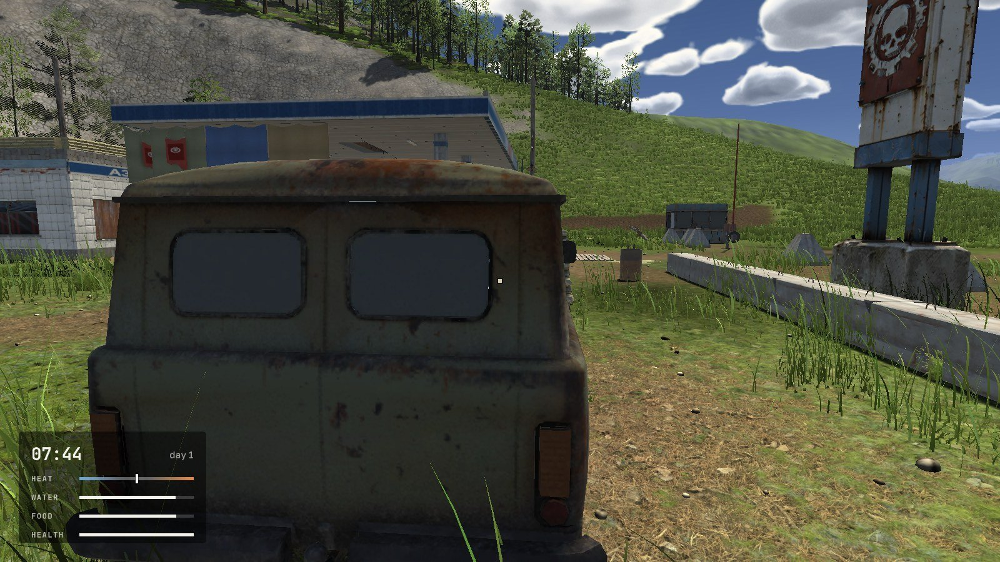

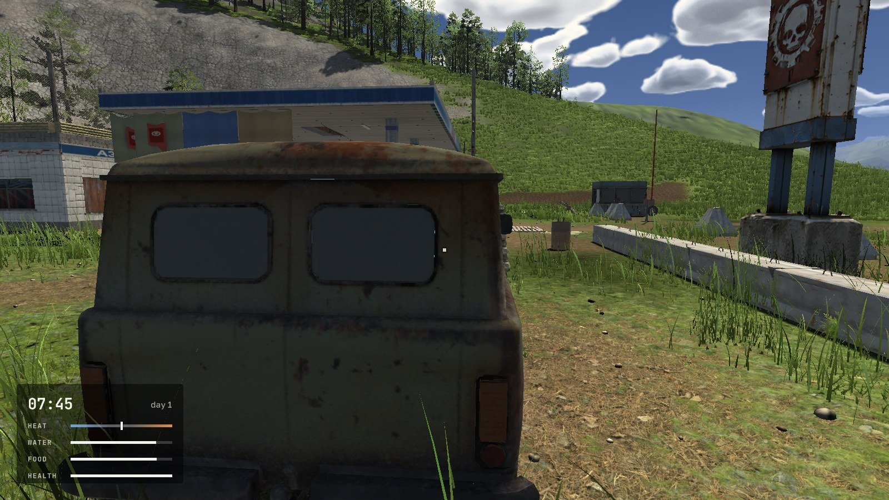

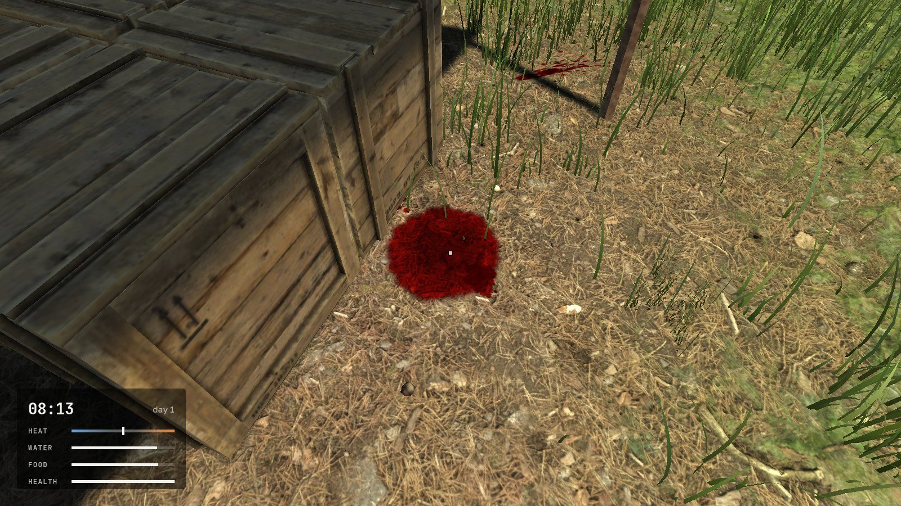

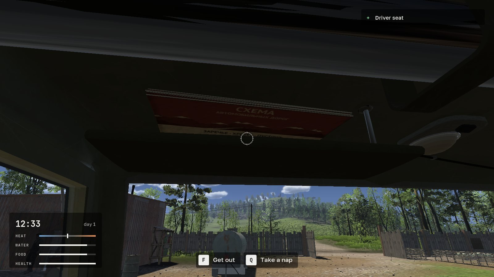

## 389. Починка радио — шаг 3 главной линии: бункер у бандитов на двух уровнях, радиола, выход в эфир, К9 и перехват переговоров банды

00:25 · SL-M2 · Радио и бункер

Коммит: [3eb5a85825](https://github.com/shsanek/EXEcutor/commit/3eb5a85825)

Ветка: `claude/peregon-m2-radio-bunker`

SL-K1: rr_radio стартует после освобождения заправки («Нужна связь, чтобы знать, где они»), новая стадия «зачистить бункер» перед радиолой, выход в эфир вечером на станции с катсценой К9, первый перехват в конце сцены. SL-K2/K3: отряд 6 — двое у костра в выемке, четверо внутри (один наверху); внутри и снаружи — отдельные пространства, бандиты ходят по лестнице и преследуют героя между этажами, внутри темно, их фонари подсвечивают героя; бой или сдача освобождают бункер, уход посреди боя возвращает его банде. SL-K4: в эфире звучат переговоры банды на заслонах, засадах, погонях, слежке и освобождениях (события из охоты на дорогах). SL-K5: bunker_tests переписаны (13). SL-K6: зона rr_bunker; РРС нейтральна, становится своей после бункера. Общая правка: катсцена закрывает открытое окно разговора.

- ✓ Тесты: bunker 13/13, story, bandit_patrol 19/19, hunt_road_play 7/7, places, cutscene, elevator, poi, journal, dialogue, combat_ai
- ✓ story_lint: 0 ошибок
- ✓ Игра: весь шаг 3 + перепроверка К9
- ✗ Ждёт: вызовы о контррейде и помощи — с задачей обороны SL-C6

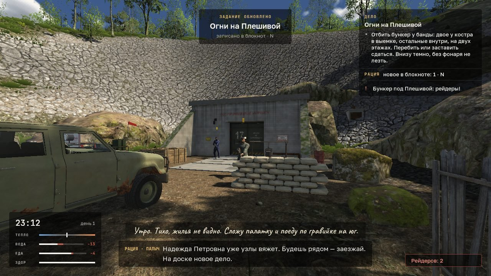

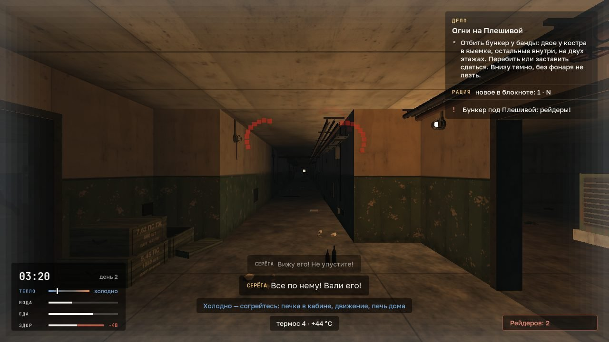

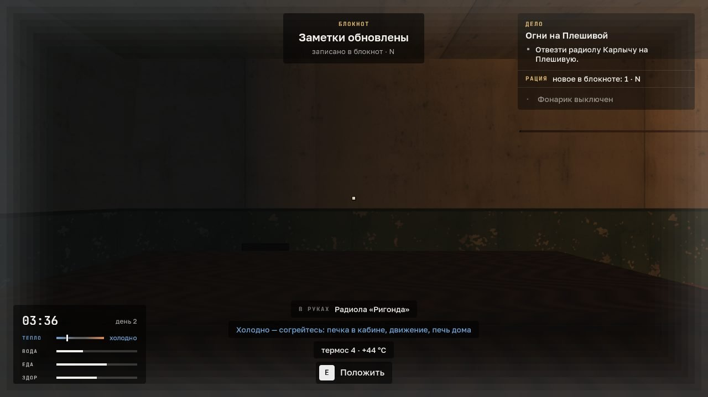

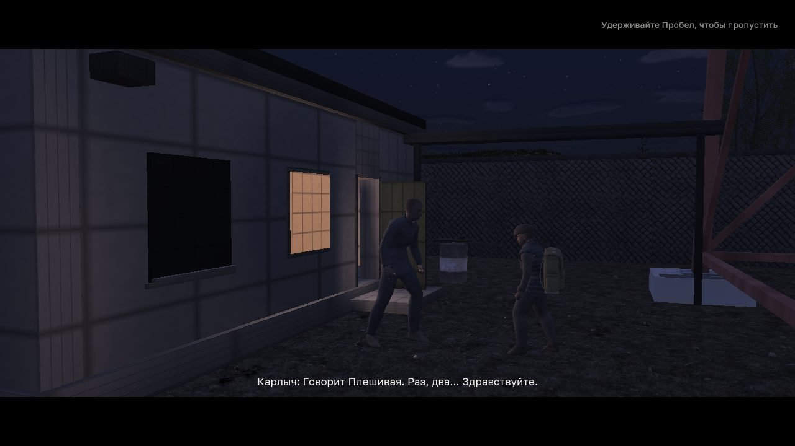

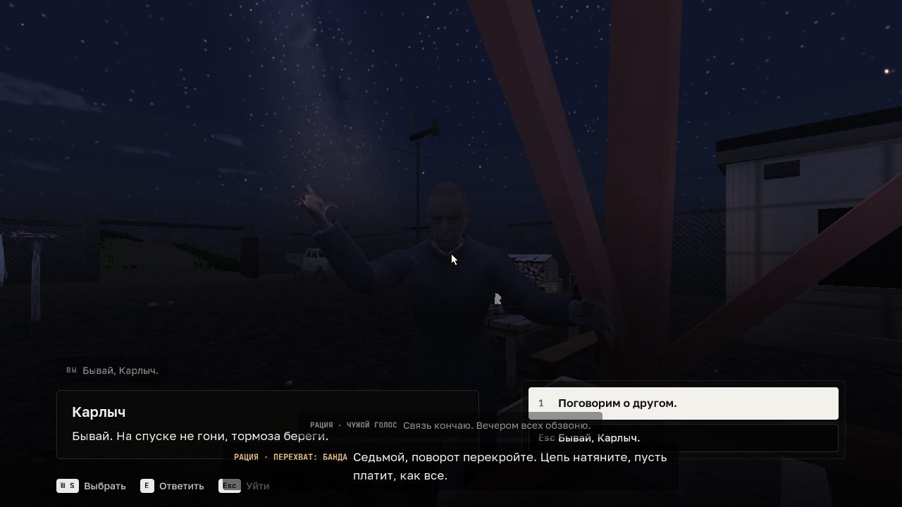

## 390. Миссия «Отбить заправку»: солярка Гриши, отряд 8, бой, ночь или уговор, К4/К5, Михалыч у колонки, платный поворот снят вместе со станцией

00:45 · SL-M2 · Заправка

Коммит: [551470b3b8](https://github.com/shsanek/EXEcutor/commit/551470b3b8)

Ветка: `claude/peregon-m2-gas`

SL-E2/H4: контракт c2 переделан в шаг 2 главной линии. Старт после «обжитого» элеватора и разговора с Гришей о солярке. Отряд 8 (группа Серого 5 + 3 беглых, стрелок на навесе); освобождение боем, ночью скрытно или уговором — группа Серого может сдаться и остаться (Михалыч у колонки, Витька). К4 — сдача у колонки, К5 — ночной костёр банды: беглый рассказывает Шатуну про грузовик (ступень охоты 2). Сцены ждут, пока ни у кого не открыт экран (факт player.busy). После: своя солярка, Михалыч у колонки, остовы на запчасти, конец дани с заимки; платный поворот освобождается вместе со станцией (заслон гаснет, N не меняется), по рации — «шлагбаума больше нет». Агент перезапускался: первый завис и держал блокировку.

- ✓ Тесты после слияния: story 81/81, gas_mission 3/3, elevator 3/3, bunker 13/13, hunt_road 7/7, places 8/8, cutscene 4/4, play_story 24/24
- ✓ story_lint: 0 ошибок
- ✓ Игра: миссия целиком, 28 кадров

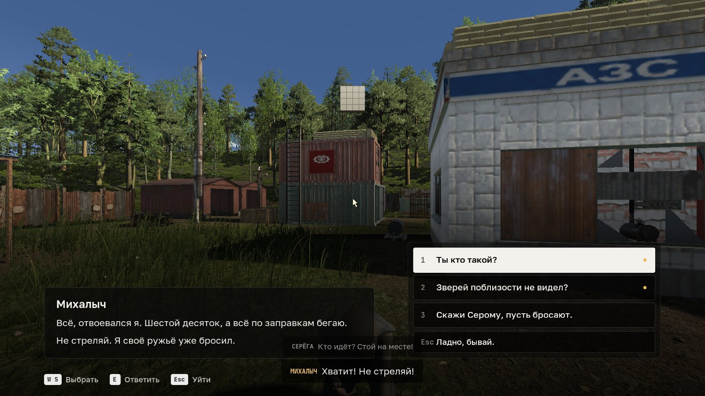

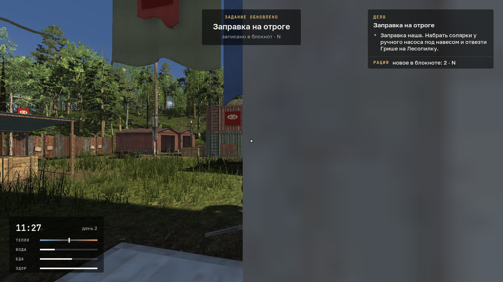

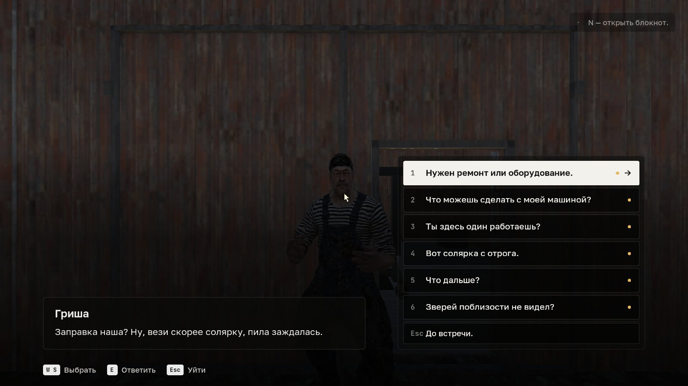

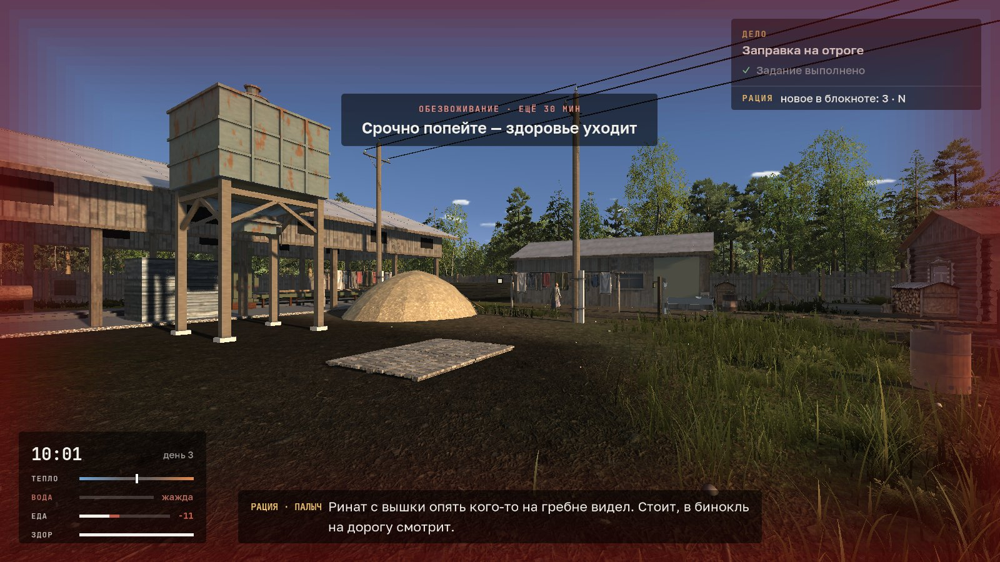

## 391. Миссия «Колхоз»: банда на дворе, штурм или ночной угон Т-40 по ключу Кости, Костя переезжает, новоселье и полевые работы

01:17 · SL-M3 · Колхоз

Коммит: [0e9d00f6e1](https://github.com/shsanek/EXEcutor/commit/0e9d00f6e1)

Ветка: `claude/peregon-m3-kolkhoz`

SL-E4: миссия открывается после выхода в эфир и возвращения ольховцев. Поверх обжитого двора — слой банды (флаг, «ПЛАТИ», мешки, два багги, логово в конторе, мешки зерна на току), отряд 6 + 2(N−1). Два пути: штурм двора или ночью скрытно угнать Т-40 по запасному ключу Кости (ночью вход во двор не начинает бой, только обнаружение); после угона банда уходит, когда рядом никого нет. Костя переезжает в колхоз, новоселье: «Трактор цел. Масло только слили.» После: пахота и уборка на доске, звонок Палыча по рации, новые приветствия Кости, Толика, Надежды, Палыча, Рината. SL-M12 «Новоселы» — заготовка (флаг после новоселья), полноценно позже. Ветка влила свежую дизайн-ветку сама: 14 конфликтов, обе стороны сохранены.

- ✓ Тесты после слияния: kolkhoz 4/4, gas, elevator, bunker, hunt_road, places, poi, story, play_story, combat_ai
- ✓ story_lint: 0 ошибок
- ✓ Игра: от двора банды через ночной угон до новоселья, 11 кадров
- ✗ Открыто: SL-M12 новосёлы — только заготовка

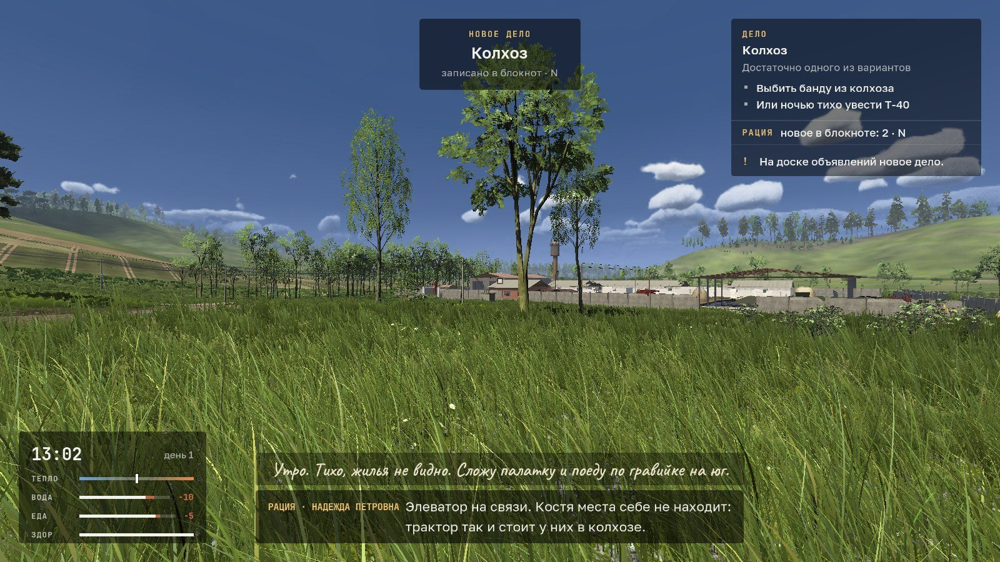

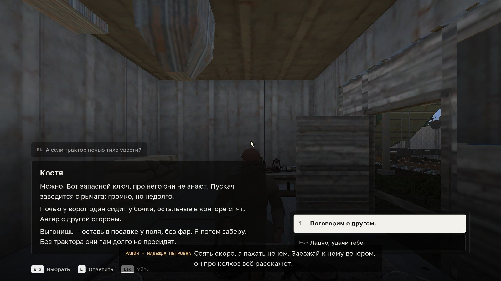

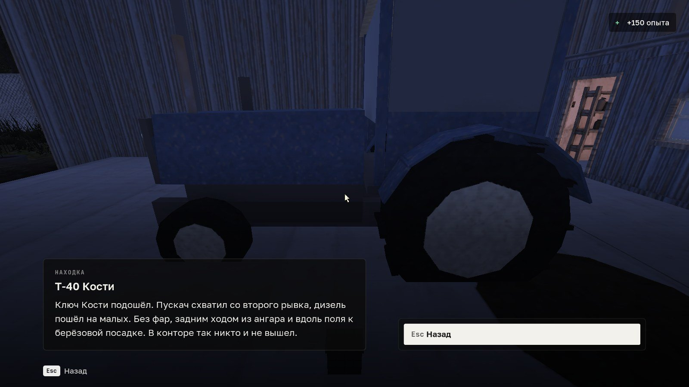

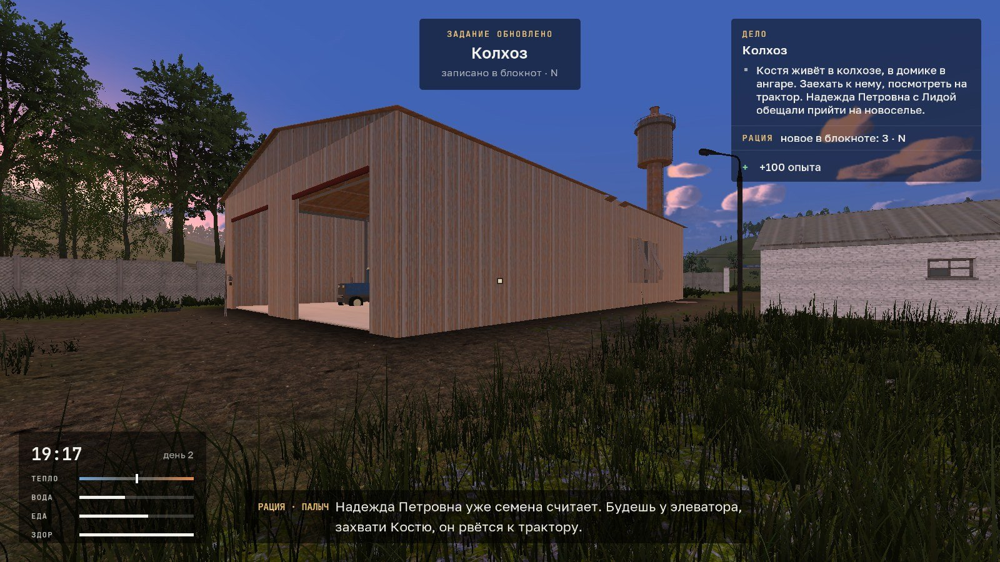

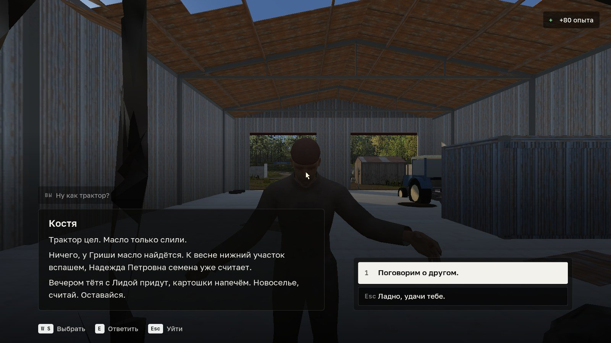

## 392. Миссия «Пост на железке»: трос парома, пулемётное гнездо банды на подстанции СЦБ, Берёзовка в безопасности, медь

01:31 · SL-M3 · Подстанция и паром

Коммит: [548e5be59e](https://github.com/shsanek/EXEcutor/commit/548e5be59e)

Ветка: `claude/peregon-m3-substation`

SL-E6: после выхода в эфир Палыч передаёт весть от Захара. Сначала трос: бревно и запчасти к причалу на грузовике (заодно закрывает квест G6 без двойной награды), понтон остаётся на берегу. Пост: дороги нет — грузовик у зернотока, дальше пешком вдоль путей; Захар советует заходить от реки. Новый тип бойца — пулемётчик в гнезде на крыше релейной, бьёт длинными очередями и не уходит от пулемёта; отряд 12 при N=3. После: звонок по рации, медь из трансформатора, Захар: «Теперь хоть по ночам спать можно», приветствия Тамары и Палыча; Бобровы возвращаются в Берёзовку только после подстанции. Пост банды убирается слоем хранителя. Конфликты слияния (арены, директор, план, тест контрактов) решены вручную, сборка и тесты в главной ветке.

- ✓ Тесты после слияния: сборка + 14 связанных наборов (contracts, director, economy, substation, kolkhoz, story, poi, combat_ai, places, gas, bunker, elevator) — все прошли
- ✓ story_lint: 0 ошибок
- ✓ Игра: трос, бой у поста, освобождение, Берёзовка — 21 кадр
- ✗ Открыто: переправа грузовика на пароме, модель пулемёта (пока серые блоки), дрезина, К6

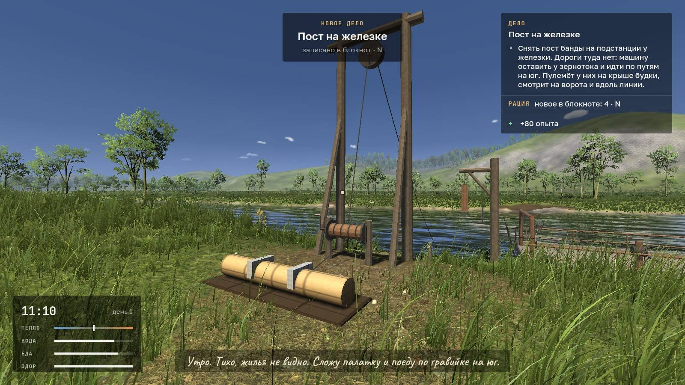

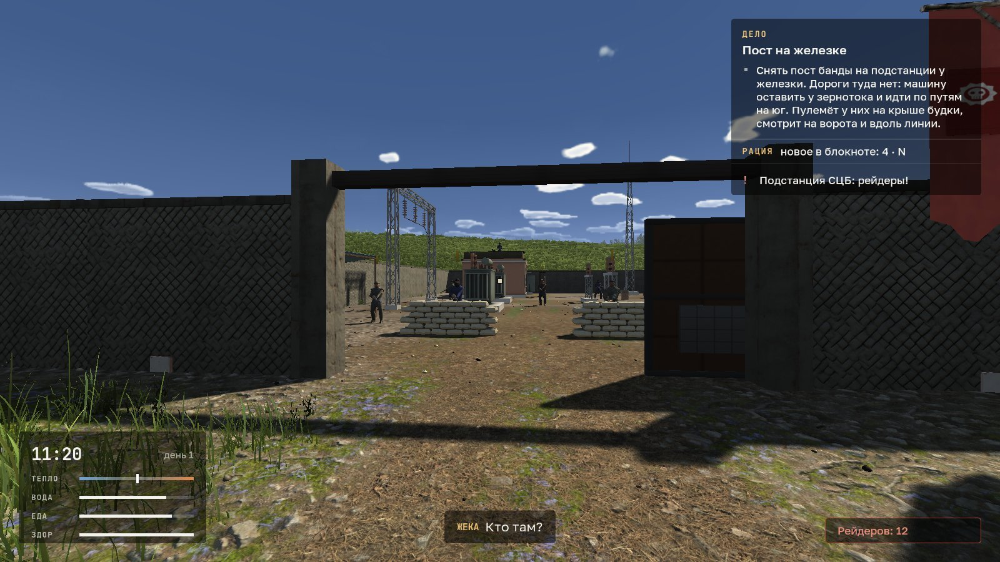

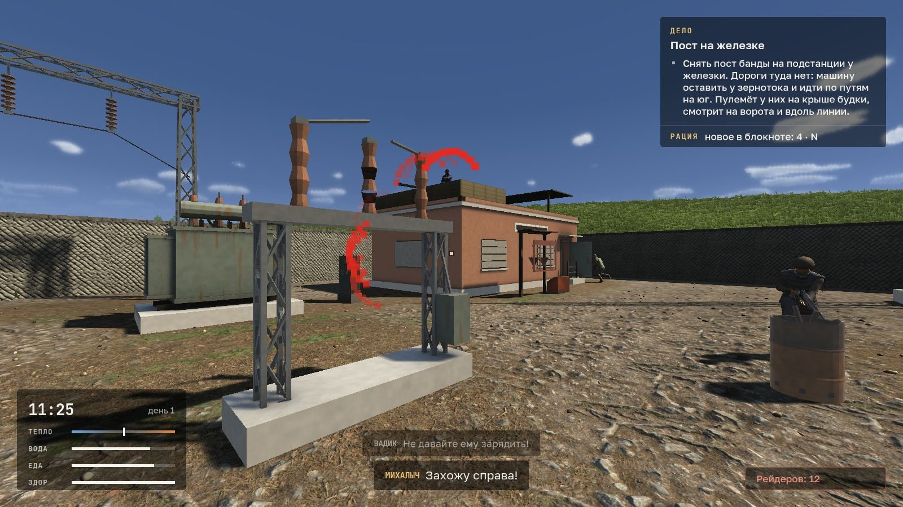

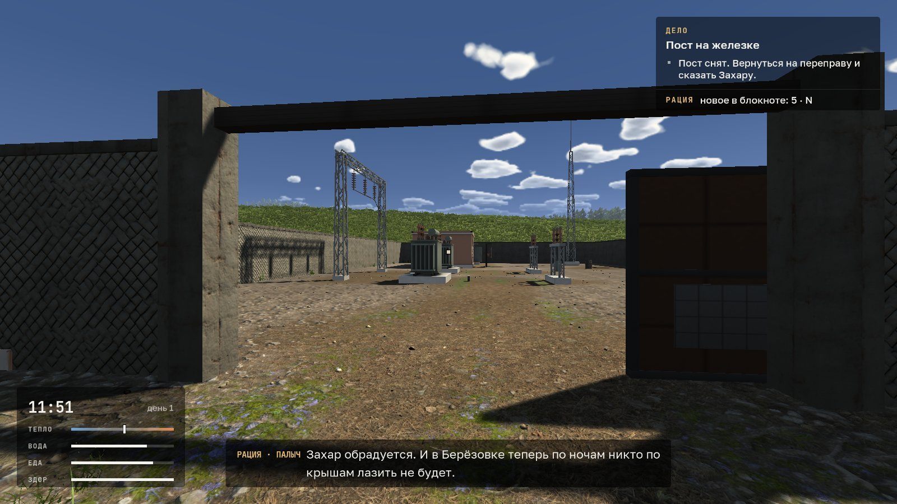

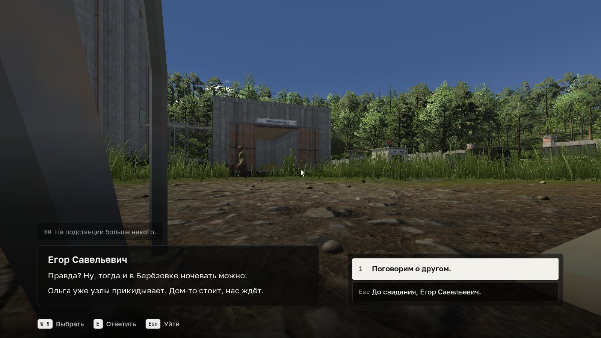

## 393. Квест «Продуктовый обоз» и обоз как система: Шило, Бугай с прицепом зерна и Шило, реакция охраны, склад, перехват, мешки Надежде

01:38 · SL-M3 · Продуктовый обоз

Коммит: [107b058d21](https://github.com/shsanek/EXEcutor/commit/107b058d21)

Ветка: `claude/peregon-m3-convoy`

SL-M1/M15: со ступени охоты 2 раз в 48 игровых часов колонна (Шило, Бугай с прицепом 12 мешков зерна, Шило, 6 м/с) идёт по открытым дорогам между двумя бандитскими местами, никогда возле своих и освобождённых; на R1 — платный поворот → брод, 884 м (запасной маршрут колхоз → брод, 306 м). Охрана замечает героя по дистанции и времени (пешком и ночью — хуже); грузовик поперёк дороги — остановка и атака; по тревоге бросают сцепку и уходят в погоню. Слежка с 160 м+ открывает склад, где прицеп стерегут две багги; пешком можно тихо вынести. Мешки — груз мира, носятся в кузов по E; через 4 мин приходят ещё две багги. Надежда Петровна берёт мешки (6 нужно, 250 опыта), следующая точка дерётся на двоих меньше. Квест lq_convoy, слух, перехват по рации. Новая модель прицепа в Blender. Кооп и сохранения поддержаны. Ветка дважды вливала дизайн-ветку; последние конфликты (подключение прогонов, номер раздела плана) решены вручную, сборка и тесты в главной ветке.

- ✓ Тесты после слияния: сборка + 14 наборов (convoy, convoy_play, hunt_road, bandit_*, substation, kolkhoz, gas, elevator, bunker, places, story) — все прошли
- ✓ story_lint: 0 ошибок
- ✓ Игра: колонна, сброс сцепки, захват, доставка, слежка до склада — 13 кадров
- ✗ Открыто: в прогоне охрана не таранила; 11 мешков из 12 загружены отладочным хуком; хлеб дешевле, метка склада, настоящая сцепка

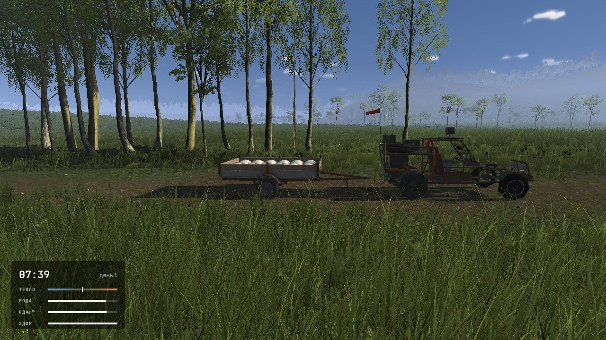

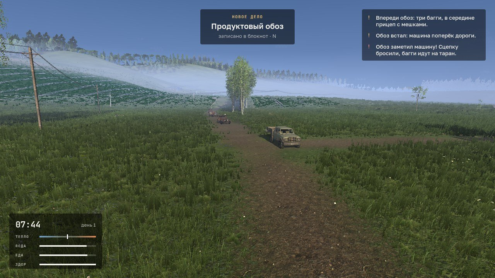

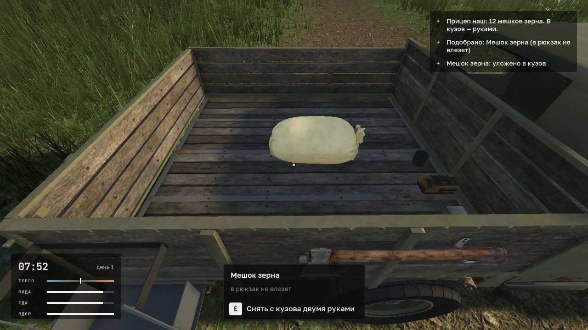

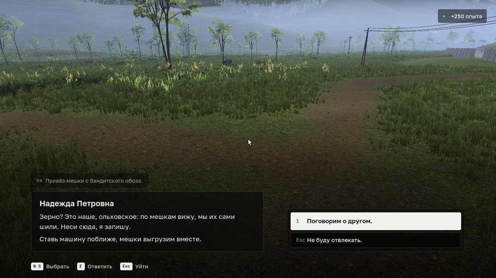

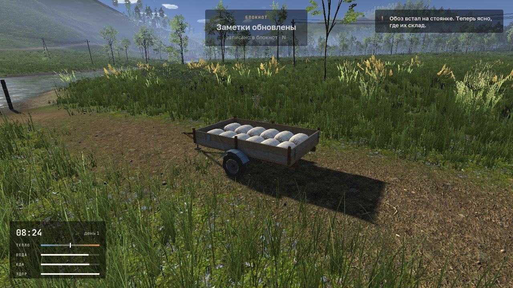

## 394. Квест «Залог на броду» (шаг 4a главной линии): Тимоха на цепи у пикета, долг мешками, ночью тихо или бой, пикет снят навсегда

02:17 · SL-M3 · Залог на броду

Коммит: [7e3385a8bc](https://github.com/shsanek/EXEcutor/commit/7e3385a8bc)

Ветка: `claude/peregon-m3-ford`

SL-M4: пикет у брода — тот же заслон охоты [block.ford_picket], теперь с заложником: пока Тимоха на цепи, у поста сидит он. Три пути: отдать долг двумя мешками зерна или картошки (E в кабине у шлагбаума вместо платы; это крючок для будущей цепочки долгов SL-M8); ночью пикет дремлет у костра — только настоящая тревога начинает бой, найденное тело ведёт к поискам, а не к бою; бой поднимает ступень охоты на 1. Освобождение — катсцена 16 с («С весны на этой цепи…», лодки банды в старице, «Брод — единственный путь сюда»). После — заслон больше не встаёт, флаг финала lq_fh_free и запись, что одна волна финала пойдёт через брод. Пикет перенесён на сухой правый берег (стоял в воде 0.4 м). Тимоха пока в теле Коли с другим цветом. Конфликты слияния (локализация, CMake, подключение прогонов, номер раздела плана) решены вручную, сборка и тесты в главной ветке.

- ✓ Тесты после слияния: сборка + 16 наборов (ford, convoy, hunt_road, bandit_*, substation, kolkhoz, gas, elevator, bunker, places, combat_ai, story) — все прошли
- ✓ story_lint: 0 ошибок
- ✓ Игра: ночной путь целиком, утром пикета нет — 15 кадров
- ✗ Открыто: своя модель Тимохи, столбы цепи — серые блоки; удары ножом в прогоне по скрипту

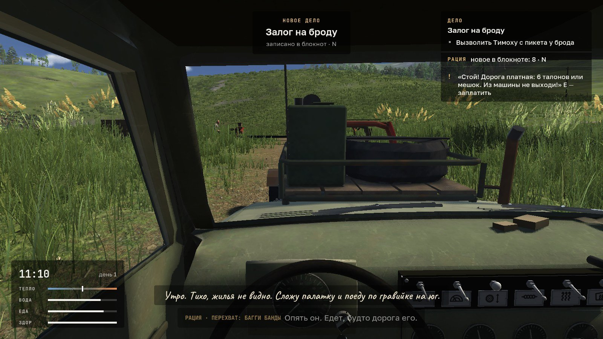

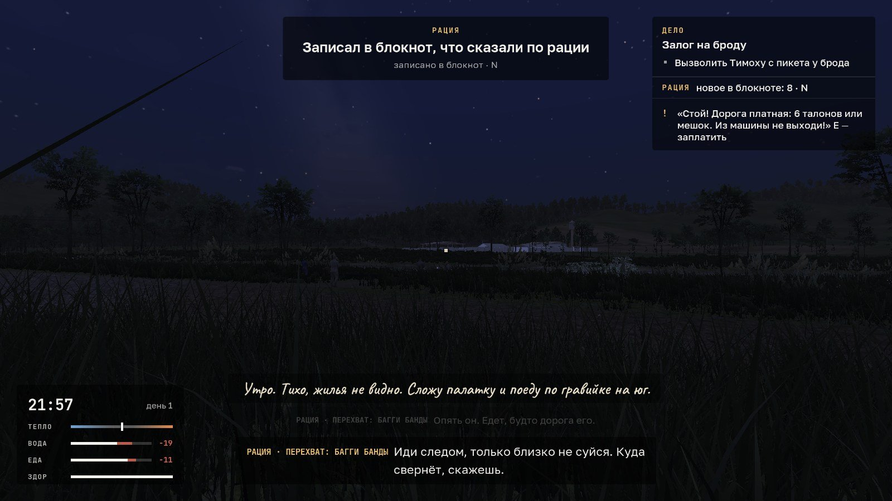

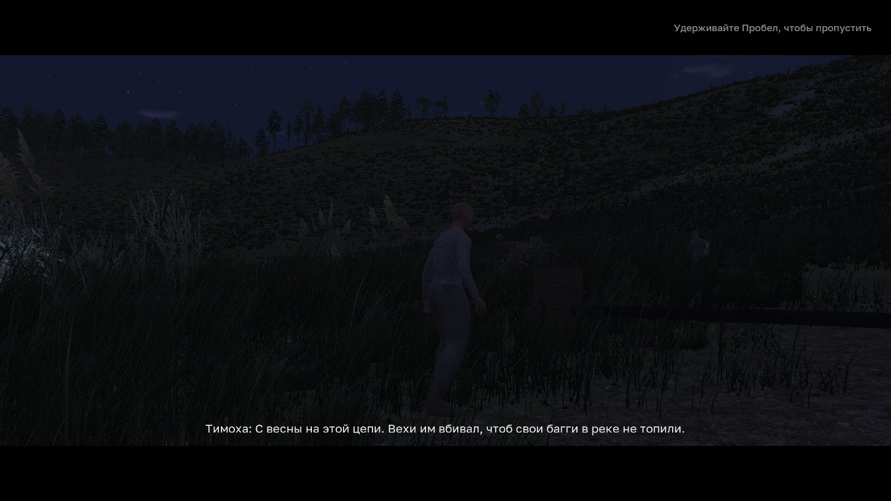

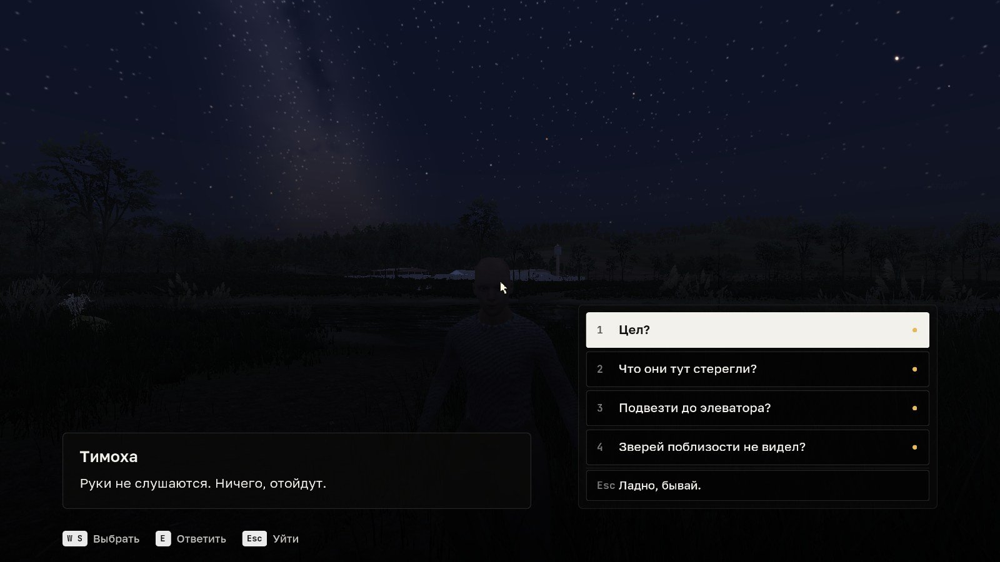

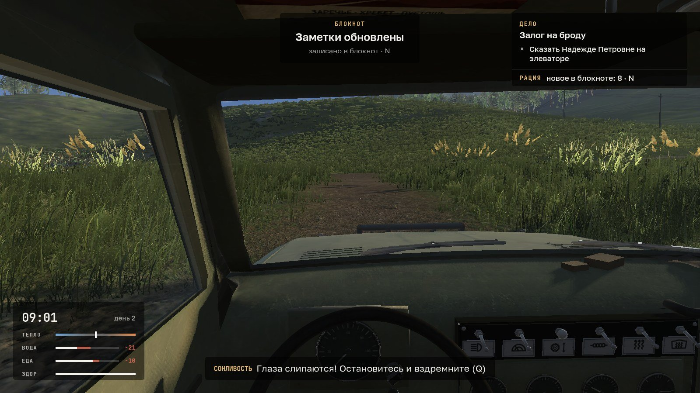

## 395. Оборона и контррейды, жители-стрелки, миссия «Ночь у ворот» (шаг 4b главной линии): грузовик поперёк ворот, волна банды, двое идут к кабине

02:28 · SL-M3 · Ночь у ворот

Коммит: [0d20f21256](https://github.com/shsanek/EXEcutor/commit/0d20f21256)

Ветка: `claude/peregon-m3-defend`

SL-C6/C7/M9: после первой точки свободного набора — предупреждение по рации; банда ждёт ночи и кого-то из своих на месте (пока игрока нет, место не теряется). На элеваторе игрок ставит жителей: у ворот, за грузовиком, на галерее или на своём посту; жители стреляют и притягивают огонь, при 0 здоровья ранены, но не гибнут. Грузовик у ворот — укрытие, но двое бандитов идут к кабине. Побитая волна отходит. Провал (все игроки лежат или все дальше 260 м 60 с) — место снова у банды, ольховцы уходят в лагерь у лесопилки, отбить можно снова. После первого рейда директор нападает на другие освобождённые места не чаще раза в 2 игровых дня. Загрузка посреди волны — волна заново от ворот. Крючок lq_kochka_taken для перебежчика (SL-M5). Агент сам влил дизайн-ветку (8 конфликтов, обе стороны сохранены: пулемётчик и союзники в ИИ, обоз и рейды в директоре).

- ✓ Тесты: combat_ai 20/20, defend_play 5/5, substation, convoy, ford, kolkhoz, gas, elevator, bunker, hunt_road, places, story — 15/15 после слияния
- ✓ story_lint: 0 ошибок
- ✓ Игра: рация, расстановка, волна, отход, утро — 13 кадров
- ✗ Открыто: у жителей нет анимации оружия; трассеры союзников не видны клиентам; оборона мест без арены (склад ВВ, SL-E7) ждёт арены

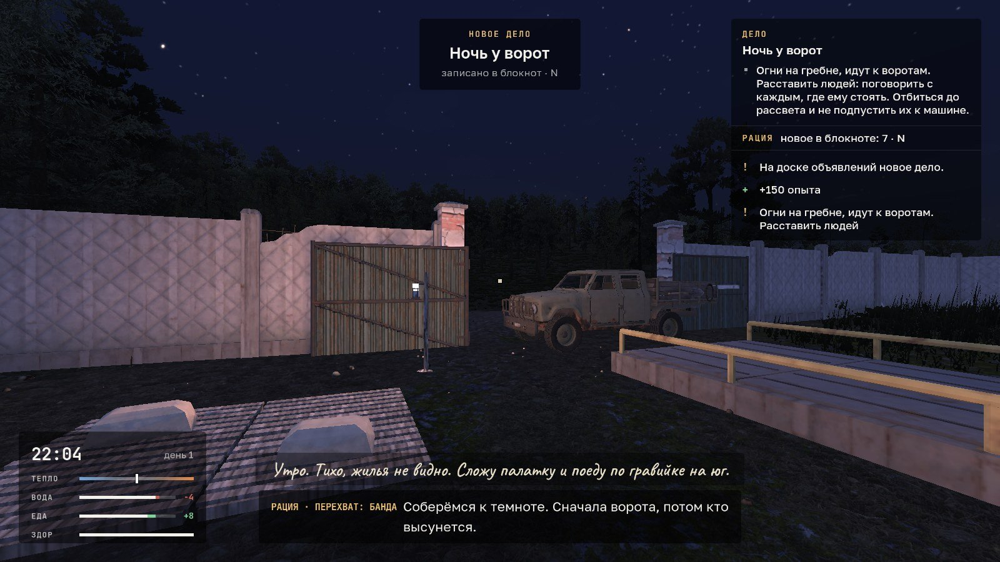

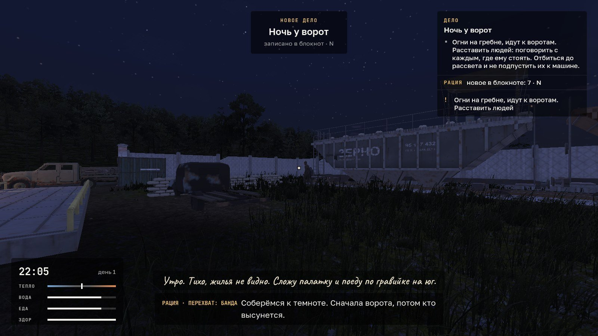

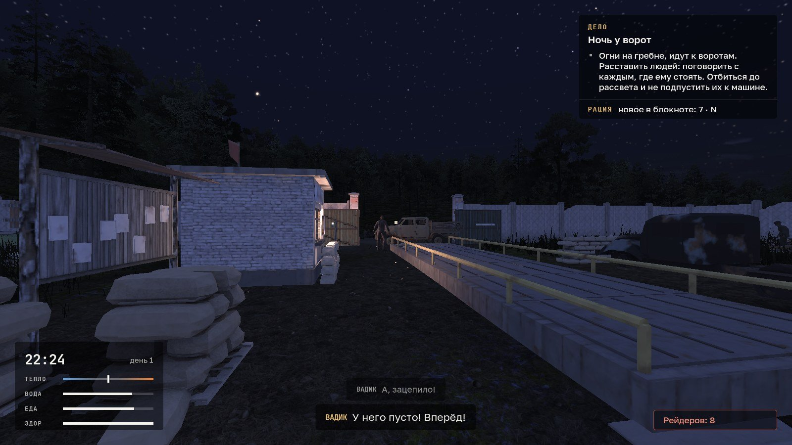

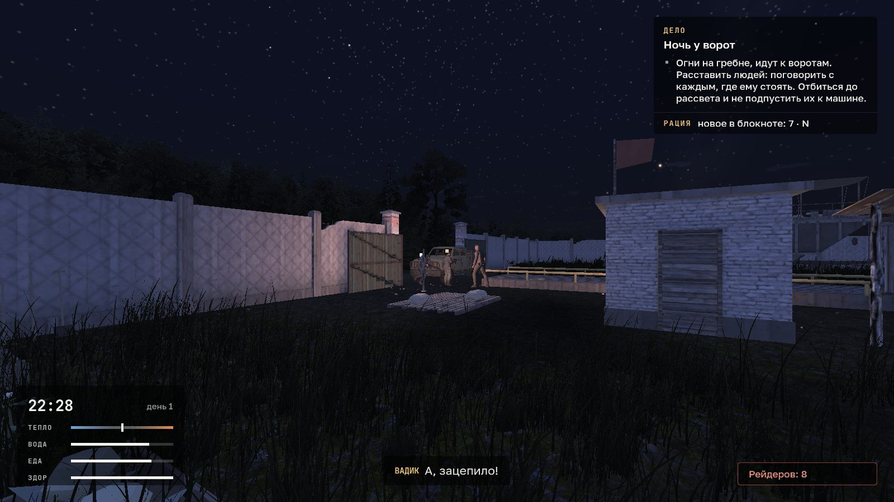

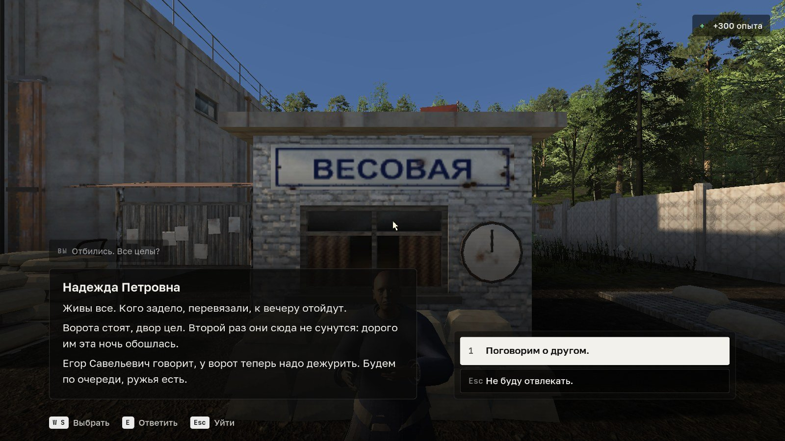

## 396. Миссия «Делянка сорок первого»: выследить банду с Михеичем, ловушки, бандиты рассыпаны по лесу, ночной выстрел у костра, брёвна Палычу

02:39 · SL-M3 · Делянка 41

Коммит: [2d89ff6663](https://github.com/shsanek/EXEcutor/commit/2d89ff6663)

Ветка: `claude/peregon-m3-logging`

SL-E5: Палыч посылает к Михеичу в Медвежий Лог. С ним читаем тропы банды по следам сапог, находим лёжки в лесу; на тропах петли и растяжки из банок. Отряд 5 + 2N рассыпан по делянке и трём лёжкам. Бой — остальные бегут, когда легло 60 %; или путь Михеича: ночью выстрел по их костру — банда бросает оружие и разбегается. Освобождение через машину состояний, звонок Палыча по рации, новые реплики. После: брёвна Палычу (20 талонов за бревно, 45 за толстое) и два рейса тёса на доске лесопилки — «Тёс с сорок первого» и «Настил из своего леса». Первый агент завис — работа сохранена коммитом и доделана новым агентом. Конфликты слияния (тип боевой точки леса совпадал с обороной — разведены на 4 и 5, план) решены вручную, сборка и 23 набора тестов в главной ветке.

- ✓ Тесты после слияния: сборка + 23 набора (logging 6/6, defend, ford, convoy, hunt_road, bandit_*, substation, kolkhoz, gas, elevator, bunker, places, combat_ai, contracts, net_world, coop) — все прошли
- ✓ story_lint: 0 ошибок
- ✓ Игра: следы, петля, ночной выстрел, брёвна, доска — 18 кадров
- ✗ Открыто: вывоз брёвен с делянки по контракту (нет точки погрузки); крики сдачи — общие имена бандитов

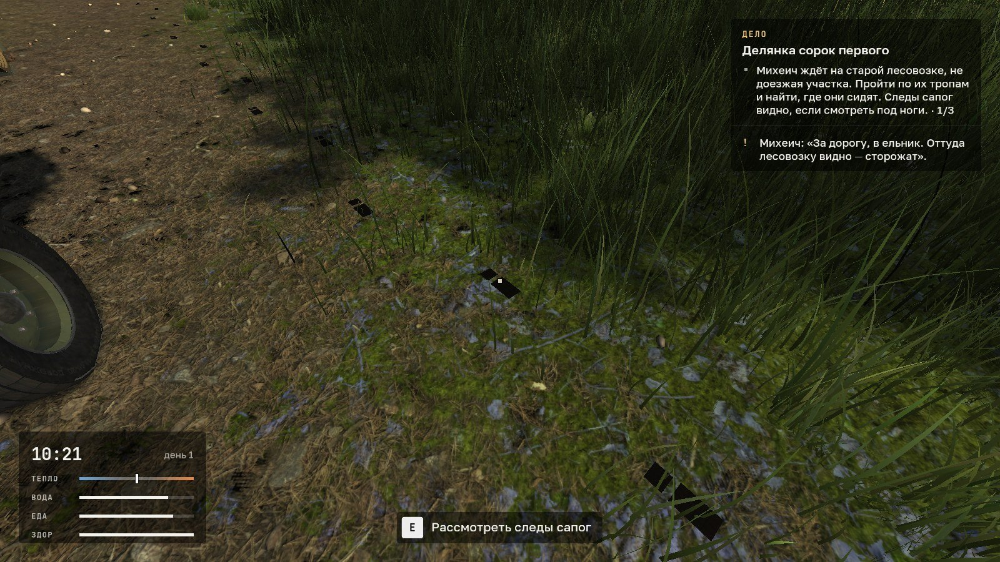

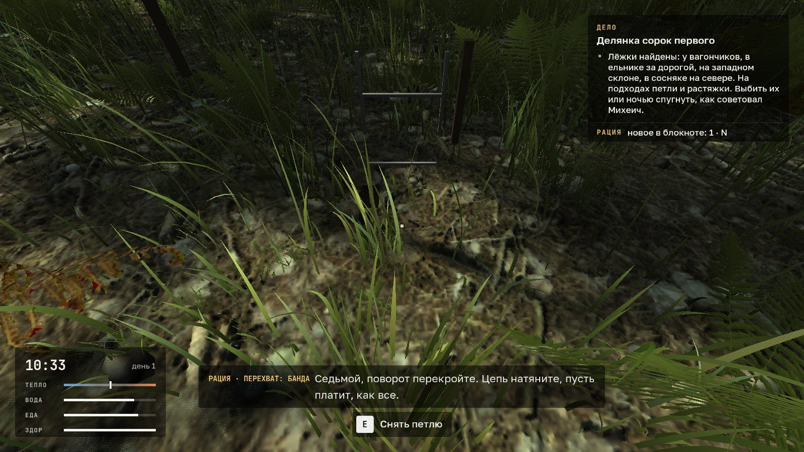

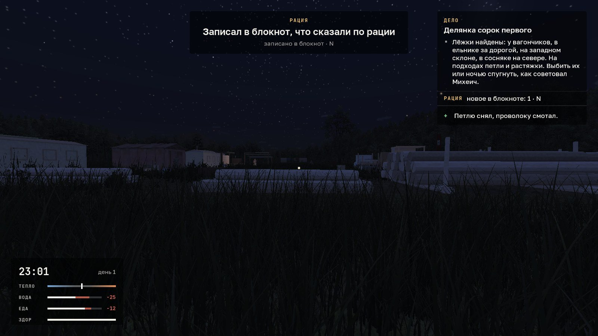

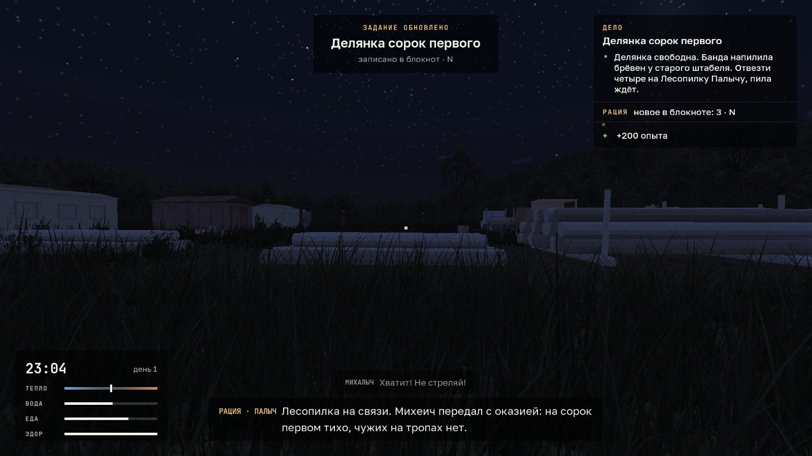

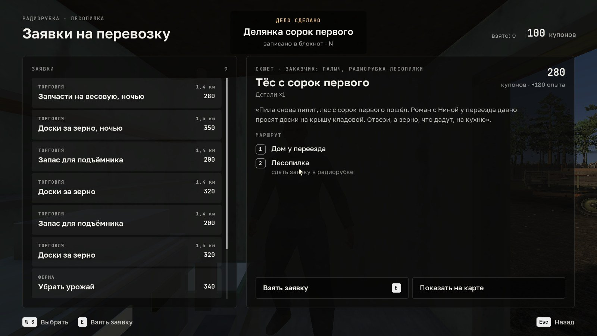

## 397. Ночные попытки угона грузовика со ступени 4, угнанную машину можно вернуть, квест «Приманка»: двое пленных выдают план Шатуна

03:07 · SL-M3 · Ночной угон и «Приманка»

Коммит: [6abc397f71](https://github.com/shsanek/EXEcutor/commit/6abc397f71)

Ветка: `claude/peregon-m3-nighttheft`

SL-D7: со ступени охоты 4 с 22:00 до 04:30 группа из 4–5 пешком подбирается к грузовику, стоящему вне своих мест: один 25 с заводит, остальные снимают вещи с кузова, затем машину уводят к ближайшему заслону банды (3 охранника, ночью дремлют). Сесть за руль — машина снова своя, грузовик никогда не теряется насовсем (повторяемый квест «Угнанная машина»). В своём месте машина в безопасности; сон вне своих мест прерывается шумом, если спишь в кабине или ближе 150 м. Отбитая группа возвращает вещи, сдавшиеся становятся пленными. Упрощение: грузовик не едет сам — переносится к посту через 3 с после запуска мотора. SL-M13: Ринат на лесопилке предлагает поймать их на машину; ночью приходят пятеро, двое живыми — пленный выдаёт план Шатуна (вторая волна финала слабее, финал без предупреждения Рината — флаги для SL-E8). Конфликты слияния (ИИ, директор, условия пленных на элеваторе, план) решены вручную, сборка и 24 набора тестов в главной ветке.

- ✓ Тесты после слияния: сборка + 24 набора (night_theft 6/6, night_theft_play 5/5, defend, logging, ford, convoy, hunt_road, bandit_*, substation, kolkhoz, gas, elevator, bunker, places, combat_ai, contracts, coop, story) — все прошли
- ✓ story_lint: 0 ошибок
- ✓ Игра: приманка, двое пленных, угон, возврат машины — 12 кадров
- ✗ Открыто: грузовик не уезжает своим ходом; охрана у ворот своих мест — пустой крючок; ночные кадры тёмные

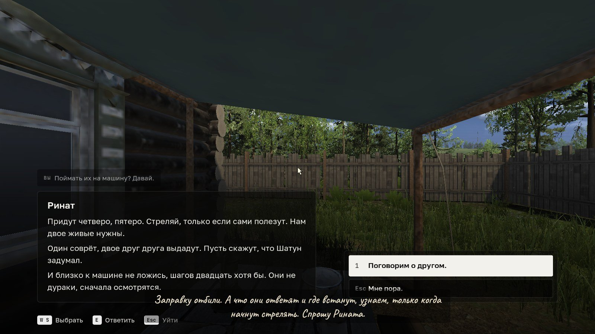

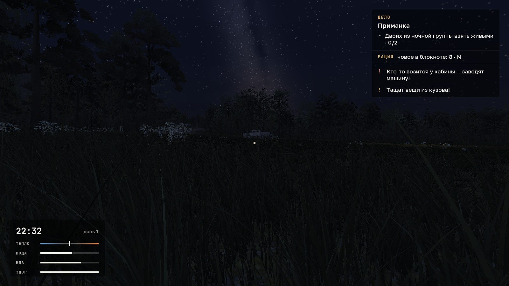

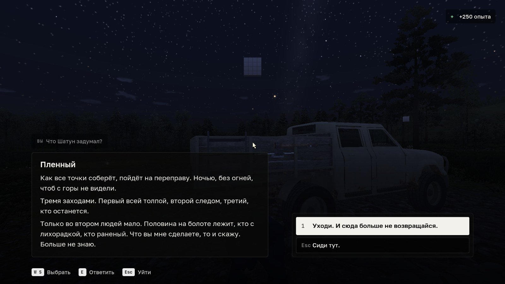

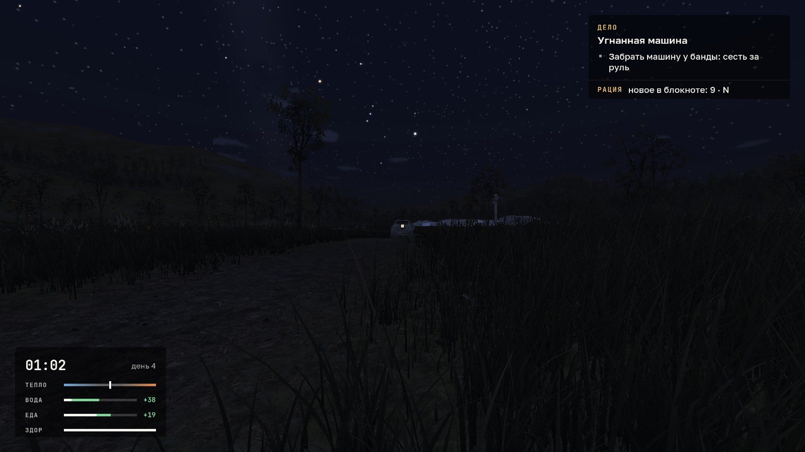

## 398. Миссия «Склад ВВ» на разрезе: штурм или тихий заход через вал, ночная оборона со Степкой, аммонит под замком

03:12 · SL-M3 · Склад ВВ

Коммит: [05c2b0da60](https://github.com/shsanek/EXEcutor/commit/05c2b0da60)

Ветка: `claude/peregon-m3-coalstore`

SL-E7: после выхода в эфир Палыч по рации передаёт, что слышал Карлыч, Степка даёт задание и тихий путь ночью через западный вал без фонаря. Слой банды поверх пустого склада (тряпка на шесте, мешки, ящики аммонита, палатка и костёр в проезде, багги), арена из чертежа склада, отряд 6 + 2(N−1), ночью бой только если заметят. Штурм освобождает склад; пленный рассказывает о ящиках Серёгина. В ту же ночь банда возвращается за аммонитом: Степка на посту, грузовик поперёк проезда, двое идут к кабине; проигранная ночь возвращает склад банде. После — Степка: «Пусть лучше в забое лежит», аммонит под его замком (крючок для «Бочек в карьере»), рация, новые темы Палыча и Рината. «Ночь у ворот» ждёт, пока не кончится ночь склада — два рейда сразу не идут. Конфликты слияния (подключение прогонов, условия пленных, план) решены вручную, сборка и 24 набора тестов в главной ветке.

- ✓ Тесты после слияния: сборка + 24 набора (coal_store 5/5, night_theft, logging, defend, ford, convoy, hunt_road, bandit_*, substation, kolkhoz, gas, elevator, bunker, places, combat_ai, contracts, director, economy, story) — все прошли
- ✓ story_lint: 0 ошибок
- ✓ Игра: штурм, пленный, ночная волна, утро — 16 кадров
- ✗ Открыто: из-за грузовика Степка не видит проезд; Степка один может отбить волну без игрока; запечённые тени карты устарели — нужна перепечка

## 399. Бумажная карта показывает состояние мест: вымпел банды, зачёркнутый с вопросом, крест, домик; заслоны, склад обоза, разведметки

03:38 · SL-M3 · Значки на карте

Коммит: [ab5652938a](https://github.com/shsanek/EXEcutor/commit/ab5652938a)

Ветка: `claude/peregon-m3-mapicons`

SL-B6: поверх бумажной карты — слой меток от руки по машине состояний мест: у банды — вымпел, идёт бой — вымпел перечёркнут с вопросом, освобождено — перечёркнуто, обжито — домик. Заслоны — шлагбаумы (снятый — зачёркнут), склад обоза — мешок. Метки появляются только для мест, о которых герой знает (был, слышал по рации, рассказали). Разведметка: переменная истории map_intel_&lt;зона&gt; ставит карандашный крест в круге (1 — метка, 2 — зачёркнута) — для тайников «Чужого эфира». Легенда перечисляет виды на листе. Общие в коопе, переживают сохранение. На карте в кабине — сложенная обложка, меток нет. Первый агент завис на прогоне — работа сохранена коммитом и доделана новым агентом.

- ✓ Тесты: map_marks_play 10/10, story, play_story, ctest — только известные
- ✓ story_lint: 0 ошибок
- ✓ Игра: колхоз: банда → бой → освобождён → обжит; пикет брода — 5 кадров
- ✗ Открыто: нет подписей у меток и анимации зачёркивания

## 400. Придорожные сценки между своими местами и квест «Дорога ожила»: тачка Кисловой, Пашка, шлагбаум в канаве, охотник Фрол, лист тетради дани

04:05 · SL-M3 · Дорога ожила

Коммит: [b3e8523adc](https://github.com/shsanek/EXEcutor/commit/b3e8523adc)

Ветка: `claude/peregon-m3-roadlife`

SL-M16: сценки задаются в data/world/roadside.txt ([roadside.*]); якорь у дороги на кратчайшем пути между двумя своими местами. Хост ставит сценку, только если точка освобождена и оба конца свои, якорь не ближе 250 м к бандитской зоне, никого ближе 300 м, одна сценка за поездку, днём, не в катсцене, бою, обороне и не рядом с событием банды на дороге. Состояние — в переменных истории (сохранения и кооп). SL-M7: пять сценок — у Анны Кисловой отвалилось колесо тачки (элеватор), Пашка идёт на заправку «просто посмотреть», шлагбаум банды в канаве разбирают на доски (колхоз), охотник Фрол в петле (делянка 41 — перевязать ногу), тело беглого с листом тетради дани (склад ВВ; крючок для «Кто кому должен»). Все пять закрывают квест. Слияние без конфликтов кода (только номер раздела плана).

- ✓ Тесты: roadside, roadside_play, hunt_road, bandit, defend, story, places, dialogue, poi — 21 набор
- ✓ story_lint: 0 ошибок
- ✓ Игра: все пять сценок, квест закрыт — 25 кадров
- ✗ Открыто: люди в сценках стоят на месте; тачка, шлагбаум, котомка — серые блоки

## 401. «Перебежчик»: Кочка у разбитой багги — взять, отдать ольховцам или прогнать; «Чужой эфир»: переговоры Счетовода, тайники на карте, засада у вышки

04:24 · SL-M3 · Перебежчик и Чужой эфир

Коммит: [a0edce5017](https://github.com/shsanek/EXEcutor/commit/a0edce5017)

Ветка: `claude/peregon-m3-defector`

SL-M5: со ступени охоты 2 и после выхода в эфир днём Ринат по рации сообщает о перевёрнутой багги на гребне над серпантином; Кочка с белой тряпкой. Взять — флаг для раннего контррейда на элеватор, позывные банды, и пока он с героем, каждая засада ставит карандашную метку на карте на 3 игровых часа; отдать — Надежде Петровне (мешок картошки); прогнать — уходит в лес. Едет на пассажирском месте, переживает сохранение. SL-M6: вечерние переговоры Счетовода раз в 2–3 игровых дня называют четыре тайника по кругу; приём днём 100, ночью 45, в дождь вдвое хуже, с Кочкой разбирается легче; невнятный вызов повторяется следующим вечером. Тайники — разведметки на бумажной карте. Третий — у пожарной вышки: засада из четырёх со ступени 3, пленный или записка ведут к Ринату и «Приманке». Конфликты слияния (подключение шагов, фигур, прогонов, линтер, план) решены вручную, сборка и 20 наборов тестов в главной ветке.

- ✓ Тесты после слияния: сборка + 20 наборов (defector 5/5, intercept 5/5, roadside, night_theft, defend, convoy, hunt_road, bandit, coal_store, map_marks, poi, places, combat_ai, story) — все прошли
- ✓ story_lint: 0 ошибок
- ✓ Игра: Кочка, позывные, тайник, засада у вышки, метки — 22 кадра
- ✗ Открыто: Кочка в чужом теле и позе сидя на земле — в кабине виден частично

## 402. Финал района «Переправа»: Ринат предупреждает, К7 на берегу, три волны через реку и брод, Шатун на багги, жители на рубеже, К8 и фонарь на последней вехе, тихие дороги после

04:50 · SL-M4 · Переправа — финал района

Коммит: [f2317ac898](https://github.com/shsanek/EXEcutor/commit/f2317ac898)

Ветка: `claude/peregon-m4-finale`

SL-E8: условие — три из четырёх точек свободного набора, Тимоха свободен, ступень охоты 4 и предупреждение Рината или план Шатуна от пленного «Приманки». Ринат: «Третью ночь на серпантине огни…»; в сумерках К7 — «Всех собрал. Значит, сегодня.», жители у воды: «Дальше реки они не пройдут. Нам за ней жить.» Грузовик поперёк дороги за рубежом. Три волны (не больше 12 живых сразу): с серпантина через реку, вторая — через брод (Тимоха показал, где лодки), третья — с багги и самим Шатуном; с планом пленного вторая волна на треть слабее. Жители стреляют, только если кто-то из своих в 170 м от брода — уйти значит проиграть; проигрыш — бой заново с первой волны. Шатун ранен и уходит живым в болото (К8), фонарь Митрича на последней вехе (крючки для SL-H6 и SL-M14). После — засады, погони, заслоны, обоз и ночные угоны в районе выключены, Карлыч: «Тишина у них в эфире». Агент перезапускался (завис без правок); слияние — подключение прогонов и план, сборка и 21 набор тестов в главной ветке.

- ✓ Тесты после слияния: сборка + 21 набор (finale 5/5, defector, intercept, roadside, night_theft, defend, ford, convoy, hunt_road, bandit, coal_store, poi, places, combat_ai, story) — все прошли
- ✓ story_lint: 0 ошибок
- ✓ Игра: Ринат, К7, три волны, Шатун, К8, тихое утро — 15 кадров
- ✗ Открыто: убийства в прогоне по скрипту; ночные кадры очень тёмные; кадр «тихий серпантин» смотрит в траву

## 403. Квест «Хозяин»: кровавый след у бункера, мерка следа с Михеичем, ночь у заимки после задранной тёлки, приманка и лабаз, убить или отогнать по-михеичевски

04:58 · SL-M3 · Хозяин

Коммит: [4e185749ed](https://github.com/shsanek/EXEcutor/commit/4e185749ed)

Ветка: `claude/peregon-m3-bearhunt`

SL-M10: существующий квест легенды медведя переделан в авторскую линию (тот же id — журнал и сохранения переносятся), этапы поднимают ступени легенды. Кровь: старый след от дверей бункера до пустого логова. Мерка: отпечаток в лесу B, показать Михеичу. Утром у Шубиных задрана тёлка, Палыч звонит, Клава просит покараулить — ночью медведь приходит к добыче, встаёт на дыбы, ревёт и уходит. Охота: Михеич соглашается; 24+ кг туши или мяса на солонец под лабазом в лесу A, ночью он приходит кормиться и не чует охотника наверху; по снегу свежий след ведёт к лёжке. Развязки: убить — коготь, шкура, ружьё Михеича, 500 опыта; или путь Михеича — факел в глаза или выстрел поверх головы отгоняют навсегда, Михеич учит «Читать след», 400 опыта. Конфликты слияния (локализация, CMake, подключение прогонов, план) решены вручную, сборка и 16 наборов тестов в главной ветке.

- ✓ Тесты после слияния: сборка + 16 наборов (bear_hunt 6/6, fauna, boss, bunker, journal, finale, defector, intercept, roadside, poi, places, story) — все прошли
- ✓ story_lint: 0 ошибок
- ✓ Игра: обе развязки, ночь у заимки, лабаз — 17 кадров
- ✗ Открыто: ночью медведь виден только по красным глазам; останки тёлки — туша лося; в прогоне медведь подходит с 40–45 м

## 404. «Бочки в карьере»: вытащить бочки банды лебёдкой или взорвать зарядом Степки; «Ночная работа» для Гриши: цепь, генератор, ящик

05:13 · SL-M3 · Бочки в карьере и Ночная работа

Коммит: [69b4e5597c](https://github.com/shsanek/EXEcutor/commit/69b4e5597c)

Ветка: `claude/peregon-m3-sabotage`

SL-M3: карьер у колхозной дороги, весть по рации после заправки. Увезти: каждая бочка 180 кг идёт только лебёдкой, через 600 с после первой приходит патруль (две багги погони), бочки забирает Гриша. Сжечь: Степка даёт заряд аммонита, когда склад ВВ свой; после взрыва в 1,5 км от карьера 2 игровых дня не больше одного патруля, погони реже и по одной багги. SL-M11: работа достаётся первому месту свободного набора, которое ещё у банды при выходе Плешивой в эфир (колхоз → подстанция → склад ВВ). Перерезать цепь (проехать сквозь — звон будит), заглушить генератор — луч прожектора считается светом для их зрения — и вынести 25-кг ящик. Если генератор заглушён, при штурме нет прожектора и на одного меньше. Конфликты слияния (CMake, подключение шагов, эффекты истории, линтер, план) решены вручную, сборка и 16 наборов тестов в главной ветке.

- ✓ Тесты после слияния: сборка + 16 наборов (sabotage 7/7, bear_hunt, finale, defector, intercept, hunt_road, bandit, coal_store, defend, poi, places, combat_ai, story) — все прошли
- ✓ story_lint: 0 ошибок
- ✓ Игра: лебёдка, патруль, взрыв, ночная работа целиком — 21 кадр
- ✗ Открыто: в кадрах багги патруля за деревьями, дневной огонь скрыт кустами

## 405. «Коробейник»: Лапин в клетке у платного поворота — выкуп, ночью тихо или бой, разведка заправки, потом торгует вдоль своих дорог; «Кто кому должен»: Надежда → Сыч → банда, тетрадь дани

05:34 · SL-M3 · Коробейник и долги

Коммит: [66b036e7f0](https://github.com/shsanek/EXEcutor/commit/66b036e7f0)

Ветка: `claude/peregon-m3-debts`

SL-M2: со ступени охоты 1 после элеватора Лапин сидит в клетке из арматуры у платного поворота; квест начинают дед Ефим или сам Лапин. Выкуп 15 талонов (E у шлагбаума вместо платы), ночью тихо через его тему, пока заслон дремлет, или бой. Если заправка освободила поворот раньше, банда переносит клетку к заслону первой ещё бандитской точки (метка на карте), если заслонов нет — отпускает. Пока заправка у банды, Лапин даёт разведку: метка стрелка на навесе. Потом раз в день ходит между своими местами по чистым дорогам, торгует через обычный экран торговца. SL-M8: Палыч после заправки; цепочка Надежда → Сыч → банда; Сыч признаётся, только увидев лист тетради дани с дороги или всю тетрадь (новая находка на заправке); круг зерно → железо → снаряды, долги закрываются у тех, кто давал; Палыч даёт два мешка за долг Тимохи; в конце тетрадь сжечь у элеватора или оставить. Конфликты слияния (подключение шагов и прогонов, план, совпавший номер строки SC24) решены вручную; сборка в отдельной папке (в основной играет владелец) и 19 наборов тестов.

- ✓ Тесты после слияния: сборка + 19 наборов (trader 6/6, debts 4/4, sabotage, bear_hunt, finale, defector, roadside, hunt_road, bandit, gas, ford, economy, contracts, places, story) — все прошли
- ✓ story_lint: 0 ошибок
- ✓ Игра: выкуп, разведка, обход Лапина, вся цепочка долгов, тетрадь сожжена — 19 кадров
- ✗ Открыто: скидка −10 % после долгов не сделана (цен по месту ещё нет)

## 406. После финала: Митрич возвращается на брод (пост, лебёдка, письмо сына), вехи из тёса сорок первого, второй фонарь на дальнем берегу, эпилог района

05:48 · SL-M4 · Митрич и фонарь на броду

Коммит: [3b40f12229](https://github.com/shsanek/EXEcutor/commit/3b40f12229)

Ветка: `claude/peregon-m4-lantern`

SL-H6: после К8 Митрич — житель брода со своим постом на нашем берегу (костёр, лавка, перевёрнутая лодка, вешала для рыбы, ручная лебёдка): днём работает, вечером у фонаря К8, ночью уходит. Разговоры — кто он (лето у горловских рыбаков), записка Гурова, письмо сына Серёжи с речного флота. Лебёдка вытягивает грузовик из брода на наш берег: 30 талонов, пока нет вех или не доставлено письмо, потом даром. SL-M14: после «дорога наша» Палыча Митрич просит тёс и брёвна; Палыч даёт 6 досок с сорок первого и 2 бревна, выгрузить у брода; держать вехи вместе или Митрич ставит сам за 6 часов; в сумерках второй фонарь на последней вехе у дальнего берега. 13 вех в воде, награда — 3 копчёные рыбы и 150 опыта. Эпилог: Карлыч ставит песню для брода, жители освобождённых мест три дня говорят «тихо стало». Митрич пока в модели лодочника Петровича. Конфликты слияния (локализация, CMake, подключение, линтер, план) решены вручную; сборка в отдельной папке и 15 наборов тестов.

- ✓ Тесты после слияния: сборка + 15 наборов (ford_lantern 3/3, finale, ford, trader, debts, sabotage, bear_hunt, journal, folk, dialogue, poi, places, story) — все прошли
- ✓ story_lint: 0 ошибок
- ✓ Игра: пост, вехи днём, лебёдка, два фонаря ночью, эпилог — 17 кадров
- ✗ Открыто: своей модели Митрича нет; контррейд «Ночь у ворот» может начаться после финала, если не был закрыт — проверить сюжетным ботом

## 407. Доводка освобождения: жители не воюют без нас, Степка стреляет от грузовика, обоз таранит, медведь виден в свете факела, модели вместо серых блоков, Кочка в кресле

06:05 · SL-M4 · Доводка M2–M4

Коммит: [055afca078](https://github.com/shsanek/EXEcutor/commit/055afca078)

Ветка: `claude/peregon-m4-polish`

Оборона: жители держат огонь, пока никого из своих нет ближе 170 м — уйти значит потерять место. Степка ищет вдоль грузовика первое место с видом на проезд (4 выстрела, 3 попадания за 30 с вместо 0). Обоз: физическое тело брошенного прицепа каждую секунду удаляло тела охраны — они стояли; починено, охрана таранит (2 тарана), тест запасного маршрута колхоз → брод. Медведь ночью: луч факела достаёт до медведя в 2,2 раза дальше — на 42–48 м виден бурый силуэт, свет на земле и фары без изменений. Модели (Blender, стиль багги): пулемёт гнезда на подстанции, столбы и цепь у брода, тачка, шлагбаум в канаве, котомка охотника. Кочка — свой набор бандита с цветом и поза пассажира в кресле, Тимоха — своя одежда. Отложено: модель тёлки, свои тела Тимохи и Кочки. Конфликты слияния (подключение прогонов, план и ссылки на раздел) решены вручную; сборка в отдельной папке и 19 наборов тестов.

- ✓ Тесты после слияния: сборка + 19 наборов (defend, coal_store, convoy, finale, ford, defector, roadside, bear_hunt, combat_ai, poi, lantern, sabotage, trader, debts, story) — все прошли
- ✓ ctest в ветке: 124/129, только известные
- ✓ Игра: модели, Кочка в кабине, медведь в луче — кадры «после», «до» — из прошлых прогонов
- ✗ Открыто: модель тёлки; свои тела Тимохи и Кочки

## 408. Жители говорят об освобождённых местах и об охоте банды: 284 новые реплики у 47 жителей, вечерние слухи, запрет тюремного жаргона в линтере

06:55 · SL-M5 · Голоса района

Коммит: [892ac9f6a0](https://github.com/shsanek/EXEcutor/commit/892ac9f6a0)

Ветка: `claude/peregon-m5-voices`

SL-G2/G3: 184 реплики об освобождённых местах (звучат двое игровых суток после освобождения), 22 финальные для тех, у кого их не было; 56 реплик по ступеням охоты 0–4 у Палыча, Надежды, Рината, Карлыча, Ефима, Гриши, Кости, Михеича, Степки, Лёхи (у Михалыча и Кочки — 2–4), начинаются через день после подъёма ступени и звучат три дня; 22 вечерних слуха (18:00–23:59) о местах, которые ещё у банды. Первая встреча, стадии квестов и свои реплики жителей имеют приоритет. SL-G6: около 80 слов тюремного жаргона — ошибка в линтере историй и в проверке локализации; медведя «шатуном» не называть; ключи ru/en без дублей и пропусков. SL-M17: метка паводка в колхозе и доска бригады на делянке — после освобождения. PB-30: переписана строка Тимохи «Тачку свою забери…» и реплики Палыча, Лёхи, Захара, Кости; осталось — темы миссий и пленных, побочные квесты, рация банды, катсцены К1–К9, журнал. Слияние без конфликтов.

- ✓ Тесты: dialogue, folk, story, play_story, journal, places; ctest — только известные
- ✓ story_lint: 0 ошибок, новые правила жаргона и «шатуна» включены
- ✓ Игра: приветствия после мест и по ступеням охоты, слухи — 14 кадров
- ✗ Открыто: субтитры рации банды перекрывают окно разговора; загрузка сохранения заново запускает двухдневные новости; переработка остальных групп диалогов (PB-30)

## 409. Сквозная проверка главной линии: тест истории от палатки до переправы и бот, который проходит регион на карте R1; найдена и исправлена «Ночь у ворот» после финала

07:01 · SL-M4 · Сюжетный бот

Коммит: [9cffc78229](https://github.com/shsanek/EXEcutor/commit/9cffc78229)

Ветка: `claude/peregon-m4-storybot`

SL-J1: тест истории ведёт линию от палатки до переправы пятью путями через свободный набор (каждая тройка из четырёх и все четыре), с ветками сдачи и боя, обоими предупреждениями финала, проигранной ночью у ворот и проигранной битвой за брод, 11–14 сохранений посреди этапов; отдельный тест условия финала. SL-J2: бот проходит линию на R1 восемью отрезками с сохранением и загрузкой между ними: переезды переносом грузовика, бой — отладочными хуками, свободный набор — колхоз, делянка, подстанция. Вся линия — 22,5 тыс. тиков, 11,1 игровых суток, 2–4 минуты; два прогона дали одинаковые тики. Найдена ошибка: предупреждённая, но не сыгранная «Ночь у ворот» оставалась открытой после финала — у элеватора загорались огни, жители встречали героя как союзники обороны. Теперь выигранный финал отменяет такой рейд, закрывает квест, ночь склада ВВ отдаёт Степке, новых рейдов нет; регрессионный тест. Слияние без конфликтов.

- ✓ Тесты: story_line (5 путей + условие финала), story_bot_play 8 отрезков; ctest — только известные
- ✓ story_lint: 0 ошибок
- ✓ Игра: бот прошёл всю линию: 49 кадров, 11,1 игровых суток, 445 с
- ✗ Открыто: в боте переезды и бой — хуками, склад ВВ только в тесте истории

## 410. «Новоселы»: три семьи пешком с тачками под охраной грузовика от лесопилки до деревни, переселенцы, угольная артель, сбор грибов и ягод

07:18 · SL-M5 · Новосёлы и жизнь после освобождения

Коммит: [202ef935ca](https://github.com/shsanek/EXEcutor/commit/202ef935ca)

Ветка: `claude/peregon-m5-settlers`

SL-M12: Козловы, Сазоновы и Ирина Мухина с дочерью (8 человек в реестре со своим расписанием) идут 1834 м от ворот лесопилки до деревенской улицы; колонна идёт, только пока грузовик ближе 150 м, иначе садятся ждать. От пикета брода выходит багги-наблюдатель — семьи останавливаются, если грузовика нет рядом; если ехать на неё, отходит; при работающей рации слышно переговоры банды о колонне. У Ирины отваливается колесо тачки — поставить на место или погрузить тачку в кузов. Каждая семья сворачивает к своему участку, участки переходят на обжитой слой, у семей свой распорядок. SL-H5: Рябова и Ахмет — на угольный карьер, тётя Шура — к колодцу в Берёзовке. SL-H3: мешок угля как предмет, куча артели растёт каждый день, уголь покупают Палыч и Козловы; Палыч покупает брёвна и для досок новосёлам; баба Дуся берёт грибы и ягоды. Попутно: с людьми придорожных сценок, Лапиным и Кочкой теперь можно заговорить. Конфликты слияния (подключение прогонов, план) решены вручную; сборка в отдельной папке, 15 наборов тестов (play_story — нестабильный под нагрузкой, прошёл отдельно).

- ✓ Тесты после слияния: settlers 7/7, kolkhoz, roadside, places, folk, economy, story, trader, debts, journal, dialogue — прошли
- ✓ story_lint: 0 ошибок
- ✓ Игра: весь переход колонны, поломка, приход, новоселье — 16 кадров
- ✗ Открыто: ручья на дороге нет — сцены брода нет; поездки новосёлов и уголь проверены тестами, без кадров; багги-наблюдатель будет выключен вместе с багги (PB-38)

## 411. Пачка правок владельца: палатка и узлы в кузов руками, короткие цели пролога и элеватора, камера катсцен не проходит сквозь стены, заставы двух видов, разговор с людьми у дороги

07:47 · OWNER-BATCH-2 · Правки по плейтесту PB-6..PB-15

Коммит: [397dc6e7c5](https://github.com/shsanek/EXEcutor/commit/397dc6e7c5)

Ветка: `claude/peregon-owner-batch2`

PB-6: сложенная палатка остаётся в руках — новая стадия пролога: положить в кузов (E у борта) и закрепить (Q, работает для любого груза в кузове); мотор не заведётся, пока не закреплено, герой говорит, чего не хватает. PB-7: цель у реки — одна фраза «Ехать на юг по старой гравийке вдоль реки. Может, там что-нибудь найдётся.» PB-8: камера катсцен подъезжает к объекту, если стена закрывает, или берёт запасную точку; пути К2 и К4 поправлены; тест на все 11 сцен. PB-9: заставы двух видов из настоящих моделей — постоянная из лома (стоит и восстанавливается, пока лагерь на этой дороге у банды) и самодельная (брёвна, остов, хлам; исчезает навсегда после зачистки); пикет брода — столбы и цепь из доводки. PB-10: с людьми придорожных сценок, Лапиным и Кочкой можно говорить. PB-11: жители идут к следующему месту или ждут, пока не смотришь, — без телепортов. PB-12/13: в цели элеватора только Надежда Петровна, лишний вариант и пункт про Палыча убраны. PB-14: при выключенных метках на карте только посещённые места. PB-15: узлы лежат у заднего борта, грузятся за одну ходку. Сюжетный бот обновлён под новые шаги пролога. Слияние: конфликты в выборе собеседников и плане решены вручную; сборка в отдельной папке, 19 наборов тестов прошли; bot_tests p3 падает уже на дизайн-ветке после снижения скорости бандитов — передано в «Боевую систему 2».

- ✓ Тесты после слияния: 19 наборов (hunt_road, ford, roadside, story_bot, elevator, prologue, cutscene, poi, story, story_line, journal, dialogue, cargo, settlers) — прошли
- ✓ Игра: палатка в руках → в кузове → закреплена, узлы за одну ходку, К2 без стен, цель у реки
- ✗ Открыто: заставы PB-9 в игре не смотрели; bot_tests p3 (бот против громилы) — в боевой системе

## 412. Боевая система 2: бандиты бегут только в укрытие, перебегают под прикрытием напарника, обходят с фланга только неподвижного, отходят к своим; багги временно выключены

08:23 · COMBAT-2 · Бандиты умнее, а не быстрее

Коммит: [afcd438b5a](https://github.com/shsanek/EXEcutor/commit/afcd438b5a)

Ветка: `claude/peregon-combat2`

По просьбе владельца — умнее, а не быстрее; меткость не трогали. Темп: бегом — только рывок в укрытие на виду у игрока, вне видимости — шагом с оружием наготове. Пары: перебежка на виду ждёт напарника, который прикрывает («Перебегаю!» / «Прикрываю!»). Фланг — только на игрока, который стоит на месте; обходящий отменяет обход, если его заметили («Засёк меня!»). Сломленный бандит отходит к своим («Отходим к своим!»), перекрикиваются о перезарядке игрока. Замеры (80 сидов на ячейку): доля бега в движении 63→54 %, 76→28 %, 62→33 %, 73→21 %; победы осторожного игрока на элеваторе 72→91 %, на заправке 81→60 % (затяжные перестрелки с последним на навесе/вышке); фланги стали редкими, в тесте с игроком за стеной доходят 4 из 4. PB-38: [buggies] enabled = false — ездящие багги выключены (патрули, погони, обоз, наблюдатель новосёлов), третья волна финала и Шатун пешком, стоящие багги остаются. PB-26: счётчик рейдеров — только бой в 120 м от игрока. PB-29: катсцена в бою ждёт конца боя. PB-32: у мёртвых нет пара изо рта. bot_tests p3 снова проходит. Слияние без конфликтов.

- ✓ Тесты: combat_ai, duel, defend, finale, convoy, hunt_road, bandit, все миссии, story_bot, story_line; ctest — только известные
- ✓ Замеры: combat_bench до/после, docs/combat-2.md §6
- ✓ Игра: заправка днём и ночью, заслон и засада пешком
- ✗ Открыто: фланги в бенче не доходят; на заправке осторожному игроку стало тяжелее; ИИ багги — потом, затем включить обратно

## 413. Тексты освобождения переписаны на нормальный современный русский: коротко, без архаики и словоблудия — 982 строки, текст на 11 % короче

08:41 · Диалоги · Современный русский

Коммит: [a1f7388589](https://github.com/shsanek/EXEcutor/commit/a1f7388589)

Ветка: `claude/peregon-dialogue-modern`

По правилу владельца (в начале docs/dialogue.md): жители — приезжие современные люди, речь обычная современная, 1–2 предложения на реплику, без «сынок», «ить», «нонче», без простыней. Переписаны по группам: голоса района, пролог и К1, элеватор и К2/К3, заправка и К4/К5, эфир и бункер с К9, колхоз, подстанция, делянка, склад ВВ, брод, ночь у ворот, обоз, угоны и приманка, перебежчик и эфир, коробейник и долги, диверсии, медведь, финал с К7/К8, фонарь, новосёлы, сцены у дороги, приветствия в старых файлах жителей. Проверено 2108 строк, переписано 982, вырезано 2; русский текст 139,4 тыс. → 123,9 тыс. знаков; идентификаторы тем, условия и награды не менялись. Убраны места, где приезжие говорили как местные (Ефим «в молодости на току», «знал отца Тимохи»). В линтер добавлено предупреждение на архаизмы и реплики длиннее 220 знаков: было 30 и 86, стало 2 и 24 (в старых файлах: Гуров, Михеич, лесопилка, дом Егора). Примеры: «Иди, сынок. С Богом.» → «Иди. Заходи ещё.»; «Слух уже пошёл, что у нас машина на ходу. Худой слух.» → «Уже все знают, что у нас машина на ходу. Это плохо.» Слияние без конфликтов.

- ✓ Тесты: dialogue, folk, story, journal, cutscene, story_bot, все миссии — прошли; ctest — только известные
- ✓ story_lint: 0 ошибок; предупреждения: архаика 30→2, длинные 86→24
- ✓ Игра: сюжетный бот на русском прошёл всю линию — 17 кадров с цитатами до/после
- ✗ Открыто: старые группы с длинными репликами (Гуров, Михеич, лесопилка, дом Егора); камера разговора с Захаром в заборе

