# Перегон — 2026-10-23

[Главный отчёт](../README.md) · [Фичи и исправления](../CHANGELOG.md)

## 448. Страх у каждого игрока: дрожит оружие, медленнее перезарядка, паника

00:30 · FEAR · Страх

Коммит: [57a4ad313f](https://github.com/shsanek/EXEcutor/commit/57a4ad313f)

Ветка: `claude/peregon-fear`

Страх растёт, когда жилец смотрит на тебя или поворачивает голову на 180°, от воя, погони, крика перед набегом, ударов, падения товарища рядом; ночью в одиночку вдали от машины и базы, при малом здоровье. Спадает на свету, у костра, в кабине и на базе, с товарищами, днём. На максимуме: оружие дрожит (до 0,7°, в панике 1,7°), перезарядка ×1,5, разброс дроби ×1,3, спичка зажигается хуже, стройка и разделка ×1,3 времени, выносливость ×1,4, тяжёлое дыхание. Паника — 5 с на 0,9 страха. На экране «Страшно», «Очень страшно: руки дрожат», «Паника!». Навыки «Выдержка I–III» и «Не оглядываться» из ветки «Нервы» теперь работают. Страх сохраняется и передаётся в кооп (протокол 42). Кривые — по Amnesia, Project Zomboid, Darkwood, The Long Dark, Hunt: Showdown.

- ✓ Тесты: survival (+5), fear_play (новый, 5), skills, net, net_world, coop_slots, balance, zhiltsy_play (+1)
- ✗ Открыто: цифры не проверены в игре; «перед тобой» — конус без проверки стен; своих звуков страха нет

## 449. Разборка 85 %, броня машины выключена, еды хватает, вода в канистре и бочке

01:10 · GP1 · Геймплей перед тестом

Коммит: [135e95e8e1](https://github.com/shsanek/EXEcutor/commit/135e95e8e1)

Ветка: `claude/peregon-gp1`

Разборка возвращает 85 % (с «Бережливым» 95 %). Узел брони машины ТА-27 серый: бронелисты не делают и не ставят; крафт отказывает рецептам выключенных узлов. Модель еды tools/balance/food.py: раньше бригада из четырёх без огорода и ножа голодала через 14 часов — удочки не было, ягоды не во что собирать, тушёнки семь банок на мир. Теперь у машины на земле стартовый набор (удочка, берестяной короб, две кружки, канистра, бочка), удочки и короба делаются у плотника, в погребах, избушках, вагончиках и на лодочной станции пополняются тушёнка, гречка и соль. Канистра 20 л и бочка 200 л наполняются из любой воды, из бочки наливают в термос, котелок, ведро, поливают грядку; полную бочку грузят лебёдкой или вдвоём. Чек-лист для тестов владельца — docs/playtest.md.

- ✓ Тесты: food, balance_food (новый), scrap, balance, loc, cargo, build, skills, tech, stations, crafting_play, trucks_play, progression_play
- ✗ Открыто: play_cargo упирается в тайм-аут 60 с под нагрузкой; inventory_tests падал и раньше; бочки не наполняются дождём, новых канистр и бочек не сделать

## 450. Ружьё изнашивается, даёт осечки, его чистят; узлы ТО стали настоящими

02:00 · GUNS · Состояние оружия

Коммит: [756477e125](https://github.com/shsanek/EXEcutor/commit/756477e125)

Ветка: `claude/peregon-guns`

Износ за выстрел: заводской патрон 0,25 %, самокрут 0,4 %, дымный порох 1,2 %; дождь пешком +0,1 % в час. Осечка: до 75 % состояния — только от патрона (0,5 / 2,5 / 4 %), ниже растёт до 30 % на нуле. Осечка тратит патрон, оставляет гильзу и блокирует ружьё на 1,4 с (дольше при страхе). Ветошь с маслом в поле +30 % до 70 % (с ТО-03 до 90 %), переборка на оружейном столе — 100 %. Заработали ТО-03, ТО-05, ТО-08, фонарь на цевьё ТО-11 и навык «Ровная навеска». Серые с причиной: ТО-01/02 (только нож), ТО-14–16 (нет винтовки и карабина), ТО-18 (пулемёт на паузе), ТО-19 (нет ракет), стрельба из машины. Осечки решает хост, протокол 45.

- ✓ Тесты: gunsmith (+6), gun_wear_play (новый, 8), play_gunsmith, net_world, crafting, skills, tech, stations, fear_play, loc, balance — 16/16
- ✗ Открыто: у ветоши нет иконки; у других игроков фонарь на цевьё рисуется ручной лампой; падение в воду не изнашивает ружьё

## 451. Одна машина тянет другую на верёвке или тросе лебёдки

02:10 · TOW · Буксировка

Коммит: [136ac7af70](https://github.com/shsanek/EXEcutor/commit/136ac7af70)

Ветка: `claude/peregon-tow`

У каждой машины точка спереди и сзади. С верёвкой или тросом в руках E на точке — взять конец, E на точке другой машины — привязать; E на привязанной — отвязать. Верёвка 6 м рвётся у 24 кН, трос 12 м держит до 110 кН. Провисшая линия ничего не делает, натянутая — пружина с демпфером; рывок на 15–22 км/ч рвёт верёвку, трос держит. Буксируемую машину может вести второй игрок; на ручнике её не тащит, ведущему подсказка. На карте мёртвую машину депо протащили 200 м за 46 с, на тросе — 40 м по раскисшей грунтовке. Кооп: решает хост, команда 29, протокол 46, сохранение раздел 277.

- ✓ Тесты: tow (8/8), tow_play (6, 84 проверки), trucks_play, net_world, net, coop_slots, save, loc, gun_wear
- ✗ Открыто: vehicle_tests упёрся в тайм-аут под нагрузкой (один проходит); линию нести только в руках; пустая машина на буксире срезает повороты в деревья; лебёдка не подтягивает машину по линии

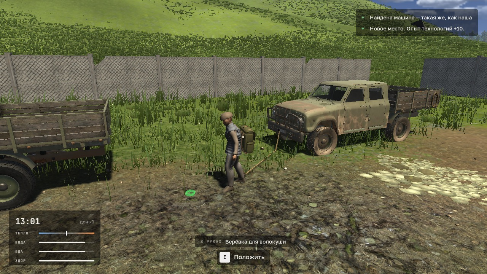

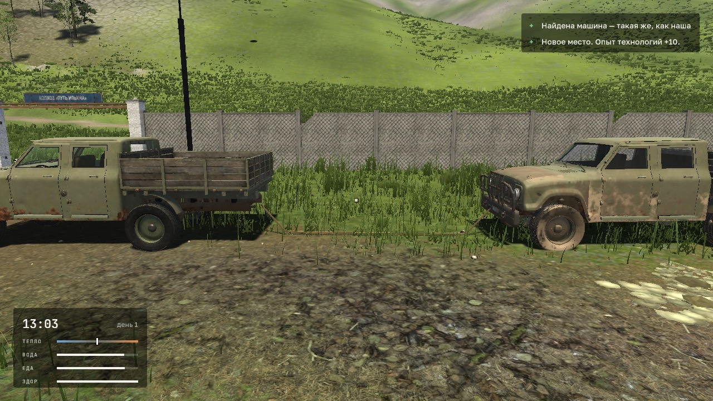

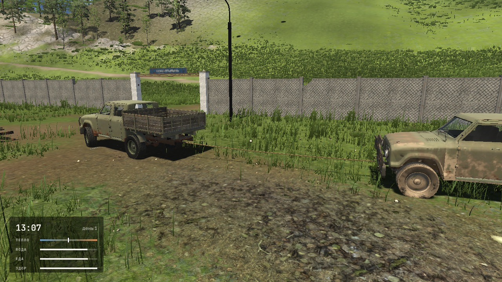

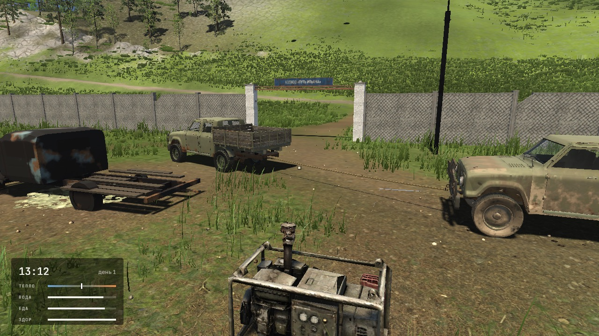

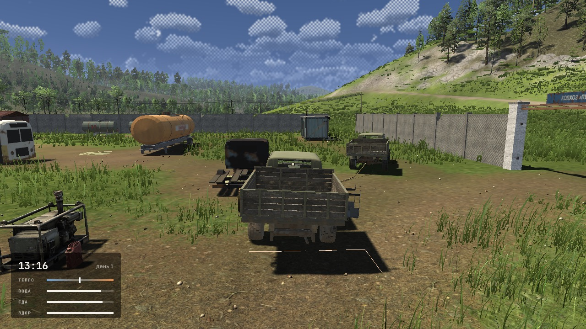

## 452. Износ и проколы по каждому колесу, замена колеса в поле, ремонт шин

03:00 · WHEEL · Колёса

Коммит: [bd339eb154](https://github.com/shsanek/EXEcutor/commit/bd339eb154)

Ветка: `claude/peregon-wheel`

У каждого из четырёх колёс свой износ и прокол: по дороге 0,2 % на км, бездорожье 0,6 %, пробуксовка добавляет; лысое колесо прокалывается намного чаще, на 98 % лопается. Пробитое или снятое колесо теряет сцепление, машину тянет в сторону. Замена в поле: домкрат, баллонный ключ и запаска (в руках, рюкзаке или кузове этой машины), машина стоит без водителя — 24 с; заклеить камеру на месте 50 с (латки и ТА-02). Снятое колесо — предмет (пробитое, лысое или годное). Рецепты: латки, заклейка колеса, винтовой домкрат (слесарный верстак), наварка протектора (гаражный пост), баллонный ключ (кузня). Домкрат, ключ и запаска лежат в гараже автобазы и колхоза; машина в депо найдена без заднего левого колеса. Удар набега приходится на ближнее колесо. Кооп: команда 30, протокол 47, раздел сохранения 278.

- ✓ Тесты: care, trucks_play, crafting, crafting_play, net, coop_audit, stations_play, fear_play, tow, gun_wear, loc, save
- ✗ Открыто: домкрат не поднимает машину, пробитое колесо не проседает, снятое не прячется (T-14); иконки колёс пока чужие

## 453. Дождь наполняет открытые бочку, ведро и котелок; новые канистры и бочки

03:05 · CAMP1 · Вода в лагере

Коммит: [9fccc7c60a](https://github.com/shsanek/EXEcutor/commit/9fccc7c60a)

Ветка: `claude/peregon-camp1`

Честный дождемер: 1 мм на 1 м² горловины = 1 л. Бочка без крышки (0,256 м²) за обычный дождь набирает около 6 л, за грозу 7,6 л; ведро 0,5–2,1 л; котелку нужно 75 мм. Закрытая канистра не наполняется, в доме тоже ничего. Рецепты: бондарная бочка (столярный, Т-1, 6 досок + 2 полосы), жестяная канистра (слесарный, ТМ-08 I, 3 лома), сварная бочка (металлообработка, ТМ-10, 2 профлиста). Иконки у ветоши и самодельных патронов. Фонарь на цевьё у других игроков светит из-под ствола. Раздел сохранения 283.

- ✓ Тесты: crafting, food, gun_wear_play, crafting_play, loc, cargo
- ✗ Открыто: бочки в кузове не ловят дождь; крыша постройки пока не укрывает (делает BUILD2)

## 454. Друг входит в игру, когда загружены 300 м вокруг, остальное догружается

03:10 · JOINEARLY · Ранний вход в кооп

Коммит: [392967f3b0](https://github.com/shsanek/EXEcutor/commit/392967f3b0)

Ветка: `claude/peregon-joinearly`

Хост шлёт куски мира от ближних к дальним; игрок входит, когда пришло всё состояние игроков, машин и бригады и все куски в радиусе 300 м (data/balance.txt). Появляется у ближайшей к бригаде найденной машины. Плашка «Можно играть · мир догружается N %». Хэши сверяются после полной загрузки. Время до игры (4 игрока, 2 машины, ~10 МБ колей, сеть 50 мс, 1 % потерь): было 10,8–22,4 с, стало 4,0–6,4 с; появление в 2,5–5,2 м от машины бригады вместо 1,7 км. Протокол 48.

- ✓ Тесты: joinearly (новый), net, net_world, trucks_play, respawn_play, coop_audit, coop_slots, coop_seats, net_menu, loc
- ✗ Открыто: не проверено в окне игры; вырубка и директор идут одним куском

## 455. Опыт навыков у каждого игрока свой

03:15 · SKILLXP · Опыт навыков у каждого

Коммит: [ef2d167165](https://github.com/shsanek/EXEcutor/commit/ef2d167165)

Ветка: `claude/peregon-skillxp`

Награду получает тот, кто сделал работу; изучение навыка тратит только свой опыт; экран навыков «Заработано вами N · потрачено M», всплывашка «+N опыта навыков». Опыт за вождение считается по водителю. Старые сохранения: каждому достаётся бывший общий кошелёк. Поздно вошедший получает 3/4 опыта самого отстающего. Раздел сохранения 285, протокол 50. Следствие: вдвоём всё дерево на одного игрока ~55 ч вместо ~27 (BA-8, вопрос владельцу).

- ✓ Тесты: skills_play (9), trucks_play, net_world, net, farm, coop_slots, coop_seats, coop_audit, fear_play, tech_play, save, balance_progression, skills, tech
- ✗ Открыто: решить темп дерева на игрока (BA-8); доля 3/4 — первая прикидка

## 456. Тесты стабилизированы, долгие прогоны без падений, docs/stability.md

03:20 · STAB · Готовность к тесту

Коммит: [fd3844dc1d](https://github.com/shsanek/EXEcutor/commit/fd3844dc1d)

Ветка: `claude/peregon-stab`

Было 22 падения из 127, стало 10 из 128 (8 давних, проверка скорости физики под нагрузкой и win32-шейдер травы). Исправлены нестабильные surface_stream, устаревшие ожидания character и порчи еды, тайм-ауты подняты в 1,5 раза, «XP» в баннере фермы → «опыта». Долгие прогоны: новая игра на сутки с 20 сохранениями и загрузками, ночь набега, кооп хост+клиент на 16× — всё восстанавливается точно, 85/85 сверок мира. Риски: паника всю первую ночь на лесопилке (8 жильцов), щука не лезет в стартовый рюкзак, медленные прогоны без экрана после езды — в работе у PT2.

- ✓ Тесты: полный ctest; повтор по затронутым после GP1–CAMP1
- ✗ Открыто: shaderc_tests: win32 vs_2_0 grass_card — 13 регистров при лимите 12 (не трогаем)

## 457. Урон от падения с высоты, «Верхолаз» и «Группировка», машина теряет фары и колёса

04:10 · FALLS · Падения и отлетающие детали

Коммит: [e2c26c5412](https://github.com/shsanek/EXEcutor/commit/e2c26c5412)

Ветка: `claude/peregon-falls`

Урон по скорости приземления: 1,3 и 2,4 м — 0, 4 м — 13, 6 м — 33, 9 м — 58, от 14 м — смерть «Вы разбились» (Warner &amp; Demling 1986, CDC 2012, Lapostolle 2005). Глубокая вода с 1,6 м вдвое гасит скорость (8 м в воду — 0), снег удлиняет торможение (1 м снега под 10 м: 7 вместо 67). Удар от 3 здоровья сбрасывает с лестницы. «Верхолаз» теперь работает, новая «Группировка» −30 %. Фара отлетает от удара с 8 км/ч, колесо с 35; при опрокидывании фара со стороны земли в 70 %. Фара — предмет, ставится за 12 с, новая на слесарном верстаке. Новая технология ТА-33 «Контровка крепежа». Команда 31, раздел 287, протокол 52.

- ✓ Тесты: falls_play (новый, 8), survival, skills, tech, crafting, care, loc, net, save, respawn, gunplay, combat, trucks_play, tow_play, coop_audit
- ✗ Открыто: потерянная фара и колесо всё ещё рисуются (T-16); зеркал нет (T-17); ТА-13 амортизаторы не подключены (делает NODES3)

## 458. Второй этаж, чердачный пол, плоская крыша, лестница, водосток; крыша укрывает

04:15 · BUILD2 · Второй этаж и крыши

Коммит: [943959091b](https://github.com/shsanek/EXEcutor/commit/943959091b)

Ветка: `claude/peregon-build2`

У элемента постройки этаж 0 или 1; стены ставятся на стены, чердачный пол ложится на стены, кровать на чердаке встаёт наверх. Новые элементы: чердачный пол П-046, плоская крыша, приставная лестница П-086, водосток П-049. Под крышей бочка не собирает дождь, под водостоком собирает много (2 мм дождя: 0 / 0,51 / 9,91 л). Под крышей вещи сухие, в закрытой комнате 0,9 °C при −25 °C без печки, страх спадает. Налётчики ломают крыши и перекрытия (60 % / 40 % прочности), киянка чинит. Отложенные П-строки с причинами — docs/build.md 13.6. Протокол 53.

- ✓ Тесты: build (17), build_play (4 новых), raid, coop_audit, loc, survival, play_care, net_world, zhiltsy_play, food_play
- ✗ Открыто: по скатной крыше не пройти, ступеней нет, только один верхний этаж, тепло комнаты постоянное (делает HEAT)

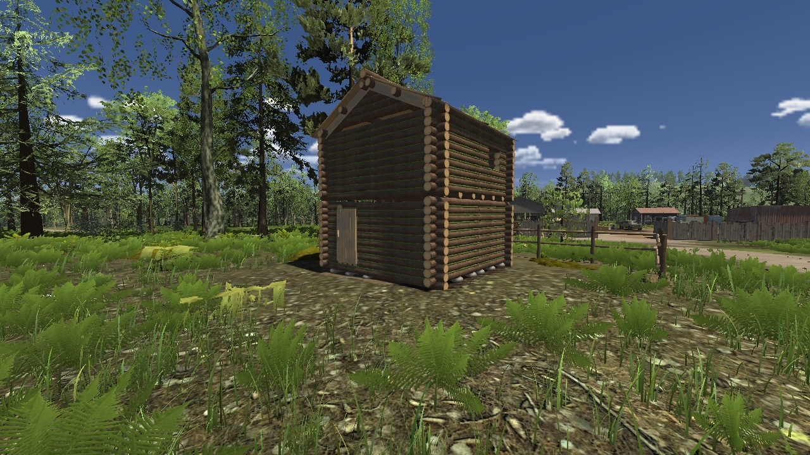

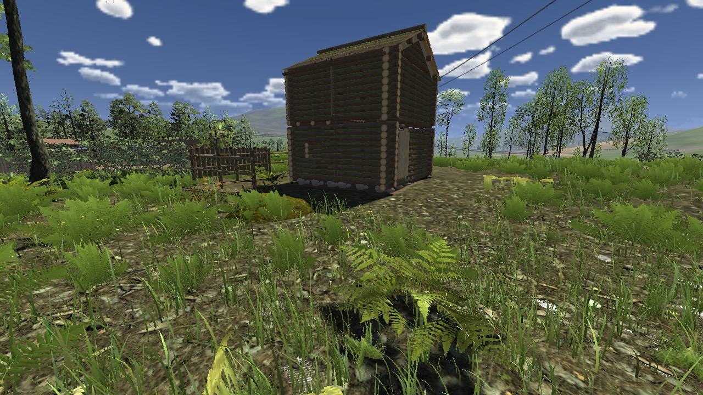

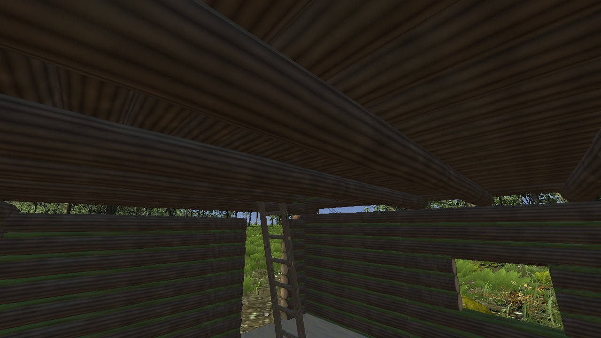

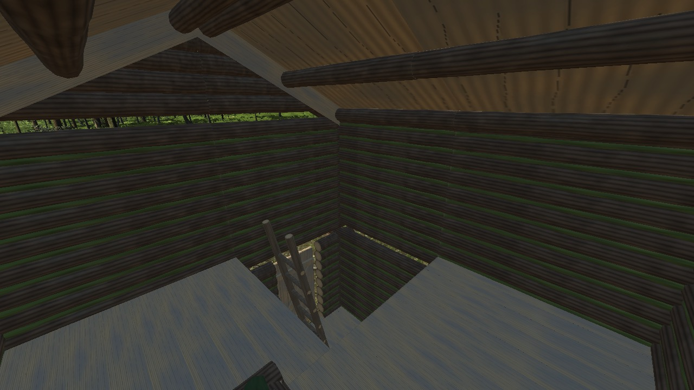

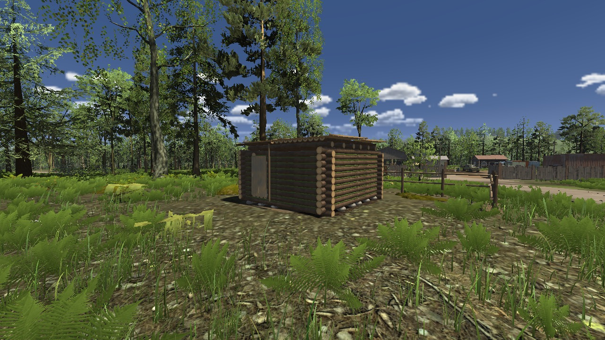

## 459. Инструменты у своей машины, чужая машина с грузом, лебёдка вытягивает машину, буксир идёт следом

05:00 · TRUCKN2 · Несколько машин

Коммит: [ffcddd9ff6](https://github.com/shsanek/EXEcutor/commit/ffcddd9ff6)

Ветка: `claude/peregon-truckn2`

Пешком игрок работает с машиной, которой занят, иначе с той, на которую смотрит в 3,5 м, иначе с ближней: подсказки, капот, бак, ящик под сиденьем, ремень, колёса, лебёдка, заводная ручка. Лопата, топор и пирамида помнят свою машину (раздел 288). Чужая машина рисуется со своей грязью, грузом в кузове и инструментом. Лебёдка сматывает трос между машинами: с 10,7 до 2,5 м за 52,8 с, машина из грязи вышла на 7,5 м, пик 36,3 кН. Пустая машина на буксире рулит по следу ведущей: на извилистой дороге 300 м, в среднем 0,22 м от следа, 0 ударов (с прямыми колёсами — застряла через 31 м, 6 ударов). Протокол 54.

- ✓ Тесты: tow (9), tow_play (8), trucks_play (16), coop_audit, coop_seats, coop_slots, net, net_world, save, loadout, woodcut, care, respawn, stations, zhiltsy_play, build_play, falls_play, loc
- ✗ Открыто: ферма, отвал, болото, термос и уход за телом ещё на первой машине (TRUCKN3); буксир задом не рулит (TOW7); play_cargo: модель ветоши вдвое больше данных (PT2)

## 460. Температура комнаты по теплопотерям, ступени, ходьба по скатной крыше, жёлоб в ведро

05:40 · HEAT · Тепло в постройках

Коммит: [d5a9ab30e3](https://github.com/shsanek/EXEcutor/commit/d5a9ab30e3)

Ветка: `claude/peregon-heat`

Каждая комната на каждом этаже держит свою температуру воздуха: потери через стены, крышу, пол по материалу, двери, окна, щели и люк на чердак, ветер усиливает; греют печь (heat_kw) и люди (75 Вт). Источники: EN ISO 6946/10456/13370/13786, ASHRAE, CIBSE. Изба 2×2 при −25 °C: закрыто без печки −22,9 °C, вчетвером −19,1; железная печь 6 кВт — 22 °C (15 °C через 3 ч, 59 % мощности); с открытой дверью −9,9…−14,4 °C; два этажа: низ 22, чердак 12 °C. Ступени П-010 в обе стороны. Скатная крыша: сухое бревно и доска проходимы, мокрая доска, жесть, снег и лёд — скатываешься. Жёлоб наполняет и ведро. Раздел 290, протокол 55.

- ✓ Тесты: build (22), build_play (27), net, play_care, net_world, fear_play, food_play, falls_play, play_water, combat, gunplay, save, survival, care, food, coop_audit, loc
- ✗ Открыто: нет утепления и дыма (INSUL); одна температура на комнату; ступени крутые (54°), NPC их не видят

## 461. Раны и кровотечение, перелом и шина, аптечка; амортизаторы гасят удары; аккуратный разбор

05:45 · NODES3 · Аптечка, амортизаторы, аккуратный разбор

Коммит: [454e6d6e8f](https://github.com/shsanek/EXEcutor/commit/454e6d6e8f)

Ветка: `claude/peregon-nodes3`

Удар от 10 вызывает кровотечение; мелкая рана останавливается сама, глубокая (от 20) — нет: 30 урона высасывают 70 здоровья за ~4 мин. Падение от ~5 м ломает ногу: без шины ×0,6 скорости, без бега, здоровье до 60, 120 ч; с шиной ×0,85, 36 ч. Бинт (швейная, 4 из ваты), шина (столярный), аптечка (бинты + шина + брезент); держать E на себе или товарище в 2 м. Источники: Stop the Bleed, ATLS 10, ICRC. ТА-13 амортизаторы: пик толчка при падении с 0,8 м 32,8 → 20,8 м/с², седока в кузове больше не выбрасывает. Н-06: без навыка каждый пятый разбор портит ремень или подшипник. Н-15 серый — нужен прицеп. Команда 32, раздел 289, протокол 56.

- ✓ Тесты: aid_play (новый, 7), survival (49), stations_play (23), skills, skills_play, falls_play, tech, crafting, vehicle, net, net_world, cargo, loc, save, coop_*
- ✗ Открыто: амортизаторы только у основной машины на третьем уровне

## 462. Страх первой ночи читаемый, рюкзак со щукой, точки жильцов, ускорение прогонов

05:50 · PT2 · Правки к тесту

Коммит: [4a99907764](https://github.com/shsanek/EXEcutor/commit/4a99907764)

Ветка: `claude/peregon-pt2`

Жилец пугает только в 40 м и при прямой видимости (постройки закрывают), несколько жильцов складываются с убыванием, взгляд даёт не больше 0,7; паника только от событий (жилец ближе 6 м, погоня, вой, крик, удар, товарищ упал), откат 90 с. Ночь у костра на лесопилке: средний страх 98 → 46 %, паник 14 → 0; в кабине 48 → 12 %; в тёмном дворе без огня — 85 %, сильные эффекты остаются. Ветошь у машины на земле, своя модель pva2_gun_rag; щука влезает в рюкзак. Пропавшая точка act_laundry_01 на элеваторе добавлена. Колеи стареют только в живых клетках: прогон 385 → 66 с, на 3 км 5 → 50–65 тиков/с, хэш тот же. Драйвер прогона садится в кабину.

- ✓ Тесты: survival, surface_stream, mud, cargo, poi, zhiltsy, character, lake, fear_play, food_play, play_cargo (66/66), gun_wear, coop_seats, coop_audit, aid_play, build_play
- ✗ Открыто: деревья и рельеф ещё не закрывают взгляд (RAID3); страх в кабине 12 % — вопрос владельцу

## 463. Плуг, отвал, болото, термосы и фары у каждой машины; буксир задом; трос за дерево

06:40 · TRUCKN3 · Вторая машина до конца

Коммит: [62cec64c85](https://github.com/shsanek/EXEcutor/commit/62cec64c85)

Ветка: `claude/peregon-truckn3`

Фермерские орудия, отвал, болото, термосы, подъёмник на лыжах и обогрев кабины работают с той машиной, у которой игрок. Буксир задом: пустая машина рулит назад по следу ведущей — отклонение 4,13 → 0,07 м, ударов 3 → 0; исправлена ошибка, когда на задней тормоз работал как газ. Конец верёвки обвязывается вокруг ствола: машина с лебёдкой на раскисшей грязи сползает 0,13 м вместо 1,72. У чужих машин горят фары и лампа в кабине, ближняя светит лучами. Раздел 295, протокол 57.

- ✓ Тесты: tow, net, build_play, bog, farm, winterplow, care, tow_play, trucks_play, fields_play, ski_play, play_care, save, net_world, coop_slots, coop_seats, food_play, aid_play — 18/18
- ✗ Открыто: срубленное дерево с верёвкой оставляет узел в воздухе (TOW9, делает COOPSWEEP); термосы в ящике второй машины не сохраняются

## 464. Конопатка, завалинка, обшивка, засыпка, тамбур, печная труба; угар в комнате

06:45 · INSUL · Утепление и дым

Коммит: [eb08c0a18f](https://github.com/shsanek/EXEcutor/commit/eb08c0a18f)

Ветка: `claude/peregon-insul`

Улучшения на готовую часть, удерживая E: конопатка глиной (утечка воздуха ×0,4), завалинка, обшивка досками по опилкам, засыпка опилками крыши и пола, двойная дверь с тамбуром, печная труба (металл: 2 трубы + глина; кирпич). Угарный газ по комнате от сожжённых дров (EPA AP-42: 115 г CO на кг): от 30 ppm кашель и нельзя спать, от 200 ppm теряешь здоровье и мутнеет, «Вы угорели». Изба при −25 °C: печь без трубы — 3813 ppm, смертельно за полчаса; печь с трубой — 22 °C, 8 ppm, 18 кг дров за ночь; утеплённая — 10,5 кг. Технологии ТС-10, ТС-11, ТС-36 открыты. Раздел 296, протокол 58.

- ✓ Тесты: build (25), build_play (29), tech, net, save, balance_progression, net_world, zhiltsy_play, progression_play, fear_play, trucks_play — 12/12
- ✗ Открыто: улучшения видны только в тексте; трубы в игре не осмотрены; разбор не возвращает материалы улучшений

## 465. Фаркоп, одноосный прицеп со своим кузовом, сцепка по E, задний ход с «Длинным кузовом»

06:50 · TRAILER · Прицеп

Коммит: [f2263f40ed](https://github.com/shsanek/EXEcutor/commit/f2263f40ed)

Ветка: `claude/peregon-trailer`

Фаркоп ставят на гаражном посту (ТА-21). Сломанный прицеп стоит во дворе автобазы, чинится E на дышле со сталью (ТА-22). Подать машину задом: подсказка показывает сантиметры до проушины, с 45 см E сцепляет. Кузов прицепа 4×6, до 600 кг. Разгон 0–30: 2,0 с без прицепа, 2,7 с с 600 кг. На карте 400 м — прицеп в среднем 0,02 м от колеи машины. Назад без навыка складывается через 7,5 м; с Н-15 «Длинный кузов» — 30 м, не больше 5,9°. Команда 36, раздел 300, протокол 59.

- ✓ Тесты: trailer (новый, 7), trailer_play (новый, 5), skills, tech, crafting, net, save, tow, tow_play
- ✗ Открыто: прицеп из коробок (новый арт не делаем); нового не построить; ТА-23 цистерна и ТА-24 роспуск — делает TRAILER2

## 466. Разрушенная база — охота на бригаду с видимыми отметинами, настоящая цистерна в депо, деревья и рельеф закрывают взгляд

07:20 · RAID3 · Набеги и цистерна

Коммит: [4ff1b64e5f](https://github.com/shsanek/EXEcutor/commit/4ff1b64e5f)

Ветка: `claude/peregon-raid3`

Когда от базы ничего не осталось, налётчики идут на бригаду в радиусе 400 м. Машине за ночь не больше 24 ударов, каждый шестой — видимая отметина: оторванная фара, порезанная шина, груз из кузова, вмятина. Износ за ночь ~1,3 % вместо 28 % (504 удара). Исправлено размножение выброшенного из кузова груза. Цистерна с соляркой в депо, 400 л: E у крана — в канистру ручным насосом 1 л/с, в машину шлангом 2 л/с, полна каждые 7 дней. Взгляд жильца закрывают постройки (PT2), рельеф (каждые 2 м) и стволы; страх первой ночи перемерен — совпадает с PT2 (у костра 46 %, в кабине 12 %). Налётчики замечают, открыта ли дверь избы. Протокол 60.

- ✓ Тесты: raid (9), stations (13), survival (50), net, fear_play, falls_play, zhiltsy_play (15), stations_play (24), net_world, coop_audit, build_play — 11/11
- ✗ Открыто: шланг и насос не нарисованы; дрезина проходит сквозь цистерну; игрок на втором этаже вне досягаемости набега

## 467. Всё новое за день проверено вдвоём; у каждого свой термос, трос слетает со срубленного дерева

07:40 · COOPSWEEP · Проверка коопа

Коммит: [03434233ea](https://github.com/shsanek/EXEcutor/commit/03434233ea)

Ветка: `claude/peregon-coopsweep`

Каждый термос принадлежит своему игроку: пить, печь, вода, рюкзак и рундук работают со своим. Термосы в рундуке второй и дальше машин сохраняются (раздел 310). Клиент знает, какая машина тянет подъёмник, и видит её обороты и бак. Таймер «не схватиться за лестницу» уходит клиенту. Срубленное или снесённое дерево сбрасывает трос, верёвка лежит у пня. Прогон хозяин + 2 клиента по сети (50±10 мс, 1 % потерь, 2 машины): трос, аптечка, дождь, опыт, падения, оружие — 0 расхождений состояния мира. Протокол 61.

- ✓ coopsweep_tests: 4/4, 84 проверки
- ✓ falls_play_tests: pass
- ✓ tow_play_tests: pass, дерево срублено → трос на земле
- ✓ net/save/coop ctest: 5/5

## 468. Прицепы на металлообработке, цистерна ТА-23 с насосом, лесовозный роспуск ТА-24, сетка кузова прицепа, колея

07:45 · TRAILER2 · Цистерна и роспуск

Коммит: [9bd5b02fa8](https://github.com/shsanek/EXEcutor/commit/9bd5b02fa8)

Ветка: `claude/peregon-trailer2`

Три рецепта: одноосный прицеп, цистерна, роспуск; до 6 прицепов на мир, любой к любой машине. Цистерна 500 л, одна жидкость: E у крана — канистра/бидон/бочка, пустыми руками — 50 л за нажатие из ёмкости керосина или реки (шланг 8 м), солярка в бак, полив грядок. С 500 л воды разгон 0–30 км/ч 2,62 с вместо 2,25. Роспуск: хлыст 6 м из трёх брёвен очищенного ствола, до 6 хлыстов/2 т; 200 м с 374 кг — складывание не больше 24,5°. Q у кузова прицепа — сетка груза с 4 ремнями; непристёгнутое лёгкое выпадает на кочках. Колея по грузу и грунту: 0 мм асфальт, 40 мм грунт, 240 мм грязь. Задние навесные орудия требуют фаркоп без прицепа. Протокол 62.

- ✓ trailer_tests: 9/9
- ✓ trailer_play_tests: 9/9
- ✓ save/net/crafting/tech/farm/woodcut: pass

## 469. Чек-лист пройден в настоящей отрисованной игре; четыре мелких бага исправлены, пять открытых переданы дальше

07:50 · PTRUN · Прогон чек-листа

Коммит: [11084bcc46](https://github.com/shsanek/EXEcutor/commit/11084bcc46)

Ветка: `claude/peregon-ptrun`

Скриптованный ввод в рендере (Metal, русский интерфейс): стартовый набор у машины, рюкзак 8 из 12, паспорт пилорамы ТМ-07, разбор 85 %, вода и бочка, изношенное ружьё и чистка ветошью, лаз на чердак и двухэтажный дом, две машины, буксир, замена колеса, печь, страх первой ночи у костра (30–58 %) и у машины (0–51 %), подключение второго игрока за 0,8 с с 49 совпавшими проверками мира. Исправлено: подсказка очистки стекла летом, «Окно» вместо печи (у окон не было коробки прицела), «Лукошко» → «Берестяной туесок», двойные скобки в баннере подбора. Открыто: −7 °C в избе после растопки, сообщения поверх заголовка инвентаря, сброс наклона камеры после F9, светлая бочка в низком солнце, inventory_tests — ими занят PTFIX.

- ✓ play_care_tests: 45/45
- ✓ build_play_tests: 29/29
- ✓ forage_play_tests: 13/13
- ✗ inventory_tests: 3 падения, были до PTRUN

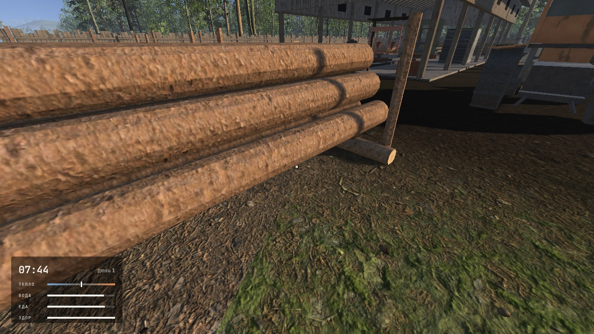

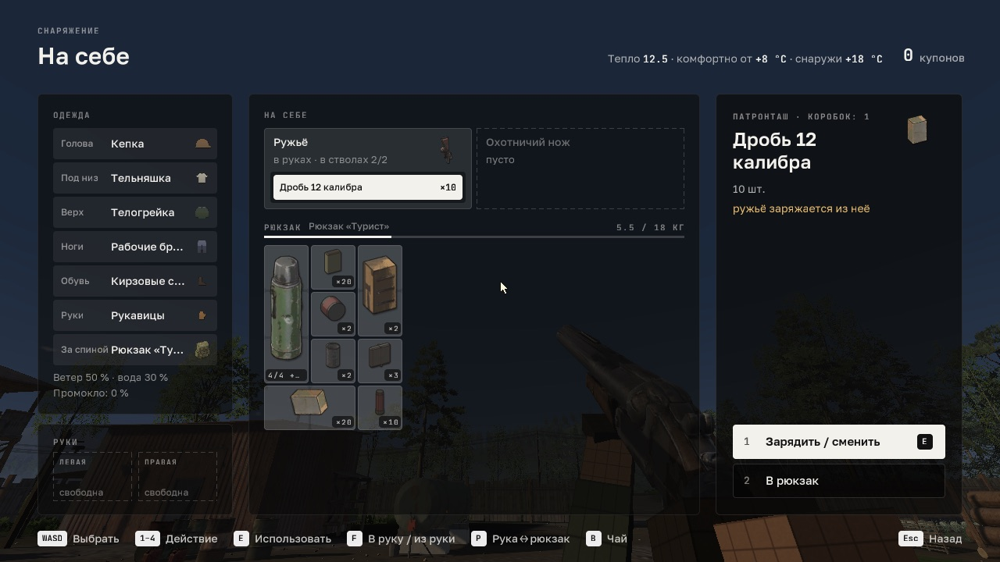

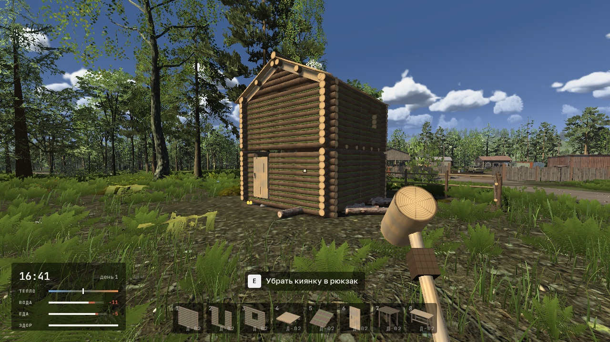

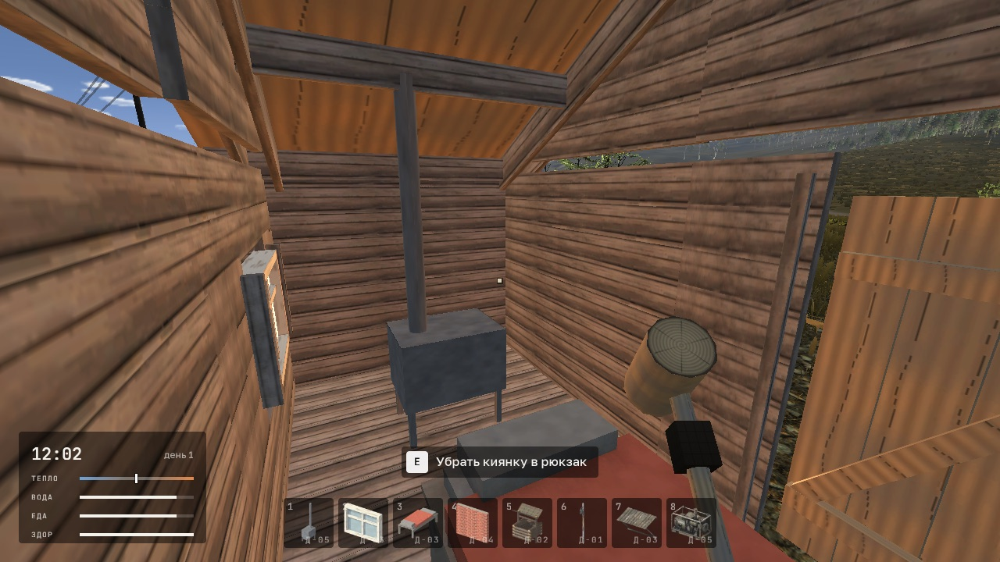

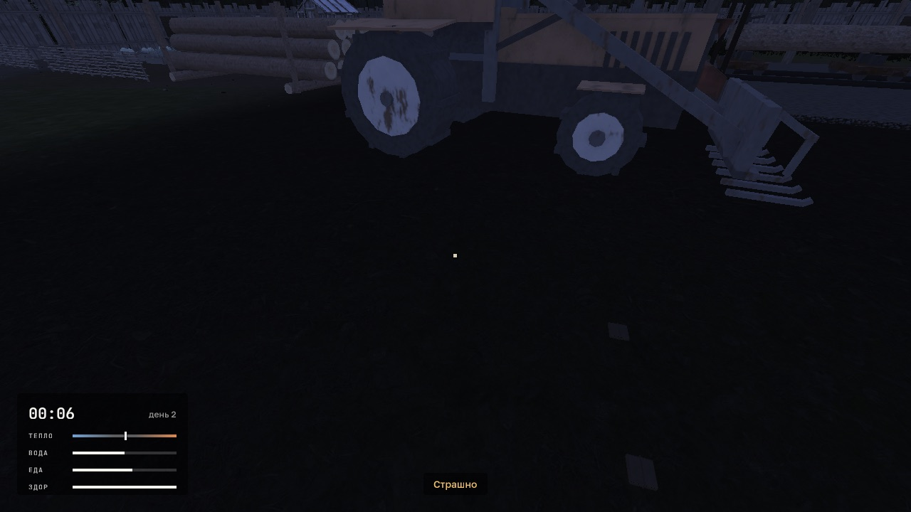

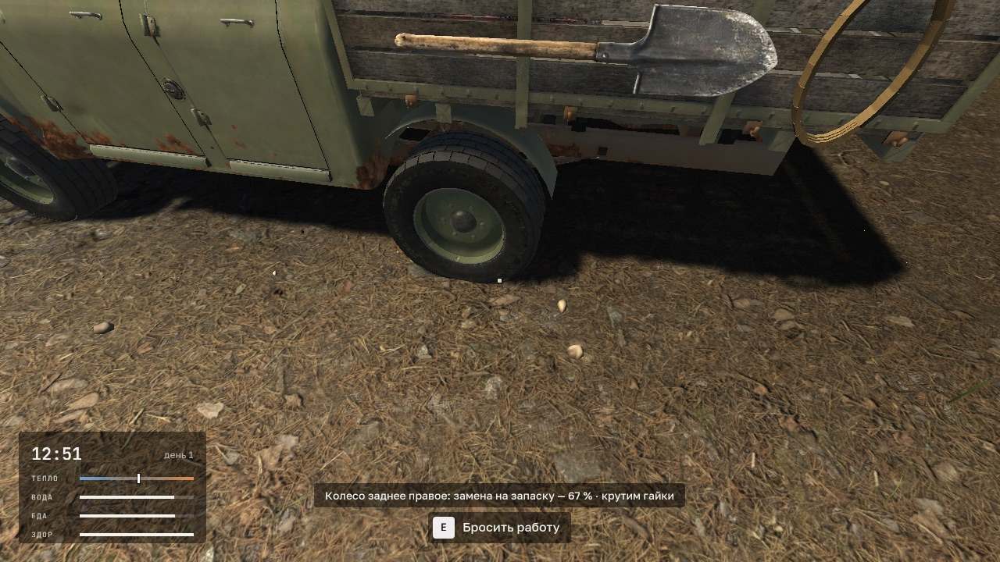

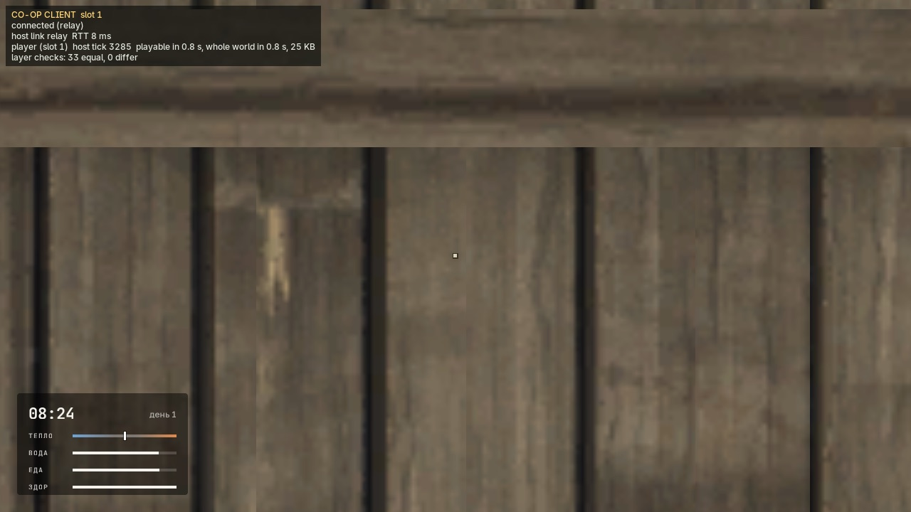

## 470. Жильцы идут на дым из трубы; смерть от угара видна у второго игрока

08:10 · SMOKE · Дым из трубы

Коммит: [4e5eb82e0f](https://github.com/shsanek/EXEcutor/commit/4e5eb82e0f)

Ветка: `claude/peregon-smoke`

Растопленная печь с трубой видна поселениям жильцов: днём до 700 м для печи 6 кВт, ночью ×1,5, ветер ±50 % по направлению, снег и дождь меньше, метель ×0,15. Каждые 6 игровых часов замеченного дыма приближают набег на день, но не съедают дни подготовки — разведчики и оба предупреждения остаются. В строке печи «дым из трубы видно за N м» / «метель прячет дым» / «жильцы чуют дым»; сообщения игрокам в 300 м с советом дать печи погаснуть. Изба в 402 м: в полдень замечена, в метель нет (105 м); в 901 м — только ночью. «Вы угорели» у клиента проверено по сети. Раздел сохранения 325, протокол 63.

- ✓ smoke_play_tests: 4/4
- ✓ zhiltsy_play_tests: 15/15
- ✓ raid/net/loc/save: pass
- ✓ coopsweep, trailer_play, falls_play: pass

## 471. Таблица оружия ближнего боя, ТО-01/02, фальшфейер ТО-19, стрельба с ходу Н-11

08:30 · COMBAT2 · Ближний бой и фальшфейер

Коммит: [c898a29b3e](https://github.com/shsanek/EXEcutor/commit/c898a29b3e)

Ветка: `claude/peregon-combat2`

Нож 22 урона/1,4 м/0,45 с, лом 35/1,8 м/0,625 с, серп 18/1,5 м, топор 38/1,9 м, лопата 28/2,1 м; у каждого износ за удар и блок. До этого ближний бой по жильцам вообще не наносил урона — теперь лёгкий и тяжёлый удары работают, блок R режет удар жильца. Износ снижает урон до 60 %, правка на верстаке слесаря (fb_whet). ТО-01 даёт древковым +0,3 м и ×1,25 тяжёлому удару, ТО-02 — ×0,85 время замаха и ×1,15 урон. Фальшфейер: 2 штуки из селитры, серы и газеты, горит 60 с, красный свет 30 м, жильцы не заходят в 18 м, страх падает в 15 м, метка видна всем до 3 км. Н-11: пассажир стреляет из своего ружья, разброс 0,04°/км/ч плюс тряска, узел вдвое меньше (40 км/ч по кочкам 3,4° → 1,7°). Раздел сохранения 320, протокол 64.

- ✓ melee_tests: 5/5
- ✓ combat2_play_tests: pass, жилец ушёл на 18 м от фальшфейера
- ✓ crafting/tech/skills/net/coopsweep/trailer/smoke: pass
- ✗ inventory_tests: 3 старых падения

## 472. Цистерна заправляется из вагона в депо, жидкость плещется, жильцы лезут на второй этаж

08:50 · HOSE · Цистерна, плеск, второй этаж

Коммит: [ade9194a57](https://github.com/shsanek/EXEcutor/commit/ade9194a57)

Ветка: `claude/peregon-hose`

У вагона-цистерны в депо пустые руки — E заливает солярку в прицеп ТА-23 (2 л/с, до 500 л; с водой или керосином внутри отказ). Неполная цистерна плещется: при торможении жидкость уходит на 23 см вперёд, тормозной путь с 30 км/ч 4,90 м пустой, 5,15 м половина, 5,49 м полная; колесо не отрывается. Налётчики поднимаются по лестнице (2,5 с) и приставной (4 с), закрытый люк выдавливают за 4 с, запертый ломают как дверь; поднятая лестница не пускает — 0 укусов за 300 с. Люк — улучшение П-010 на лестнице. Протокол 65.

- ✓ raid/trailer/build/net/save: pass
- ✓ build_play_tests: 31/31
- ✓ coopsweep_tests: 5/5
- ✗ trucks_play_tests: 17/18: плуг на второй машине у клиента — передано в BALFIX

## 473. Оружие напарника видно, хват из данных, общий износ топора и лопаты, фальшфейер на Shift+L, ружьё у пассажира

08:55 · COMBAT3 · Доводка ближнего боя

Коммит: [74f22c2283](https://github.com/shsanek/EXEcutor/commit/74f22c2283)

Ветка: `claude/peregon-combat3`

Аватары других игроков держат настоящее оружие с пояса (в руке или на бедре). Хват лома, серпа и ножа задан в melee.txt. Износ топора и лопаты общий на бригаду, старые сохранения берут наибольший. Shift+L зажигает фальшфейер из рук, второй руки или рюкзака (L — фонарь). Поднятое на пассажирском месте ружьё рисуется с отдачей и перезарядкой. Генератор выстрелов с места сохраняется. Раздел 345, протокол 66.

- ✓ combat2_play_tests: 11/11
- ✓ coopsweep_tests: 6/6
- ✓ melee/net/save: pass

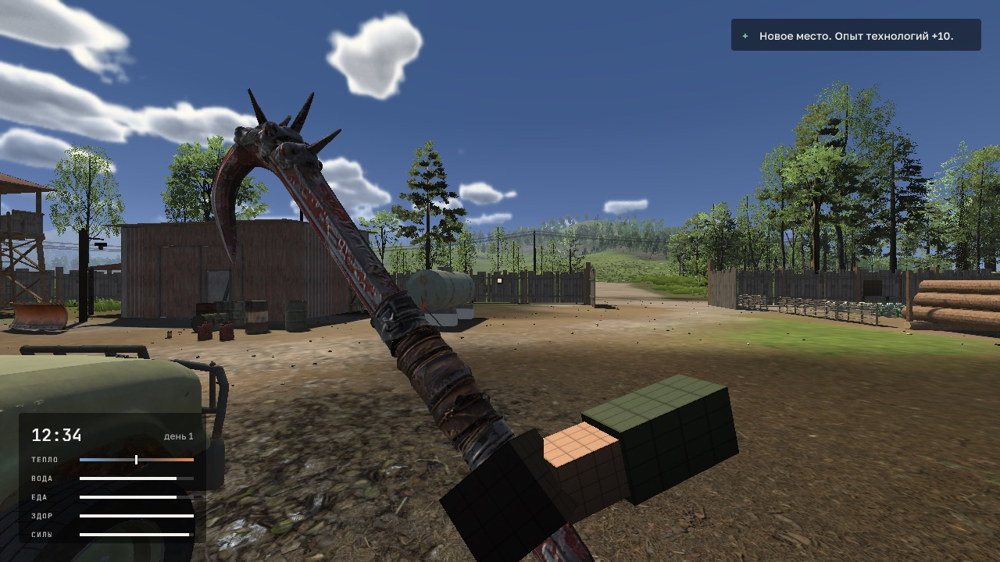

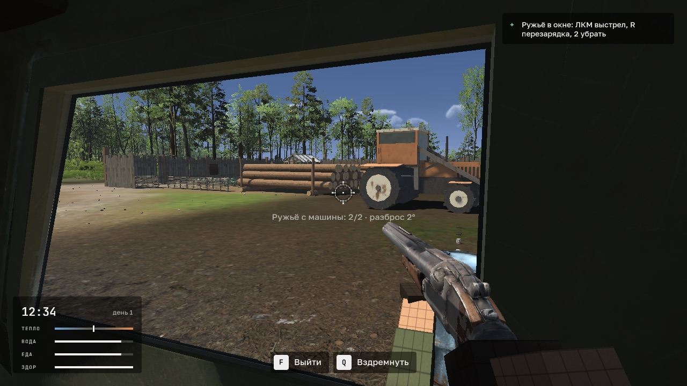

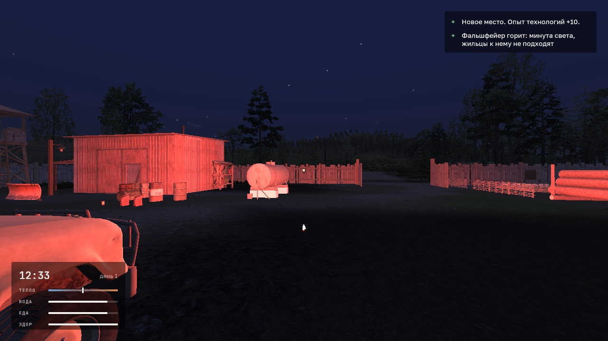

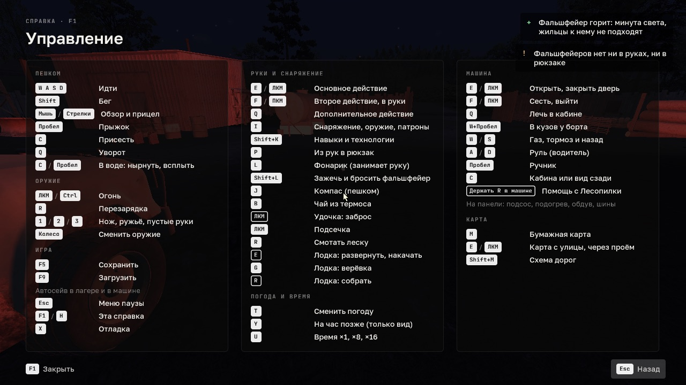

## 474. Игра разложена на этапы от старта до поздней игры: перевозки, тиры, навыки, угроза; найдены тупики и телепорты ресурсов

09:10 · STAGES · Игра по этапам

Коммит: [bc9172efaf](https://github.com/shsanek/EXEcutor/commit/bc9172efaf)

Ветка: `claude/peregon-stages`

Новый инструмент tools/balance/deps.py строит граф зависимостей из данных игры: самый ранний тир каждого предмета, рейсы, километры, солярка и время на 18 целей этапов. Этапы: первый час 0,3 т / 2 рейса; первый день 3,9 т / 7; первая неделя 63 км и 186 л солярки; середина 193 км и 572 л; поздняя 219 км и 646 л. Главные проблемы: солярка — настоящий ограничитель (одна цистерна в депо в 4,4 км), 46 ящиков лома ни на что не идут, резина/запчасти/ткань конечны, 16 рецептов открываются раньше своих деталей, скачок тира 250 → 1700. Найдено шесть телепортов ресурсов (эвакуация с кузовом и соляркой, рюкзак после смерти, крафт в кузов издалека, магазин через кузов, полка дома). Исправлено: газета теперь находится; навыки открываются клавишей 0, подсказка в HUD. Предложения S-01…S-18 — следующие задачи БАЛ5а, ТЕЛЕ1, ЖЛ1.

- ✓ balance_deps: pass
- ✓ loc/skills/tech/ui: pass
- ✗ balance_progression: 60,2 ч при лимите 60 — уйдёт с S-17

## 475. Ярусный лес за переключателем --forest, 78 референсов для Tripo, концепты жуков-захватчиков

09:30 · ARTFOREST · Ярусный лес и концепты жуков

Коммит: [9ba49e01cf](https://github.com/shsanek/EXEcutor/commit/9ba49e01cf)

Ветка: `claude/peregon-artforest`

Пока у ChatGPT Pro последние дни: 13 листов референсов для Tripo нарезаны на 78 отдельных объектов (9 пород в трёх возрастах, сухостой, кусты, пни, брёвна, 6 камней, грибы — мухомор, белый, подберёзовик, лисички, трутовик, — папоротники, черника, брусника, мох; развороты взрослых берёзы, сосны, ели и валуна). Кредиты Tripo не тратились. Ярусный лес: взрослые деревья 0,72–0,88 полной высоты (высоких 241 вместо 344 на гектар), 8 видов подлеска ~442 растения на гектар; FPS как у классического в пределах шума. По умолчанию classic до решения владельца. Концепты жуков: роевой, воин, таран, плевака; гнездо в трёх стадиях; гнёзда в тайге и на развалинах колхоза. Огнемёт ChatGPT рисовать отказался.

- ✓ nature_tests: pass
- ✓ forest_layered --check: OK
- ✗ полог сверху: реже, чем classic

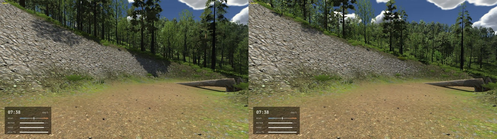

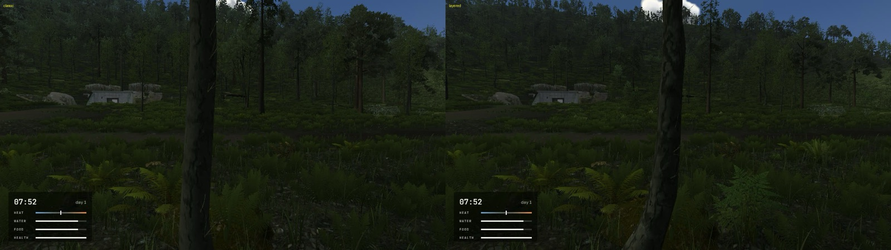

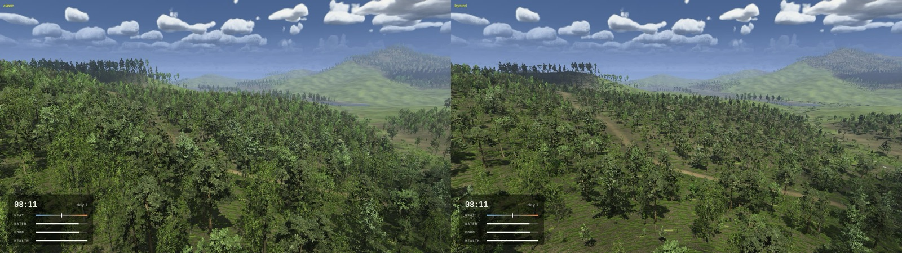

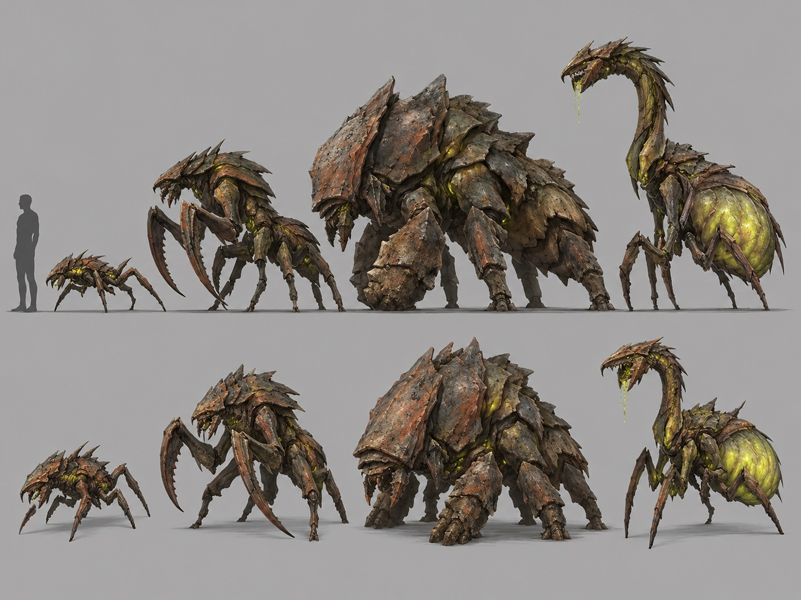

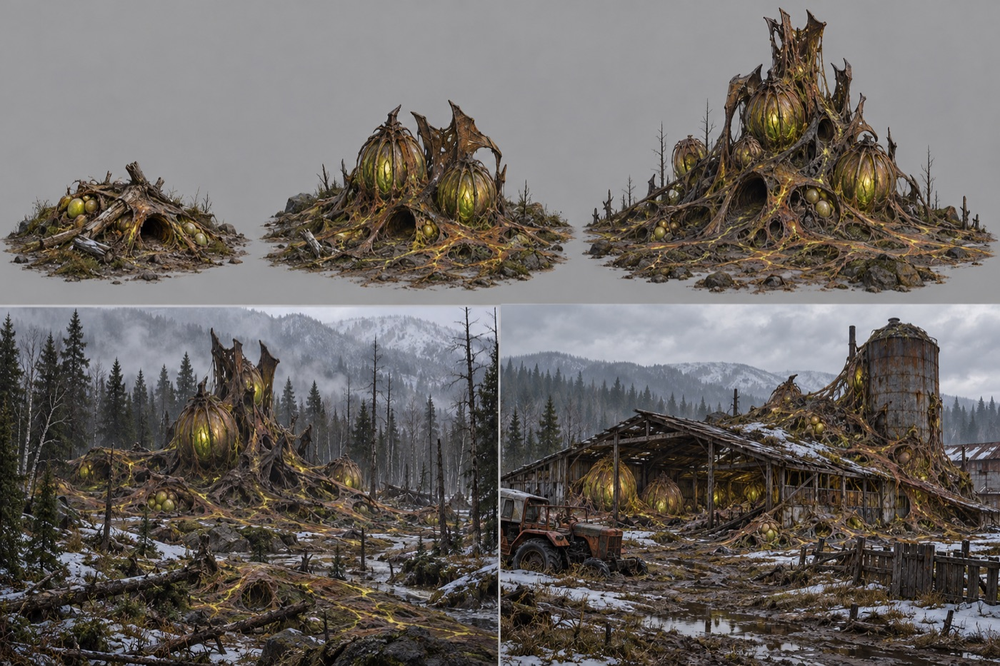

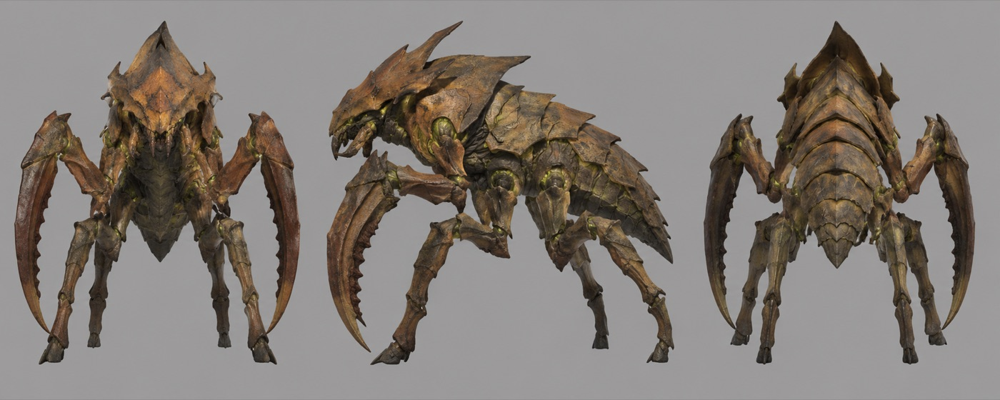

## 476. Лом в дело, склад ГСМ в колхозе, разборка машин и домов пополняется, тиры 1200/2400, дерево навыков 56 ч

09:50 · BAL5a · Первый ребаланс

Коммит: [2f44e10d6d](https://github.com/shsanek/EXEcutor/commit/2f44e10d6d)

Ветка: `claude/peregon-bal5a`

Мелкими шагами с прогоном deps.py после каждого. Ящики лома идут в кузницу и мехцех (нехватки 7 → 2). Склад ГСМ в колхозе 150 л с пополнением раз в 14 дней, слив топлива включён: первая неделя 1 рейс за топливом вместо 2 (9 мин вместо 37). Масло, антифриз, резина, запчасти, моторы, ткань снимаются с брошенных машин, ангаров и изб и появляются заново раз в 5 дней — нехватки 0, шины Т3 возможны. Т-3 1200 вместо 1700, Т-4 2400 (до Т-3 4,6 ч вместо 5,8). ТМ-05 на стол 3; рецепты закрыты, пока их детали недостижимы, станок называет нужный узел. Дерево навыков 56,3 ч. Логистика одного игрока: первая неделя 108 мин вместо 155, середина 517 вместо 588, поздняя 495 вместо 586.

- ✓ balance_progression, balance_deps: pass
- ✓ crafting/tech/skills/stations/save/loc: pass
- ✓ scrap_tests: 4/4
- ✓ stations_play_tests: 25/25

## 477. Звук установки постройки больше не зацикливается; сторож зависших звуков

10:10 · SND1 · Бесконечный звук

Коммит: [491a795996](https://github.com/shsanek/EXEcutor/commit/491a795996)

Ветка: `claude/peregon-snd1`

Причина бесконечного звука: списки звуков дерева, лопаты и воды очищались только при шаге мира, а звук читал их каждый тик и сеть пересылала их клиентам — пока мир стоял (пауза, настройки, загрузка, подвисание), последний звук установки повторялся каждый тик у хоста и клиентов. Старый код в тесте: 1248 звуков на 168 событий, 1080 из них на паузе. Ещё: шипение брызг и льда было бесконечной петлёй и забивало пул голосов; одиночные звуки отнимали голоса у петель; повторная команда запускала второй голос; клиент проигрывал запоздавшие звуки. Всё исправлено, добавлен сторож, который глушит петлю без хозяина и пишет его имя в лог. Тесты прогнаны по 10 раз; кооп по сети с задержкой, потерями и подвисаниями: 279 из 279 звуков, ни одного лишнего.

- ✓ audio_tests: 50/50
- ✓ build_play_tests: 32/32, 168 из 168 звуков, 0 на паузе
- ✓ coopsweep_tests: 7/7
- ✓ 10 повторов: одинаково зелёные

## 478. Повторяемый замер сети: рывки, рассинхрон, трафик и задержка на 4 профилях связи

10:40 · NET1 · Замер сети

Коммит: [9dc64b153c](https://github.com/shsanek/EXEcutor/commit/9dc64b153c)

Ветка: `claude/peregon-net1`

Хост + 2 клиента по настоящей петле, карта R1, 2 машины; сценарии: ходьба/езда, стройка, рубка, бой с набегом; профили: LAN, 50 мс 1 %, 120 мс 3 %, потери пачками. Рывков у клиента 663–726 в минуту, но игроки, машины и камера — только 2–33; основное — звери (~740/мин у клиента против 10 у хоста: интерполяция от тика хоста, а не от прихода пакета) и жильцы в набеге (2000–3200/мин; даже у хоста 743 — рисуется сырая симуляция). Предметы и прицепы ставятся из пакетов без интерполяции. Колеи забивают канал (очередь до 1 МБ, остальное опаздывает на 1–6 с). Состояние игрока шлётся целиком — ~700 Б за тик на клиента, половина трафика хоста (~169 КБ/с). Исправлен рассинхрон мира после колки (счётчик хешировался, но не передавался). Инструмент tools/net/netbench.sh, база baseline-net1.json — для замеров после каждого шага.

- ✓ netbench_tests: 4/4
- ✓ net_tests: 22/22
- ✓ coopsweep_tests: 7/7

## 479. ART2 pilot: Tripo Scots pine behind --forest tripo

00:51 · ART2

Коммит: [bae08c748f](https://github.com/shsanek/EXEcutor/commit/bae08c748f)

Ветка: `claude/peregon-design`

One mature Scots pine generated in Tripo Studio (80 credits: HD multi-view 45 + retopology 35) and imported by tools/import/tripo_trees.py: Tripo trunk and bark at our triangle budget, crown covered with our own needle cards (Tripo's solid foliage looked like plastic), LODs and billboard built. Launch with --forest tripo; classic and layered are unchanged. Tripo pine 4600/1854 tris vs 7483/3747, own textures 612 KB vs 3.4 MB, frame 21.7 ms vs 22.2 ms in dense pine stands. At eye level it looks like the current pine; from the air the crowns are rounder and lumpier. Verdict: not worth it for every species (foliage stays ours); worth it for dead/burnt trees, stumps, fallen logs and landmark trees. Recipe in docs/trees.md section 9.

- ✓ nature_tests: 30/30
- ✓ Tripo credits: 80 of 150

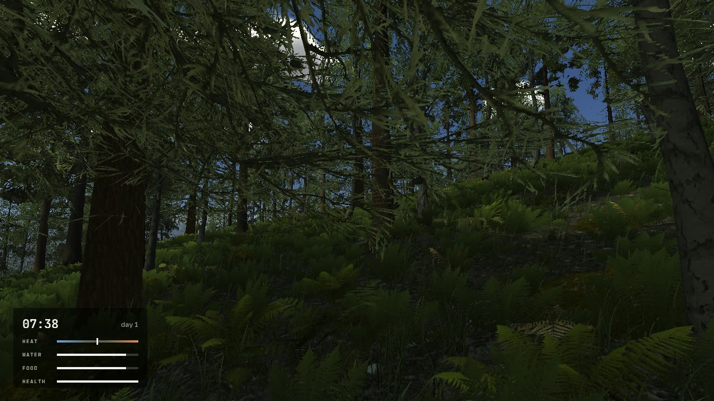

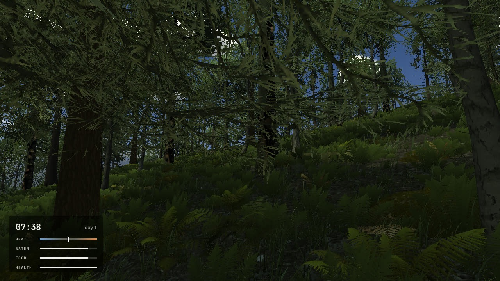

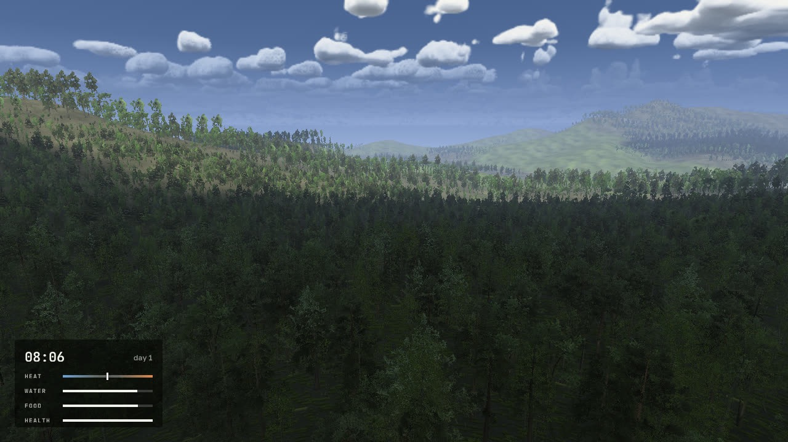

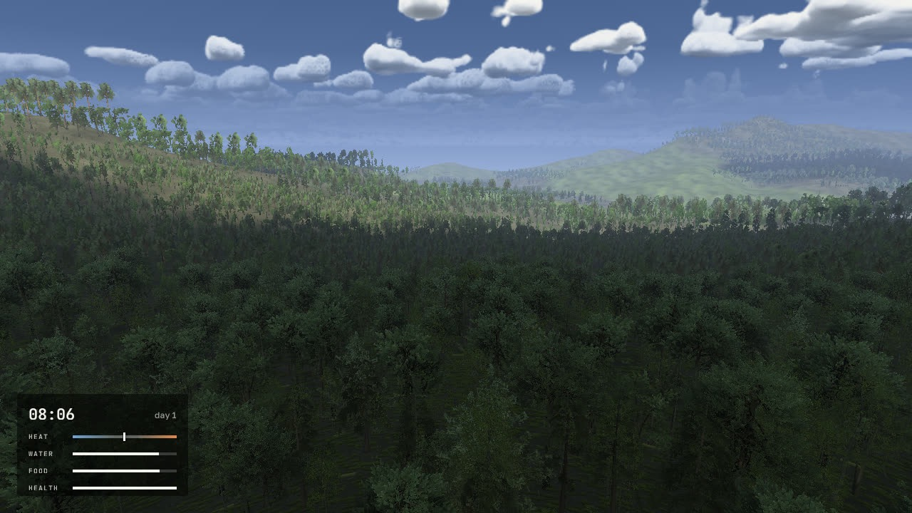

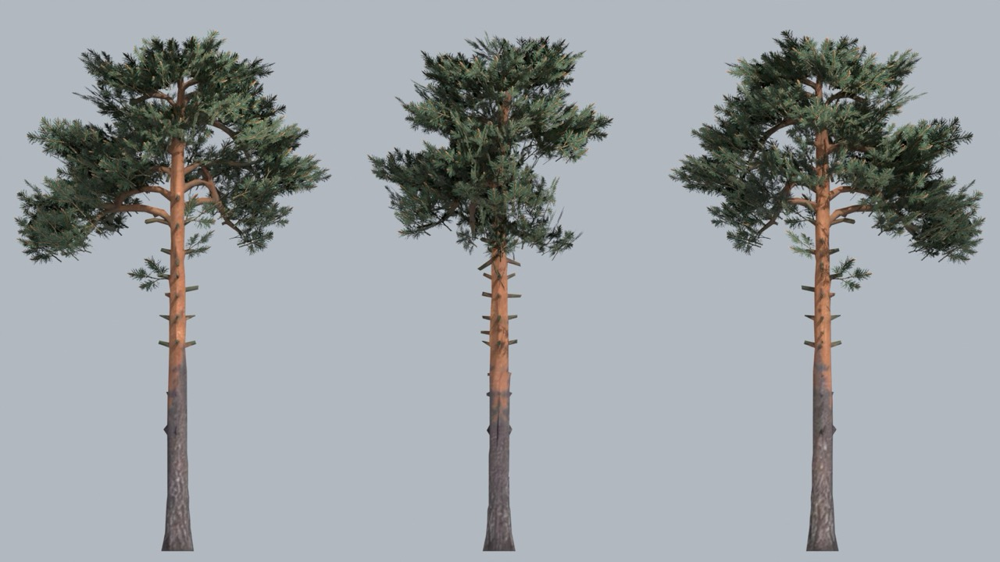

## 480. TELE1: no teleported items

01:30 · TELE1

Коммит: [263d6d74c7](https://github.com/shsanek/EXEcutor/commit/263d6d74c7)

Ветка: `claude/peregon-design`

All six teleport cases from docs/stages.md fixed. Rescue tow brings truck and bed to camp but no free fuel or coolant. On death the rucksack, hands and strapped tent stay on the spot as a death bag (X on the paper map, saved, any player can pick it up). Foraging and cooking with a full rucksack go to the bed only within 2.4 m, otherwise drop at the feet. Shops and receptions need the player at the counter and use the bed only with the truck within 25 m. Garage post and gun bench jobs pause while the truck or gun is away and resume with progress kept. The home shelf counter became one physical shelf filled once (3 oil, 2 antifreeze, bucket). Hands reach the bed from 3 m (was 9), warehouse auto-pull 15-20 m (was 30-45), a removed wheel goes to hands or ground. deps.py now fails balance_deps if a fixed case comes back. Leftover: T7 sawmill trader (screen cut, unreachable).

- ✓ care/respawn/food/lake/stations/cargo play: all pass
- ✓ net_world: 12/12
- ✓ coopsweep: 8/8
- ✗ trucks_play plough: pre-existing, fixed by BALFIX

## 481. BALFIX: owner play-test blockers BAL1-BAL3

02:00 · BALFIX

Коммит: [0354c80939](https://github.com/shsanek/EXEcutor/commit/0354c80939)

Ветка: `claude/peregon-design`

BAL3: in co-op a second crew truck stands at the start (trucks.txt [truck.start_crew], spawn spot checked for collisions); only the host creates it and clients receive it, which fixed a join desync on the truck/physics layers. BAL1: a broken station's status names where its missing parts lie and which tech is needed; the starting ground kit moves with the truck. BAL2: the wheel no longer dead-ends: tech ТА-02 at table 0, jack, wrench and 3 patches in the bed, any wheel fits any hub, a patched tyre wears at 0.9, spare wheels at wrecks and the kolkhoz. New Game::progress_check walks the tech tables and reports dead ends (only expected T3 ones remain). The plough test was fixed (it lacked a tow ball). Protocol 68.

- ✓ coopsweep: 8/8
- ✓ net_world: 12/12
- ✓ trucks_play: 20/20
- ✓ progress_check: 2/2
- ✓ stations_play / care_play: 25/25, 46/46

## 482. ZH1: base heat drives raids; many zhiltsy, but calm time to build

02:40 · ZH1

Коммит: [77c8b52894](https://github.com/shsanek/EXEcutor/commit/77c8b52894)

Ветка: `claude/peregon-design`

Each base keeps a heat value from real activity: running generator, machines and idling engine (1/h each), powered bench, lamps at night, a smoking chimney, built pieces, plus every gunshot (0.3) and felled tree (0.5); far sources count a quarter, heat loses 30% a day. Three heat levels show as a banner and a notebook line, no HUD meter. Threat = heat and days since the base; the raid interval shrinks from 11 days (cold) to 4 (hot), the first raid 6-9 days after the base is found, at least 3 quiet days after every raid, and the raid day locks once scouts appear so warnings always come. Raids grow up to 30 zhiltsy in waves of at most 8, 2-4 minutes apart, from different sides; tiers at day 10/36 make them bite harder, run faster and flank. A 70-day simulation for solo and duo crews meets every S-18 target for normal play; quiet crews fall below on purpose. Protocol 69.

- ✓ raid_tests incl. 70-day sim: 15/15
- ✓ zhiltsy_play: 15/15
- ✓ smoke_play co-op: 5/5
- ✓ coopsweep / net_world: 8/8, 12/12

## 483. GP2: tracking animals

02:48 · GP2

Коммит: [f37e19d1a3](https://github.com/shsanek/EXEcutor/commit/f37e19d1a3)

Ветка: `claude/peregon-design`

A tracking sense: every 2 s the game names the nearest unread sign with side and distance in steps; the noticing range grows with skill (7 m Read tracks, 13 m Tracker I, 20 m Tracker II) and prints of the animal you follow come first. New scent marks (wolf about every 450 m, fox every 150 m, three times as often in the winter rut), seen on snow, smelled downwind (urine 40 m, kill 90 m), each adds a notebook line; reading prints at sense 1+ tells which way the wind carries scent. Following one species' trail to the animal pays 10 xp per 100 m (trails 40-600 m), once per trail, effort only. Two new hunt skill nodes (tree 57 nodes, 18,550 xp). Sources cited in docs/fauna-research.md; smell distances are model values. Deterministic tracks, no protocol bump.

- ✓ fauna_tests: 37/37
- ✓ hunt_play_tests incl. co-op: 17/17
- ✓ skills / food / notes / save: pass

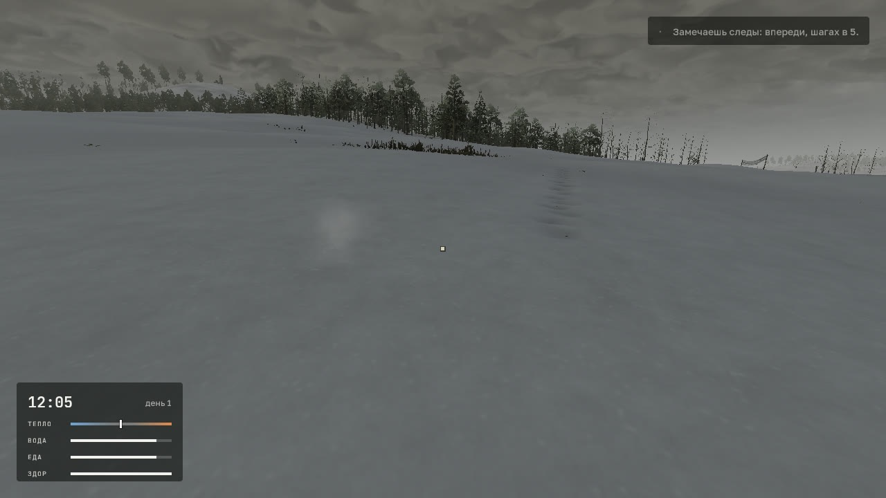

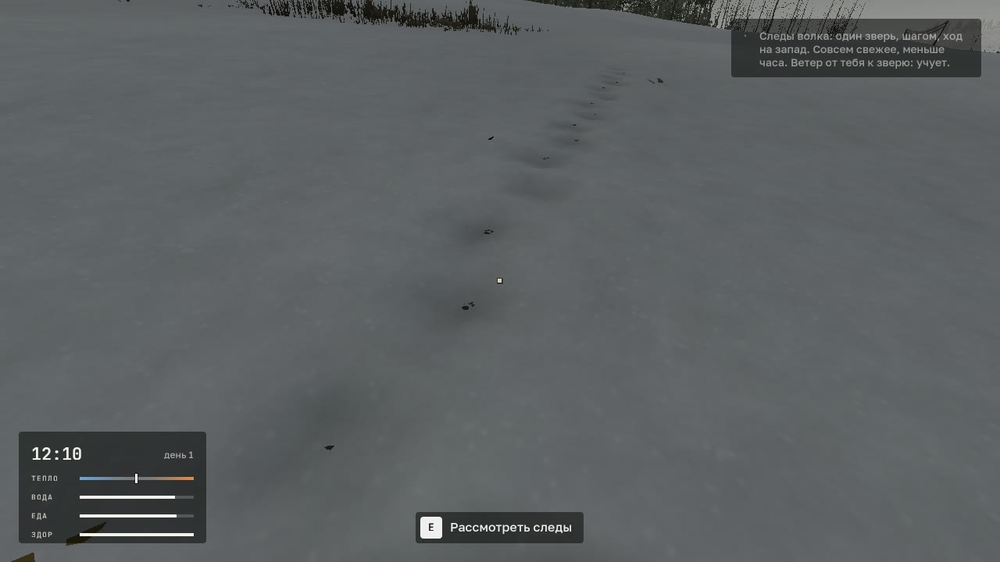

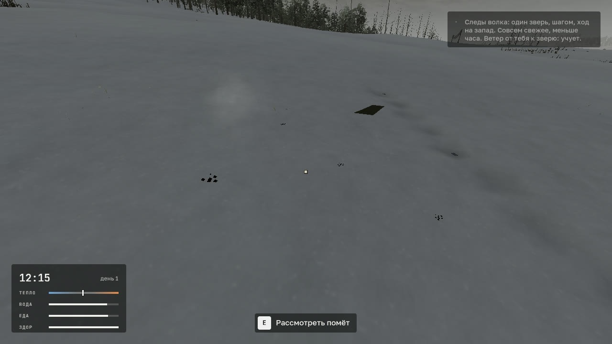

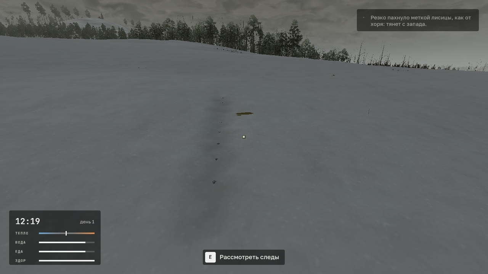

## 484. NET5: desync hunt — per-subsystem hashes that name the object and field

04:10 · NET5

Коммит: [d416e3d505](https://github.com/shsanek/EXEcutor/commit/d416e3d505)

Ветка: `claude/peregon-design`

The eight layer hashes are split into about 55 named subsystems (env, snow, ruts, cargo, truck, physics, world, players, water, glass, fauna and more). When one differs, the client asks the host for the recorded values and logs which subsystem, entity, field and both values differ, or that they converged; cost is bounded to one request per subsystem every 10 s. tools/net/desync_summary.py summarises a run. One real desync found and fixed: falling trees (the client plays the fall ahead; the hash now covers only stable fields while a tree is falling). Netbench wan50: 8 of 547 layer checks differed before, 0 of 555 after; 39 sweep mechanics show no other desync. Protocol 70.

- ✓ net5_desync_tests: 6/6
- ✓ coop_audit / coopsweep: 29/29, 8/8
- ✓ net_world / smoke_play / hunt_play: pass

## 485. NET2/NET3: smooth co-op — animals and zhiltsy from thousands of jerks to tens

04:20 · NET2/NET3

Коммит: [325ab61ebc](https://github.com/shsanek/EXEcutor/commit/325ab61ebc)

Ветка: `claude/peregon-design`

docs/net-plan.md collects the practice of Quake, Source, Overwatch, Rocket League, Rust, Valheim and Fiedler: clients show other objects slightly in the past and glide between snapshots, their own movement at once with quiet corrections. Animals, birds and zhiltsy now interpolate this way (also on the host, where zhiltsy jerked), props and trailers use the truck clock with capped extrapolation, the player state goes as a delta against the last acknowledged one (588 B to 21 B), and ruts get their own small budget behind every other stream. On a 50 ms link: client jerks 714 to 131 per minute, animals in a fight 4049 to 33, zhiltsy 2673 to 3.5, desyncs 14.7% to 0%, host upload 184 to 119 KB/s. Left: animals shown 0.3-0.7 s late while driving (aim at the past), own shot waits a round trip, ruts lag longer. Protocol 71.

- ✓ net_tests / netbench_tests: 22/22, 7/7
- ✓ net_world: 13/13
- ✓ coopsweep: 9/9

## 486. GP1: shooting from the truck, made discoverable

04:30 · GP1

Коммит: [98e8bafc6c](https://github.com/shsanek/EXEcutor/commit/98e8bafc6c)

Ветка: `claude/peregon-design`

A seated player with a gun gets a one-line hint worded for the seat (20 s after sitting and whenever a zhilets is within 50 m), three notebook lines and an F1 help entry. Every seat has a firing arc (front cab 15-150 deg to its side, rear cab 30-155, bed all but the nose, gun rest all round); outside it the crosshair turns red with the reason and a small top-down gauge shows the arc. Raising the gun winds the window down. The driver may shoot only when stopped (3 km/h or less; brake held, gun drops above 6 km/h). No mounted weapon: instead a welded gun rest in the bed (garage recipe behind ТА-21, 2 brackets and a hinge brought to the bay) lets a bed shooter fire over the cab roof with half the speed spread. Protocol 72.

- ✓ combat2_play GP1 tests: 5 new pass
- ✓ coop_seats / coopsweep: 26/26, 10/10
- ✗ combat2 hand-weapons test: broken by an earlier merge; fix-up running

## 487. PAR1/PAR2 step 1: job system and the first work off the main thread

04:40 · PAR1

Коммит: [30edb681a0](https://github.com/shsanek/EXEcutor/commit/30edb681a0)

Ветка: `claude/peregon-design`

Profile of a raid host with two clients: the busiest system was the windscreen fog (21% of the main thread), then vehicle physics 13%, HUD prompts 7%, network 6.6%, and switching between the two trucks 10-15%. New job system (cores-1 workers, per-frame graph, deterministic reduce, per-job RNG streams; --threads / PEREGON_THREADS). Fog maths rewritten bit-identically (21% to 7%), each client's network packing runs as a job, truck glass weather runs async and render waits for it. Headless raid host frame 10.6 to 7.8 ms average (p95 30 to 21 ms), main thread busy 82% to 60%; the rendered frame stays about 20 ms (present-bound). Same replay hash at 1 and 8 threads, co-op suites pass at both. Next (PAR1b, running): truck switching cost, read-only Game, simulation systems on jobs.

- ✓ jobs_tests: 7/7
- ✓ coopsweep 8 threads / 1 thread: 10/10, 10/10
- ✓ net_world / net5_desync: 13/13, 6/6

## 488. BAL5b: second rebalance step — fuel drum, salvage sources, workshop page

05:20 · BAL5b

Коммит: [d1f1488961](https://github.com/shsanek/EXEcutor/commit/d1f1488961)

Ветка: `claude/peregon-design`

A 200 l fuel drum: rolled on its rim, loaded by two players or the winch, filled from the tank-car hose and emptied with a hand pump at the tank filler (two at the kolkhoz fitter, one at the depot). Electronics salvage placed in R1 (substation house, elevator lab cabin), copper wire at substations, chemicals/saltpetre/sulfur in the lab and the railway bunker, window panes from izba ruins as one-time spots. Recipes can take a ready-made crate; craft lists hide recipes whose tech is switched off. A sixth notebook tab «Станки» lists every found station by place with distance from base and missing parts in red, the same for host and client. The rescue tow now costs game time (an hour of waiting plus the tow at 12 km/h). deps.py: dead ends 5 to 3, finite items 7 to 4, mid-game fuel runs 9 to 5.

- ✓ balance_deps / progression: pass
- ✓ drum_tests incl. co-op: pass
- ✓ scrap / crafting / stations / care play: 5/5, 10/10, 27/27, 46/46
- ✗ play_cargo aimed bed cell: pre-existing, assigned

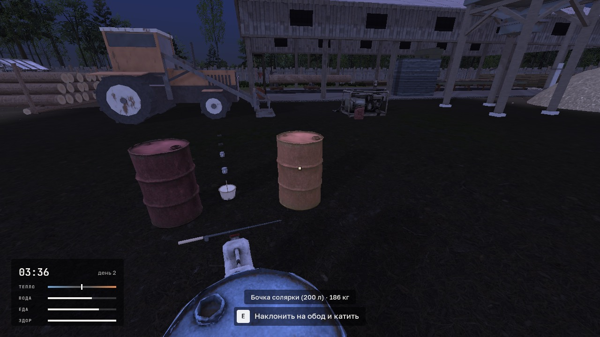

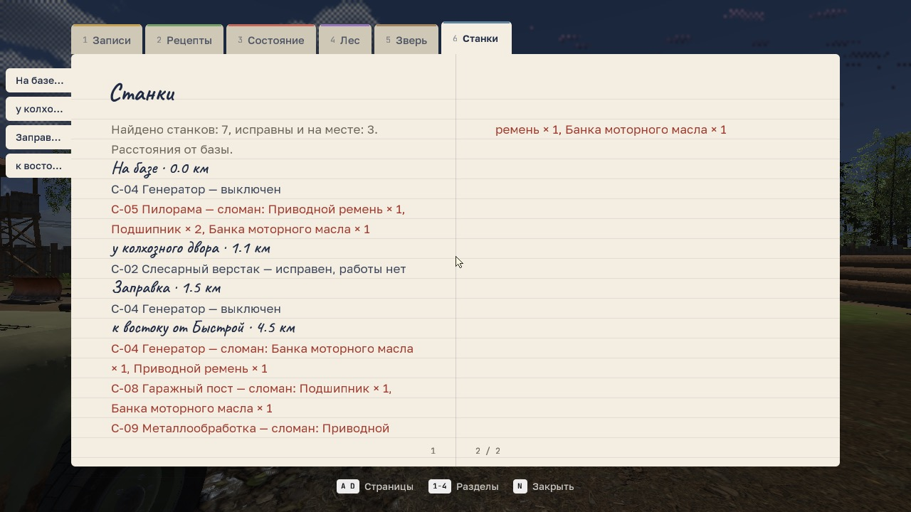

## 489. Fix: crowbar and shots hit zhiltsy where they really are

05:15 · GP1FIX

Коммит: [e34e311580](https://github.com/shsanek/EXEcutor/commit/e34e311580)

Ветка: `claude/peregon-design`

After NET2/NET3 the zhiltsy figures returned smoothed render poses, which trail the real ones, and melee strikes and the shot hit test checked against them, so blows missed walkers within reach. Gameplay hit tests now use the real positions; only drawing uses the smoothed ones. Also fixed: boarding the rear-left seat pushed the body 1 cm through the cab's back wall since a 2026-10-17 animation re-bake; the move back to the seat now starts after the turn.

- ✓ combat2_play: 16/16
- ✓ zhiltsy_play: 15/15
- ✓ view_tests: 70/70

## 490. NET4: own shot at once, hits on what you saw, steadier clock

06:10 · NET4

Коммит: [0691152bb1](https://github.com/shsanek/EXEcutor/commit/0691152bb1)

Ветка: `claude/peregon-design`

The playout clock caps how far back each class is shown (animals 14, zhiltsy 10, props 10 ticks) and speeds up or slows down instead of stepping back; clock resyncs per session went from about 120 to 0, animals while driving are shown 10 ticks late instead of 40. The host judges a client's shot against where animals and zhiltsy were when that client saw them (up to 36 ticks back). The client plays its own shot at once (sound, smoke, tracer, hit marker) while the host still decides damage: shot visible to the shooter 90 to 12 ms. Rut chunks wait until they stop changing (rut traffic in a fight 10.4 to 5.5 KB/s, longest rut lag 70 to 34 s), and props and trailers no longer jump after packet loss. Client jerks on a 50 ms link 131 to 41 per minute, 0 differing checks. Protocol 73.

- ✓ netbench_tests incl. lag-comp test: 8/8
- ✓ net_world / net5_desync: 13/13, 6/6
- ✓ combat2 / zhiltsy / hunt play: 16/16, 16/16, 17/17
- ✓ coopsweep: 10/10

## 491. PAR1b: truck switching nearly free, fog of every truck on threads

06:30 · PAR1b

Коммит: [89f8fa9a42](https://github.com/shsanek/EXEcutor/commit/89f8fa9a42)

Ветка: `claude/peregon-design`

Switching the simulated truck copied about 200 KB (dirt arrays and history ring) several times per tick; they are now held by pointer and a switch moves about 15 KB: 13% of the host main thread down to 0.7%. A headless host skips building HUD prompts (11% to 1%); a rendered HUD casts each truck ray once per frame. The windscreen fog of every truck runs in one parallel job pass. Headless raid host at 8 threads: main thread busy 78% to 50%, frame p95 27.8 to 17.8 ms. Same replay hash at 1 and 8 threads; co-op suites pass at both. 35 const methods still switch trucks: next step PAR2.

- ✓ replay hash 1 vs 8 threads: identical
- ✓ coopsweep 8 / 1 thread: 10/10, 10/10
- ✓ trucks / seats / care / combat2 play: all pass

## 492. BAL5c: third rebalance step — nothing runs out for good

07:00 · BAL5c

Коммит: [98918e8b6b](https://github.com/shsanek/EXEcutor/commit/98918e8b6b)

Ветка: `claude/peregon-design`

Truck batteries can be rebuilt or assembled at the garage bay from lead and sulfur; lead comes from the cable sheath at the substation; smokeless powder at the gun bench; fired hulls already return. Canvas robe and leather jacket now take part of a bite or a zhilets hit (0.25 and 0.4, up to 0.6). Plank bunk and yard bench open at tier 1 with the saw. The balance tool now reads what the real salvage roll places (salvage_placed.txt, kept up to date by scrap_tests), which revealed the late game at 866 minutes because R1 holds almost no ready steel (fixed by BAL5d). Depot is a named map point; found stations show on the paper map; notebook sections cycle with Q.

- ✓ balance_deps / progression: pass
- ✓ scrap / crafting / stations / food play: pass
- ✓ coop_audit: 29/29

## 493. COOPSWEEP2: every co-op sweep row passes

08:00 · COOPSWEEP2

Коммит: [285eb1ad20](https://github.com/shsanek/EXEcutor/commit/285eb1ad20)

Ветка: `claude/peregon-design`

About 30 rows of the co-op mechanic sweep failed while host and clients agreed. Most were timing: scripts started before clients became playable under load, so the sweep now waits for every client. Stale scripts were updated to the new rules (techs, counter range, real cargo). Real bugs fixed with a regression test each: a carcass in the bed unloaded as cargo and lost its hunt record; walking into a ruins complex from outside did not load its walls; no prompt at the shut tailgate; E at a raided garden bed started digging a field; raid damage hashed differently on host and client. Result: 53 scripts, 235 rows, 0 failing, 0 differing checks.

- ✓ coopsweep: 10/10
- ✓ play_cargo: 67/67
- ✓ hunt_play / scrap: 20/20, 7/7

## 494. RAIDCFG: base noise switch and raid frequency setting

08:30 · RAIDCFG

Коммит: [123adebb47](https://github.com/shsanek/EXEcutor/commit/123adebb47)

Ветка: `claude/peregon-design`

Owner request. Settings → «Погружение» → «НАБЕГИ»: «Шум базы» on/off (off: activity adds no heat, raids follow days only) and «Набеги» Выкл / Редко ×0.5 / Норма / Часто ×1.5 / Много ×2 (scales time between raids and raid size; Выкл stops raids, scouts and warnings). The host's settings are authoritative, clients see them read-only; saved with the world, old saves load as on/normal. Solo, 70 days: noise on 12 raids, off 6; Редко 6, Много 15 with raids up to the 30 cap. Backlog: a new-game screen, a higher cap for the top steps.

- ✓ raid_tests: 16/16
- ✓ immersion_tests: 12/12
- ✓ smoke_play co-op: 6/6

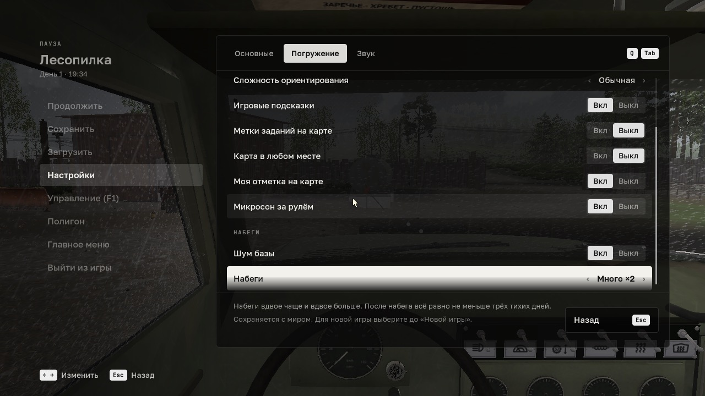

## 495. BAL5d: endless diesel at the roadside station, steel for the hangar

08:40 · BAL5d

Коммит: [689b727b37](https://github.com/shsanek/EXEcutor/commit/689b727b37)

Ветка: `claude/peregon-design`

Owner request: the roadside filling station now has an underground tank that never runs dry; the prompt only says «Солярка в подземной ёмкости АЗС», with no litres and no hint that it is endless. Jerrycan by hand pump, truck, bed drum and tank trailer by hose, same for co-op guests. Building steel is now part of the world salvage roll ([metal]): bundles of rod by the wrecked platform, roofing sheet stacks, rusty garages, pipe racks at the depot and mine, beams at the dump — about 12 rod bundles and 4 sheet packs in Zarechye, respawning after 5 days when nobody is near. The hangar still needs the mine smelter. Modelled late game to the hangar: 866 → 475 minutes of play.

- ✓ balance / stations / drum ctest: 5/5
- ✓ scrap / stations_play: 7/7, 28/28
- ✓ coopsweep / progress_check: 10/10, 2/2

## 496. LOOT1: found items lie in natural places, not in rows

10:45 · LOOT1

Коммит: [6c19ffc660](https://github.com/shsanek/EXEcutor/commit/6c19ffc660)

Ветка: `claude/peregon-design`

Owner request. The world roll still decides what each place holds, so items, counts and balance are unchanged; then each item moves to a natural nook of its building by size: small things on shelves and tables, middle things on tables, heavy things and crates on the floor along walls or on the ground by wrecks and behind houses, belts, wire and hose on nail boards. An item is placed only where it rests on a surface, touches nothing and can be taken with E. Buildings with nothing to put things on get simple shelves, racks, nail boards, crate stacks and plank tables (plain boxes for now). R1: 74 of 107 caches in nooks; 42 of 84 station starting items now on a bench, shelf or rack (jack and battery on the motor depot rack). Seeded and identical for every co-op player (60 ms, 2% loss: no differences). Still in rows: start-ground items, the zhiltsy raid drop, station items with no building around.

- ✓ scrap_tests: 11/11
- ✓ stations_play / poi / contracts / cargo: pass
- ✓ coop_audit / net_world / coopsweep: 29/29, 13/13, 10/10

## 497. Concept art: four rugged men as the new player characters

10:45 · PLAYERART

Коммит: [-](https://github.com/shsanek/EXEcutor/commit/-)

Ветка: `art`

Owner request: harsher, rugged player characters to replace the current one (every player now uses the bandit Mikhalych model). ChatGPT, same style as the approved bug key art: Tikhon (~55, foreman, fur ushanka, quilted coat, bug-shell breastplate), Arseniy (~42, lean hunter, fur-and-canvas anorak, shell plates), Gleb (~33, big mechanic, army jacket, welding apron, kerosene can), Savva (~62, trapper-medic, sheepskin, shell shin guards). For each: front/side/back turnaround ready for Tripo, a separate gear sheet and a face sheet; plus two key arts. Waiting for the owner's verdict before Tripo.

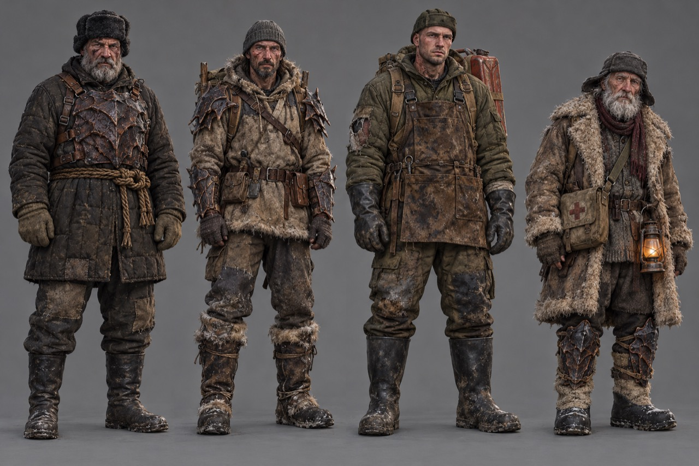

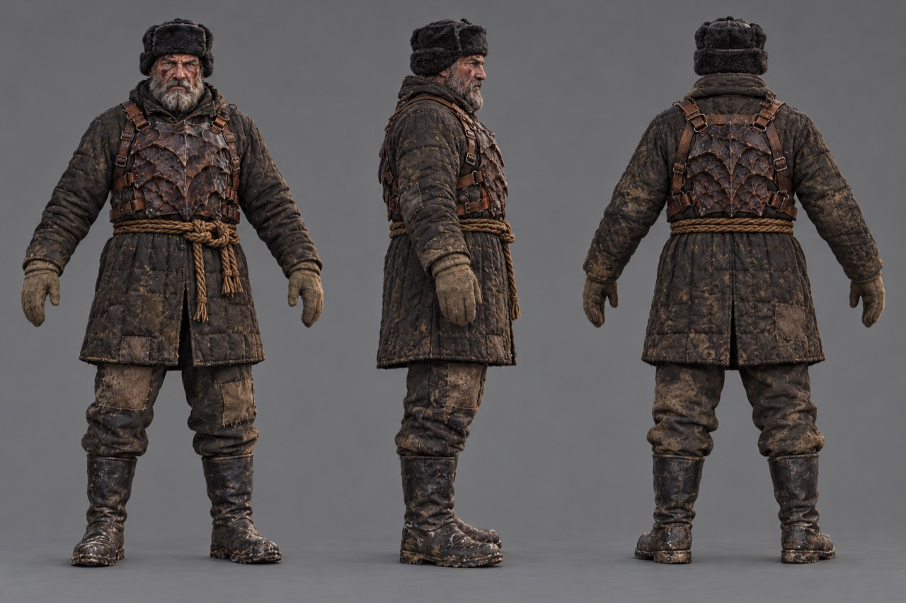

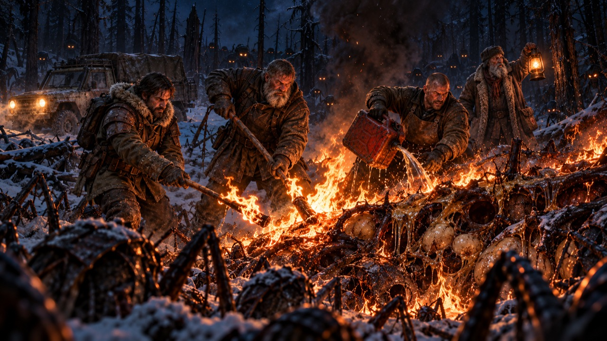

## 498. PAR2: simulation and frame preparation off the main thread

12:30 · PAR2

Коммит: [d072f076b3](https://github.com/shsanek/EXEcutor/commit/d072f076b3)

Ветка: `claude/peregon-design`

Reading another truck's or player's state no longer switches the current truck or slot: all 35 such read-only methods go through thread-local views, so on a raid host the count of these switches went from ~120k per run to 0. Host stream collection runs one job per stream, truck boxes for walking and truck dirt run on jobs, and the render frame and view layers are prepared on a job after each tick. Headless raid host at 8 threads: frame 6.8 → 5.8 ms, p95 18.7 → 14.1 ms; rendered host 25.2 → 23.6 ms (present still paces the frame). Replay of 7200 ticks gives the same hash at 1 and 8 threads, co-op fight sweeps 0 differing checks. Next: thread-safe surface reads, overlap client packing with render, HUD/map/audio inputs into the snapshot.

- ✓ replay hash 1 vs 8 threads: identical
- ✓ coopsweep / net_world: 10/10, 13/13
- ✓ ThreadSanitizer coopsweep: only the known random_u64 race

## 499. TESTFIX: four failing suites fixed, two of them real game bugs

12:35 · TESTFIX

Коммит: [b541e70ed0](https://github.com/shsanek/EXEcutor/commit/b541e70ed0)

Ветка: `claude/peregon-design`

Glass weather: with truck dirt off, seven shader registers were never set (a real device would read stale values) — now zeroed. Co-op save with a cart: on a world reset the host added the crew truck before the found trailers while clients add it after, so the client's cart received the crew truck's physics body about 1.7 km away — the order is now the same. Two co-op tests were updated to the crew-truck rule. tow and joinearly failures were machine-load flakes. Open: the truck 2 winch pulls a stuck truck out worse than documented (slide 1.69 m vs 1.5 m; suspect: start items on one side of the bed), shader grass_card needs 13 temps on vs_2_0, three render checks with unbound slots.

- ✓ glass_weather: 19/19
- ✓ respawn_play / trailer_play: 6/6, 10/10
- ✗ tow_play winch: open

## 500. ZB1: living bug nests — growing, pulsing creep that burns

12:40 · ZB1-CREEP

Коммит: [076f4a6a20](https://github.com/shsanek/EXEcutor/commit/076f4a6a20)

Ветка: `claude/peregon-design`

Owner request. Three nests in R1 far from the Sawmill (the ruin, the farmstead, the hut) grow in stages over game days (6× faster for play-testing). Nests are assembled from objects — mound, spawner pods, egg clusters, hive tower, tunnels — and the creep is procedural: crust and veins grow over the ground and over building walls and floors, the pulse travels out from the centre in the shader, dark olive by day with a faint glow at night. The creep mesh is built on a worker thread only near players (ruin: 5178 triangles near, 1222 far, 0.4 ms off the main thread). Pour kerosene on the creep and light it with matches or a lighter: fire runs along the soaked veins, eggs die, black charred patches regrow slowly, a swallowed building is freed. Host-authoritative, saved and replicated; spawn and found-nest API for the bugs and waves.

- ✓ bugs_tests: 11/11
- ✓ co-op sweep bugs (3 processes): 49 equal checks
- ✓ net5_desync: 6/6

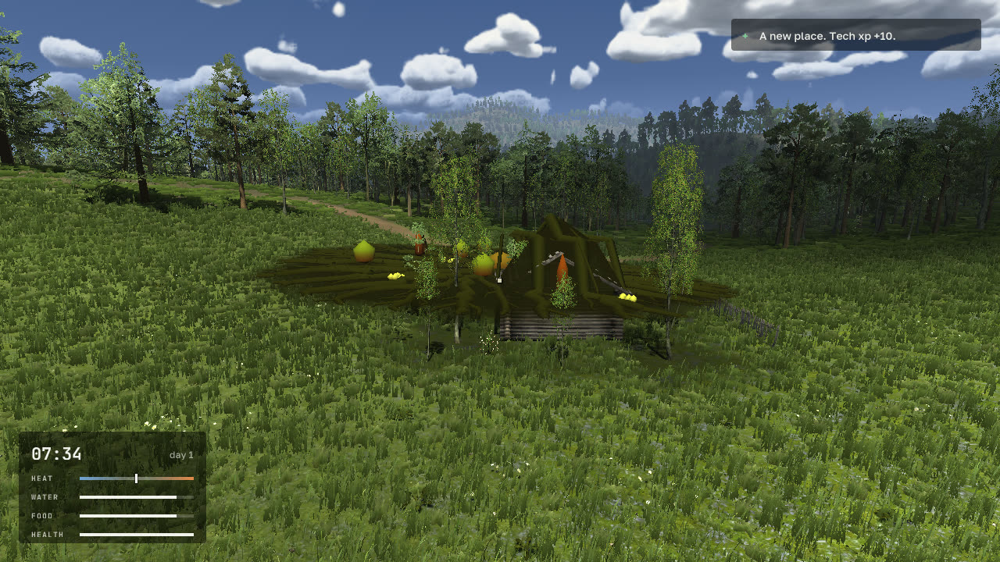

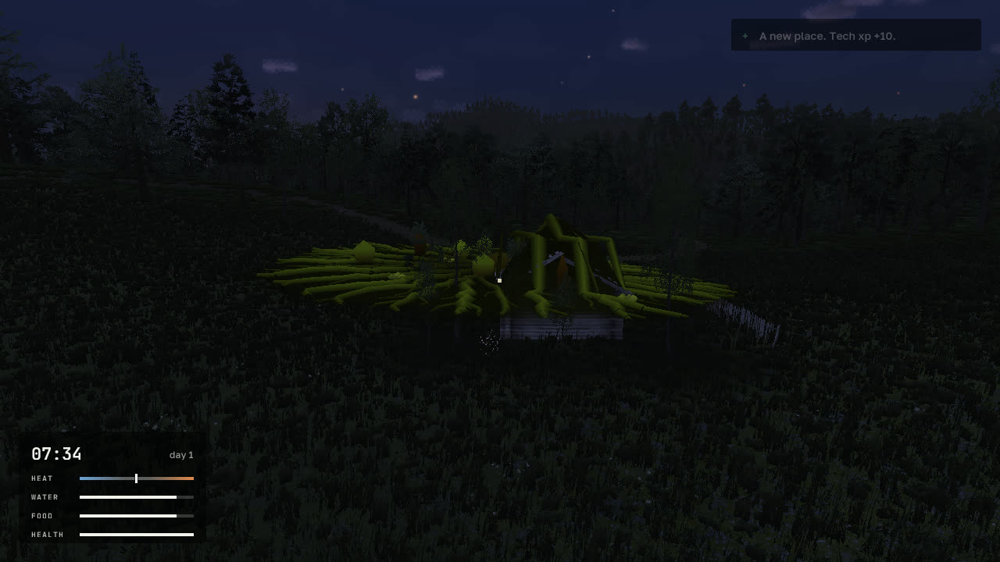

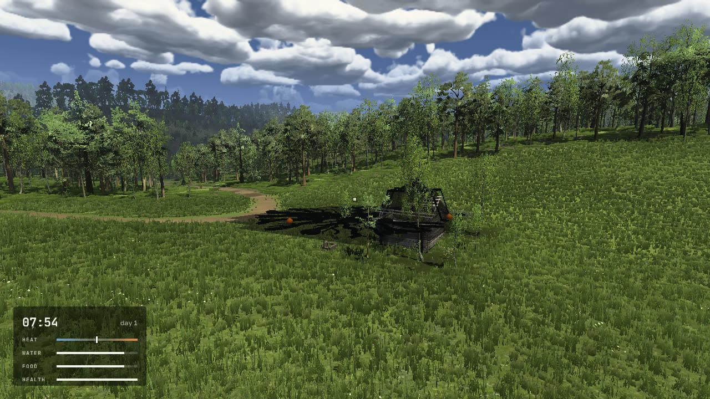

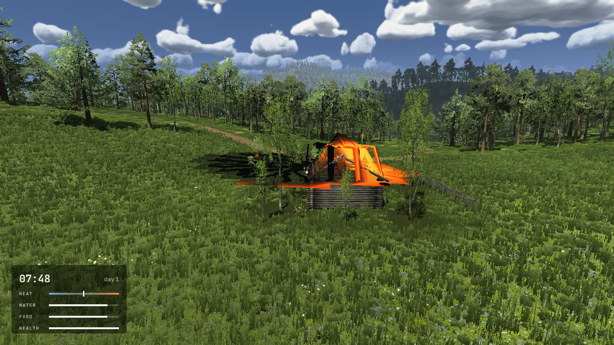

## 501. ZB3: bug waves instead of zhiltsy raids, hives spread by migration, two trucks at the start

12:42 · ZB3

Коммит: [d58c0cd235](https://github.com/shsanek/EXEcutor/commit/d58c0cd235)

Ветка: `claude/peregon-design`

Owner's Factorio-like spec. Each nest builds pressure from noise near it — generators, machines, engines, lights, chimney smoke, campfires, shots, felled trees, people — nearer sources count more and a quiet base calms it. A nest gathers a squad (bigger with its stage) and sends it whole at the loudest source. Breathing room: 36 game hours per nest, 18 between any two waves, never under 4 real minutes. Coming within 70 m of a nest raises a hunting pack of 2–4. Hives spread only by expansion parties that walk 200–450 m away from the base and found a new nest. Settings «Жуки» (on for new worlds) and «Темп жуков» ×1/×3/×10; «Шум базы» and «Набеги» now drive bug waves; zhiltsy base raids are off while bugs are on (settlement zhiltsy stay). Banners and notebook lines warn of waves; a scream at the nest. Every new game starts with two trucks. Play-test start: main menu «Новая игра: проверка жуков» — tempo ×10, two nests 320 and 420 m away, sawn-offs, nailgun, kerosene and matches in the bed.

- ✓ bug_wave_tests: 11/11
- ✓ co-op: host and two clients: 9 equal hash checks

## 502. ZB2: the bug swarm — five castes, squads, hundreds of bugs

12:45 · ZB2

Коммит: [db140e6d4a](https://github.com/shsanek/EXEcutor/commit/db140e6d4a)

Ветка: `claude/peregon-design`

Swarmer (fast, weak, packs), warrior (melee, tough), breacher (chews walls and build pieces, rams the truck), spitter (keeps 9–24 m and lobs splashing acid) and scout, all stats from data. Bugs hatch from the nests within each nest's budget, gather into a home squad and leave as one; goals are gather, raid a target, expand to a site, return. Distance tiers keep hundreds cheap: 200 bugs take 66 µs per simulation step. Bites wound and frighten players, guns, the seat gun and melee kill bugs, burning creep burns them. Placeholder bodies are built in code with walking legs (Tripo models with our own animation come next). Co-op: 19 bytes per bug in the fauna stream; over 80 ms latency and 2% loss host and client both had 100 identical bugs.

- ✓ swarm_tests: 11/11
- ✓ swarm_play_tests: 6/6

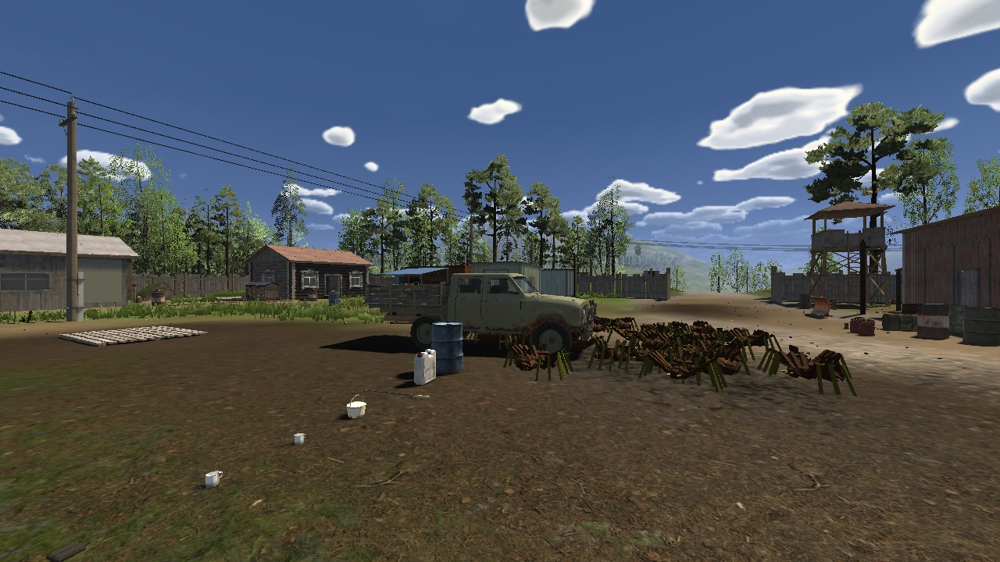

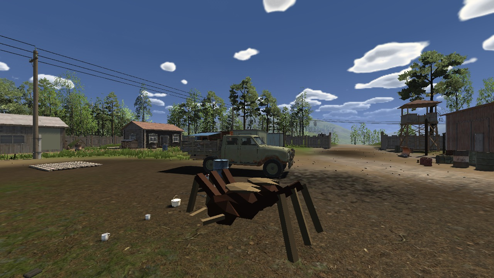

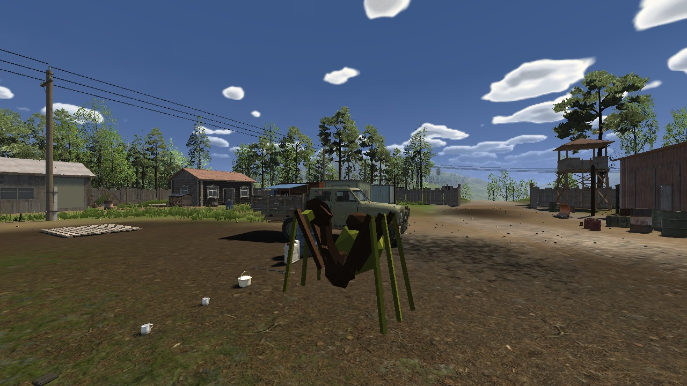

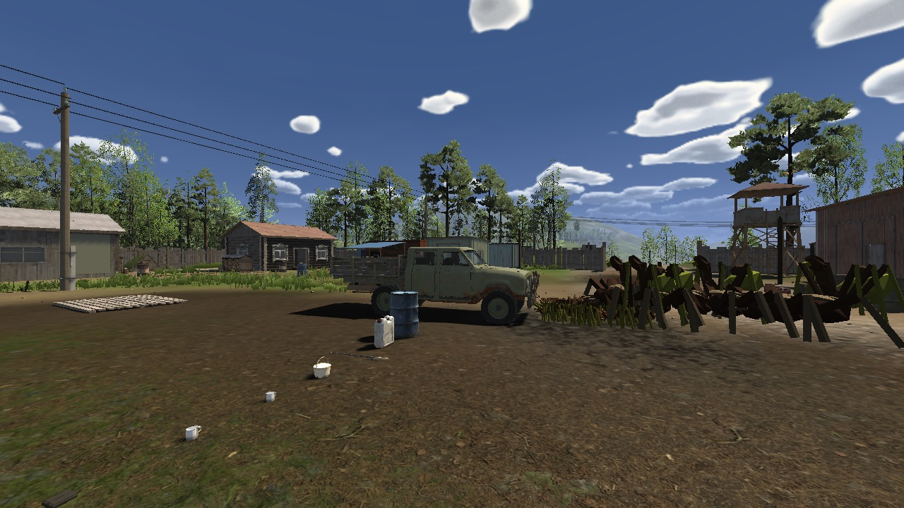
