# Перегон — 2026-10-24

[Главный отчёт](../README.md) · [Фичи и исправления](../CHANGELOG.md)

## 525. PLAYTEST1: бот прошёл две новые игры без читов — 46 проблем, разбор стройки и технологий

03:20 · PLAYTEST1

Коммит: [debab2f7c3](https://github.com/shsanek/EXEcutor/commit/debab2f7c3)

Ветка: `claude/peregon-design`

Бот играет только через ввод игрока (клавиши, мышь, клики), решения принимает по состоянию игры и кадрам. Две новые игры с палатки, ~6 игровых суток. Срубил 4 дерева, сделал брёвна и дрова, разжёг костёр, построил колья, таган, верстак и одну бревенчатую стену, съездил к указателю «Лесопилка» и в Берёзовку, выучил Т-1, ТС-01, ТС-02, ТЛ-01, дрался с жуками. Главное: нет цели на старте и записи в блокноте; топор висит на правом борту без подсказки (без него нет стройки); книга строек открывается на закрытом «Д-02 Сруб», клавиши A/D W/S в ней не работают; два разных «Верстака плотника» — построенный ничего не крафтит, настоящий (лук) только на Стройдворе под гнездом; кол-копьё не сделать (хворост не идёт во вторую руку); молодое гнездо в 500 м — ~30 жуков, смерть за 5 с; лесопилку сторожат 55 жуков; машина вязнет на ровной поляне у лагеря, раз перевернулась на 4 км/ч; помощь (R) увозит к гнезду на лесопилке; дом с дверью и печью требует Т-2 (~700 опыта), бот за 2,5 суток набрал 206 (в основном +10 за новые места); «держать E — выучить» не работает, только мышь; стены при разметке прыгают на чужую сторону. Блокеры исправлены: топор у костра/тагана снова поднимается, после смерти игрок просыпается в 60 м от живых жуков, а не в рое. Полный отчёт с предложениями по стройке и дереву технологий: games/peregon/docs/playtest1-report.md.

- ✓ две новые игры без читов: ~6 игровых суток
- ✓ блокеры исправлены: 3 коммита
- ✗ цель: зачистить гнездо и лесопилку: не достигнута — гнёзда слишком сильные

## 526. D1: книга строек — только то, что можно построить, один экран, удобные клавиши

09:00 · D1

Коммит: [6a2676fa4f](https://github.com/shsanek/EXEcutor/commit/6a2676fa4f)

Ветка: `claude/peregon-design`

По решениям владельца после игрового теста. Книга строек больше не показывает закрытое: все доступные постройки на одном экране двумя колонками, по секциям из данных; в строке только материалы и количество, без подсказок, где их взять. O — войти и выйти из режима стройки. В книге WASD/стрелки/колесо — выбор, Shift+W/S, Shift+колесо, Shift+1…8 — секции, E — взять чертёж, 1–8 — на панель. При разметке E — отметить, R/Shift+R — поворот на 90°, F — убрать чертёж, Shift+F — отменить последнюю разметку (до 16 назад, принесённое остаётся рядом). Стена встаёт поперёк взгляда или по направлению стены, на которую смотришь, не налезает на чужие и не прыгает на этаж выше. Экран технологий: Shift+K открыть/закрыть, держать E — выучить, E в окне подтверждения подтверждает. Протокол 94, чек-лист §66. Проверено сборкой и ботом через настоящий ввод (тесты на паузе).

- ✓ сборка native-release: ок
- ✓ бот: книга, стены, технологии: 17 кадров

## 527. D3: гнёзда начинают маленькими, погоня отстаёт, мотор тише, жуки не прячутся под машиной

09:40 · D3

Коммит: [16506b6861](https://github.com/shsanek/EXEcutor/commit/16506b6861)

Ветка: `claude/peregon-design`

По решениям владельца после игрового теста. Гнездо у старта в первый день — 7 жуков (было 15), на пятый — 17 (было 29); гнёзда у баз тоже стартуют маленькими и растут примерно втрое медленнее; набеги молодого гнезда — до 6 жуков. Погоня бросает игрока в 120 м от гнезда, если отстала больше чем на 35 м дольше 6 с, или через 45 с — бот добежал от гнезда до палатки живым (раньше погибал в 117 м). Работающий мотор привлекает жуков в 5 раз слабее: ночь на холостых у гнезда лесопилки — без волны, 4–5 жуков у машины вместо 19. Жуки больше не залезают под машину (коробка машины не доходила до земли). В настройках «Погружение → Набеги» добавлены «Гнёзда» (малые/обычные/крупные) и «Рост гнёзд» (медленный/обычный/быстрый). В блокноте на старте — «Нужно выжить.». Протокол 95, чек-лист §68. Проверено сборкой, сценами и ботом в новой игре (тесты на паузе). Старые сохранения сохраняют свои большие гнёзда.

- ✓ гнездо у старта, день 1: 15 → 7 жуков
- ✓ погоня от гнезда к палатке: смерть → дошёл с 36 % здоровья
- ✓ жуки под машиной: до 3 → 0

## 528. D2: дерево технологий по образцу Icarus — опыт за любой труд, бесплатный первый набор

10:05 · D2

Коммит: [f488262f2d](https://github.com/shsanek/EXEcutor/commit/f488262f2d)

Ветка: `claude/peregon-design`

Разобран Icarus (вики: 5 уровней, первый уровень весь руками без верстака — каменные инструменты, копьё, лук, костёр, целые наборы стройки с дверью; стройка продаётся наборами; верстак — корень второго уровня; опыт в основном за убийства и задания, но и за добычу; при объединении узлов очки возвращаются сами) — docs/tech-research.md со ссылками. У нас: опыт технологий капает за каждое действие (дерево 4, бревно 1, колка 1, хворост 1, палка/камень 0,3, ягоды 1, рыба 3, убийство 8, жуки 1–5, сердце гнезда 40, отбитая волна 10) плюс разовые бонусы за первое (первое дерево 10, первая добыча 20, первое гнездо 50…), полоска «+N опыта технологий · свободно M». Бесплатно с начала: Т-0 и «Времянка» с жердевой стеной с проёмом и плетёной дверью; руками (держать R) — лук, лук с тетивой из жил, стрелы, колчан, каменный топор. Т-1 «Верстак плотника» (60) теперь строит настоящий станок С-01, который сразу крафтит и тешет доски; бесполезный верстак-декорация убран. Объединения: «Изба» (стены, проём, дверь, крыша), «Буржуйка и труба» на Т-1, окна со ставнями, склады. Цены уровней 60/350/1600/3600. Бот в новой игре: Т-1 к 15:30 первого дня (раньше — только на второй день), к 17:23 построен станок и есть опыт на избу или печь. Каждый материал имеет возобновляемый источник — проверка баланса это требует (стекло, трубу, доски теперь можно делать). Старые сохранения: объединённые узлы переносятся, переплата возвращается опытом. Экран технологий в стиле Icarus — макет в docs/tech-tree.md §8, ещё не сделан. Протокол 96, чек-лист §67. Проверено сборкой, проверкой баланса и ботом (тесты на паузе).

- ✓ deps.py --check: OK, всё возобновляемо
- ✓ бот: Т-1 в новой игре: день 2 → 15:30 дня 1
- ✗ новый экран технологий: только макет

## 529. D4: каменный топор, 5 быстрых слотов, помощь по рации, стекло, без гильз, брёвна в 3 ряда

10:30 · D4

Коммит: [a284a01385](https://github.com/shsanek/EXEcutor/commit/a284a01385)

Ветка: `claude/peregon-design`

По решениям владельца после игрового теста. Топор: камень + палка, держать R 3 с, без верстака и технологий; камни и палки лежат везде (примерно по одному на 25 м), появляются снова через 8 игровых часов — потерять топор больше не конец игры. Топор — оружие в слоте: рубит деревья и брёвна и бьёт жуков. Пять быстрых слотов (1–5 и колесо) справа внизу; G с топором убирает его в слот и освобождает руку (кол делается с топором в слоте). Рюкзак 3×5 / 20 кг (был 3×4 / 18), армейский 3×6 / 24. Помощь — по рации: «Вызвать Савельича по рации?» — тракторист из Верхних Кужунов за перевалом на ДТ-75 тащит машину в ваш лагерь подальше от гнёзд, берёт только солярку из бака (6 л + 2 л/км, не больше 30 л, видно в окне), E и клик подтверждают. Запотевание стекла по физике: сухой летний день — чисто, дождь и мокрая одежда в закрытой кабине — около 5 минут, окно очищает за ~1,5 мин, обдув за ~40 с (зимой в игре окно пока чистит медленнее модели). Стреляные гильзы больше не копятся, рецепты патронов без гильз. В кузове три толстых бревна в высоту; если не влезает — так и пишет и не роняет. Протокол 97, чек-лист §69. Проверено сборкой и ботом в новых играх (тесты на паузе).

- ✓ бот: топор из камня и палки у палатки: ок
- ✓ помощь: машина в лагере: ок
- ✗ зимой окно очищает стекло: втрое медленнее модели

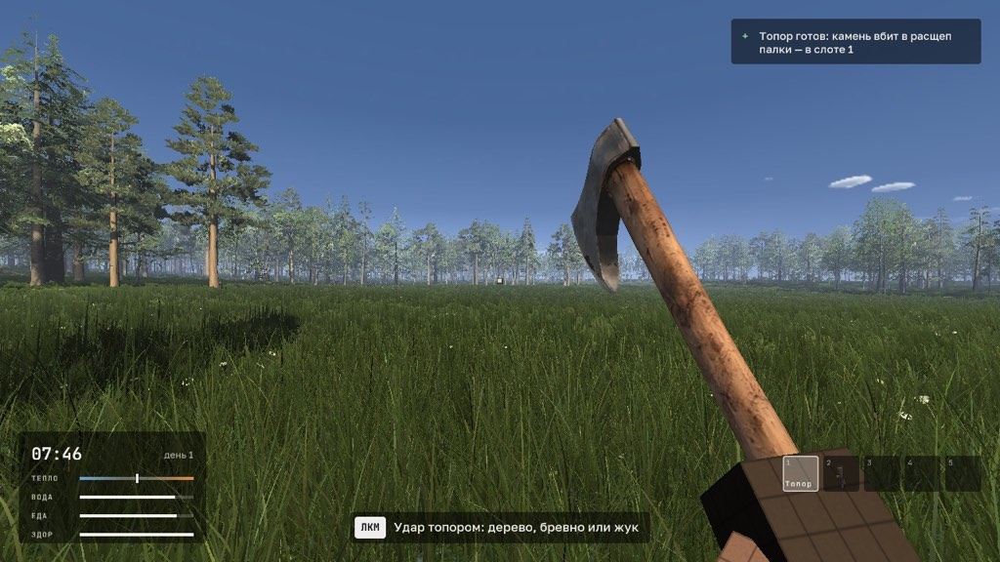

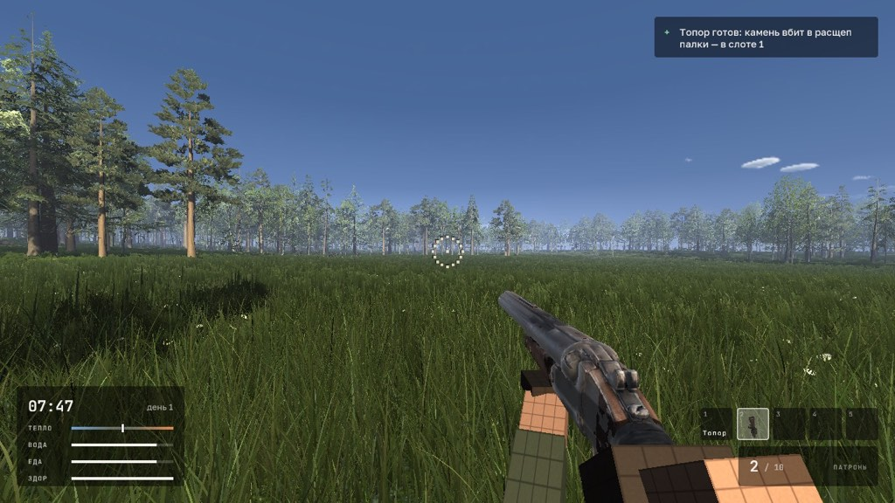

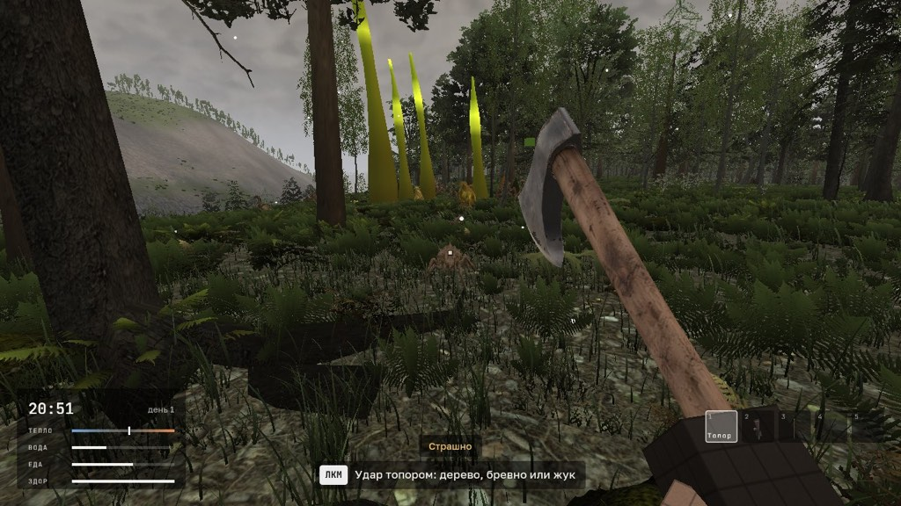

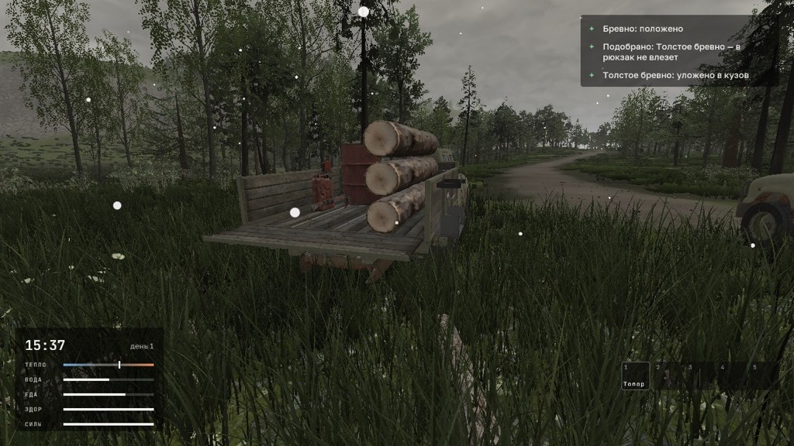

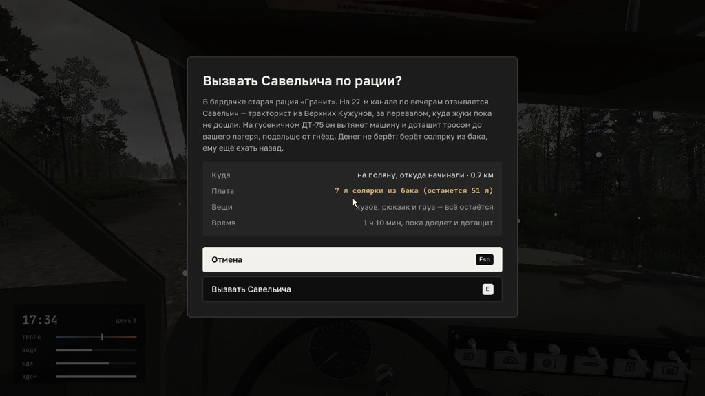

## 530. D5: экран технологий в стиле Icarus

11:20 · D5

Коммит: [82cf6aff4f](https://github.com/shsanek/EXEcutor/commit/82cf6aff4f)

Ветка: `claude/peregon-design`

Пять вкладок Т-0…Т-4 сверху, у каждой состояние: «изучено» (зелёная), «60 · можно» (янтарная), «350 · закрыто» (серая); клавиши 1–5. Первая карточка страницы — сам стол с ценой и условием. Карточки по секциям (Мастерская, Стройка, Машина…) с иконкой, названием и ценой: изучено — зелёная с ✓, можно — янтарная рамка, не хватает опыта — красная цена «не хватает N», закрыто — серая пунктирная с короткой причиной. Линии от предыдущего узла к следующему. При наведении — всё, что узел открывает, с иконками; справа — описание, «Открывает», «Где», «Нужно» и кнопка «Выучить». Свободный опыт всегда виден вверху справа. Поиск по «/» (по названию, коду и тому, что узел открывает: «дверь» находит «Избу»), фильтр «Только доступные» (R), секции (Tab). Изучение всегда удержанием — E или мышью, без окна подтверждения. Где брать ресурсы — не подсказывается. Протокол 98, чек-лист §70. Проверено сборкой и ботом (тесты на паузе). Не готово: ~40 узлов без списка «Открывает» (в работе у PTPOLISH), связи между секциями, иконки станков и услуг.

- ✓ бот: Т-1 удержанием E, «Изба» мышью: ок
- ✓ поиск «дверь», «печ»: находит

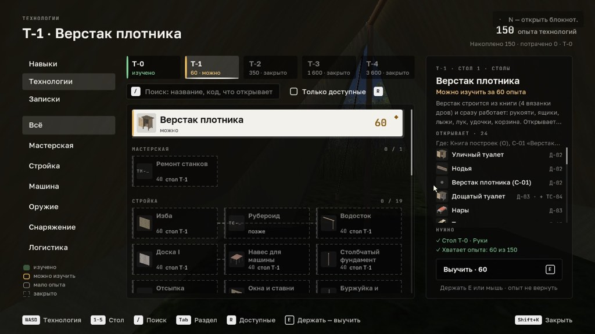

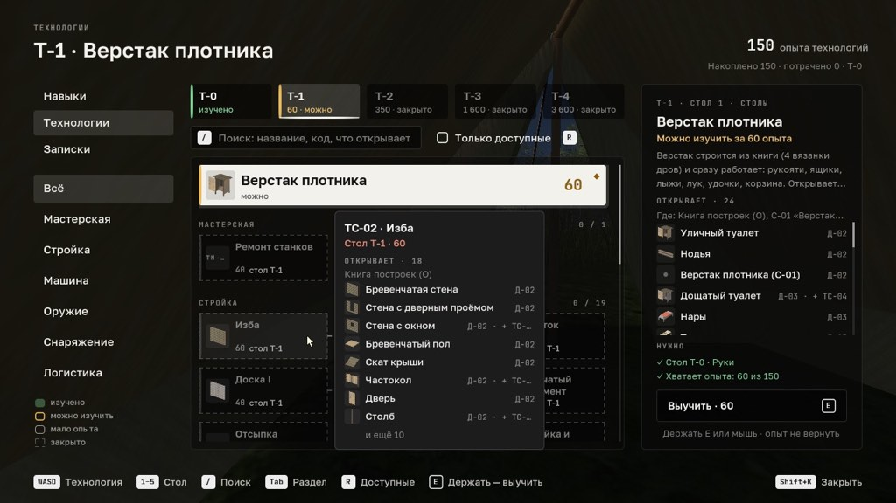

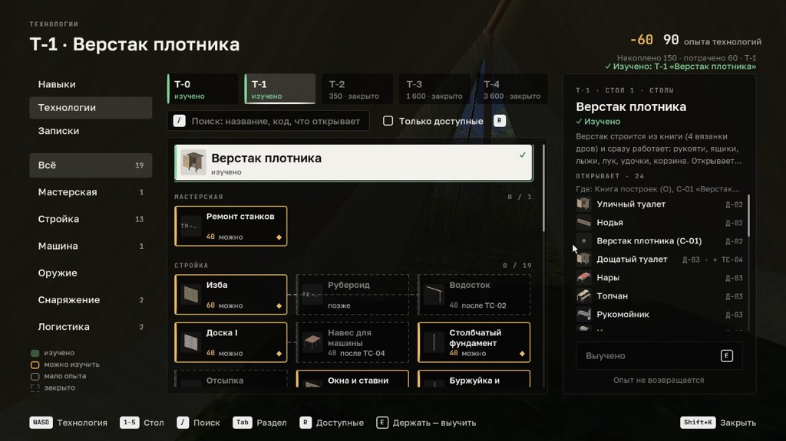

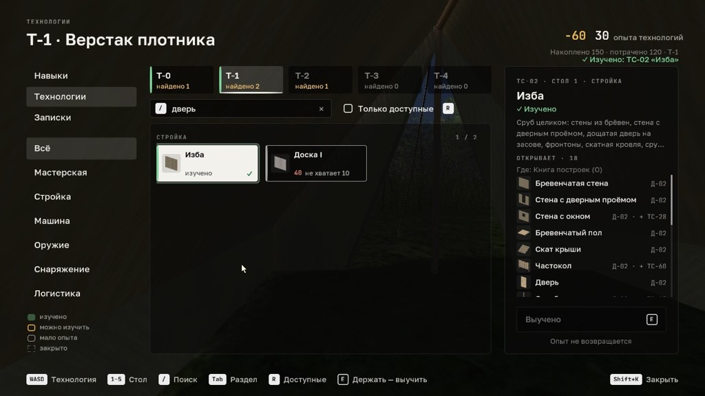

## 531. WORLD-L: фары по отдельности, домкрат поднимает угол, гнёзда у экскаватора, охотники уходят от тихой машины

12:15 · WORLD-L

Коммит: [4f62c2da74](https://github.com/shsanek/EXEcutor/commit/4f62c2da74)

Ветка: `claude/peregon-design`

Фары разделены на левую и правую модели (оторванная больше не рисуется; заодно исправлена путаница «левая/правая» в сообщениях и следах). Домкрат при замене колеса поднимает угол машины примерно на 9 см. Гнутое колесо стоит криво (~5°) и виляет. Переворот о низкие препятствия воспроизвести не удалось (48 ударов на 5–40 км/ч); добавлена защита — низкое препятствие не подбрасывает машину. Экскаватор на разрезе заблокирован, пока жив его улей. Грузовику на автобазе нужна только солярка, прицепу в депо — одни «Запчасти». Старые сохранения разово получают маленькие гнёзда у баз (не рядом с игроком, палаткой и уже использованными станками). Укусы на кузове мельче, копоть от огнемёта, костра, фальшфейера и горящих жуков, вмятины у дверных щелей. Охотники гнезда уходят от тихой стоящей машины через 30 игровых минут: ночь у лесопилки в 45 м от гнезда — 0 жуков на машине вместо 4–5. Зеркал у машины нет (их убрали раньше) — пункт закрыт. Протокол 99, чек-лист §72. Проверено сборкой и сценами (тесты на паузе).

- ✓ ночь у гнезда, жуки на машине: 4–5 → 0
- ✓ домкрат: угол +9 см
- ✗ переворот о низкие препятствия: не воспроизведён

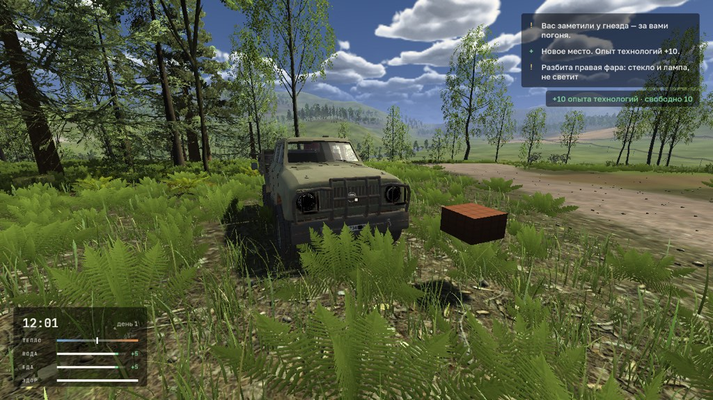

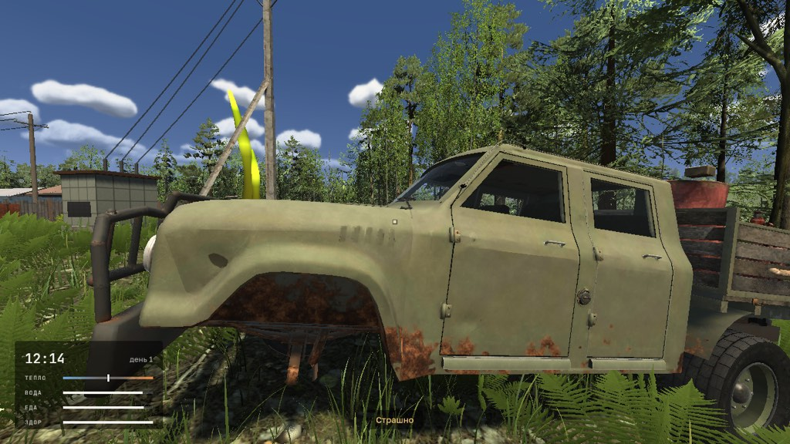

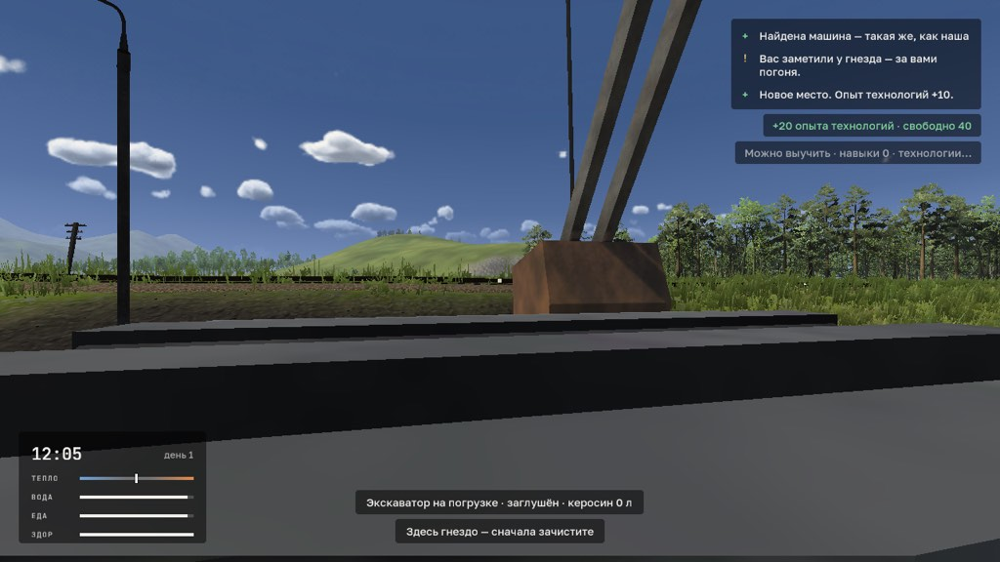

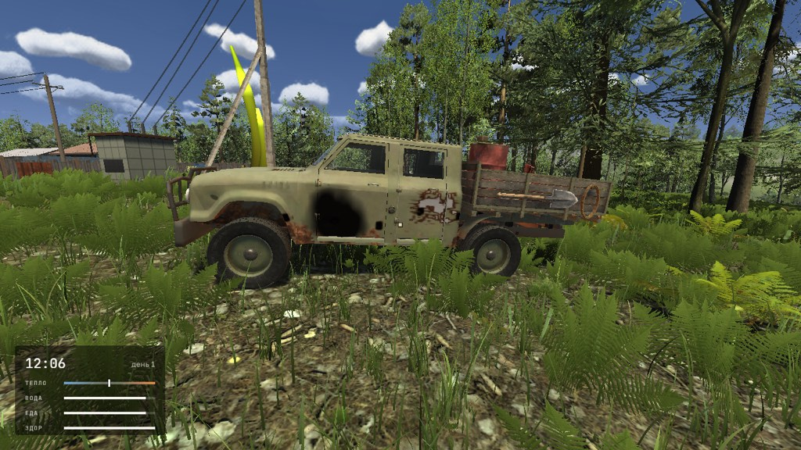

## 532. PTPOLISH: 26 мелочей из игрового теста, у всех технологий список «Открывает»

12:40 · PTPOLISH

Коммит: [0b70102e03](https://github.com/shsanek/EXEcutor/commit/0b70102e03)

Ветка: `claude/peregon-design`

Все пункты отчёта игрового теста разобраны по таблице, ничего не потеряно: клавиши в справке, вкладки блокнота, карта открывается на игроке, ключ уже в замке, открытая дверь закрывается на ходу, «жильцы» → «жуки» везде, подсказки подбора чище, названия «Брёвна»/«Хворост», режим стройки выключается в кабине и в навыках, дальше пить с берега, нет ускорения времени, если жуки ближе 30 м, страх сбрасывается после смерти, у лагеря у палатки снова можно строить (кроме кострища), метка на стволе где кончится следующее бревно, ружьё мокнет только при настоящем плавании. Экран технологий: у всех 169 узлов есть список «Открывает» (было 53 пустых), связи между секциями, иконки у всех строк, включая топор, камень и палку; атлас иконок не превышает 4096 пикселей. Протокол 100, чек-лист §74. Проверено сборкой и ботом в новых играх (тесты на паузе).

- ✓ узлы без «Открывает»: 53 → 0
- ✓ бот: новые игры: ок

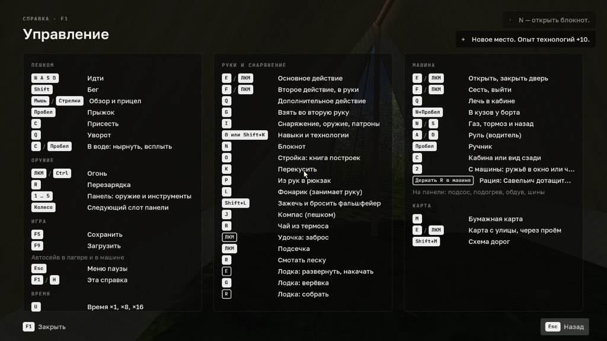

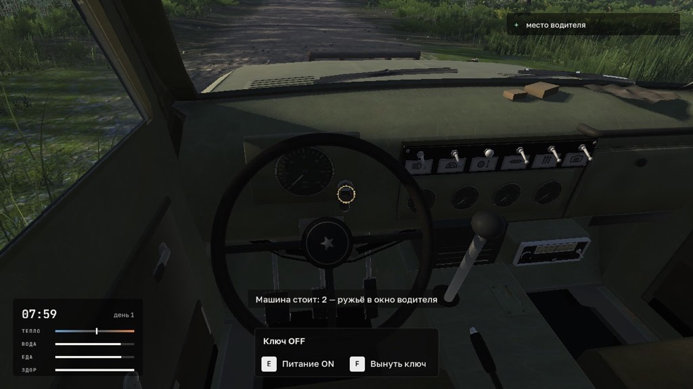

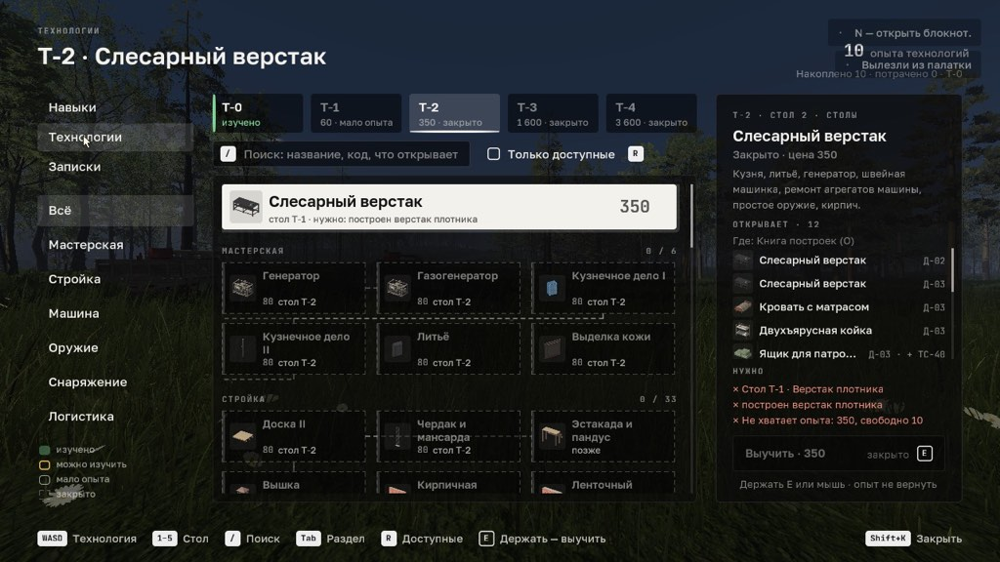

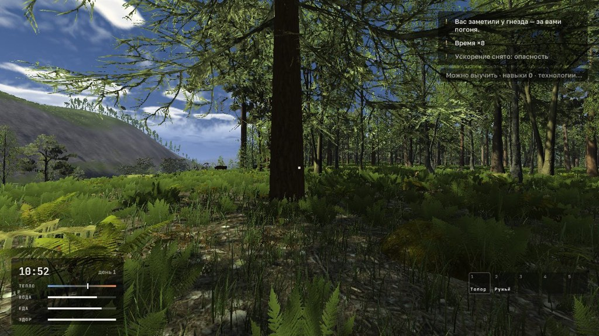

## 533. WEAPONS-L: доводка автомата, пулемёта, лука, кола и огнемёта

12:45 · WEAPONS-L

Коммит: [610b4c9028](https://github.com/shsanek/EXEcutor/commit/610b4c9028)

Ветка: `claude/peregon-design`

Автомат: чистка ветошью и переборка на оружейном верстаке, правильный хват от третьего лица, виден у других игроков, предсказание очередей у гостя проверено (55 из 55 выстрелов подтверждены). Пулемёт в кузове: руки на рукоятках, гость слышит очереди, груз отодвигается от стрелка. Лук: стрелы втыкаются в деревья, стены и ящики, отскакивают от машины и камней, в мелкой воде лежат на дне, во льду — на льду; звук тетивы и попадания; лук можно повесить за спину; колчан гостя сохраняется. Кол: другие игроки видят удар, жук остаётся на кольях 90 с. Огнемёт: топливо хранится в огнемёте, модель из бака и брандспойта, струя — огонь и дым вместо коробок. Протокол 101, чек-лист §71. Проверено сборкой, сценами и кооп-прогонами (тесты на паузе).

- ✓ кооп: очереди автомата у гостя: 55/55
- ✓ кооп: гость слышит пулемёт: 82 выстрела

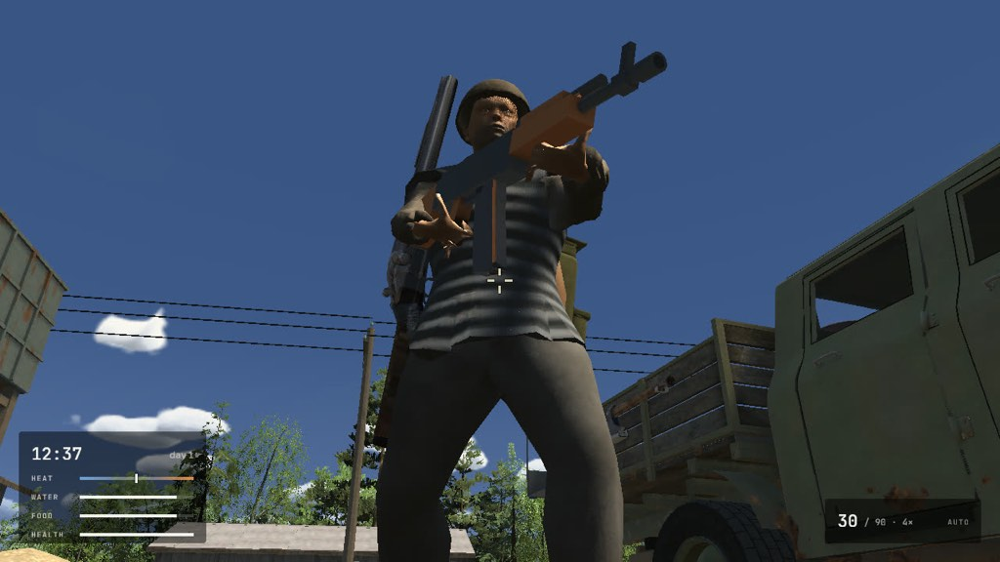

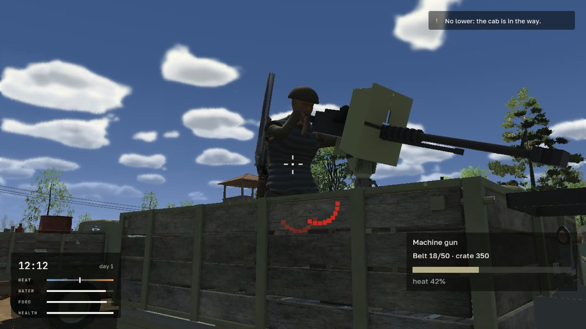

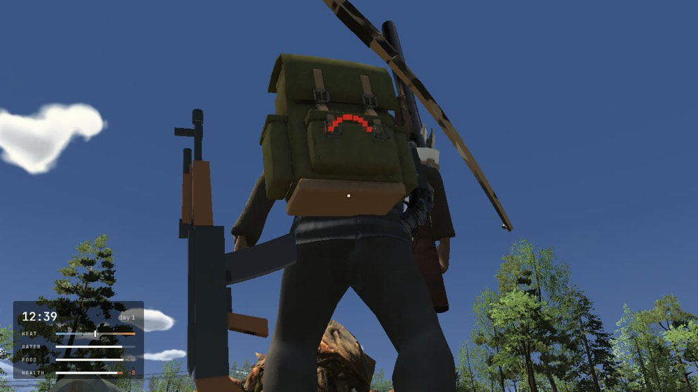

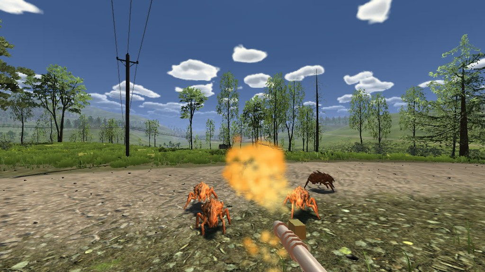

## 534. PAR3: параллельная симуляция — чтение поверхностей и упаковка сети в фоне

13:30 · PAR3

Коммит: [d63ecc0097](https://github.com/shsanek/EXEcutor/commit/d63ecc0097)

Ветка: `claude/peregon-design`

Чтение полей поверхности (снег, грязь, колеи) стало потокобезопасным, семь потоков поверхности собираются отдельными задачами; упаковка данных для клиентов идёт в фоне параллельно с отрисовкой и следующим тиком. Поведение игры и формат сети не изменились: повтор 7200 тиков даёт один и тот же хеш на 1 и 8 потоках, 33 кооп-прогона (хост + 2 клиента, 2 машины, 66 жуков) — 0 расхождений. С отрисовкой на 8 потоках кадр 63,6 → 52,2 мс, тик 2,38 → 1,46 мс (машина была сильно загружена, абсолютные числа завышены). Проверено сборкой (тесты на паузе).

- ✓ повтор: хеш на 1 и 8 потоках: совпадает
- ✓ кооп-прогоны: 33, 0 расхождений
- ✓ кадр с отрисовкой, 8 потоков: 63,6 → 52,2 мс

## 535. SWARM5: касты идут вместе, бросок веером, выход из «карманов», пролом без затора

14:10 · SWARM5

Коммит: [05a9f0e5d3](https://github.com/shsanek/EXEcutor/commit/05a9f0e5d3)

Ветка: `claude/peregon-design`

Бегуны, воины и плевуны держатся рядом с медленными кастами (не уходят вперёд, чтобы погибнуть одни); тяжёлые не отступают, пока не повоевали. На открытом лагере вместо трёх колонн — широкий фронт. Жуки выбираются из глубоких П-образных «карманов» и доходят до защитника за длинной стеной (18 из 26). Свет фар пугает только в темноте. После пролома жуки расходятся по целям внутри (ударов по стене 133 → 499). Лёд проверяется каждый метр — на реке тонет 1 таран вместо 4. Не решено: на обороне волна всё равно гибнет у ловушек, не ударив по стене. Протокол 102, чек-лист §73. Проверено сборкой и сценами (тесты на паузе).

- ✓ защитник за стеной: 0 → 18 из 26 жуков доходят
- ✗ оборона: удары по стене: всё ещё 0

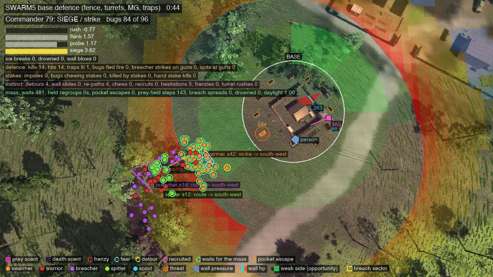

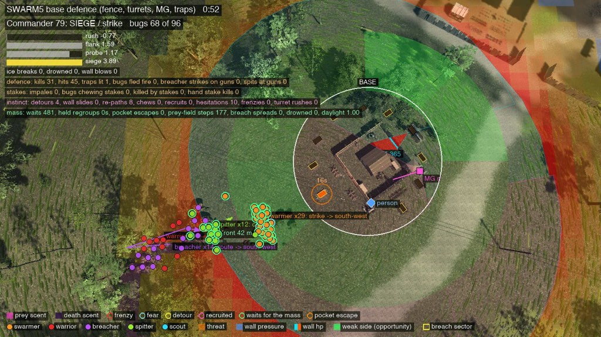

## 536. POLISH2: киянка компактнее, болотная вода, дверь из кабины, камни и палки, стекло зимой

14:40 · POLISH2

Коммит: [01c39517c2](https://github.com/shsanek/EXEcutor/commit/01c39517c2)

Ветка: `claude/peregon-design`

Киянка занимает 1×3 вместо 2×4 и помещается в рюкзак. Из болотных окон можно пить (риск заболеть выше, чем из реки). Дверь кабины открывается с водительского места. Камни и палки — настоящие модели (по 3 варианта). Зимнее запотевание: температура стекла считалась в реальных секундах, а погода — в игровом времени, поэтому стекло было холоднее воздуха и окно не помогало; теперь открытое окно очищает за ~30 с, обдув — за 10 с. Стекло сохраняется. В инвентаре можно класть предметы в быстрые слоты и доставать их. Сухостой у палатки не добавлен — нужна пересборка карты. Протокол 103, чек-лист §76. Проверено сборкой и ботом (тесты на паузе).

- ✓ зима: окно очищает стекло: 6 мин+ → ~30 с

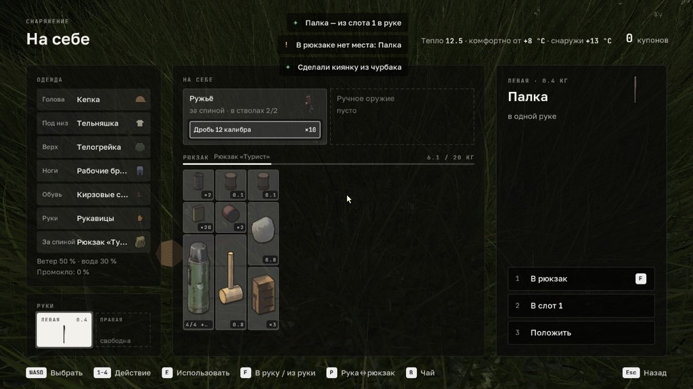

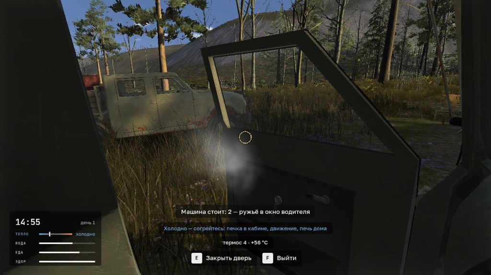

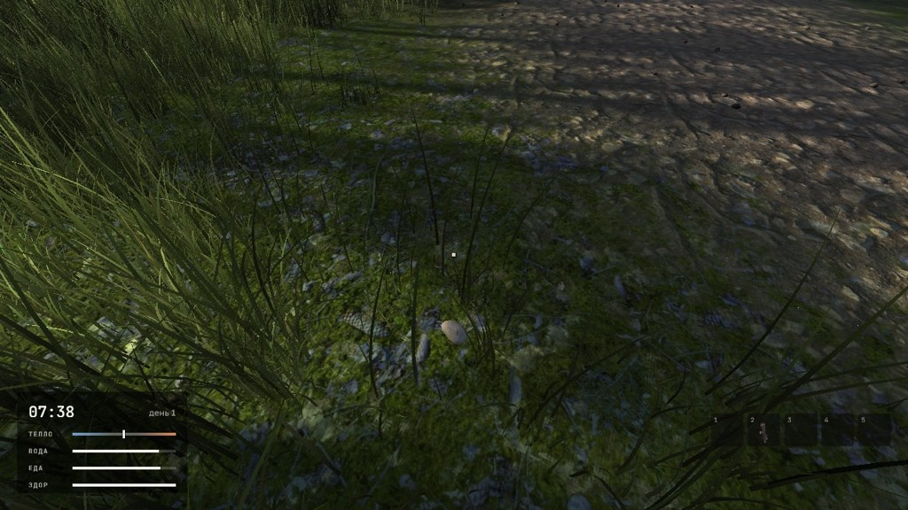

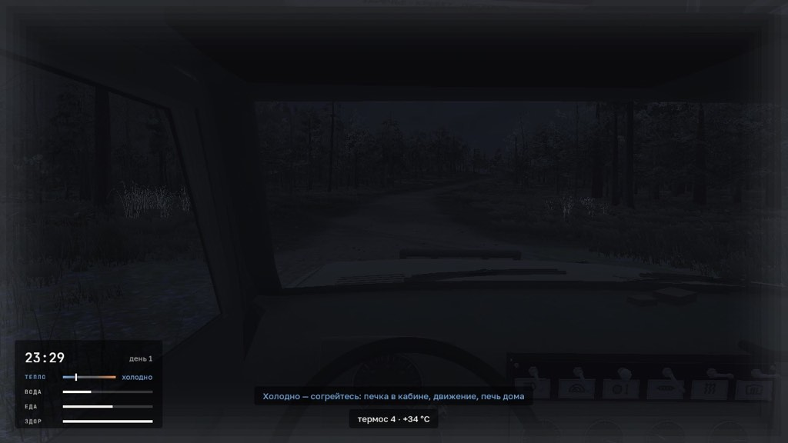

## 537. FORESTCOL: машина переезжает брёвна и пни, а не взлетает

14:55 · FORESTCOL

Коммит: [2519b656a0](https://github.com/shsanek/EXEcutor/commit/2519b656a0)

Ветка: `claude/peregon-design`

По жалобе владельца: в лесу машину подбрасывало и переворачивало на упавших деревьях и пнях. Причины: коробка кузова начиналась на высоте 0,30 м по всей длине — любое бревно выше упиралось в неё раньше колеса и жёстко выталкивало машину; шина «видела» препятствие только в ±60° снизу; брёвна были коробками с плоским верхом, пни — острыми коробками, камни — крутыми шипами; у пня после рубки столкновения не было вообще. Теперь брёвна круглые и чуть проминаются, пни и камни скруглены, колесо замечает препятствие на 84°, кузов начинается от бампера (0,55 м), днищем машина мягко садится на бревно, отталкивание ограничено. 110 заездов, 5–20 км/ч: переехала 58 из 66 (было 30), переворотов и полётов 0 (было 5). Протокол 104, чек-лист §75. Проверено сборкой и сценой заездов (тесты на паузе). Осталось: на 30–40 км/ч перевороты возможны; толстый ствол 44 см с места на 5 км/ч не взять без разгона.

- ✓ 5–20 км/ч: переехала: 30 → 58 из 66
- ✓ 5–20 км/ч: перевороты и полёты: 5 → 0

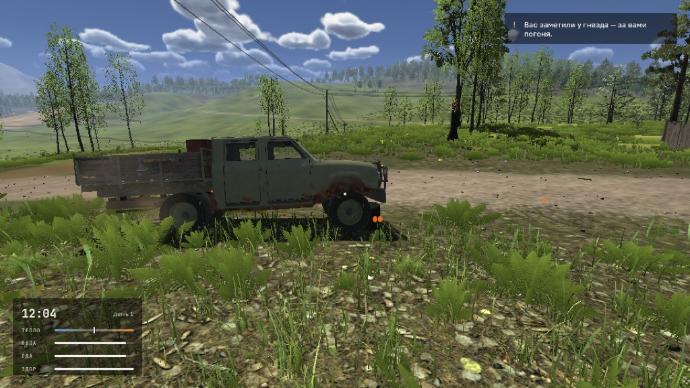

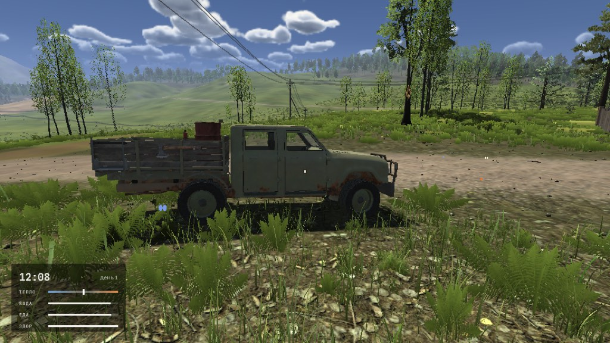

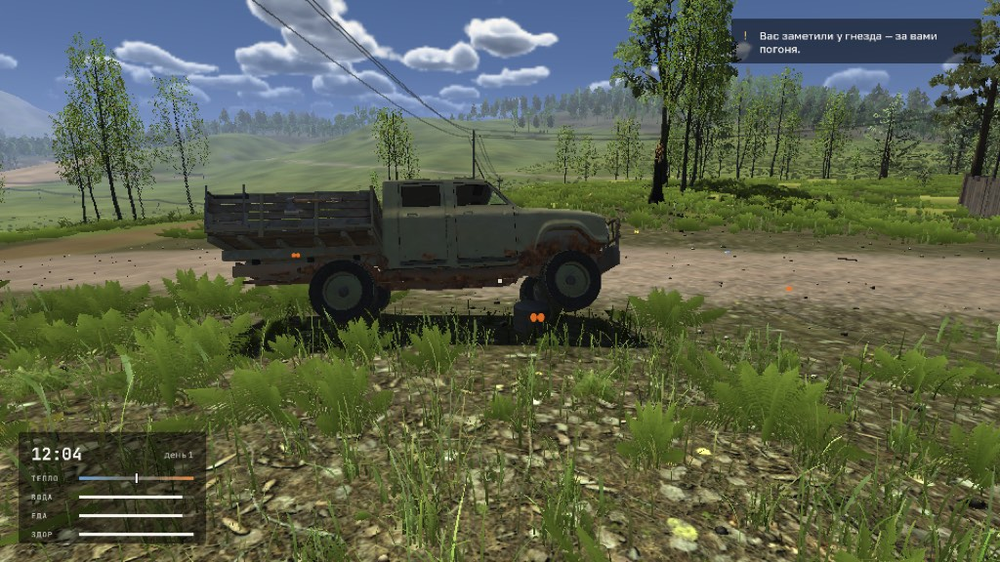

## 538. PLAYTEST2: второй тест ботом — старт, стройка и технологии намного лучше, машины вязнут на стартовой поляне

17:00 · PLAYTEST2

Коммит: [c0689925de](https://github.com/shsanek/EXEcutor/commit/c0689925de)

Ветка: `claude/peregon-design`

Новая игра с палатки без читов, 3 игровых дня 17 часов за 2 ч 17 мин. Каменный топор за 5,5 мин (было 33 мин и чтение документации); Т-1 за 19 мин в первый день (было — второй день); настоящий верстак С-01; лук руками в первый день; закрытая изба с дверью ко 2-му утру и печь из бочки (в первом тесте жилья не было вообще); опыт технологий 448 к 4-му дню (было 206 за 2,5 дня). Книга строек, разметка и экран технологий — понятные. Сравнение с 46 пунктами первого теста: исправлено 28, частично 5, осталось 6, регрессий 0, не дошли 7. Главное плохое: обе стартовые машины вязнут на поляне у лагеря (грязь с полной влажностью летом, колёса садятся на 0,4–0,55 м за 2 с, Савельич тащит на 5 м на ту же грязь) — езда, вывоз и лесопилка не проверены; дверной проём 1,68 м ниже игрока 1,8 м; печь в избе 2×2 запирает игрока, «держать Q» мгновенно разбирает готовую стену с потерей брёвен; молодое гнездо к 3-му дню — 17–19 жуков, сердце требует ~13 патронов при 10 в наборе; рюкзак с едой остаётся у гнезда после смерти; крыша ставится снаружи; Т-2 (350) — стена на 2-й день. Отчёт: docs/playtest2-report.md.

- ✓ топор: 33 → 5,5 мин
- ✓ Т-1: день 2 → день 1, 19 мин
- ✓ сравнение с PLAYTEST1: 28 исправлено, 0 регрессий
- ✗ езда со стартовой поляны: 0 м — машины вязнут

## 539. MUD V0: стартовая поляна твёрже, спасатель ставит машину на твёрдую землю

20:40 · MUD V0

Коммит: [b43505ca0a](https://github.com/shsanek/EXEcutor/commit/b43505ca0a)

Ветка: `claude/peregon-design`

Влажность луга у лагеря снижена с 9 до 5 только там, поляна — до 2; машины больше не садятся на стартовой поляне. Савельич при спасении ставит машину только на твёрдый грунт. Бот на Windows сообщает грунт под каждым колесом. Дальше — общий воксельный движок для земли, грязи, снега и воды рядом с машиной (идёт). Сетевой протокол 106.

- ✓ сборка win64: зелёная

## 540. THREATS2: стартовое гнездо проходимо ранним набором, смерть не восполняет голод

20:40 · THREATS2

Коммит: [b43505ca0a](https://github.com/shsanek/EXEcutor/commit/b43505ca0a)

Ветка: `claude/peregon-design`

После смерти голод и жажда сохраняются. Сердце гнезда: 250 / 600 / 950 / 1300 по стадиям. Стрелы ранят гнёзда (16–36 за выстрел вместо 2,4). Заливка гнезда — 5 л керосина или солярки из любой ёмкости (канистра 20 л — 4 заливки). Гнёзда в 2,5 км от палатки растут на 35 % до конца 3-го дня: стартовое доходит до стадии 1 только на 4-й день. Бот со стартовым набором на 2-й день убил сердце за ~5 выстрелов и выжил. Рюкзак у гнезда после смерти остаётся, как решил владелец. Сетевой протокол 106.

- ✓ сердце стартовым ружьём: ~5 выстрелов, день 2
- ✓ лук: 16 за попадание (было 2,4)
- ✓ стартовое гнездо: стадия 1 на 4-й день
- ✗ бой луком с жуками: бот слаб, нужна ручная проверка

## 541. TECHPACE: Т-2 дешевле, опыта за труд больше, каменная труба на Т-1

21:30 · TECHPACE

Коммит: [ba6fce858c](https://github.com/shsanek/EXEcutor/commit/ba6fce858c)

Ветка: `claude/peregon-design`

Т-2 стоит 200 вместо 350. Опыта за действия больше: валка 4 → 6, сучья, раскряжёвка, колка и хворост 1 → 2, перенос 0,5 → 1; сбор даёт в 1,6 раза больше опыта в час. Т-3 и Т-4 подняты до 2000 и 4000, чтобы остаться на прежнем месте. Новая каменная труба на Т-1 из 8 камней для бочки и железной печки — дым уходит раньше. С сухих деревьев больше хвороста, из кроны — охапки. По замеру ботом Т-2 смещается примерно с 8-го на 4-й день без стройки, со стройкой — на 2–3-й день. Сетевой протокол 107.

- ✓ опыт за час сбора: 2,1 → 3,3
- ✓ deps.py: зелёный
- ✗ каменная труба в игре: ещё не проверена ботом

## 542. HUT: в избу входишь в рост, печь не запирает, разбор с возвратом

22:00 · HUT

Коммит: [78898bbb5c](https://github.com/shsanek/EXEcutor/commit/78898bbb5c)

Ветка: `claude/peregon-design`

Стена 12 венцов, дверной проём 2,2 м — игрок проходит не пригибаясь. Маленькие предметы (печь) встают к стене или в угол, куда смотришь; если печь загородит выход, ставить нельзя («загородит выход»). Закрытая дверь всегда открывается от игрока. Крыша встаёт на избу и когда целишься изнутри в стену, и когда в небо. Готовую часть разбирают удержанием Q 5 секунд, карточка показывает, что вернётся; брёвна возвращаются целыми, печь из бочки отдаёт бочку. Подсказка стройки идёт первой. Всё проверено ботом на Windows. Сетевой протокол 108.

- ✓ проход в дверь: в рост, 1,98 м над порогом
- ✓ печь в центре: отказ «загородит выход»
- ✓ разбор стены: 2 с — нет, 5,5 с — да, брёвна на земле
- ✓ бочка из печи: возвращается

## 543. WINBOT: бот-тестировщик работает на Windows

22:40 · WINBOT

Коммит: [dabedb84d2](https://github.com/shsanek/EXEcutor/commit/dabedb84d2)

Ветка: `claude/peregon-design`

Бот для play-тестов теперь запускает и ведёт игру на Windows так же, как на macOS: без окна и в окне, D3D12, скриншоты. Исправлено зависание бота: на Windows игра не могла обновить файл состояния, пока его читали (18 из 40 команд зависали, теперь 0 из 60). Чтение команд бота стало надёжным. Это нужно для PLAYTEST3 на этой машине. Игра не менялась.

- ✓ новая игра ботом на Windows: палатка → палка в руках
- ✓ зависания: 18/40 → 0/60
