# Перегон — 2026-10-24

[Главный отчёт](../README.md) · [Фичи и исправления](../CHANGELOG.md)

## 525. PLAYTEST1: бот прошёл две новые игры без читов — 46 проблем, разбор стройки и технологий

03:20 · PLAYTEST1

Коммит: [debab2f7c3](https://github.com/shsanek/EXEcutor/commit/debab2f7c3)

Ветка: `claude/peregon-design`

Бот играет только через ввод игрока (клавиши, мышь, клики), решения принимает по состоянию игры и кадрам. Две новые игры с палатки, ~6 игровых суток. Срубил 4 дерева, сделал брёвна и дрова, разжёг костёр, построил колья, таган, верстак и одну бревенчатую стену, съездил к указателю «Лесопилка» и в Берёзовку, выучил Т-1, ТС-01, ТС-02, ТЛ-01, дрался с жуками. Главное: нет цели на старте и записи в блокноте; топор висит на правом борту без подсказки (без него нет стройки); книга строек открывается на закрытом «Д-02 Сруб», клавиши A/D W/S в ней не работают; два разных «Верстака плотника» — построенный ничего не крафтит, настоящий (лук) только на Стройдворе под гнездом; кол-копьё не сделать (хворост не идёт во вторую руку); молодое гнездо в 500 м — ~30 жуков, смерть за 5 с; лесопилку сторожат 55 жуков; машина вязнет на ровной поляне у лагеря, раз перевернулась на 4 км/ч; помощь (R) увозит к гнезду на лесопилке; дом с дверью и печью требует Т-2 (~700 опыта), бот за 2,5 суток набрал 206 (в основном +10 за новые места); «держать E — выучить» не работает, только мышь; стены при разметке прыгают на чужую сторону. Блокеры исправлены: топор у костра/тагана снова поднимается, после смерти игрок просыпается в 60 м от живых жуков, а не в рое. Полный отчёт с предложениями по стройке и дереву технологий: games/peregon/docs/playtest1-report.md.

- ✓ две новые игры без читов: ~6 игровых суток
- ✓ блокеры исправлены: 3 коммита
- ✗ цель: зачистить гнездо и лесопилку: не достигнута — гнёзда слишком сильные

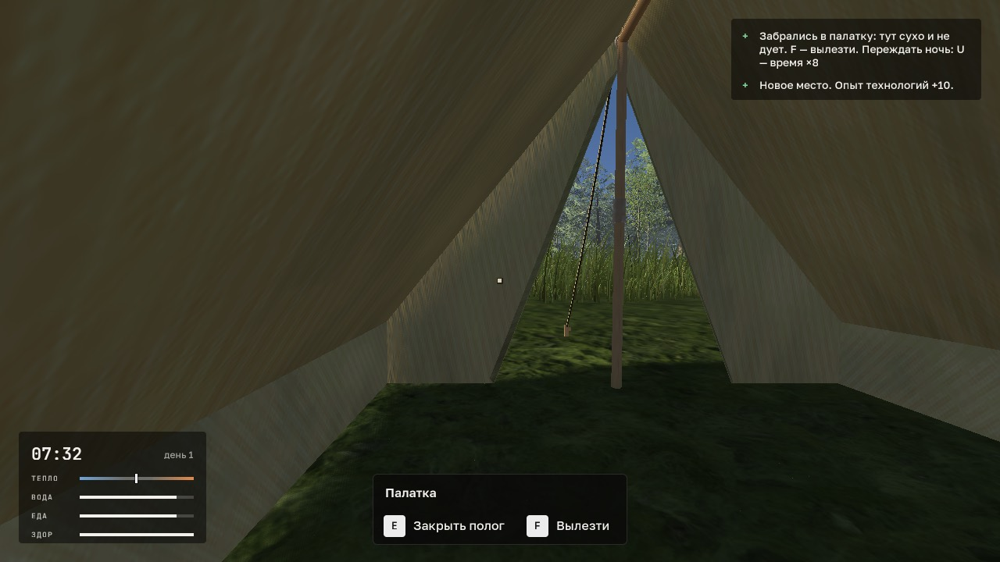

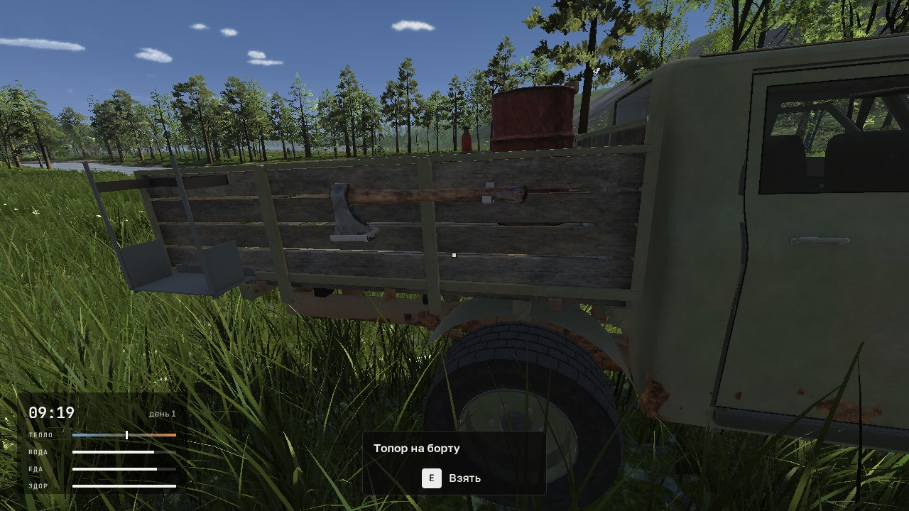

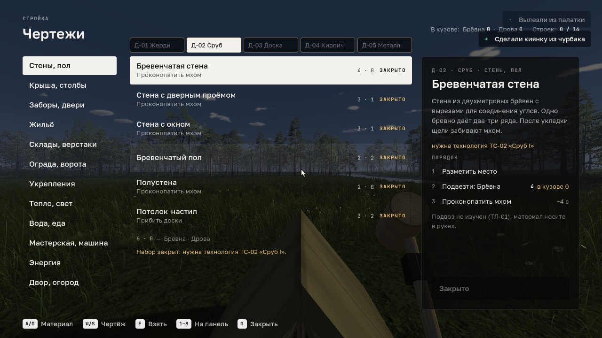

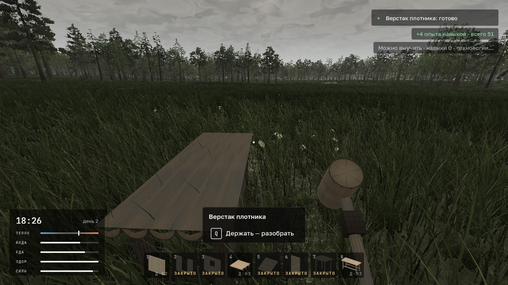

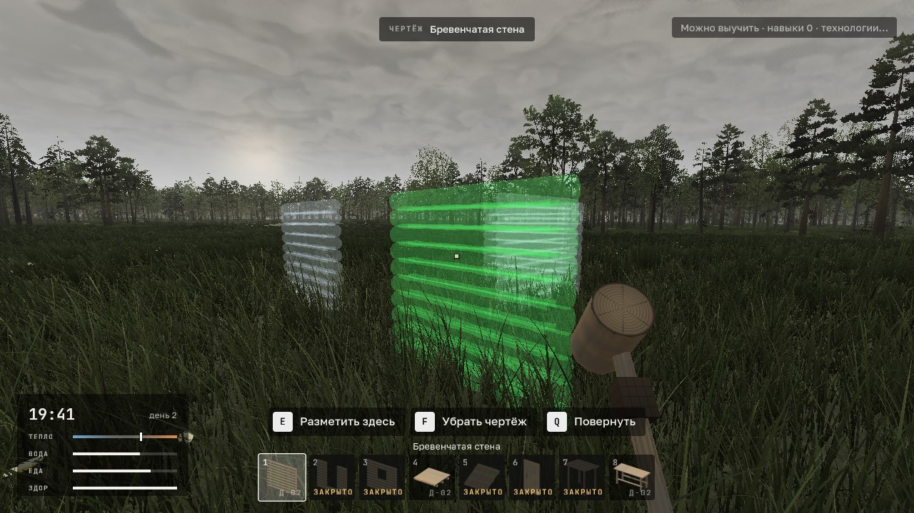

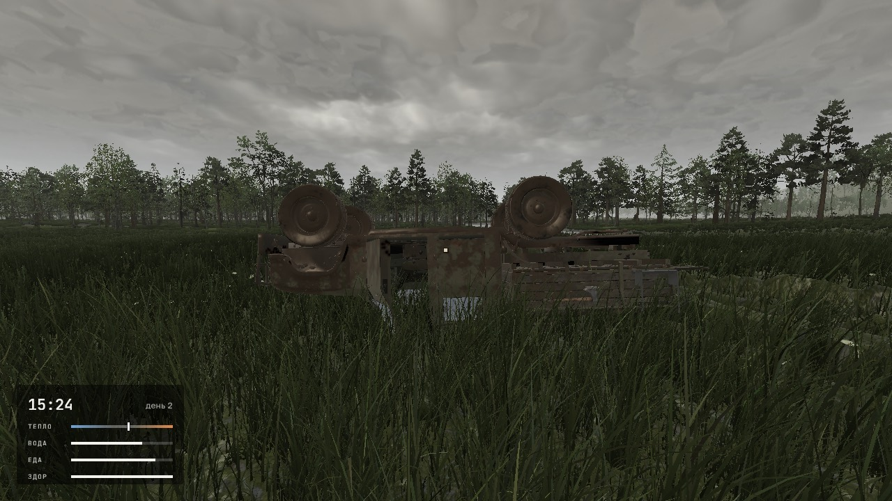

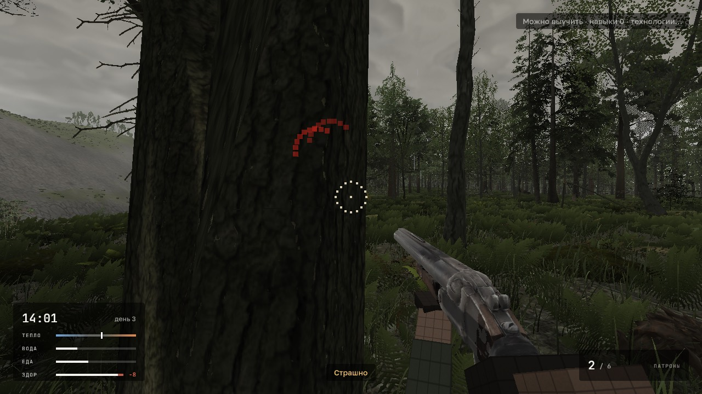

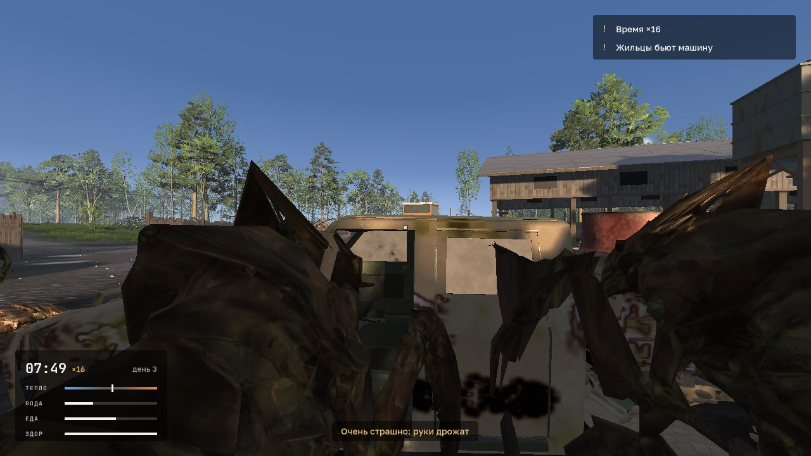

## 526. D1: книга строек — только то, что можно построить, один экран, удобные клавиши

09:00 · D1

Коммит: [6a2676fa4f](https://github.com/shsanek/EXEcutor/commit/6a2676fa4f)

Ветка: `claude/peregon-design`

По решениям владельца после игрового теста. Книга строек больше не показывает закрытое: все доступные постройки на одном экране двумя колонками, по секциям из данных; в строке только материалы и количество, без подсказок, где их взять. O — войти и выйти из режима стройки. В книге WASD/стрелки/колесо — выбор, Shift+W/S, Shift+колесо, Shift+1…8 — секции, E — взять чертёж, 1–8 — на панель. При разметке E — отметить, R/Shift+R — поворот на 90°, F — убрать чертёж, Shift+F — отменить последнюю разметку (до 16 назад, принесённое остаётся рядом). Стена встаёт поперёк взгляда или по направлению стены, на которую смотришь, не налезает на чужие и не прыгает на этаж выше. Экран технологий: Shift+K открыть/закрыть, держать E — выучить, E в окне подтверждения подтверждает. Протокол 94, чек-лист §66. Проверено сборкой и ботом через настоящий ввод (тесты на паузе).

- ✓ сборка native-release: ок
- ✓ бот: книга, стены, технологии: 17 кадров

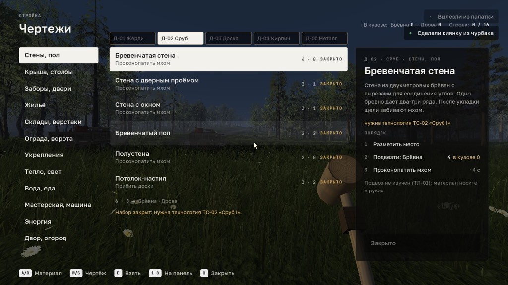

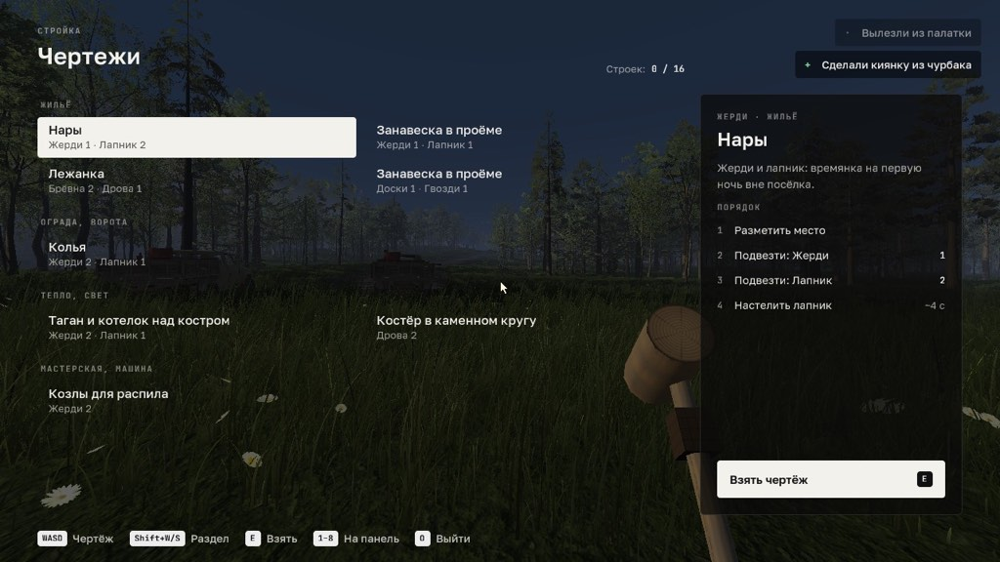

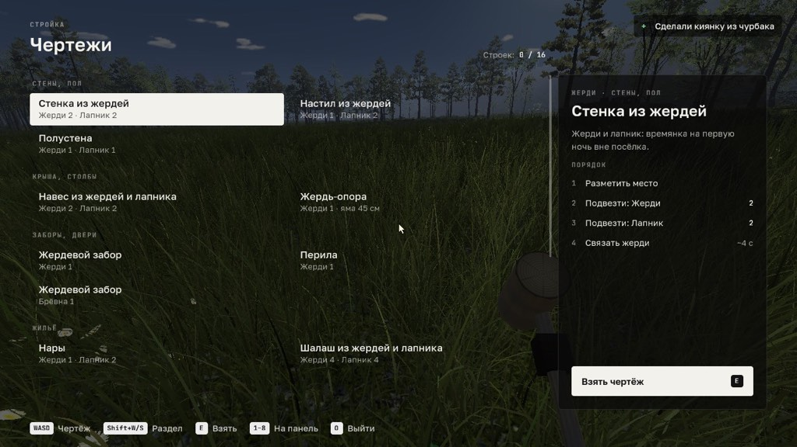

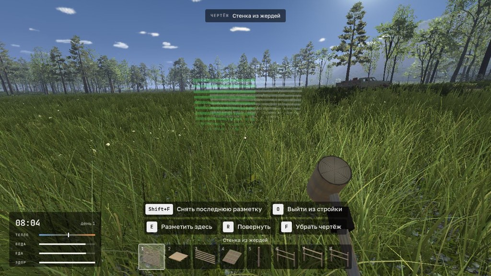

## 527. D3: гнёзда начинают маленькими, погоня отстаёт, мотор тише, жуки не прячутся под машиной

09:40 · D3

Коммит: [16506b6861](https://github.com/shsanek/EXEcutor/commit/16506b6861)

Ветка: `claude/peregon-design`

По решениям владельца после игрового теста. Гнездо у старта в первый день — 7 жуков (было 15), на пятый — 17 (было 29); гнёзда у баз тоже стартуют маленькими и растут примерно втрое медленнее; набеги молодого гнезда — до 6 жуков. Погоня бросает игрока в 120 м от гнезда, если отстала больше чем на 35 м дольше 6 с, или через 45 с — бот добежал от гнезда до палатки живым (раньше погибал в 117 м). Работающий мотор привлекает жуков в 5 раз слабее: ночь на холостых у гнезда лесопилки — без волны, 4–5 жуков у машины вместо 19. Жуки больше не залезают под машину (коробка машины не доходила до земли). В настройках «Погружение → Набеги» добавлены «Гнёзда» (малые/обычные/крупные) и «Рост гнёзд» (медленный/обычный/быстрый). В блокноте на старте — «Нужно выжить.». Протокол 95, чек-лист §68. Проверено сборкой, сценами и ботом в новой игре (тесты на паузе). Старые сохранения сохраняют свои большие гнёзда.

- ✓ гнездо у старта, день 1: 15 → 7 жуков
- ✓ погоня от гнезда к палатке: смерть → дошёл с 36 % здоровья
- ✓ жуки под машиной: до 3 → 0

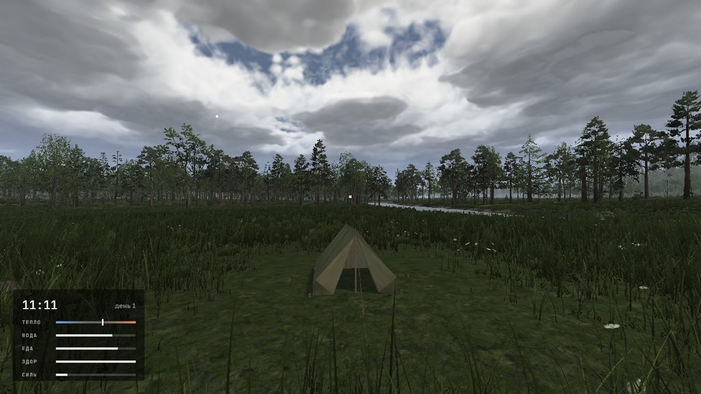

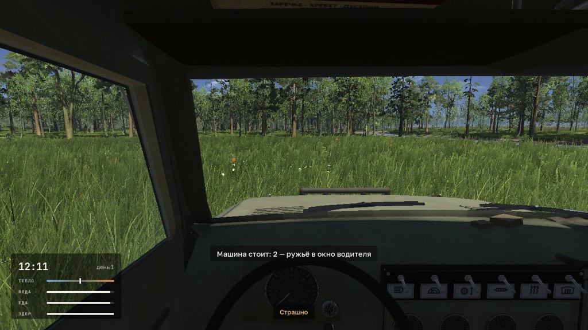

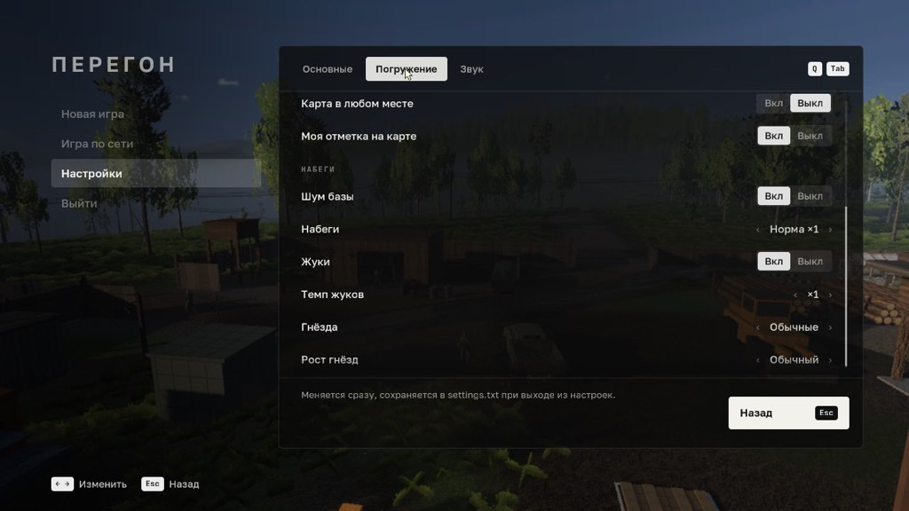

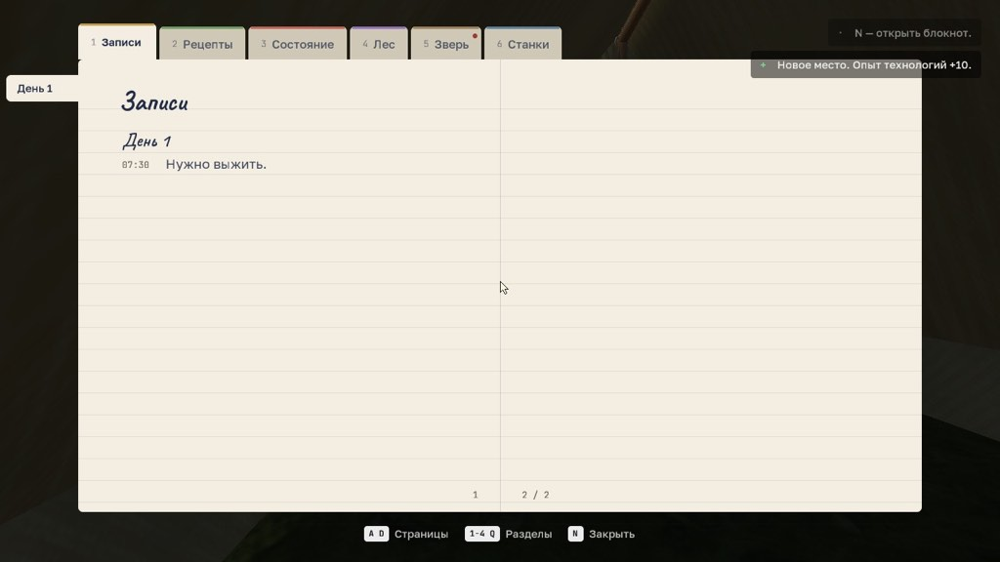

## 528. D2: дерево технологий по образцу Icarus — опыт за любой труд, бесплатный первый набор

10:05 · D2

Коммит: [f488262f2d](https://github.com/shsanek/EXEcutor/commit/f488262f2d)

Ветка: `claude/peregon-design`

Разобран Icarus (вики: 5 уровней, первый уровень весь руками без верстака — каменные инструменты, копьё, лук, костёр, целые наборы стройки с дверью; стройка продаётся наборами; верстак — корень второго уровня; опыт в основном за убийства и задания, но и за добычу; при объединении узлов очки возвращаются сами) — docs/tech-research.md со ссылками. У нас: опыт технологий капает за каждое действие (дерево 4, бревно 1, колка 1, хворост 1, палка/камень 0,3, ягоды 1, рыба 3, убийство 8, жуки 1–5, сердце гнезда 40, отбитая волна 10) плюс разовые бонусы за первое (первое дерево 10, первая добыча 20, первое гнездо 50…), полоска «+N опыта технологий · свободно M». Бесплатно с начала: Т-0 и «Времянка» с жердевой стеной с проёмом и плетёной дверью; руками (держать R) — лук, лук с тетивой из жил, стрелы, колчан, каменный топор. Т-1 «Верстак плотника» (60) теперь строит настоящий станок С-01, который сразу крафтит и тешет доски; бесполезный верстак-декорация убран. Объединения: «Изба» (стены, проём, дверь, крыша), «Буржуйка и труба» на Т-1, окна со ставнями, склады. Цены уровней 60/350/1600/3600. Бот в новой игре: Т-1 к 15:30 первого дня (раньше — только на второй день), к 17:23 построен станок и есть опыт на избу или печь. Каждый материал имеет возобновляемый источник — проверка баланса это требует (стекло, трубу, доски теперь можно делать). Старые сохранения: объединённые узлы переносятся, переплата возвращается опытом. Экран технологий в стиле Icarus — макет в docs/tech-tree.md §8, ещё не сделан. Протокол 96, чек-лист §67. Проверено сборкой, проверкой баланса и ботом (тесты на паузе).

- ✓ deps.py --check: OK, всё возобновляемо
- ✓ бот: Т-1 в новой игре: день 2 → 15:30 дня 1
- ✗ новый экран технологий: только макет

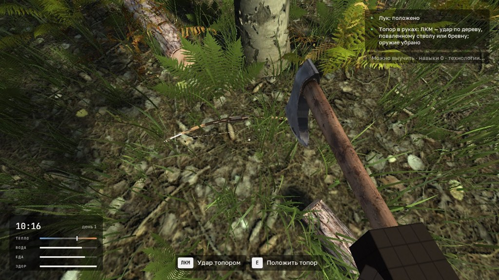

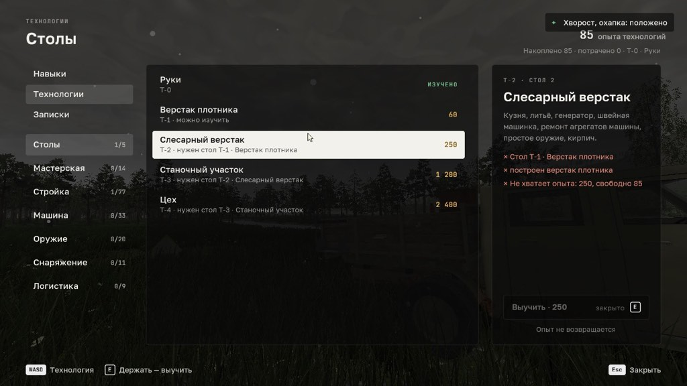

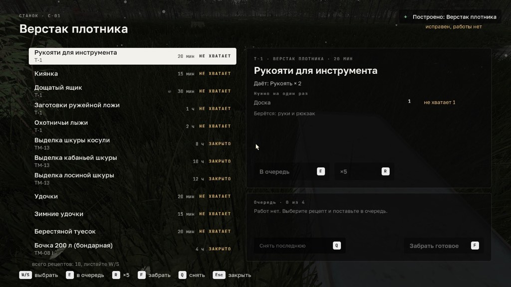

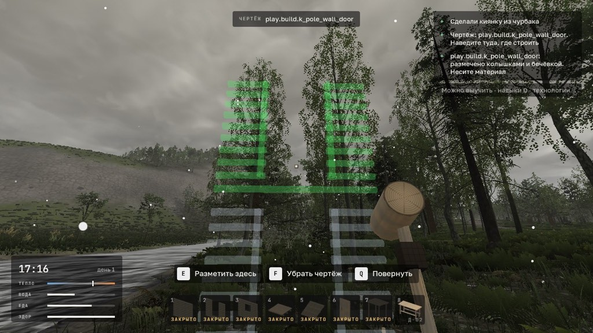
