# Перегон — 2026-10-25

[Главный отчёт](../README.md) · [Фичи и исправления](../CHANGELOG.md)

## 545. NOHINTS: никаких подсказок, где взять фаркоп

00:20 · NOHINTS

Коммит: [29e92bdd57](https://github.com/shsanek/EXEcutor/commit/29e92bdd57)

Ветка: `claude/peregon-design`

Убраны подсказки «у машины нет фаркопа — поставить на гаражном посту» у прицепа и у навесных орудий (плуг, сеялка): без фаркопа сцепка просто ничего не предлагает. Из заметки о стрельбе из кузова убрано указание на гаражный пост. Описания технологий в книге остались.

- ✓ сборка win64: зелёная

## 546. MUD: один воксельный движок для земли, воды и снега рядом с машиной

01:10 · MUD

Коммит: [edb532361a](https://github.com/shsanek/EXEcutor/commit/edb532361a)

Ветка: `claude/peregon-design`

Земля, грязь, снег и вода — один движок: материалы отличаются только свойствами и считаются одновременно в одной сетке (столбцы 10 см, воксели 5 см) вокруг машин. Движок работает в своём потоке: 2,7–3,8 мс на шаг в рабочем потоке, основной поток почти не ждёт (14–27 мкс). Колёса закапываются, грунт выдавливается в валы, объём сохраняется точно — бесконечных горок больше нет; искусственные ограничения глубины убраны, предел — твёрдый слой. Вода реки обтекает машину, набегает с верхней стороны, выталкивает и сносит, заливает капот на глубине; машина выносит из реки около 80 л, вода стекает и пропитывает берег, собирается в колеях. Снег с водой превращается в кашу. Грязь налипает на шины (до 7 л на колесо) и отваливается на скорости. Когда машина уезжает, высоты и состав запекаются, при возвращении восстанавливаются. Стартовая поляна твёрже, спасатель ставит машину на твёрдую землю. Сетевой протокол 110.

- ✓ объём грунта при буксовании: ямы 2,20 м³ / валы 2,18 м³, масса постоянна
- ✓ высоты после ухода и возврата: 238,718 / 238,711 м
- ✓ выезд со стартовой поляны в дождь: 1–3 → 14 км/ч
- ✓ поток вокселей: 2,7–3,8 мс/шаг, основной поток 14–27 мкс
- ✗ вода как поверхность: пока только физика и лужи
- ✗ состав у клиентов кооператива: не передаётся

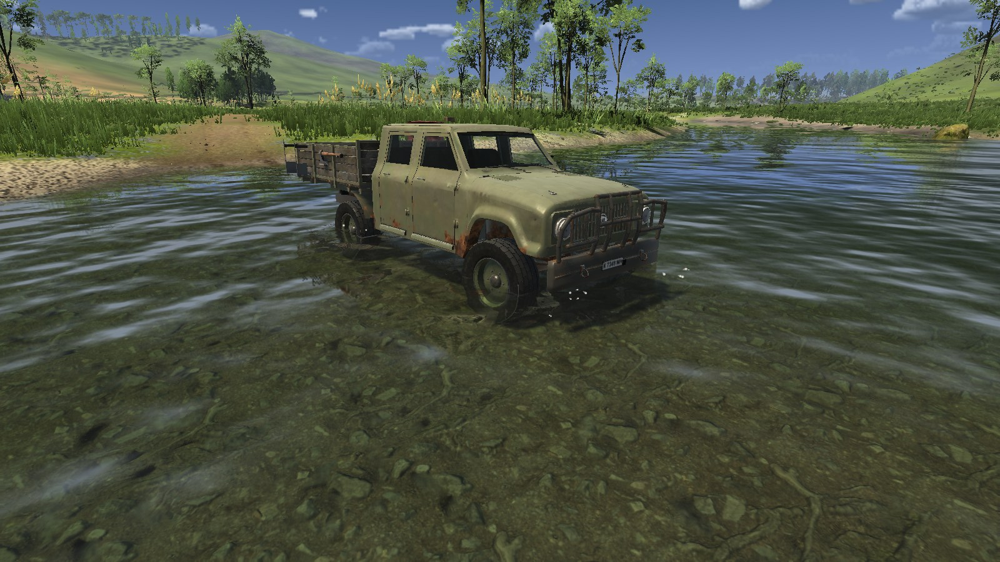

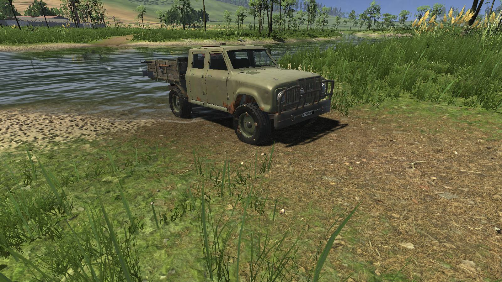

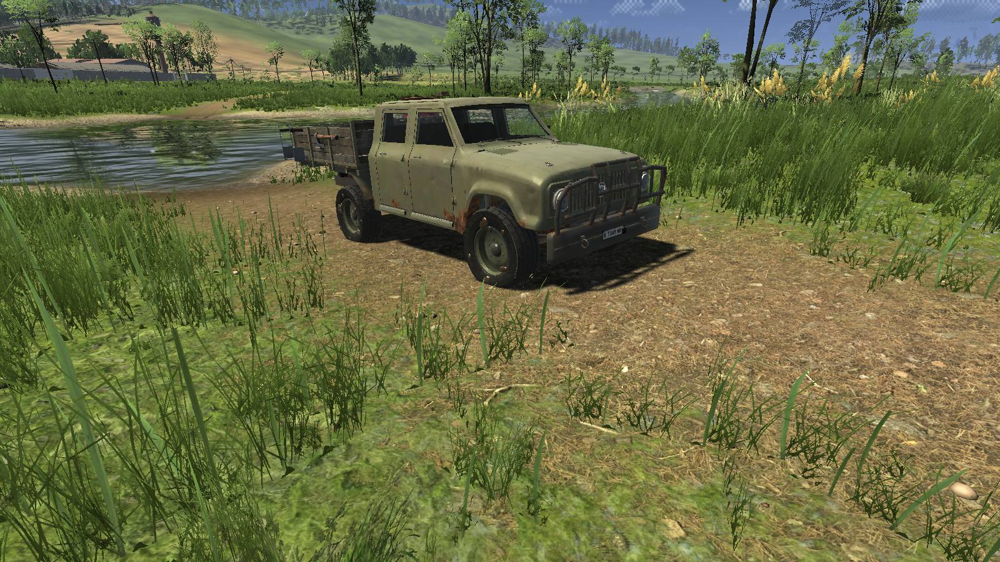

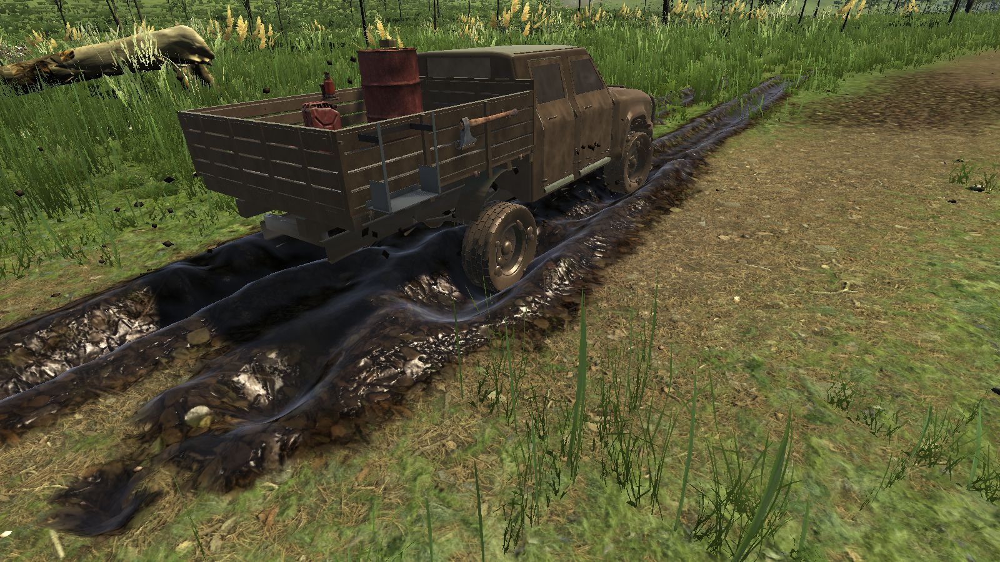

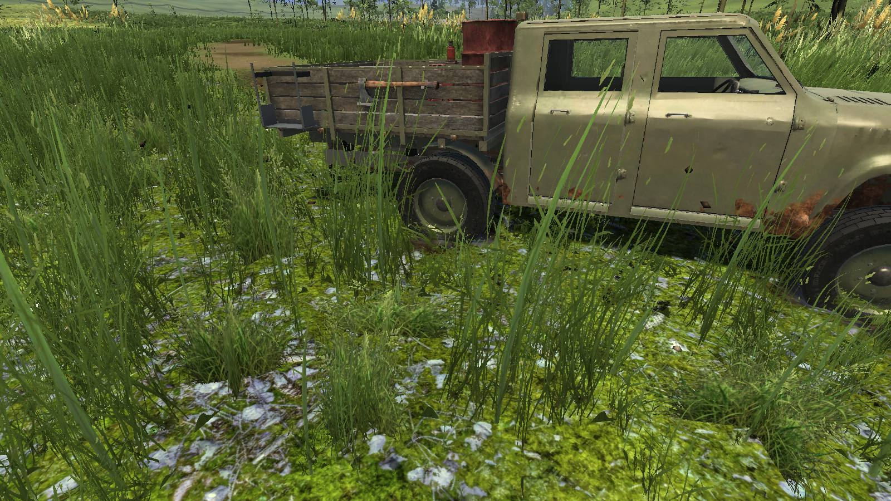

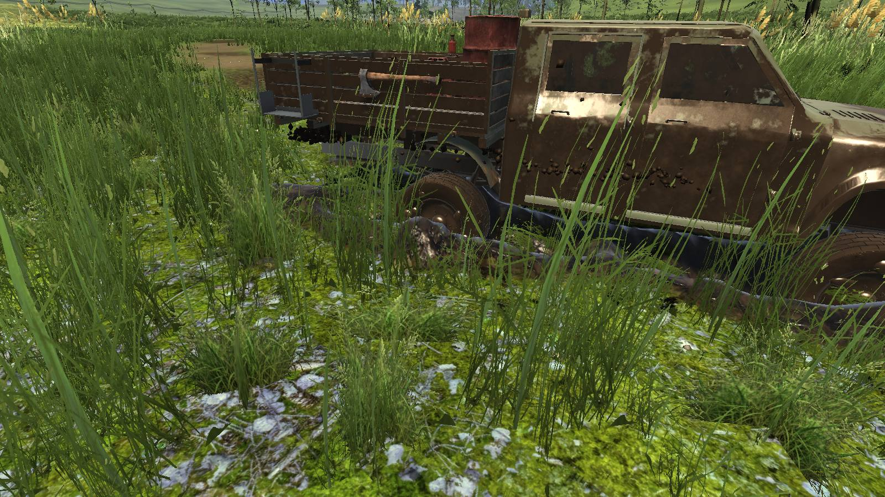

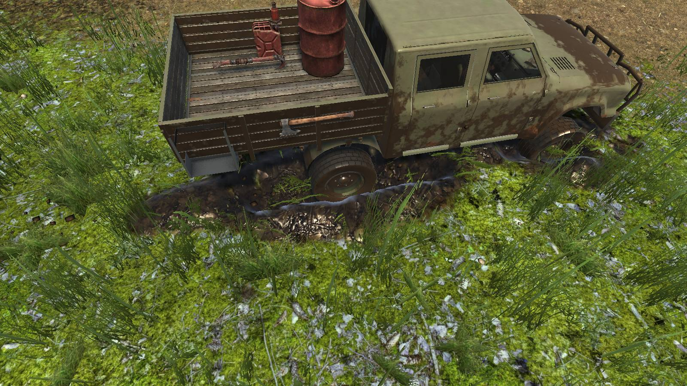

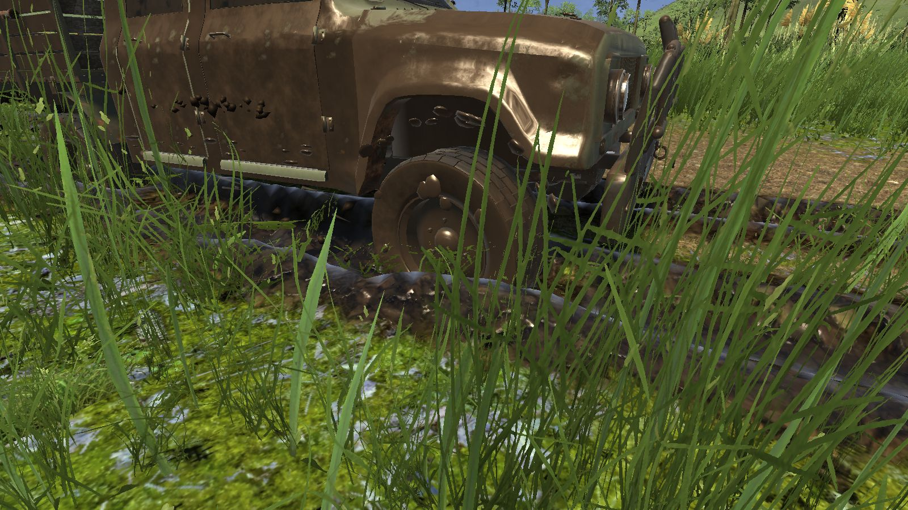

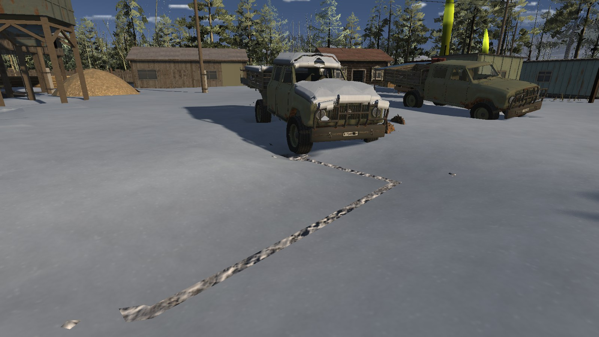

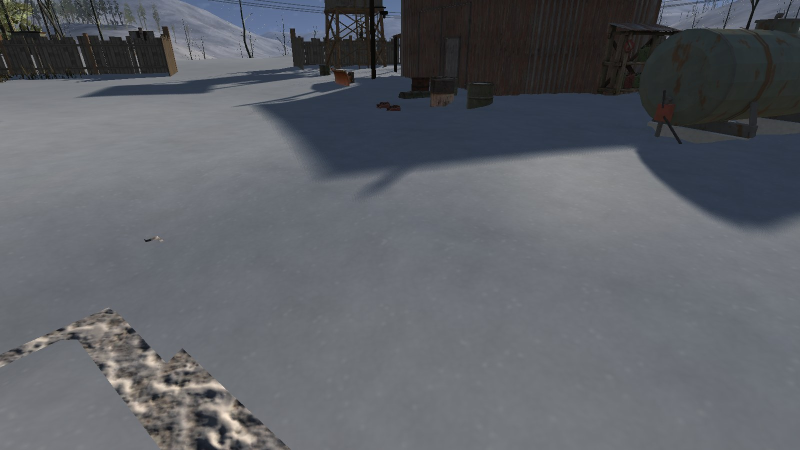

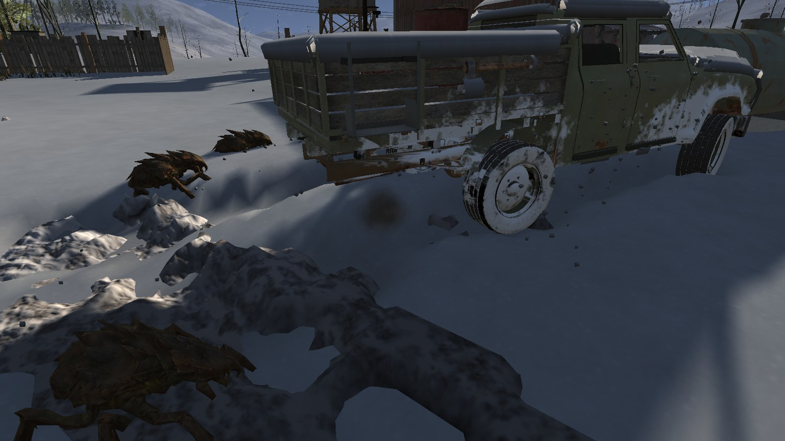
