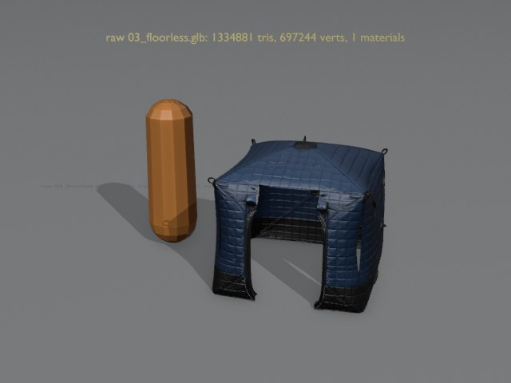
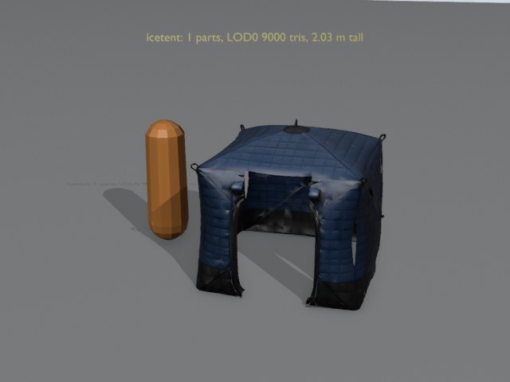
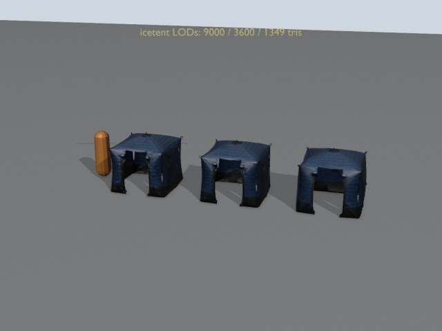

# FINISH3 repairs

[Все модели](README.md) · [Главный отчёт](../README.md)

## bird_bean_goose

### 1 Source, 2026-10-13

### 2 Cleaned import, 2026-10-13

### 3 Runtime LODs, 2026-10-13

### 4 In game: native Metal, 2026-10-13

## bird_teal

### 1 Source, 2026-10-13

### 2 Cleaned import, 2026-10-13

### 3 Runtime LODs, 2026-10-13

### 4 In game: native Metal, 2026-10-13

## bird_mallard

### 1 Source, 2026-10-13

### 2 Cleaned import, 2026-10-13

### 3 Runtime LODs, 2026-10-13

### 4 In game: native Metal, 2026-10-13

## bird_hazel_grouse

### 1 Source, 2026-10-13

### 2 Cleaned import, 2026-10-13

### 3 Runtime LODs, 2026-10-13

### 4 In game: native Metal, 2026-10-13

## icetent

### 1 Source, 2026-10-13

### 2 Cleaned import, 2026-10-13

### 3 Runtime LODs, 2026-10-13

### 4 In game: native Metal, 2026-10-13

## draisine

### 1 Source, 2026-10-13

### 2 Cleaned import, 2026-10-13

### 3 Runtime LODs, 2026-10-13

### 4 In game: native Metal, 2026-10-13

## ballast_sack

### 1 Source, 2026-10-13

### 2 Cleaned import, 2026-10-13

### 3 Runtime LODs, 2026-10-13

### 4 In game: native Metal, 2026-10-13

